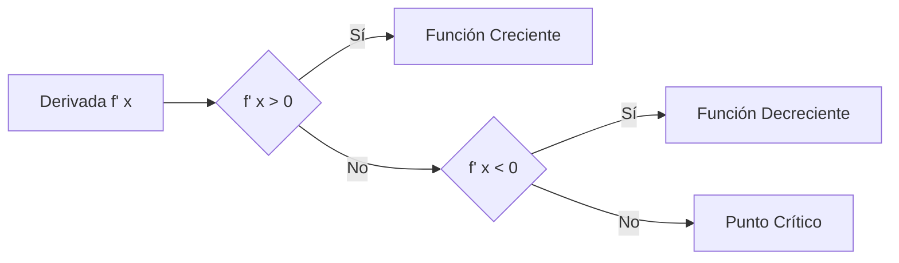
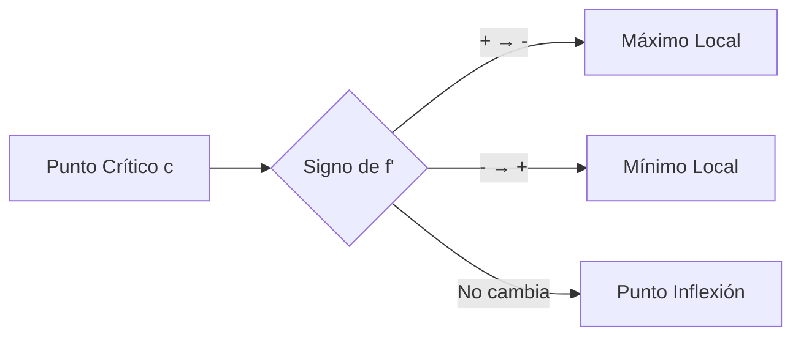

# Matemáticas para Ciencias Aplicadas I - Derivada de funciones reales de una variable real

## 2.7 Crecimiento y decrecimiento de una función. Máximos y mínimos.

---

### 1. Crecimiento y Decrecimiento

#### 1.1 Definiciones Fundamentales

Sea $f$ una función derivable en un intervalo $I$:

- **Función creciente**:  
  $$ f'(x) > 0 \Rightarrow f \text{ es creciente en } I $$

- **Función decreciente**:

$$ f'(x) < 0 \Rightarrow f \text{ es decreciente en } I $$

- **Punto crítico**:

$$ f'(x) = 0 \text{ o } f'(x) \text{ no existe} $$

#### 1.2 Diagrama de Comportamiento



### 2. Máximos y Mínimos Locales

#### 2.1 Definiciones

- **Máximo local**: $f(c)$ es máximo local si $f(c) \geq f(x)$ para $x$ cerca de $c$
- **Mínimo local**: $f(c)$ es mínimo local si $f(c) \leq f(x)$ para $x$ cerca de $c$
- **Extremo local**: Máximo o mínimo local

#### 2.2 Criterio de la Primera Derivada

Sea $c$ un punto crítico de $f$:

- Si $f'$ cambia de positiva a negativa en $c$ ⇒ **Máximo local**
- Si $f'$ cambia de negativa a positiva en $c$ ⇒ **Mínimo local**
- Si $f'$ no cambia de signo ⇒ **Punto de inflexión**

#### 2.3 Diagrama del Criterio



### 3. Método para Analizar Extremos

#### 3.1 Pasos del Análisis

1. Encontrar puntos críticos: resolver $f'(x) = 0$
2. Dividir la recta real en intervalos usando puntos críticos
3. Evaluar el signo de $f'$ en cada intervalo
4. Clasificar los puntos críticos según el cambio de signo

#### 3.2 Ejemplo: $f(x) = x^3 - 3x^2 + 4$

1. $f'(x) = 3x^2 - 6x = 3x(x - 2)$
2. Puntos críticos: $x = 0$, $x = 2$
3. Intervalos: $(-\infty, 0)$, $(0, 2)$, $(2, \infty)$
4. Signo de $f'$:
   - $(-\infty, 0)$: $f' > 0$ (creciente)
   - $(0, 2)$: $f' < 0$ (decreciente)
   - $(2, \infty)$: $f' > 0$ (creciente)
5. Clasificación:
   - $x = 0$: Máximo local
   - $x = 2$: Mínimo local

### 4. Implementación Computacional

#### 4.1 Código Python para Análisis

```python
import numpy as np
import matplotlib.pyplot as plt
import sympy as sp

def analizar_funcion(expr):
    """Analiza crecimiento y extremos de una función"""
    x = sp.symbols('x')
    f = sp.sympify(expr)
    f_prime = sp.diff(f, x)

    print(f"Función: f(x) = {f}")
    print(f"Derivada: f'(x) = {f_prime}")

    # Puntos críticos
    puntos_criticos = sp.solve(f_prime, x)
    print(f"Puntos críticos: {puntos_criticos}")

    # Evaluar signo de la derivada
    for punto in puntos_criticos:
        signo_izq = f_prime.subs(x, punto - 0.1)
        signo_der = f_prime.subs(x, punto + 0.1)

        if signo_izq > 0 and signo_der < 0:
            print(f"x = {punto:.2f}: Máximo local")
        elif signo_izq < 0 and signo_der > 0:
            print(f"x = {punto:.2f}: Mínimo local")
        else:
            print(f"x = {punto:.2f}: Punto de inflexión")

    return f, f_prime, puntos_criticos

# Ejemplo de uso
f, f_prime, criticos = analizar_funcion("x**3 - 3*x**2 + 4")
```

#### 4.2 Visualización Gráfica

```python
def graficar_analisis(f, f_prime, puntos_criticos, x_range=(-2, 4)):
    """Grafica función y su derivada"""
    x_vals = np.linspace(x_range[0], x_range[1], 400)

    # Convertir a funciones numéricas
    f_num = sp.lambdify(sp.symbols('x'), f, 'numpy')
    f_prime_num = sp.lambdify(sp.symbols('x'), f_prime, 'numpy')

    y_vals = f_num(x_vals)
    y_prime_vals = f_prime_num(x_vals)

    fig, (ax1, ax2) = plt.subplots(2, 1, figsize=(10, 8))

    # Gráfica de la función
    ax1.plot(x_vals, y_vals, 'b-', label='f(x)')
    for punto in puntos_criticos:
        y_punto = f_num(punto)
        ax1.plot(punto, y_punto, 'ro', markersize=8)
        ax1.annotate(f'({punto:.1f}, {y_punto:.1f})',
                    (punto, y_punto), xytext=(5, 5),
                    textcoords='offset points')
    ax1.set_ylabel('f(x)')
    ax1.legend()
    ax1.grid(True)

    # Gráfica de la derivada
    ax2.plot(x_vals, y_prime_vals, 'r-', label="f'(x)")
    ax2.axhline(0, color='k', linestyle='--')
    for punto in puntos_criticos:
        ax2.axvline(punto, color='g', linestyle='--', alpha=0.5)
    ax2.set_xlabel('x')
    ax2.set_ylabel("f'(x)")
    ax2.legend()
    ax2.grid(True)

    plt.tight_layout()
    plt.show()

# Graficar el ejemplo anterior
graficar_analisis(f, f_prime, criticos)
```

### 5. Aplicaciones en Optimización

#### 5.1 Problemas de Optimización

1. **Maximizar área**: Dado perímetro fijo, maximizar área rectangular
2. **Minimizar costo**: Encontrar dimensiones que minimicen costo de material
3. **Maximizar beneficio**: Optimizar producción para máximo beneficio

#### 5.2 Ejemplo: Área Máxima de un Rectángulo

Perímetro fijo $P = 2l + 2w = 100$  
Área $A = l \cdot w = l(50 - l)$  
Maximizar: $A(l) = 50l - l^2$  
Derivada: $A'(l) = 50 - 2l$  
Punto crítico: $l = 25$  
Área máxima: $A(25) = 625$

### 6. Ejercicios y Problemas

#### 6.1 Ejercicios de Análisis

Analiza crecimiento y encuentra extremos de:

1. $f(x) = x^3 - 6x^2 + 9x + 1$
2. $g(x) = \frac{x^2}{x^2 + 1}$
3. $h(x) = x^4 - 4x^3 + 6$

#### 6.2 Problemas de Aplicación

1. Un fabricante encuentra que el costo de producir $x$ unidades es $C(x) = 0.001x^3 - 0.3x^2 + 40x + 1000$. Encuentra el nivel de producción que minimiza el costo promedio.
2. Se lanza un proyectil con altura $h(t) = -5t^2 + 20t$. Encuentra la altura máxima y el tiempo que tarda en alcanzarla.
3. Un rectángulo tiene perímetro de 80 cm. ¿Qué dimensiones maximizan el área?

### Ver también

- **2.6** Propiedades de la derivada — los máximos/mínimos se encuentran con derivadas.
- **2.8** Derivadas de orden superior — la segunda derivada y la concavidad.
- **4.1** Método de Newton — uso de derivadas para encontrar ceros.

### Referencias

- Stewart, J. (2016). _Cálculo de una variable_ (8.ª ed.). Cengage Learning.
- Simmons, G. F. (2012). _Cálculo con geometría analítica_ (2.ª ed.). McGraw-Hill.
- Thomas, G. B. et al. (2014). _Cálculo_ (13.ª ed.). Pearson.
