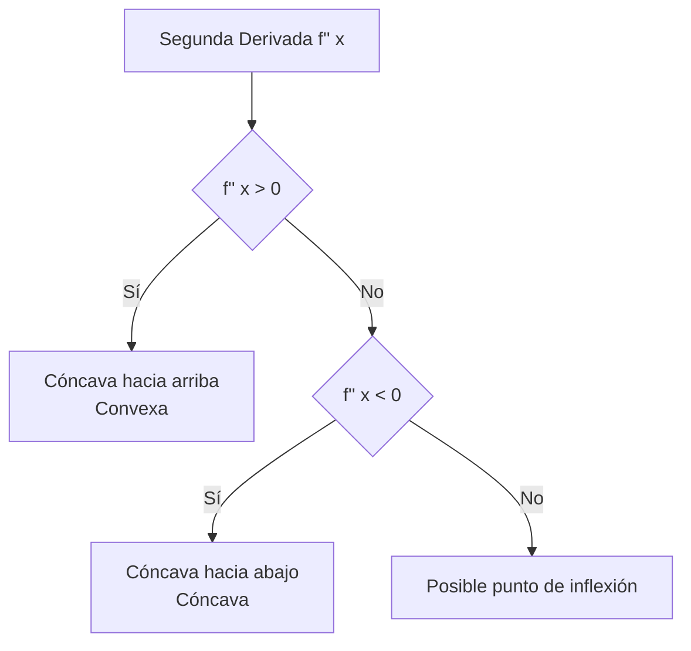

# Matemáticas para Ciencias Aplicadas I - Derivada de funciones reales de una variable real

## 2.8 Derivadas de orden superior. Aceleración. Convexidad y concavidad. Puntos de inflexión.

---

### 1. Derivadas de Orden Superior

#### 1.1 Definición Formal

La **derivada de orden n** de una función $f$ se define recursivamente:

$$ f^{(n)}(x) = \frac{d^n}{dx^n}f(x) = \frac{d}{dx}\left[f^{(n-1)}(x)\right] $$

#### 1.2 Notaciones Comunes

- $f''(x)$ o $f^{(2)}(x)$: Segunda derivada
- $f'''(x)$ o $f^{(3)}(x)$: Tercera derivada
- $f^{(n)}(x)$: n-ésima derivada

#### 1.3 Ejemplo: Polinomio de Grado 4

Para $f(x) = x^4 - 3x^3 + 2x^2 - x + 1$:

$$ f'(x) = 4x^3 - 9x^2 + 4x - 1 $$ $$ f''(x) = 12x^2 - 18x + 4 $$ $$ f'''(x) = 24x - 18 $$ $$ f^{(4)}(x) = 24 $$ $$ f^{(5)}(x) = 0 $$

### 2. Aceleración en Movimiento

#### 2.1 Relación Cinemática

Para un objeto en movimiento con posición $s(t)$:

- **Velocidad**: $v(t) = s'(t) = \frac{ds}{dt}$
- **Aceleración**: $a(t) = v'(t) = s''(t) = \frac{d^2s}{dt^2}$

#### 2.2 Interpretación Física

- $a(t) > 0$: Velocidad aumentando (acelerando)
- $a(t) < 0$: Velocidad disminuyendo (desacelerando)
- $a(t) = 0$: Velocidad constante

#### 2.3 Ejemplo: Caída Libre

$s(t) = -4.9t^2 + v_0t + s_0$  
$v(t) = s'(t) = -9.8t + v_0$  
$a(t) = s''(t) = -9.8$ m/s² (aceleración constante)

### 3. Convexidad y Concavidad

#### 3.1 Criterio de la Segunda Derivada

Sea $f$ una función dos veces derivable en un intervalo $I$:

- **Cóncava hacia arriba** (convexa):  
  $$ f''(x) > 0 \quad \forall x \in I $$

- **Cóncava hacia abajo** (cóncava):

$$ f''(x) < 0 \quad \forall x \in I $$

#### 3.2 Interpretación Geométrica



### 4. Puntos de Inflexión

#### 4.1 Definición

Un **punto de inflexión** es un punto $(c, f(c))$ donde la curva cambia de concavidad:

- De cóncava hacia arriba a cóncava hacia abajo
- De cóncava hacia abajo a cóncava hacia arriba

#### 4.2 Condiciones Necesarias

1. $f''(c) = 0$ o $f''(c)$ no existe
2. Cambio de signo de $f''(x)$ en $x = c$

#### 4.3 Ejemplo: $f(x) = x^3$

$f'(x) = 3x^2$  
$f''(x) = 6x$  
$f''(0) = 0$ y cambia de negativa a positiva ⇒ Punto de inflexión en $x = 0$

### 5. Implementación Computacional

#### 5.1 Código Python para Análisis Completo

```python
import numpy as np
import matplotlib.pyplot as plt
import sympy as sp

def analizar_curvatura(expr):
    """Analiza concavidad y puntos de inflexión"""
    x = sp.symbols('x')
    f = sp.sympify(expr)
    f_prime = sp.diff(f, x)
    f_double_prime = sp.diff(f_prime, x)

    print(f"Función: f(x) = {f}")
    print(f"Primera derivada: f'(x) = {f_prime}")
    print(f"Segunda derivada: f''(x) = {f_double_prime}")

    # Puntos críticos de primera derivada (posibles inflexión)
    puntos_inflexion = sp.solve(f_double_prime, x)
    puntos_inflexion = [p.evalf() for p in puntos_inflexion if p.is_real]

    print(f"Puntos de inflexión potenciales: {puntos_inflexion}")

    # Verificar cambio de concavidad
    for punto in puntos_inflexion:
        signo_izq = f_double_prime.subs(x, punto - 0.1)
        signo_der = f_double_prime.subs(x, punto + 0.1)

        if signo_izq * signo_der < 0:  # Cambio de signo
            print(f"x = {punto:.2f}: Punto de inflexión")
            if signo_izq < 0 and signo_der > 0:
                print(f"  Cambio de cóncava a convexa")
            else:
                print(f"  Cambio de convexa a cóncava")
        else:
            print(f"x = {punto:.2f}: No es punto de inflexión")

    return f, f_prime, f_double_prime, puntos_inflexion

# Ejemplo: función cúbica
f, f_p, f_pp, inflexiones = analizar_curvatura("x**3 - 3*x**2 + 2")
```

#### 5.2 Visualización de Concavidad

```python
def graficar_concavidad(f, f_pp, puntos_inflexion, x_range=(-1, 3)):
    """Grafica función y su concavidad"""
    x_vals = np.linspace(x_range[0], x_range[1], 400)

    # Convertir a funciones numéricas
    f_num = sp.lambdify(sp.symbols('x'), f, 'numpy')
    f_pp_num = sp.lambdify(sp.symbols('x'), f_pp, 'numpy')

    y_vals = f_num(x_vals)
    y_pp_vals = f_pp_num(x_vals)

    fig, (ax1, ax2) = plt.subplots(2, 1, figsize=(10, 8))

    # Gráfica de la función
    ax1.plot(x_vals, y_vals, 'b-', label='f(x)')
    for punto in puntos_inflexion:
        y_punto = f_num(punto)
        ax1.plot(punto, y_punto, 'ro', markersize=8)
        ax1.annotate(f'Inflexión\n({punto:.1f}, {y_punto:.1f})',
                    (punto, y_punto), xytext=(10, -20),
                    textcoords='offset points',
                    arrowprops=dict(arrowstyle='->'))
    ax1.set_ylabel('f(x)')
    ax1.legend()
    ax1.grid(True)

    # Gráfica de la segunda derivada
    ax2.plot(x_vals, y_pp_vals, 'r-', label="f''(x)")
    ax2.axhline(0, color='k', linestyle='--')
    ax2.fill_between(x_vals, 0, y_pp_vals, where=y_pp_vals>0,
                    alpha=0.3, color='green', label='Convexa (f'''>0)')
    ax2.fill_between(x_vals, 0, y_pp_vals, where=y_pp_vals<0,
                    alpha=0.3, color='red', label='Cóncava (f''<0)')
    ax2.set_xlabel('x')
    ax2.set_ylabel("f''(x)")
    ax2.legend()
    ax2.grid(True)

    plt.tight_layout()
    plt.show()

# Graficar el ejemplo
graficar_concavidad(f, f_pp, inflexiones)
```

### 6. Aplicaciones en Ciencias e Ingeniería

#### 6.1 Análisis Estructural

- La concavidad indica puntos de máximo esfuerzo en vigas
- Los puntos de inflexión marcan cambios en la distribución de cargas

#### 6.2 Economía y Finanzas

- La segunda derivada del costo marginal indica cambios en la eficiencia
- Puntos de inflexión en curvas de demanda y oferta

#### 6.3 Biomecánica

- La aceleración (segunda derivada de posición) analiza movimientos corporales
- Cambios de concavidad en curvas de crecimiento

### 7. Ejercicios y Problemas

#### 7.1 Ejercicios de Cálculo

Para cada función, encuentra:

1. Primera y segunda derivada
2. Intervalos de concavidad
3. Puntos de inflexión

a) $f(x) = x^4 - 4x^3 + 6x^2$  
b) $g(x) = \sin(x)$ en $[0, 2\pi]$  
c) $h(x) = e^{-x^2}$

#### 7.2 Problemas de Aplicación

1. Un proyectil sigue la trayectoria $s(t) = -5t^2 + 20t + 10$. Encuentra la aceleración y determina cuándo alcanza la altura máxima.
2. La población de bacterias crece según $P(t) = 100e^{0.1t}$. Analiza la concavidad del crecimiento.
3. El costo de producción es $C(x) = 0.001x^3 - 0.3x^2 + 40x + 1000$. Encuentra puntos de inflexión en la curva de costo.

### Ver también

- **2.7** Crecimiento y extremos — complemento con concavidad.
- **2.5** Derivada — base de las derivadas de orden superior.
- **Matemáticas CC III 1.1** (Sem. 3) — derivadas parciales como extensión multivariable.

### Referencias

- Stewart, J. (2016). _Cálculo de una variable_ (8.ª ed.). Cengage Learning.
- Simmons, G. F. (2012). _Cálculo con geometría analítica_ (2.ª ed.). McGraw-Hill.
- Thomas, G. B. et al. (2014). _Cálculo_ (13.ª ed.). Pearson.
