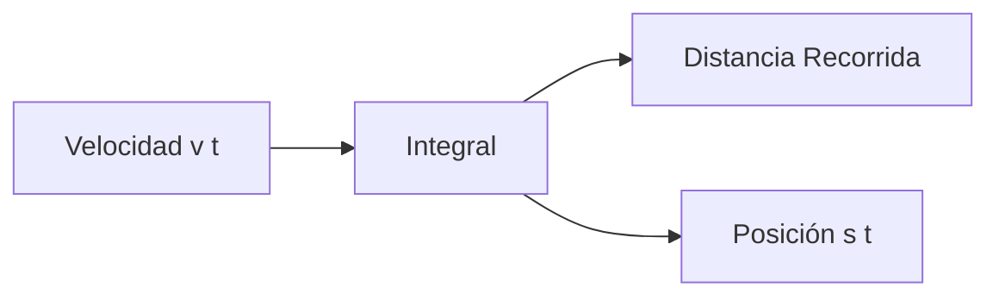

# Matemáticas para Ciencias Aplicadas I - Integral de funciones reales de una variable real

## 3.1 Distancia recorrida a partir de la velocidad instantánea. Área de la región limitada por una curva.

---

### 1. Distancia Recorrida desde la Velocidad

#### 1.1 Concepto Fundamental

Si $v(t)$ representa la velocidad instantánea en el tiempo $t$, la distancia total recorrida entre $t = a$ y $t = b$ es:

$$ \text{Distancia} = \int_{a}^{b} |v(t)|  dt $$

#### 1.2 Relación con la Posición

La posición $s(t)$ se relaciona con la velocidad mediante:  

$$ s(t) = s(a) + \int_{a}^{t} v(\tau)  d\tau $$

#### 1.3 Diagrama de Integración



### 2. Área bajo una Curva

#### 2.1 Definición Geométrica

El área bajo la curva $y = f(x)$ entre $x = a$ y $x = b$ es:

$$ \text{Área} = \int_{a}^{b} f(x)  dx $$

#### 2.2 Interpretación de Riemann

La integral definida representa el límite de sumas de áreas de rectángulos:

$$ \int_{a}^{b} f(x)  dx = \lim_{n \to \infty} \sum_{i=1}^{n} f(x_i^*) \Delta x $$

#### 2.3 Ejemplo: Área bajo $f(x) = x^2$

$$ \int_{0}^{2} x^2  dx = \left[\frac{x^3}{3}\right]_0^2 = \frac{8}{3} $$

### 3. Implementación Computacional

#### 3.1 Cálculo de Distancia desde Velocidad

```python
import numpy as np
import matplotlib.pyplot as plt
from scipy.integrate import quad

# Ejemplo: velocidad variable v(t) = 2t + 1
def velocidad(t):
    return 2*t + 1

# Distancia entre t=0 y t=5
distancia, error = quad(velocidad, 0, 5)
print(f"Distancia recorrida entre t=0 y t=5: {distancia:.2f} metros")

# Visualización
t = np.linspace(0, 5, 100)
v = velocidad(t)

plt.figure(figsize=(10, 5))
plt.plot(t, v, 'b-', label='v(t) = 2t + 1')
plt.fill_between(t, 0, v, alpha=0.3, label='Área = distancia')
plt.xlabel('Tiempo (s)')
plt.ylabel('Velocidad (m/s)')
plt.title('Distancia recorrida como área bajo la curva de velocidad')
plt.legend()
plt.grid(True)
plt.show()
```

#### 3.2 Cálculo de Área bajo Curva

```python
# Área bajo f(x) = x^2 entre 0 y 2
def funcion(x):
    return x**2

area, error = quad(funcion, 0, 2)
print(f"Área bajo f(x) = x² entre 0 y 2: {area:.4f}")

# Visualización
x = np.linspace(-0.5, 2.5, 100)
y = funcion(x)

plt.figure(figsize=(10, 6))
plt.plot(x, y, 'r-', label='f(x) = x²')
plt.fill_between(x, 0, y, where=(x>=0)&(x<=2), alpha=0.3, label='Área')
plt.xlabel('x')
plt.ylabel('f(x)')
plt.title('Área bajo la curva f(x) = x²')
plt.legend()
plt.grid(True)
plt.show()
```

### 4. Métodos de Aproximación Numérica

#### 4.1 Regla del Rectángulo

$$ \int_{a}^{b} f(x)  dx \approx \sum_{i=1}^{n} f(x_i) \Delta x $$

#### 4.2 Regla del Trapecio

$$ \int_{a}^{b} f(x)  dx \approx \frac{\Delta x}{2} \sum_{i=1}^{n} [f(x_{i-1}) + f(x_i)] $$

#### 4.3 Implementación de Riemann

```python
def integral_riemann(f, a, b, n=1000, method='midpoint'):
    """Aproximación de integral por sumas de Riemann"""
    dx = (b - a) / n
    x = np.linspace(a, b, n+1)

    if method == 'left':
        x_i = x[:-1]
    elif method == 'right':
        x_i = x[1:]
    elif method == 'midpoint':
        x_i = (x[:-1] + x[1:]) / 2
    else:
        raise ValueError("Método no válido")

    return np.sum(f(x_i) * dx)

# Comparar métodos
f = lambda x: x**2
a, b = 0, 2
n = 1000

left = integral_riemann(f, a, b, n, 'left')
right = integral_riemann(f, a, b, n, 'right')
midpoint = integral_riemann(f, a, b, n, 'midpoint')
exacta = 8/3

print(f"Left Riemann: {left:.6f} (Error: {abs(left-exacta):.6f})")
print(f"Right Riemann: {right:.6f} (Error: {abs(right-exacta):.6f})")
print(f"Midpoint Riemann: {midpoint:.6f} (Error: {abs(midpoint-exacta):.6f})")
print(f"Valor exacto: {exacta:.6f}")
```

### 5. Aplicaciones Físicas

#### 5.1 Movimiento con Velocidad Variable

Para $v(t) = 3t^2 - 2t + 1$ entre $t=1$ y $t=4$:  

$$ \text{Distancia} = \int_{1}^{4} (3t^2 - 2t + 1)  dt = [t^3 - t^2 + t]_1^4 = 60 $$

#### 5.2 Trabajo Realizado

Si $F(x)$ es la fuerza aplicada, el trabajo es:  

$$ W = \int_{a}^{b} F(x)  dx $$

#### 5.3 Flujo de Fluido

El caudal total through una sección transversal:  

$$ Q = \int_{0}^{R} 2\pi r  v(r)  dr $$

### 6. Ejercicios y Problemas

#### 6.1 Ejercicios de Cálculo

1. Calcula la distancia recorrida si $v(t) = \sin(t)$ entre $t=0$ y $t=\pi$
2. Encuentra el área bajo $f(x) = \sqrt{x}$ entre $x=1$ y $x=4$
3. Determina $\int_{0}^{1} e^x  dx$ y interpreta geométricamente

#### 6.2 Problemas de Aplicación

1. Un automóvil acelera con $v(t) = 2t + 5$ m/s. ¿Qué distancia recorre en 10 segundos?
2. La sección transversal de un túnel sigue $y = 9 - x^2$. Calcula el área de la sección.
3. La población crece a razón $P'(t) = 100e^{0.02t}$ personas/año. ¿Cuánto crece entre 2000 y 2020?

### Ver también

- **2.1** Razón de cambio — la integral como proceso inverso.
- **3.2** Integral definida — formalización.
- **3.3** Teorema fundamental del cálculo — relación entre área y derivada.

### Referencias

- Stewart, J. (2016). _Cálculo de una variable_ (8.ª ed.). Cengage Learning.
- Simmons, G. F. (2012). _Cálculo con geometría analítica_ (2.ª ed.). McGraw-Hill.
- Thomas, G. B. et al. (2014). _Cálculo_ (13.ª ed.). Pearson.
