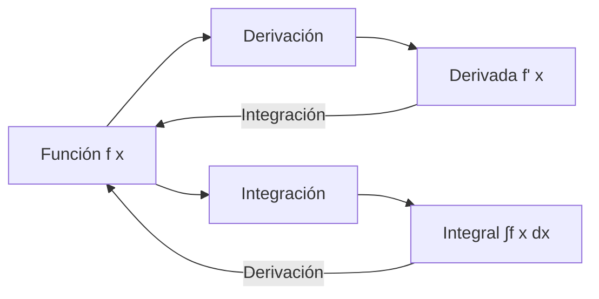

# Matemáticas para Ciencias Aplicadas I - Integral de funciones reales de una variable real

## 3.3 Relación entre la integral y la derivada. Teorema fundamental del cálculo.

---

### 1. Conceptos Fundamentales

#### 1.1 Derivada vs Integral

- **Derivada**: Razón de cambio instantáneo, pendiente de la tangente
- **Integral**: Acumulación de cantidades, área bajo la curva

#### 1.2 Relación Inversa

La integración y derivación son operaciones inversas:  

$$ \frac{d}{dx} \left( \int f(x)  dx \right) = f(x) \quad \text{y} \quad \int \left( \frac{d}{dx} f(x) \right) dx = f(x) + C $$

#### 1.3 Diagrama de Relación



### 2. Teorema Fundamental del Cálculo (TFC)

#### 2.1 Primera Parte del TFC

Si $f$ es continua en $[a, b]$ y $F$ es una primitiva de $f$, entonces:  

$$ \int_{a}^{b} f(x)  dx = F(b) - F(a) $$

#### 2.2 Segunda Parte del TFC

Si $f$ es continua en $[a, b]$, entonces la función:  

$$ G(x) = \int_{a}^{x} f(t)  dt $$  

es derivable y $G'(x) = f(x)$ para todo $x \in (a, b)$.

#### 2.3 Notación

$$ \int_{a}^{b} f(x)  dx = F(x) \Big|_{a}^{b} = F(b) - F(a) $$

### 3. Demostración Conceptual del TFC

#### 3.1 Idea Geométrica


#### 3.2 Explicación Intuitiva

- $G(x)$ mide el área acumulada bajo $f$ desde $a$ hasta $x$
- La razón de cambio del área es la altura de la función: $G'(x) = f(x)$

### 4. Implementación Computacional

#### 4.1 Verificación del TFC con Python

```python
import sympy as sp
import numpy as np
import matplotlib.pyplot as plt

# Verificación del Teorema Fundamental
x = sp.symbols('x')
f = sp.sin(x)  # Función original

# Primera parte: ∫f dx = F(b) - F(a)
F = sp.integrate(f, x)  # Primitiva
a, b = 0, sp.pi
integral_val = sp.integrate(f, (x, a, b))
F_diff = F.subs(x, b) - F.subs(x, a)

print(f"Función: f(x) = {f}")
print(f"Primitiva: F(x) = {F}")
print(f"∫₀^π sin(x) dx = {integral_val}")
print(f"F(π) - F(0) = {F_diff}")
print(f"¿Coinciden? {sp.simplify(integral_val) == sp.simplify(F_diff)}")

# Segunda parte: d/dx[∫₀^x f(t) dt] = f(x)
G = sp.integrate(f, (x, 0, x))
G_prime = sp.diff(G, x)
print(f"\nG(x) = ∫₀^x sin(t) dt = {G}")
print(f"G'(x) = {G_prime}")
print(f"¿G'(x) = f(x)? {sp.simplify(G_prime) == sp.simplify(f)}")
```

#### 4.2 Visualización del TFC

```python
# Visualización de la relación
x_vals = np.linspace(0, 2*np.pi, 100)
f_vals = np.sin(x_vals)
F_vals = -np.cos(x_vals) + 1  # ∫₀^x sin(t) dt = 1 - cos(x)

plt.figure(figsize=(12, 5))

# Gráfica 1: Función y área acumulada
plt.subplot(1, 2, 1)
plt.plot(x_vals, f_vals, 'b-', label='f(x) = sin(x)')
plt.fill_between(x_vals, 0, f_vals, alpha=0.3, label='Área acumulada')
plt.xlabel('x')
plt.ylabel('f(x)')
plt.title('Función y área bajo la curva')
plt.legend()
plt.grid(True)

# Gráfica 2: Primitiva
plt.subplot(1, 2, 2)
plt.plot(x_vals, F_vals, 'r-', label='F(x) = 1 - cos(x)')
plt.xlabel('x')
plt.ylabel('F(x)')
plt.title('Primitiva (Integral acumulada)')
plt.legend()
plt.grid(True)

plt.tight_layout()
plt.show()
```

### 5. Aplicaciones del TFC

#### 5.1 Cálculo de Integrales Definidas

El TFC permite calcular integrales mediante primitivas:  

$$ \int_{a}^{b} f(x)  dx = F(b) - F(a) $$

#### 5.2 Derivación de Integrales con Límites Variables

Para funciones de la forma:  

$$ G(x) = \int_{a}^{g(x)} f(t)  dt $$  

la derivada es:  

$$ G'(x) = f(g(x)) \cdot g'(x) $$

#### 5.3 Ecuaciones Diferenciales

El TFC conecta ecuaciones diferenciales con condiciones iniciales:  

$$ \frac{dy}{dx} = f(x) \quad \Rightarrow \quad y(x) = y(a) + \int_{a}^{x} f(t)  dt $$

### 6. Ejemplos y Ejercicios

#### 6.1 Ejemplo 1: Función Polinómica

Para $f(x) = x^2$:  

$$ \int_{0}^{2} x^2  dx = \left[\frac{x^3}{3}\right]_0^2 = \frac{8}{3} $$

#### 6.2 Ejemplo 2: Función Trigonométrica

Para $f(x) = \cos x$:  

$$ \int_{0}^{\pi/2} \cos x  dx = [\sin x]_0^{\pi/2} = 1 - 0 = 1 $$

#### 6.3 Ejemplo 3: Función Exponencial

Para $f(x) = e^x$:  

$$ \int_{0}^{1} e^x  dx = [e^x]_0^1 = e - 1 $$

#### 6.4 Ejercicios Propuestos

1. Verifica el TFC para $f(x) = 3x^2 - 2x$ en $[0, 2]$
2. Encuentra $\frac{d}{dx} \left( \int_{0}^{x^2} \sin t  dt \right)$
3. Calcula $\int_{1}^{4} \frac{1}{x}  dx$ usando el TFC

### Ver también

- **2.5** Derivada — la integral es el proceso inverso.
- **3.2** Integral definida — el teorema conecta derivada e integral.
- **3.4** Integral indefinida — la antiderivada como integral sin límites.

### Referencias

- Stewart, J. (2016). _Cálculo de una variable_ (8.ª ed.). Cengage Learning.
- Simmons, G. F. (2012). _Cálculo con geometría analítica_ (2.ª ed.). McGraw-Hill.
- Thomas, G. B. et al. (2014). _Cálculo_ (13.ª ed.). Pearson.
