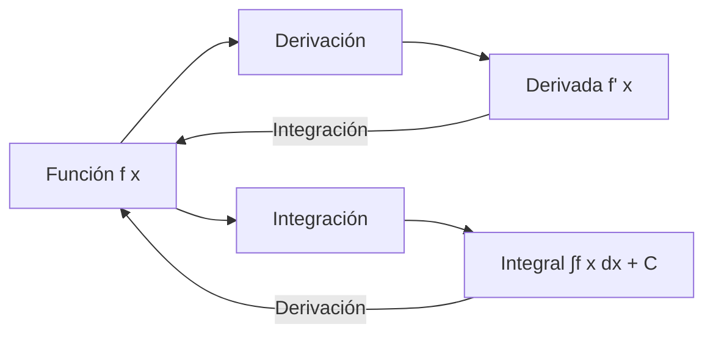

# Matemáticas para Ciencias Aplicadas I - Integral de funciones reales de una variable real

## 3.4 Integral indefinida.

---

### 1. Concepto de Integral Indefinida

#### 1.1 Definición Formal

La integral indefinida de una función $f(x)$ es el conjunto de todas sus primitivas:

$$ \int f(x)  dx = F(x) + C $$

donde $F'(x) = f(x)$ y $C$ es la constante de integración.

#### 1.2 Relación con la Derivada

La integración es la operación inversa de la derivación:  

$$ \frac{d}{dx} \left( \int f(x)  dx \right) = f(x) $$

#### 1.3 Diagrama de Relación



### 2. Propiedades de la Integral Indefinida

#### 2.1 Linealidad

$$ \int [\alpha f(x) + \beta g(x)]  dx = \alpha \int f(x)  dx + \beta \int g(x)  dx $$

#### 2.2 Integral de una Constante

$$ \int k  dx = kx + C $$

#### 2.3 Regla de la Potencia

$$ \int x^n  dx = \frac{x^{n+1}}{n+1} + C \quad \text{para } n \neq -1 $$

#### 2.4 Integral de 1/x

$$ \int \frac{1}{x}  dx = \ln|x| + C $$

### 3. Fórmulas de Integración Básicas

#### 3.1 Funciones Elementales

| Función             | Integral                                |
| ------------------- | --------------------------------------- |
| $\int k  dx$        | $kx + C$                                |
| $\int x^n  dx$      | $\frac{x^{n+1}}{n+1} + C$ $(n \neq -1)$ |
| $\int e^x  dx$      | $e^x + C$                               |
| $\int a^x  dx$      | $\frac{a^x}{\ln a} + C$                 |
| $\int \sin x  dx$   | $-\cos x + C$                           |
| $\int \cos x  dx$   | $\sin x + C$                            |
| $\int \sec^2 x  dx$ | $\tan x + C$                            |

#### 3.2 Integrales Inmediatas

$$ \int \frac{1}{x}  dx = \ln|x| + C $$

$$ \int \frac{1}{1 + x^2}  dx = \arctan x + C $$

$$ \int \frac{1}{\sqrt{1 - x^2}}  dx = \arcsin x + C $$

### 4. Implementación Computacional

#### 4.1 Cálculo Simbólico con Python

```python
import sympy as sp

# Cálculo de integrales indefinidas
x = sp.symbols('x')

# Ejemplos de integración
funciones = [
    x**3,
    sp.sin(x),
    sp.exp(x),
    1/x,
    sp.cos(x),
    1/(1 + x**2)
]

print("Integrales indefinidas:")
for func in funciones:
    integral = sp.integrate(func, x)
    print(f"∫({func}) dx = {integral} + C")
```

#### 4.2 Verificación de Resultados

```python
# Verificación: derivación de la integral
func = x**3
integral = sp.integrate(func, x)
derivada = sp.diff(integral, x)

print(f"Función original: f(x) = {func}")
print(f"Integral: F(x) = {integral} + C")
print(f"Derivada de la integral: F'(x) = {derivada}")
print(f"¿F'(x) = f(x)? {sp.simplify(derivada) == func}")
```

#### 4.3 Visualización de Familias de Curvas

```python
import numpy as np
import matplotlib.pyplot as plt

# Visualización de constantes de integración
x_vals = np.linspace(-2, 2, 100)
f = x**2
F = sp.integrate(f, x)

# Evaluar para diferentes constantes
C_vals = [-2, 0, 2, 4]
F_func = sp.lambdify(x, F, 'numpy')

plt.figure(figsize=(10, 6))
for C in C_vals:
    y_vals = F_func(x_vals) + C
    plt.plot(x_vals, y_vals, label=f'F(x) = {F} + {C}')

plt.xlabel('x')
plt.ylabel('F(x)')
plt.title('Familia de primitivas de f(x) = x²')
plt.legend()
plt.grid(True)
plt.show()
```

### 5. Métodos de Integración

#### 5.1 Sustitución o Cambio de Variable

Si $u = g(x)$, entonces:  

$$ \int f(g(x)) g'(x)  dx = \int f(u)  du $$

#### 5.2 Integración por Partes

$$ \int u  dv = uv - \int v  du $$

#### 5.3 Ejemplo de Sustitución

$$ \int 2x e^{x^2}  dx $$  

Sea $u = x^2$, $du = 2x  dx$:  

$$ \int e^u  du = e^u + C = e^{x^2} + C $$

### 6. Aplicaciones de la Integral Indefinida

#### 6.1 Solución de Ecuaciones Diferenciales

Resolver $\frac{dy}{dx} = f(x)$:  

$$ y = \int f(x)  dx + C $$

#### 6.2 Cálculo de Función a partir de su Razón de Cambio

Si se conoce la derivada de una función, se puede recuperar la función original mediante integración.

#### 6.3 Movimiento en Física

Dada la aceleración $a(t)$, encontrar velocidad y posición:  

$$ v(t) = \int a(t)  dt + C_1 \\ s(t) = \int v(t)  dt + C_2 $$

### 7. Ejercicios y Problemas

#### 7.1 Ejercicios de Integración

Calcula las siguientes integrales indefinidas:

1. $\int (3x^2 - 2x + 5)  dx$
2. $\int \cos(2x)  dx$
3. $\int \frac{2x}{x^2 + 1}  dx$
4. $\int e^{-3x}  dx$

#### 7.2 Problemas de Aplicación

1. Encuentra la función $f(x)$ tal que $f'(x) = 2x + 3$ y $f(0) = 1$
2. La aceleración de un objeto es $a(t) = -9.8$ m/s². Si se lanza hacia arriba con $v(0) = 20$ m/s, encuentra la función de velocidad
3. La tasa de crecimiento de una población es $P'(t) = 100e^{0.02t}$. Encuentra $P(t)$ si $P(0) = 1000$

### Ver también

- **3.3** Teorema fundamental — la integral indefinida es la antiderivada.
- **5.1** Integración por partes — técnica para integrales indefinidas.
- **5.2** Cambio de variable — técnica de integración.

### Referencias

- Stewart, J. (2016). _Cálculo de una variable_ (8.ª ed.). Cengage Learning.
- Simmons, G. F. (2012). _Cálculo con geometría analítica_ (2.ª ed.). McGraw-Hill.
- Thomas, G. B. et al. (2014). _Cálculo_ (13.ª ed.). Pearson.
