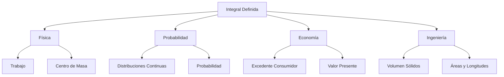

# Matemáticas para Ciencias Aplicadas I - Integral de funciones reales de una variable real

## 3.6 Ejemplos y aplicaciones. Trabajo. Distribuciones de Probabilidad.

---

### 1. Trabajo en Física

#### 1.1 Concepto de Trabajo

El trabajo realizado por una fuerza variable $F(x)$ al mover un objeto desde $x = a$ hasta $x = b$ es:

$$ W = \int_a^b F(x)  dx $$

#### 1.2 Ejemplo: Trabajo para Estirar un Resorte

Ley de Hooke: $F(x) = kx$ donde $k$ es la constante del resorte.  
Trabajo para estirar desde $x_1$ hasta $x_2$:

$$ W = \int_{x_1}^{x_2} kx  dx = \frac{1}{2}k(x_2^2 - x_1^2) $$

**Código Python:**

```python
import numpy as np
import matplotlib.pyplot as plt

# Trabajo en resorte (k = 100 N/m)
k = 100
x1, x2 = 0, 0.5  # metros

def F(x):
    return k * x

x_vals = np.linspace(0, 0.6, 100)
F_vals = F(x_vals)

# Cálculo del trabajo
W = 0.5 * k * (x2**2 - x1**2)

plt.figure(figsize=(10, 6))
plt.plot(x_vals, F_vals, 'b-', label='F(x) = 100x [N]')
plt.fill_between(x_vals, 0, F_vals, where=(x_vals>=x1)&(x_vals<=x2),
                 alpha=0.3, color='green', label=f'Trabajo = {W:.1f} J')
plt.xlabel('Desplazamiento (m)')
plt.ylabel('Fuerza (N)')
plt.title('Trabajo realizado al estirar un resorte')
plt.legend()
plt.grid(True)
plt.show()
```

### 2. Distribuciones de Probabilidad Continuas

#### 2.1 Función de Densidad de Probabilidad (PDF)

Para una variable aleatoria continua $X$ con PDF $f(x)$:

1. $f(x) \geq 0$ para todo $x$
2. $\int_{-\infty}^{\infty} f(x)  dx = 1$
3. $P(a \leq X \leq b) = \int_a^b f(x)  dx$

#### 2.2 Distribución Normal Estándar

PDF:  
$$ f(x) = \frac{1}{\sqrt{2\pi}} e^{-x^2/2} $$

Probabilidad entre $-1$ y $1$:  
$$ P(-1 \leq X \leq 1) = \int_{-1}^{1} \frac{1}{\sqrt{2\pi}} e^{-x^2/2}  dx \approx 0.6827 $$

**Código Python:**

```python
from scipy.integrate import quad
from scipy.stats import norm
import numpy as np

# PDF de distribución normal
def normal_pdf(x):
    return (1/np.sqrt(2*np.pi)) * np.exp(-x**2/2)

# Probabilidad entre -1 y 1
prob, error = quad(normal_pdf, -1, 1)
print(f"P(-1 ≤ X ≤ 1) = {prob:.4f}")

# Visualización
x_vals = np.linspace(-3, 3, 100)
y_vals = normal_pdf(x_vals)

plt.figure(figsize=(10, 6))
plt.plot(x_vals, y_vals, 'b-', label='PDF Normal')
plt.fill_between(x_vals, 0, y_vals, where=(x_vals>=-1)&(x_vals<=1),
                 alpha=0.3, color='green', label=f'P(-1,1) = {prob:.4f}')
plt.xlabel('x')
plt.ylabel('f(x)')
plt.title('Distribución Normal Estándar')
plt.legend()
plt.grid(True)
plt.show()
```

### 3. Aplicaciones en Economía

#### 3.1 Excedente del Consumidor

El excedente del consumidor cuando el precio es $p_0$ y la demanda es $D(p)$:

$$ EC = \int_{0}^{p_0} D(p)  dp $$

#### 3.2 Valor Presente de un Flujo de Ingresos

Para un flujo de ingresos $I(t)$ y tasa de interés $r$:

$$ VP = \int_{0}^{T} I(t) e^{-rt}  dt $$

### 4. Aplicaciones en Ingeniería

#### 4.1 Centro de Masa

Para una varilla con densidad lineal $\rho(x)$:

$$ \bar{x} = \frac{\int_a^b x \rho(x)  dx}{\int_a^b \rho(x)  dx} $$

#### 4.2 Volumen de Sólidos de Revolución

Método del disco:

$$ V = \pi \int_a^b [f(x)]^2  dx $$

### 5. Diagrama de Aplicaciones



### 6. Ejemplos Integrados

#### 6.1 Cálculo de Trabajo con Fuerza Variable

Supongamos una fuerza $F(x) = 10x^2 + 5x$ N actuando desde $x=0$ hasta $x=2$ m:

$$ W = \int_0^2 (10x^2 + 5x)  dx = \left[ \frac{10x^3}{3} + \frac{5x^2}{2} \right]_0^2 = \frac{80}{3} + 10 = \frac{110}{3} \text{ J} $$

#### 6.2 Probabilidad en Distribución Exponencial

PDF: $f(x) = \lambda e^{-\lambda x}$ para $x \geq 0$  
Probabilidad de que $X > t$:

$$ P(X > t) = \int_t^{\infty} \lambda e^{-\lambda x}  dx = e^{-\lambda t} $$

### 7. Implementación de Aplicaciones Múltiples

```python
# Aplicaciones múltiples de la integral
import numpy as np
from scipy.integrate import quad

# 1. Trabajo con fuerza variable
def F(x):
    return 10*x**2 + 5*x

trabajo, _ = quad(F, 0, 2)
print(f"Trabajo realizado: {trabajo:.2f} J")

# 2. Probabilidad con distribución exponencial (λ = 0.5)
lambda_val = 0.5
def exp_pdf(x):
    return lambda_val * np.exp(-lambda_val * x)

prob, _ = quad(exp_pdf, 2, np.inf)  # P(X > 2)
print(f"P(X > 2) = {prob:.4f}")

# 3. Excedente del consumidor
def demanda(p):
    return 100 - 2*p  # Función de demanda lineal

p0 = 30  # Precio de equilibrio
excedente, _ = quad(demanda, 0, p0)
print(f"Excedente del consumidor: {excedente:.2f}")
```

### 8. Ejercicios y Problemas

#### 8.1 Problemas de Aplicación

1. Un resorte requiere 50 J para estirarse de 0.2 m a 0.4 m. Encuentra la constante del resorte.
2. Para $X \sim N(0,1)$, calcula $P(-2 \leq X \leq 2)$
3. La demanda de un producto es $D(p) = 200 - 4p$. Calcula el excedente del consumidor si $p_0 = 30$

#### 8.2 Ejercicios Teóricos

1. Explica por qué el área bajo la PDF debe ser 1
2. Deduce la fórmula del trabajo para una fuerza constante
3. Justifica la fórmula del valor presente continuo

### Ver también

- **3.2–3.5** Integral definida y sus propiedades — se aplican aquí.
- **Probabilidad I 2.1** (Sem. 3) — las distribuciones continuas usan integrales.

### Referencias

- Stewart, J. (2016). _Cálculo de una variable_ (8.ª ed.). Cengage Learning.
- Simmons, G. F. (2012). _Cálculo con geometría analítica_ (2.ª ed.). McGraw-Hill.
- Thomas, G. B. et al. (2014). _Cálculo_ (13.ª ed.). Pearson.
