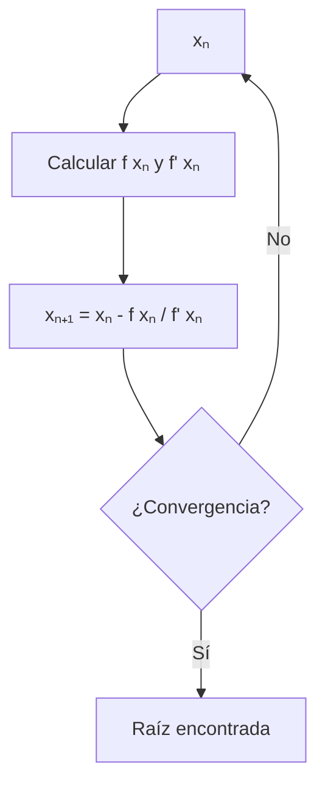

# Matemáticas para Ciencias Aplicadas I - Cálculo de las derivadas

## 4.1 Diferencial, Aproximación por medio de la derivada. Cero de funciones. Método de Newton.

---

### 1. Diferencial de una Función

#### 1.1 Definición de Diferencial

Para una función $y = f(x)$, el diferencial $dy$ se define como:

$$ dy = f'(x)  dx $$

donde $dx$ es un incremento arbitrario en $x$.

#### 1.2 Interpretación Geométrica

El diferencial $dy$ representa el cambio en la altura de la recta tangente, mientras que $\Delta y$ representa el cambio real en la función.


#### 1.3 Ejemplo de Cálculo

Para $f(x) = x^2$:  
$$ dy = 2x  dx $$  
Si $x=3$ y $dx=0.1$:  
$$ dy = 2(3)(0.1) = 0.6 $$

### 2. Aproximación Lineal por Derivada

#### 2.1 Fórmula de Aproximación

Para $dx$ pequeño:  
$$ f(x + dx) \approx f(x) + dy = f(x) + f'(x)  dx $$

#### 2.2 Aproximación de $\sqrt{16.2}$

Sea $f(x) = \sqrt{x}$, $x=16$, $dx=0.2$:

$$ f'(x) = \frac{1}{2\sqrt{x}} $$

$$ \sqrt{16.2} \approx \sqrt{16} + \frac{1}{2\sqrt{16}} \cdot 0.2 = 4 + \frac{0.2}{8} = 4.025 $$

**Código Python:**

```python
import numpy as np

def aproximacion_lineal(f, df, x, dx):
    return f(x) + df(x) * dx

# Aproximar √16.2
f = np.sqrt
df = lambda x: 1/(2*np.sqrt(x))

x0 = 16
dx = 0.2
aprox = aproximacion_lineal(f, df, x0, dx)
real = np.sqrt(16.2)
error = abs(real - aprox)

print(f"Aproximación: {aprox:.6f}")
print(f"Valor real: {real:.6f}")
print(f"Error: {error:.6f}")
print(f"Error relativo: {error/real*100:.4f}%")
```

### 3. Ceros de Funciones y Método de Newton

#### 3.1 Método de Newton-Raphson

Iteración para encontrar raíces de $f(x) = 0$:  
$$ x_{n+1} = x_n - \frac{f(x_n)}{f'(x_n)} $$

#### 3.2 Convergencia del Método

El método converge cuadráticamente si:

- $f'(x) \neq 0$ en la raíz
- La aproximación inicial es suficientemente buena

#### 3.3 Diagrama del Método



### 4. Implementación del Método de Newton

#### 4.1 Código Python

```python
def newton_raphson(f, df, x0, tol=1e-6, max_iter=100):
    """
    Método de Newton-Raphson para encontrar raíces
    """
    x = x0
    for i in range(max_iter):
        fx = f(x)
        if abs(fx) < tol:
            return x, i+1, True

        dfx = df(x)
        if abs(dfx) < tol:
            return x, i+1, False

        x_new = x - fx / dfx
        if abs(x_new - x) < tol:
            return x_new, i+1, True

        x = x_new

    return x, max_iter, False

# Ejemplo: encontrar √2 (raíz de f(x) = x² - 2 = 0)
f = lambda x: x**2 - 2
df = lambda x: 2*x

raiz, iteraciones, convergio = newton_raphson(f, df, x0=1.0)
print(f"Raíz encontrada: {raiz:.8f}")
print(f"Iteraciones: {iteraciones}")
print(f"Convergió: {convergio}")
print(f"Error: {abs(raiz - np.sqrt(2)):.2e}")
```

#### 4.2 Visualización del Método

```python
import matplotlib.pyplot as plt

def plot_newton(f, df, x0, x_range=(-1, 3)):
    x_vals = np.linspace(x_range[0], x_range[1], 400)
    y_vals = f(x_vals)

    plt.figure(figsize=(10, 6))
    plt.plot(x_vals, y_vals, 'b-', label='f(x)')
    plt.axhline(0, color='k', linestyle='--', alpha=0.5)

    # Iteraciones de Newton
    x = x0
    for i in range(5):
        fx = f(x)
        dfx = df(x)
        plt.plot(x, fx, 'ro', markersize=8)
        plt.plot([x, x], [0, fx], 'r--', alpha=0.5)

        # Recta tangente
        tangente = dfx * (x_vals - x) + fx
        plt.plot(x_vals, tangente, 'g--', alpha=0.7, label=f'Tangente {i+1}' if i==0 else "")

        x_new = x - fx/dfx
        plt.plot([x, x_new], [fx, 0], 'r-', alpha=0.7)

        x = x_new

    plt.xlabel('x')
    plt.ylabel('f(x)')
    plt.title('Método de Newton-Raphson')
    plt.legend()
    plt.grid(True)
    plt.show()

# Visualizar para f(x) = x² - 2
plot_newton(f, df, x0=2.5)
```

### 5. Aplicaciones y Ejemplos

#### 5.1 Aproximación de Funciones

- Cálculo de valores de funciones trigonométricas
- Estimación de raíces y potencias
- Análisis de errores en mediciones

#### 5.2 Problemas de Optimización

- Encontrar puntos críticos resolviendo $f'(x) = 0$
- Aproximar mínimos y máximos locales

#### 5.3 Ingeniería y Ciencias

- Solución de ecuaciones no lineales en física
- Análisis de circuitos eléctricos
- Modelado de sistemas dinámicos

### 6. Ejercicios y Problemas

#### 6.1 Ejercicios de Aproximación

1. Usa diferenciales para aproximar $\sqrt[3]{8.1}$
2. Estima $\sin(0.1)$ usando aproximación lineal
3. Calcula el error porcentual al aproximar $\ln(1.05)$

#### 6.2 Problemas de Newton-Raphson

1. Encuentra la raíz de $f(x) = e^x - 3x$ con $x_0 = 1$
2. Resuelve $x^3 - 2x - 5 = 0$ con el método de Newton
3. Encuentra todas las raíces de $f(x) = x^3 - 3x^2 + 4$

### Ver también

- **2.5** Derivada — el diferencial es la aproximación lineal de la derivada.
- **2.7** Extremos — el método de Newton busca los ceros.
- **4.4** Raíces de polinomios — aplicación de Newton a polinomios.

### Referencias

- Stewart, J. (2016). _Cálculo de una variable_ (8.ª ed.). Cengage Learning.
- Simmons, G. F. (2012). _Cálculo con geometría analítica_ (2.ª ed.). McGraw-Hill.
- Thomas, G. B. et al. (2014). _Cálculo_ (13.ª ed.). Pearson.
