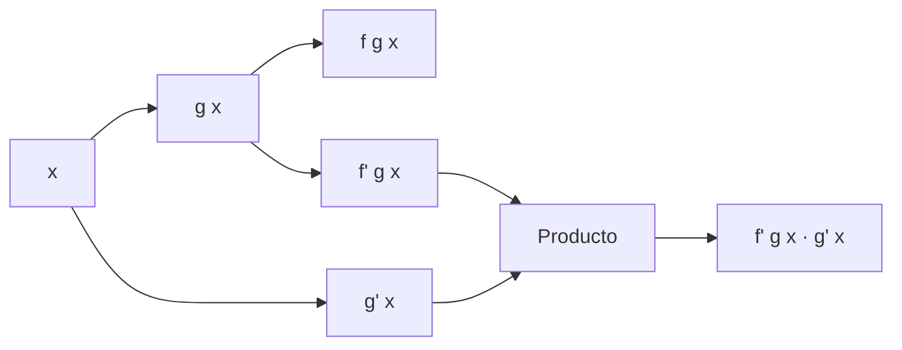
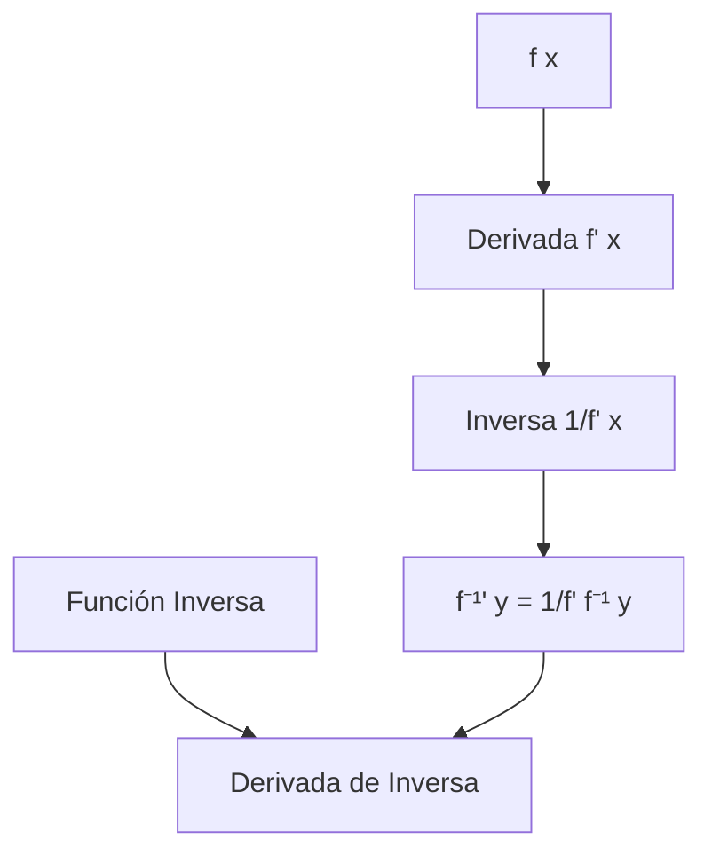

# Matemáticas para Ciencias Aplicadas I - Cálculo de las derivadas

## 4.2 Regla de la cadena. Derivada de la función inversa.

---

### 1. Regla de la Cadena

#### 1.1 Definición Formal

Si $y = f(u)$ es derivable en $u$ y $u = g(x)$ es derivable en $x$, entonces la función compuesta $y = f(g(x))$ es derivable en $x$ y:

$$ \frac{dy}{dx} = \frac{dy}{du} \cdot \frac{du}{dx} = f'(g(x)) \cdot g'(x) $$

#### 1.2 Notación Alternativa

$$ (f \circ g)'(x) = f'(g(x)) \cdot g'(x) $$

#### 1.3 Diagrama de la Regla de la Cadena



### 2. Ejemplos de la Regla de la Cadena

#### 2.1 Ejemplo 1: Función Compuesta

Para $y = \sin(3x^2)$:

- $u = 3x^2$, $y = \sin u$
- $\frac{du}{dx} = 6x$, $\frac{dy}{du} = \cos u$
- $\frac{dy}{dx} = \cos(3x^2) \cdot 6x = 6x \cos(3x^2)$

#### 2.2 Ejemplo 2: Función Exponencial

Para $y = e^{2x^3}$:

- $u = 2x^3$, $y = e^u$
- $\frac{du}{dx} = 6x^2$, $\frac{dy}{du} = e^u$
- $\frac{dy}{dx} = e^{2x^3} \cdot 6x^2 = 6x^2 e^{2x^3}$

#### 2.3 Implementación en Python

```python
import sympy as sp

def derivada_compuesta(f_externa, f_interna, x):
    """
    Calcula la derivada de f(g(x)) usando regla de la cadena
    """
    u = sp.symbols('u')
    derivada_externa = sp.diff(f_externa(u), u)
    derivada_interna = sp.diff(f_interna(x), x)

    # Sustituir u por g(x) en la derivada externa
    derivada = derivada_externa.subs(u, f_interna(x)) * derivada_interna
    return derivada

# Ejemplo: sin(3x²)
x = sp.symbols('x')
f_ext = sp.sin
f_int = 3*x**2

derivada = derivada_compuesta(f_ext, f_int, x)
print(f"d/dx [sin(3x²)] = {derivada}")
print(f"Simplificado: {sp.simplify(derivada)}")
```

### 3. Derivada de la Función Inversa

#### 3.1 Teorema de la Función Inversa

Si $f$ es una función biyectiva y derivable con $f'(x) \neq 0$, entonces su inversa $f^{-1}$ es derivable y:

$$ (f^{-1})'(y) = \frac{1}{f'(x)} = \frac{1}{f'(f^{-1}(y))} $$

donde $y = f(x)$.

#### 3.2 Demostración Conceptual

Usando la regla de la cadena en $f(f^{-1}(y)) = y$:

$$ f'(f^{-1}(y)) \cdot (f^{-1})'(y) = 1 $$  

Despejando:

$$ (f^{-1})'(y) = \frac{1}{f'(f^{-1}(y))} $$

#### 3.3 Diagrama de Relación



### 4. Ejemplos de Derivada de la Función Inversa

#### 4.1 Ejemplo 1: Función Exponencial y Logaritmo

Para $f(x) = e^x$ y $f^{-1}(y) = \ln y$:

- $f'(x) = e^x$
- $(f^{-1})'(y) = \frac{1}{f'(f^{-1}(y))} = \frac{1}{e^{\ln y}} = \frac{1}{y}$

#### 4.2 Ejemplo 2: Función Cuadrática

Para $f(x) = x^2$ ( con $x > 0$ ) y $f^{-1}(y) = \sqrt{y}$:

- $f'(x) = 2x$
- $(f^{-1})'(y) = \frac{1}{2\sqrt{y}}$

#### 4.3 Implementación en Python

```python
def derivada_inversa(f, y):
    """
    Calcula la derivada de la función inversa usando el teorema
    """
    x = sp.symbols('x')
    f_prime = sp.diff(f(x), x)

    # Encontrar la inversa simbólicamente
    ecuacion = sp.Eq(f(x), y)
    inversa = sp.solve(ecuacion, x)[0]  # Tomar la solución apropiada

    derivada_inv = 1 / f_prime.subs(x, inversa)
    return derivada_inv, inversa

# Ejemplo: f(x) = x³
f = lambda x: x**3
y_val = sp.symbols('y')

derivada, inversa = derivada_inversa(f, y_val)
print(f"Función: f(x) = x³")
print(f"Inversa: f⁻¹(y) = {inversa}")
print(f"Derivada de la inversa: (f⁻¹)'(y) = {derivada}")
print(f"Forma simplificada: {sp.simplify(derivada)}")
```

### 5. Aplicaciones Conjuntas

#### 5.1 Combinación de Reglas

Para derivar funciones complejas como $\ln(\sin(2x))$:

1. Regla de la cadena: $\frac{d}{dx}[\ln(\sin(2x))] = \frac{1}{\sin(2x)} \cdot \cos(2x) \cdot 2$
2. Simplificar: $2 \cot(2x)$

#### 5.2 Derivación Implícita

Para ecuaciones como $y = \arcsin(x)$:

- $x = \sin(y)$
- $\frac{dx}{dy} = \cos(y)$
- $\frac{dy}{dx} = \frac{1}{\cos(y)} = \frac{1}{\sqrt{1 - x^2}}$

### 6. Ejercicios y Problemas

#### 6.1 Ejercicios de Regla de la Cadena

Deriva las siguientes funciones:

1. $y = \cos(5x^3)$
2. $y = \sqrt{\tan(2x)}$
3. $y = e^{\sin(3x)}$

#### 6.2 Ejercicios de Función Inversa

Encuentra la derivada de:

1. $f^{-1}(y)$ para $f(x) = 2x + 3$
2. $\arctan(x)$ usando el teorema de la función inversa
3. $\arcsin(2x)$

#### 6.3 Problemas de Aplicación

1. Un objeto se mueve con posición $s(t) = \sin(2t^2)$. Encuentra su velocidad.
2. La temperatura sigue $T(t) = e^{-0.1t}\cos(t)$. Encuentra la tasa de cambio.
3. El volumen de un globo es $V(r) = \frac{4}{3}\pi r^3$. Encuentra cómo cambia el radio cuando el volumen aumenta.

### Ver también

- **1.17** Composición de funciones — la regla de la cadena diferencia composiciones.
- **2.6** Propiedades de la derivada — la regla de la cadena es la propiedad más importante.
- **4.7** Derivación implícita — usa la regla de la cadena.

### Referencias

- Stewart, J. (2016). _Cálculo de una variable_ (8.ª ed.). Cengage Learning.
- Simmons, G. F. (2012). _Cálculo con geometría analítica_ (2.ª ed.). McGraw-Hill.
- Thomas, G. B. et al. (2014). _Cálculo_ (13.ª ed.). Pearson.
