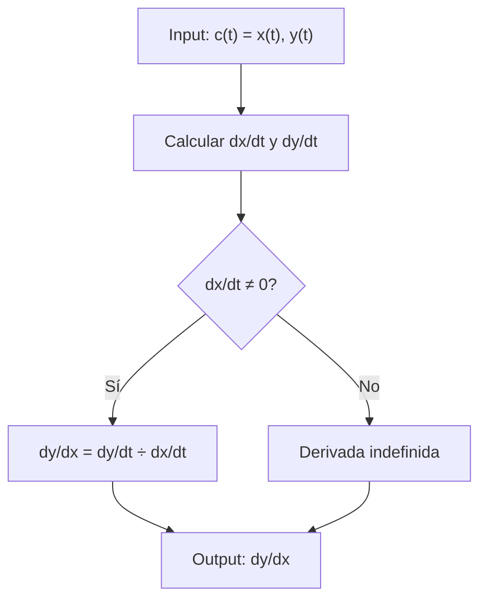

# Matemáticas para Ciencias Aplicadas I - Cálculo de las derivadas

## 4.3 Curvas parametrizadas c(t)=(x(t),y(t)). Derivadas de y respecto a x.

---

### 1. Definición de Curvas Parametrizadas

Una curva parametrizada en el plano es una función vectorial que asigna a cada valor de un parámetro $t$ un punto $(x, y)$ en el plano:

$$ c(t) = (x(t), y(t)) $$

donde $x(t)$ y $y(t)$ son funciones del parámetro $t$ definidas en un intervalo $I \subseteq \mathbb{R}$.

### 2. Derivada de una Curva Parametrizada

La derivada de la curva $c(t)$ respecto al parámetro $t$ es:

$$c'(t) = (x'(t), y'(t)) = \left(\frac{dx}{dt}, \frac{dy}{dt}\right)$$

### 3. Derivada de y respecto a x

Para encontrar $\frac{dy}{dx}$ cuando la curva está definida paramétricamente:

$$\frac{dy}{dx} = \frac{dy/dt}{dx/dt} = \frac{y'(t)}{x'(t)}, \quad \text{con } x'(t) \neq 0$$

#### 3.1. Segunda Derivada

$$\frac{d^2y}{dx^2} = \frac{d}{dx}\left(\frac{dy}{dx}\right) = \frac{\frac{d}{dt}\left(\frac{dy}{dx}\right)}{\frac{dx}{dt}}$$

### 4. Ejemplos Resueltos

#### Ejemplo 1: Circunferencia

$c(t) = (\cos t, \sin t)$

- $\frac{dx}{dt} = -\sin t$
- $\frac{dy}{dt} = \cos t$
- $\frac{dy}{dx} = \frac{\cos t}{-\sin t} = -\cot t$

#### Ejemplo 2: Parábola

$c(t) = (t, t^2)$

- $\frac{dx}{dt} = 1$
- $\frac{dy}{dt} = 2t$
- $\frac{dy}{dx} = 2t$

### 5. Implementación Computacional

```python
import numpy as np
import matplotlib.pyplot as plt

def parametric_derivative(x_func, y_func, t, h=0.0001):
    dx_dt = (x_func(t + h) - x_func(t - h)) / (2 * h)
    dy_dt = (y_func(t + h) - y_func(t - h)) / (2 * h)
    return dy_dt / dx_dt if dx_dt != 0 else float('inf')

# Ejemplo de uso
def x_func(t): return np.cos(t)
def y_func(t): return np.sin(t)

t_val = np.pi/4
derivada = parametric_derivative(x_func, y_func, t_val)
print(f"dy/dx en t={t_val}: {derivada}")
```

### 6. Diagrama de Proceso



### 7. Ejercicios Prácticos

1. Para $c(t) = (t^3, t^2)$ calcule $\frac{dy}{dx}$ y $\frac{d^2y}{dx^2}$

2. Para $c(t) = (\sin t, \cos t)$ encuentre la pendiente cuando $t = \pi/3$

3. Demuestre que para $c(t) = (e^t, e^{-t})$ se cumple $\frac{d^2y}{dx^2} = \frac{dy}{dx}$

### 8. Aplicaciones

- Cálculo de tangentes a curvas paramétricas
- Determinación de puntos críticos
- Cálculo de longitudes de arco
- Análisis de trayectorias en física

### 9. Consideraciones Importantes

- La derivada $\frac{dy}{dx}$ solo existe donde $x'(t) \neq 0$
- Los puntos donde $x'(t) = 0$ y $y'(t) = 0$ son puntos singulares
- La curva es suave si $x'(t)$ y $y'(t)$ son continuas y no simultáneamente cero

### Ver también

- **1.8** Curvas paramétricas — definición de las curvas que se derivan aquí.
- **4.2** Regla de la cadena — se aplica para derivar $ respecto a $.
- **Matemáticas CC III 3.1** (Sem. 3) — curvas orientadas en el cálculo vectorial.

### Referencias

- Stewart, J. (2016). _Cálculo de una variable_ (8.ª ed.). Cengage Learning.
- Simmons, G. F. (2012). _Cálculo con geometría analítica_ (2.ª ed.). McGraw-Hill.
- Thomas, G. B. et al. (2014). _Cálculo_ (13.ª ed.). Pearson.
