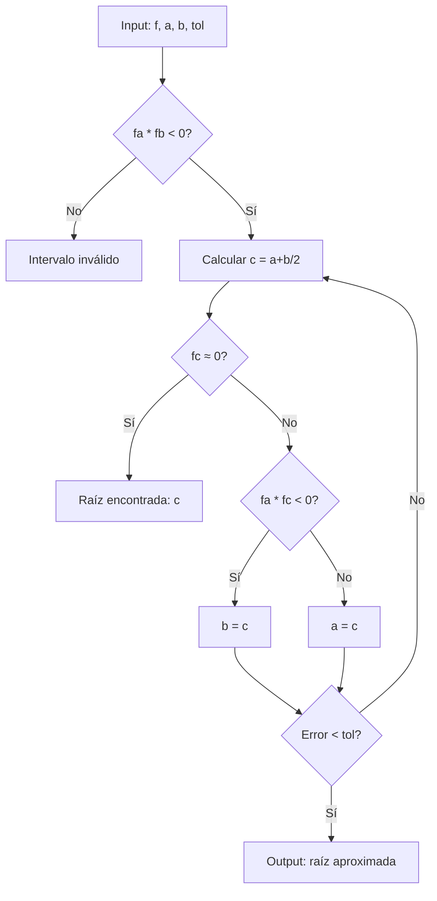
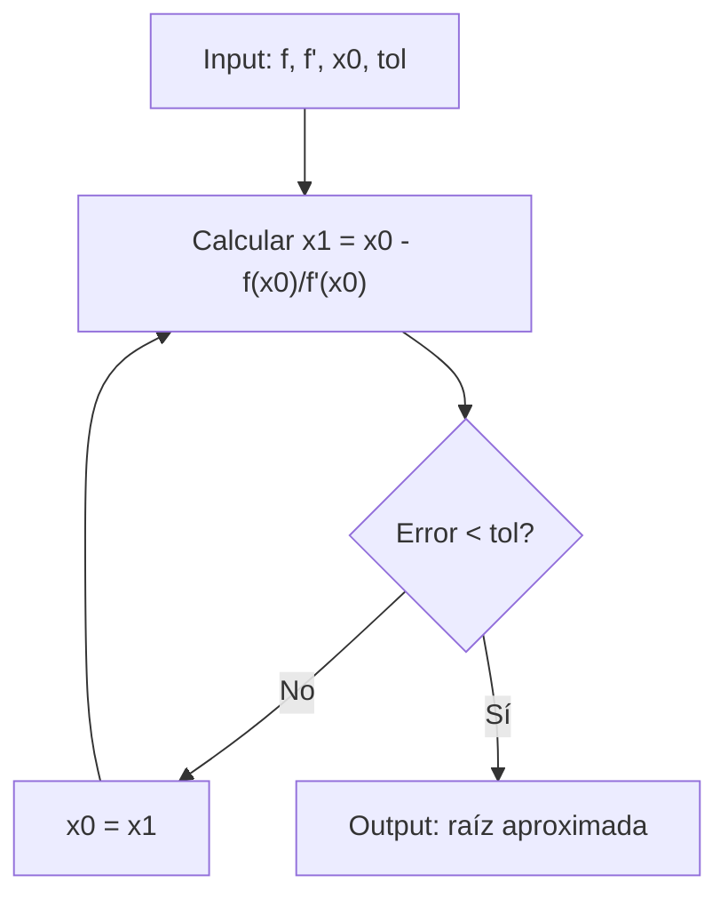

# Matemáticas para Ciencias Aplicadas I - Cálculo de las derivadas

## 4.4 Polinomios. Raíces de polinomios. Métodos numéricos.

---

### 1. Definición de Polinomios

Un polinomio de grado $n$ es una función de la forma:

$$P(x) = a_nx^n + a_{n-1}x^{n-1} + \cdots + a_1x + a_0$$

donde $a_n \neq 0$ y los coeficientes $a_i$ son números reales o complejos.

**Ejemplos:**

- Lineal: $P(x) = 2x + 3$ (grado 1)
- Cuadrático: $P(x) = x^2 - 5x + 6$ (grado 2)
- Cúbico: $P(x) = 4x^3 - 2x^2 + x - 7$ (grado 3)

### 2. Raíces de Polinomios

Una raíz (o cero) de un polinomio $P(x)$ es un valor $r$ tal que:

$$ P(r) = 0 $$

**Teorema Fundamental del Álgebra:** Todo polinomio de grado $n$ tiene exactamente $n$ raíces complejas (contando multiplicidades).

#### 2.1. Fórmulas para Raíces

**Grado 1 (Lineal):**

$$ax + b = 0 \Rightarrow x = -\frac{b}{a}$$

**Grado 2 (Cuadrático):**

$$ax^2 + bx + c = 0 \Rightarrow x = \frac{-b \pm \sqrt{b^2 - 4ac}}{2a}$$

### 3. Métodos Numéricos para Encontrar Raíces

#### 3.1. Método de Bisección



#### 3.2. Método de Newton-Raphson

$$x_{n+1} = x_n - \frac{f(x_n)}{f'(x_n)}$$



### 4. Implementación de Métodos Numéricos

```python
import numpy as np

def biseccion(f, a, b, tol=1e-6, max_iter=100):
    if f(a) * f(b) >= 0:
        raise ValueError("La función no cambia de signo en el intervalo")

    for i in range(max_iter):
        c = (a + b) / 2
        if abs(f(c)) < tol:
            return c
        if f(a) * f(c) < 0:
            b = c
        else:
            a = c
    return c

def newton_raphson(f, df, x0, tol=1e-6, max_iter=100):
    x = x0
    for i in range(max_iter):
        fx = f(x)
        if abs(fx) < tol:
            return x
        dfx = df(x)
        if dfx == 0:
            raise ValueError("Derivada cero")
        x = x - fx / dfx
    return x

# Ejemplo: encontrar raíz de x^2 - 2
f = lambda x: x**2 - 2
df = lambda x: 2*x

raiz_biseccion = biseccion(f, 1, 2)
raiz_newton = newton_raphson(f, df, 1.5)

print(f"Bisección: {raiz_biseccion}")
print(f"Newton-Raphson: {raiz_newton}")
print(f"Valor exacto: {np.sqrt(2)}")
```

### 5. Derivadas de Polinomios

La derivada de un polinomio $P(x) = a_nx^n + a_{n-1}x^{n-1} + \cdots + a_1x + a_0$ es:

$$P'(x) = na_nx^{n-1} + (n-1)a_{n-1}x^{n-2} + \cdots + a_1$$

**Ejemplo:**

$$P(x) = 3x^4 - 2x^3 + 5x^2 - x + 7$$

$$P'(x) = 12x^3 - 6x^2 + 10x - 1$$

### 6. Aplicaciones de las Derivadas en Polinomios

1. **Encontrar puntos críticos:** Resolver $P'(x) = 0$
2. **Determinar concavidad:** Analizar $P''(x)$
3. **Optimización:** Encontrar máximos y mínimos
4. **Métodos numéricos:** Como en Newton-Raphson

### 7. Ejercicios Resueltos

#### Ejercicio 1

Encontrar las raíces de $P(x) = x^3 - 6x^2 + 11x - 6$

**Solución:**

Por inspección, $P(1) = 0$, entonces $(x-1)$ es factor:

$$ P(x) = (x-1)(x^2 - 5x + 6) = (x-1)(x-2)(x-3) $$

Raíces: $x = 1, 2, 3$

#### Ejercicio 2

Usar el método de Newton-Raphson para aproximar $\sqrt[3]{2}$

**Solución:**

Sea $f(x) = x^3 - 2$, $f'(x) = 3x^2$
Con $x_0 = 1$:

- $x_1 = 1 - (-1)/3 = 1.3333$
- $x_2 = 1.3333 - (0.370)/5.333 = 1.2639$
- $x_3 = 1.2639 - (0.019)/4.793 = 1.2599$

### 8. Ejercicios Propuestos

1. Encuentre las raíces de $P(x) = x^4 - 5x^2 + 4$
2. Implemente el método de la secante en Python
3. Use el método de bisección para encontrar la raíz de $f(x) = e^x - 3x$ en $[0, 1]$
4. Calcule la derivada de $P(x) = (x^2 + 1)(x^3 - 2x)$

### 9. Referencias

- Burden, R. L., & Faires, J. D. (2010). _Análisis Numérico_
- Stewart, J. (2008). _Cálculo: Trascendentes tempranas_
- Chapra, S. C., & Canale, R. P. (2010). _Métodos numéricos para ingenieros_

### Ver también

- **1.5** Polinomios — raíces como problema de cálculo numérico.
- **4.1** Método de Newton — técnica numérica para encontrar raíces.
- **Álgebra Superior II 4.1** (Sem. 2) — polinomios con coeficientes en un campo.

### Referencias

- Stewart, J. (2016). _Cálculo de una variable_ (8.ª ed.). Cengage Learning.
- Simmons, G. F. (2012). _Cálculo con geometría analítica_ (2.ª ed.). McGraw-Hill.
- Thomas, G. B. et al. (2014). _Cálculo_ (13.ª ed.). Pearson.
