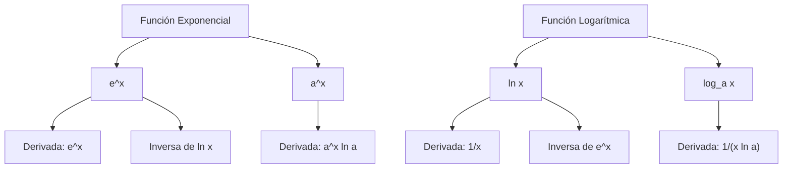

# Matemáticas para Ciencias Aplicadas I - Cálculo de las derivadas

## 4.5 Función exponencial. El número e. Logaritmos.

---

### 1. Función Exponencial

La función exponencial se define como:

$$f(x) = a^x$$

donde $a > 0$ y $a \neq 1$ es la base de la exponencial.

**Propiedades:**

- $a^0 = 1$
- $a^1 = a$
- $a^{x+y} = a^x \cdot a^y$
- $a^{x-y} = \frac{a^x}{a^y}$
- $(a^x)^y = a^{xy}$

### 2. El Número e

El número $e$ es una constante matemática fundamental aproximadamente igual a:

$$e \approx 2.718281828459045$$

Se define como el límite:

$$e = \lim_{n \to \infty} \left(1 + \frac{1}{n}\right)^n$$

#### 2.1. Función Exponencial Natural

La función exponencial con base $e$ se denota como:

$$f(x) = e^x$$

### 3. Función Logarítmica

El logaritmo en base $a$ de un número $x$ se define como:

$$\log_a x = y \iff a^y = x$$

**Propiedades de los logaritmos:**

- $\log_a 1 = 0$
- $\log_a a = 1$
- $\log_a(xy) = \log_a x + \log_a y$
- $\log_a\left(\frac{x}{y}\right) = \log_a x - \log_a y$
- $\log_a(x^y) = y \cdot \log_a x$

#### 3.1. Logaritmo Natural

El logaritmo natural ( base $e$ ) se denota como:

$$ \ln x = \log_e x $$

### 4. Derivadas de Funciones Exponenciales y Logarítmicas

#### 4.1. Derivada de la Función Exponencial

$$\frac{d}{dx}(a^x) = a^x \cdot \ln a$$

$$\frac{d}{dx}(e^x) = e^x$$

#### 4.2. Derivada de la Función Logarítmica

$$\frac{d}{dx}(\log_a x) = \frac{1}{x \ln a}$$

$$\frac{d}{dx}(\ln x) = \frac{1}{x}$$

#### 4.3. Derivada de Funciones Compuestas

$$\frac{d}{dx}(e^{u(x)}) = e^{u(x)} \cdot u'(x)$$

$$\frac{d}{dx}(\ln u(x)) = \frac{u'(x)}{u(x)}$$

### 5. Implementación Computacional

```python
import numpy as np
import matplotlib.pyplot as plt

# Cálculo de derivadas numéricas
def derivada_exponencial(x, h=0.0001):
    return (np.exp(x + h) - np.exp(x - h)) / (2 * h)

def derivada_logaritmica(x, h=0.0001):
    return (np.log(x + h) - np.log(x - h)) / (2 * h)

# Ejemplos de cálculo
x_valores = np.linspace(0.1, 5, 100)
deriv_exp = [derivada_exponencial(x) for x in x_valores]
deriv_log = [derivada_logaritmica(x) for x in x_valores]

# Gráficas
plt.figure(figsize=(12, 5))

plt.subplot(1, 2, 1)
plt.plot(x_valores, np.exp(x_valores), 'b-', label='e^x')
plt.plot(x_valores, deriv_exp, 'r--', label='Derivada de e^x')
plt.legend()
plt.title('Función Exponencial y su Derivada')

plt.subplot(1, 2, 2)
plt.plot(x_valores, np.log(x_valores), 'b-', label='ln x')
plt.plot(x_valores, deriv_log, 'r--', label='Derivada de ln x')
plt.legend()
plt.title('Función Logarítmica y su Derivada')

plt.tight_layout()
plt.show()
```

### 6. Diagrama de Relaciones



### 7. Ejercicios Resueltos

#### Ejercicio 1

Calcular la derivada de $f(x) = e^{3x^2}$

**Solución:**

$$f'(x) = e^{3x^2} \cdot \frac{d}{dx}(3x^2) = e^{3x^2} \cdot 6x = 6x e^{3x^2}$$

#### Ejercicio 2

Calcular la derivada de $g(x) = \ln(2x^3 + 1)$

**Solución:**

$$g'(x) = \frac{1}{2x^3 + 1} \cdot \frac{d}{dx}(2x^3 + 1) = \frac{6x^2}{2x^3 + 1}$$

#### Ejercicio 3

Resolver la ecuación: $e^{2x} = 5$

**Solución:**

$$e^{2x} = 5$$

$$2x = \ln 5$$

$$x = \frac{\ln 5}{2}$$

### 8. Aplicaciones

1. **Crecimiento exponencial:** Poblaciones, inversiones
2. **Decaimiento exponencial:** Materiales radiactivos
3. **Escalas logarítmicas:** Richter, pH, decibelios
4. **Modelado matemático:** En física, química, economía

### 9. Ejercicios Propuestos

1. Derive las siguientes funciones:
   a) $f(x) = 2^{x^2}$
   b) $g(x) = \ln(\cos x)$
   c) $h(x) = e^x \cdot \ln x$

2. Resuelva las ecuaciones:
   a) $3^{x+1} = 27$
   b) $\ln(x^2) = 4$
   c) $e^{2x} - 5e^x + 6 = 0$

3. Encuentre la ecuación de la recta tangente a $y = e^x$ en $x = 0$

4. Demuestre que $\frac{d}{dx}(a^x) = a^x \ln a$ usando la definición de derivada

### 10. Referencias

- Stewart, J. (2008). _Cálculo: Trascendentes tempranas_
- Larson, R., & Edwards, B. H. (2009). _Cálculo_
- Thomas, G. B. (2009). _Cálculo de una variable_

### Ver también

- **2.5–2.6** Derivadas — las funciones exponencial y logarítmica tienen derivadas especiales.
- **3.3** Teorema fundamental — integración de funciones exponenciales.
- **6.1** Serie de Taylor — la exponencial como serie de Taylor.

### Referencias

- Stewart, J. (2016). _Cálculo de una variable_ (8.ª ed.). Cengage Learning.
- Simmons, G. F. (2012). _Cálculo con geometría analítica_ (2.ª ed.). McGraw-Hill.
- Thomas, G. B. et al. (2014). _Cálculo_ (13.ª ed.). Pearson.
