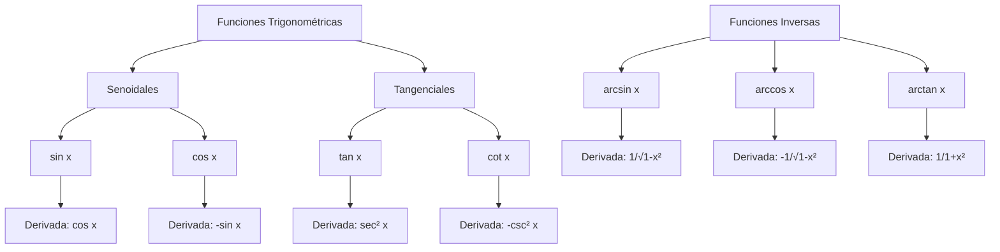

# Matemáticas para Ciencias Aplicadas I - Cálculo de las derivadas

## 4.6 Funciones trigonométricas y sus inversas.

---

### 1. Funciones Trigonométricas Básicas

Las seis funciones trigonométricas principales son:

#### 1.1. Seno y Coseno

- $\sin \theta = \frac{\text{opuesto}}{\text{hipotenusa}}$
- $\cos \theta = \frac{\text{adyacente}}{\text{hipotenusa}}$

#### 1.2. Tangente y Cotangente

- $\tan \theta = \frac{\sin \theta}{\cos \theta} = \frac{\text{opuesto}}{\text{adyacente}}$
- $\cot \theta = \frac{\cos \theta}{\sin \theta} = \frac{1}{\tan \theta}$

#### 1.3. Secante y Cosecante

- $\sec \theta = \frac{1}{\cos \theta}$
- $\csc \theta = \frac{1}{\sin \theta}$

### 2. Identidades Trigonométricas Fundamentales

#### 2.1. Identidades Pitagóricas

- $\sin^2 \theta + \cos^2 \theta = 1$
- $1 + \tan^2 \theta = \sec^2 \theta$
- $1 + \cot^2 \theta = \csc^2 \theta$

#### 2.2. Identidades de Ángulo Doble

- $\sin 2\theta = 2\sin\theta\cos\theta$
- $\cos 2\theta = \cos^2\theta - \sin^2\theta$
- $\tan 2\theta = \frac{2\tan\theta}{1 - \tan^2\theta}$

### 3. Funciones Trigonométricas Inversas

#### 3.1. Arcoseno

$$\arcsin x = y \iff \sin y = x, \quad -\frac{\pi}{2} \leq y \leq \frac{\pi}{2}$$

#### 3.2. Arcocoseno

$$\arccos x = y \iff \cos y = x, \quad 0 \leq y \leq \pi$$

#### 3.3. Arcotangente

$$\arctan x = y \iff \tan y = x, \quad -\frac{\pi}{2} < y < \frac{\pi}{2}$$

### 4. Derivadas de Funciones Trigonométricas

#### 4.1. Derivadas Básicas

- $\frac{d}{dx}(\sin x) = \cos x$
- $\frac{d}{dx}(\cos x) = -\sin x$
- $\frac{d}{dx}(\tan x) = \sec^2 x$
- $\frac{d}{dx}(\cot x) = -\csc^2 x$
- $\frac{d}{dx}(\sec x) = \sec x \tan x$
- $\frac{d}{dx}(\csc x) = -\csc x \cot x$

#### 4.2. Derivadas de Funciones Inversas

- $\frac{d}{dx}(\arcsin x) = \frac{1}{\sqrt{1 - x^2}}$
- $\frac{d}{dx}(\arccos x) = -\frac{1}{\sqrt{1 - x^2}}$
- $\frac{d}{dx}(\arctan x) = \frac{1}{1 + x^2}$

#### 4.3. Regla de la Cadena para Funciones Trigonométricas

- $\frac{d}{dx}[\sin(u(x))] = \cos(u(x)) \cdot u'(x)$
- $\frac{d}{dx}[\cos(u(x))] = -\sin(u(x)) \cdot u'(x)$
- $\frac{d}{dx}[\tan(u(x))] = \sec^2(u(x)) \cdot u'(x)$

### 5. Implementación Computacional

```python
import numpy as np
import matplotlib.pyplot as plt

# Derivadas numéricas de funciones trigonométricas
def derivada_numerica(f, x, h=0.0001):
    return (f(x + h) - f(x - h)) / (2 * h)

# Funciones trigonométricas
def f_sin(x): return np.sin(x)
def f_cos(x): return np.cos(x)
def f_tan(x): return np.tan(x)

# Cálculo de derivadas
x_vals = np.linspace(-np.pi, np.pi, 100)
deriv_sin = [derivada_numerica(f_sin, x) for x in x_vals]
deriv_cos = [derivada_numerica(f_cos, x) for x in x_vals]

# Gráficas comparativas
plt.figure(figsize=(12, 8))

plt.subplot(2, 2, 1)
plt.plot(x_vals, np.sin(x_vals), 'b-', label='sin x')
plt.plot(x_vals, deriv_sin, 'r--', label='Derivada numérica')
plt.plot(x_vals, np.cos(x_vals), 'g:', label='cos x (derivada exacta)')
plt.legend()
plt.title('Derivada del Seno')

plt.subplot(2, 2, 2)
plt.plot(x_vals, np.cos(x_vals), 'b-', label='cos x')
plt.plot(x_vals, deriv_cos, 'r--', label='Derivada numérica')
plt.plot(x_vals, -np.sin(x_vals), 'g:', label='-sin x (derivada exacta)')
plt.legend()
plt.title('Derivada del Coseno')

plt.tight_layout()
plt.show()
```

### 6. Diagrama de Relaciones



### 7. Ejercicios Resueltos

#### Ejercicio 1

Calcular la derivada de $f(x) = \sin(3x^2 + 2x)$

**Solución:**

$$f'(x) = \cos(3x^2 + 2x) \cdot \frac{d}{dx}(3x^2 + 2x) = \cos(3x^2 + 2x) \cdot (6x + 2)$$

#### Ejercicio 2

Calcular la derivada de $g(x) = \arctan(\sqrt{x})$

**Solución:**

$$g'(x) = \frac{1}{1 + (\sqrt{x})^2} \cdot \frac{d}{dx}(\sqrt{x}) = \frac{1}{1 + x} \cdot \frac{1}{2\sqrt{x}} = \frac{1}{2\sqrt{x}(1 + x)}$$

#### Ejercicio 3

Calcular la derivada de $h(x) = \sec(x^3)$

**Solución:**

$$h'(x) = \sec(x^3)\tan(x^3) \cdot \frac{d}{dx}(x^3) = \sec(x^3)\tan(x^3) \cdot 3x^2$$

### 8. Aplicaciones

1. **Movimiento armónico simple:** $\sin(\omega t)$ y $\cos(\omega t)$
2. **Ondas y vibraciones:** Modelado de ondas sonoras y electromagnéticas
3. **Circuitos eléctricos:** Corriente alterna
4. **Problemas de optimización:** Con restricciones angulares
5. **Navegación y astronomía:** Cálculo de distancias y ángulos

### 9. Ejercicios Propuestos

1. Derive las siguientes funciones:
   a) $f(x) = \cos(2x^3 - 4x)$
   b) $g(x) = \arcsin(x^2)$
   c) $h(x) = \tan(x) \cdot \sec(x)$

2. Encuentre la ecuación de la recta tangente a $y = \sin x$ en $x = \frac{\pi}{4}$

3. Demuestre que $\frac{d}{dx}(\cot x) = -\csc^2 x$ usando la regla del cociente

4. Resuelva: $\frac{dy}{dx} = \cos x$ con condición inicial $y(0) = 1$

5. Calcule la derivada segunda de $f(x) = \sin(2x)$

### 10. Referencias

- Stewart, J. (2008). _Cálculo: Trascendentes tempranas_
- Larson, R., & Edwards, B. H. (2009). _Cálculo_
- Thomas, G. B. (2009). _Cálculo de una variable_
- Apostol, T. M. (1967). _Calculus, Vol. 1_

### Ver también

- **4.5** Función exponencial — conexión via la fórmula de Euler.
- **2.6** Propiedades de la derivada — derivadas de funciones trigonométricas.
- **Matemáticas CC II 1.1** (Sem. 2) — vectores y ángulos en $\mathbb{R}^n$.

### Referencias

- Stewart, J. (2016). _Cálculo de una variable_ (8.ª ed.). Cengage Learning.
- Simmons, G. F. (2012). _Cálculo con geometría analítica_ (2.ª ed.). McGraw-Hill.
- Thomas, G. B. et al. (2014). _Cálculo_ (13.ª ed.). Pearson.
