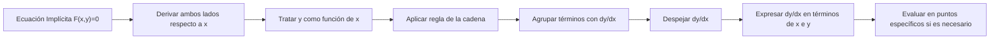

# Matemáticas para Ciencias Aplicadas I - Cálculo de las derivadas

## 4.7 Derivación implícita.

---

# Guía de Estudio: Derivación Implícita

### 1. Concepto de Derivación Implícita

La derivación implícita es una técnica utilizada para encontrar la derivada de una función cuando no está expresada explícitamente en la forma $y = f(x)$, sino que está dada mediante una ecuación que relaciona $x$ e $y$.

**Forma explícita:** $y = f(x)$  
**Forma implícita:** $F(x, y) = 0$

### 2. Procedimiento para Derivación Implícita

#### 2.1. Pasos Básicos

1. Derivar ambos lados de la ecuación respecto a $x$
2. Tratar $y$ como función de $x$ (usar regla de la cadena)
3. Agrupar términos con $\frac{dy}{dx}$
4. Despejar $\frac{dy}{dx}$

#### 2.2. Regla de la Cadena para Términos con y

Cuando derivamos términos que contienen $y$, aplicamos:

$$ \frac{d}{dx}[f(y)] = f'(y) \cdot \frac{dy}{dx} $$

### 3. Ejemplos Fundamentales

#### 3.1. Ejemplo 1: Circunferencia

$$x^2 + y^2 = 25$$

**Derivación:**

$$ \frac{d}{dx}(x^2) + \frac{d}{dx}(y^2) = \frac{d}{dx}(25) $$

$$ 2x + 2y \frac{dy}{dx} = 0 $$

$$ 2y \frac{dy}{dx} = -2x $$

$$ \frac{dy}{dx} = -\frac{x}{y} $$

#### 3.2. Ejemplo 2: Ecuación con Producto

$$x^3y + y^2 = x$$

**Derivación:**

$$\frac{d}{dx}(x^3y) + \frac{d}{dx}(y^2) = \frac{d}{dx}(x)$$
$$3x^2y + x^3\frac{dy}{dx} + 2y\frac{dy}{dx} = 1$$
$$x^3\frac{dy}{dx} + 2y\frac{dy}{dx} = 1 - 3x^2y$$
$$\frac{dy}{dx}(x^3 + 2y) = 1 - 3x^2y$$
$$\frac{dy}{dx} = \frac{1 - 3x^2y}{x^3 + 2y}$$

### 4. Derivadas de Orden Superior

Para encontrar $\frac{d^2y}{dx^2}$:

1. Encontrar $\frac{dy}{dx}$ por derivación implícita
2. Derivar nuevamente respecto a $x$
3. Sustituir $\frac{dy}{dx}$ en la expresión resultante

**Ejemplo:** Para $x^2 + y^2 = 25$

$$\frac{dy}{dx} = -\frac{x}{y}$$
$$\frac{d^2y}{dx^2} = -\frac{y(1) - x\frac{dy}{dx}}{y^2}$$
$$\frac{d^2y}{dx^2} = -\frac{y - x(-\frac{x}{y})}{y^2} = -\frac{y + \frac{x^2}{y}}{y^2} = -\frac{x^2 + y^2}{y^3}$$

### 5. Implementación Computacional

```python
import sympy as sp
import numpy as np
import matplotlib.pyplot as plt

# Derivación implícita simbólica
def derivada_implicita(ecuacion, x, y):
    # Definir variables simbólicas
    x_sym, y_sym = sp.symbols('x y')

    # Derivar respecto a x
    derivada = sp.idiff(ecuacion, y_sym, x_sym)

    return derivada

# Ejemplo: x^2 + y^2 = 25
x, y = sp.symbols('x y')
ecuacion = x**2 + y**2 - 25

dy_dx = derivada_implicita(ecuacion, x, y)
print(f"dy/dx = {dy_dx}")

# Evaluar en un punto específico
dy_dx_val = dy_dx.subs({x: 3, y: 4})
print(f"dy/dx en (3,4) = {dy_dx_val}")

# Visualización
def plot_implicit_derivative():
    x_vals = np.linspace(-5, 5, 400)
    y_vals = np.linspace(-5, 5, 400)
    X, Y = np.meshgrid(x_vals, y_vals)
    F = X**2 + Y**2 - 25

    plt.figure(figsize=(8, 6))
    plt.contour(X, Y, F, [0], colors='blue')
    plt.grid(True)
    plt.title('Circunferencia: x² + y² = 25')
    plt.xlabel('x')
    plt.ylabel('y')
    plt.axis('equal')
    plt.show()

plot_implicit_derivative()
```

### 6. Diagrama del Proceso



### 7. Aplicaciones de la Derivación Implícita

#### 7.1. Rectas Tangentes y Normales

Para encontrar la ecuación de la recta tangente en un punto $(x_0, y_0)$:

1. Calcular $\frac{dy}{dx}$ en $(x_0, y_0)$
2. Usar forma punto-pendiente: $y - y_0 = m(x - x_0)$

#### 7.2. Problemas de Tasas Relacionadas

Cuando dos variables dependen de una tercera variable (usualmente tiempo)

#### 7.3. Curvas Definidas Implícitamente

- Elipses e hipérbolas
- Curvas algebraicas
- Funciones definidas por ecuaciones no lineales

### 8. Ejercicios Resueltos

#### Ejercicio 1

Encontrar $\frac{dy}{dx}$ para $x^3 + y^3 = 6xy$

**Solución:**

$$\frac{d}{dx}(x^3) + \frac{d}{dx}(y^3) = \frac{d}{dx}(6xy)$$
$$3x^2 + 3y^2\frac{dy}{dx} = 6y + 6x\frac{dy}{dx}$$
$$3y^2\frac{dy}{dx} - 6x\frac{dy}{dx} = 6y - 3x^2$$
$$\frac{dy}{dx}(3y^2 - 6x) = 6y - 3x^2$$
$$\frac{dy}{dx} = \frac{6y - 3x^2}{3y^2 - 6x} = \frac{2y - x^2}{y^2 - 2x}$$

#### Ejercicio 2

Encontrar la ecuación de la recta tangente a $x^2y + y^3 = 2$ en $(1, 1)$

**Solución:**

$$\frac{d}{dx}(x^2y) + \frac{d}{dx}(y^3) = 0$$
$$2xy + x^2\frac{dy}{dx} + 3y^2\frac{dy}{dx} = 0$$
$$\frac{dy}{dx}(x^2 + 3y^2) = -2xy$$
$$\frac{dy}{dx} = -\frac{2xy}{x^2 + 3y^2}$$

En $(1, 1)$: $\frac{dy}{dx} = -\frac{2(1)(1)}{1 + 3} = -\frac{1}{2}$

Ecuación tangente: $y - 1 = -\frac{1}{2}(x - 1)$

### 9. Ejercicios Propuestos

1. Encuentre $\frac{dy}{dx}$ para:
   a) $x^2y + xy^2 = 6$
   b) $\sin(xy) = x + y$
   c) $e^{xy} = x^2 + y^2$

2. Encuentre $\frac{d^2y}{dx^2}$ para $x^2 + y^2 = 9$

3. Encuentre la ecuación de la recta normal a $x^3 + y^3 = 9xy$ en $(2, 4)$

4. Demuestre que para cualquier curva definida implícitamente por $F(x, y) = 0$, la pendiente de la tangente es $-\frac{F_x}{F_y}$

5. Resuelva: $\frac{dy}{dx}$ para $\ln(x^2 + y^2) = 2\arctan(\frac{y}{x})$

### 10. Referencias

- Stewart, J. (2008). _Cálculo: Trascendentes tempranas_
- Larson, R., & Edwards, B. H. (2009). _Cálculo_
- Thomas, G. B. (2009). _Cálculo de una variable_
- Apostol, T. M. (1967). _Calculus, Vol. 1_

_Esta guía fue generada para el estudio de Matemáticas para Ciencias Aplicadas I. Revisar siempre con material oficial del curso._

### Ver también

- **4.2** Regla de la cadena — la derivación implícita usa la regla de la cadena.
- **4.6** Funciones trigonométricas — derivación implícita de funciones inversas trigonométricas.
- **Matemáticas CC II 4.1** (Sem. 2) — derivadas parciales y la función implícita.

### Referencias

- Stewart, J. (2016). _Cálculo de una variable_ (8.ª ed.). Cengage Learning.
- Simmons, G. F. (2012). _Cálculo con geometría analítica_ (2.ª ed.). McGraw-Hill.
- Thomas, G. B. et al. (2014). _Cálculo_ (13.ª ed.). Pearson.
