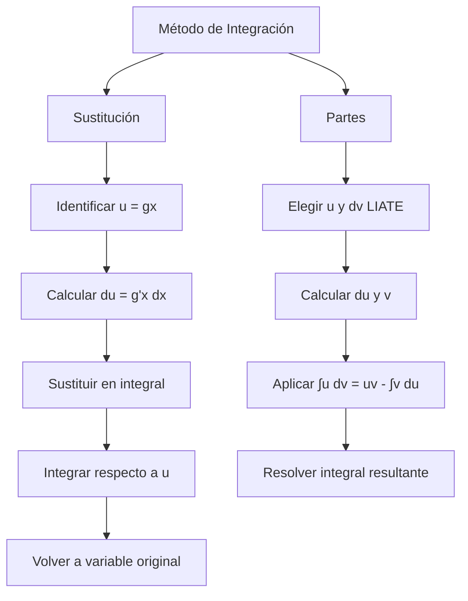

# Matemáticas para Ciencias Aplicadas I - Métodos de integración

## 5.1 Integración por partes. Integración por substitución.

---

### 1. Integración por Sustitución

#### 1.1. Concepto Fundamental

La integración por sustitución es el método análogo a la regla de la cadena para derivadas. Se utiliza cuando una integral contiene una función y su derivada.

**Fórmula general:**

$$\int f(g(x)) \cdot g'(x)  dx = \int f(u)  du$$
donde $u = g(x)$ y $du = g'(x)  dx$

#### 1.2. Procedimiento

1. Identificar $u = g(x)$
2. Calcular $du = g'(x)  dx$
3. Sustituir en la integral original
4. Integrar respecto a $u$
5. Volver a la variable original

#### 1.3. Ejemplo

$$\int 2x \cdot e^{x^2}  dx$$

- Sea $u = x^2$, entonces $du = 2x  dx$
- La integral se convierte en: $\int e^u  du = e^u + C$
- Sustituyendo de vuelta: $e^{x^2} + C$

### 2. Integración por Partes

#### 2.1. Fórmula Fundamental

Basada en la regla del producto para derivadas:

$$ \int u  dv = uv - \int v  du $$

#### 2.2. Elección de u y dv

**Regla LIATE** para elegir $u$ (en orden de preferencia):

- Logarithmic (Logarítmicas)
- Inverse trigonometric (Inversas trigonométricas)
- Algebraic (Algebraicas)
- Trigonometric (Trigonométricas)
- Exponential (Exponenciales)

#### 2.3. Ejemplo

$$ \int x \cdot e^x  dx $$

- Sea $u = x$, $dv = e^x  dx$
- Entonces $du = dx$, $v = e^x$
- Aplicando la fórmula:

$$ \int x e^x  dx = x e^x - \int e^x  dx = x e^x - e^x + C $$

### 3. Implementación Computacional

```python
import sympy as sp
import numpy as np
import matplotlib.pyplot as plt

# Integración por sustitución simbólica
def integracion_sustitucion(expr, x, u):
    x_sym = sp.symbols('x')
    u_expr = u
    du = sp.diff(u_expr, x_sym)

    # Sustituir en la expresión
    expr_sust = expr.subs(u_expr, sp.Symbol('u'))
    expr_sust = expr_sust.subs(du * sp.diff(x_sym), sp.Symbol('du'))

    # Integrar respecto a u
    integral_u = sp.integrate(expr_sust, sp.Symbol('u'))

    # Volver a variable original
    integral_final = integral_u.subs(sp.Symbol('u'), u_expr)

    return integral_final

# Ejemplo de integración por sustitución
x = sp.symbols('x')
expr = 2*x * sp.exp(x**2)
resultado = integracion_sustitucion(expr, x, x**2)
print(f"∫2x e^(x²) dx = {resultado}")

# Integración por partes simbólica
def integracion_partes(expr, x):
    return sp.integrate(expr, x)

# Ejemplo de integración por partes
expr2 = x * sp.exp(x)
resultado2 = integracion_partes(expr2, x)
print(f"∫x e^x dx = {resultado2}")
```

### 4. Diagrama de Procesos



### 5. Ejemplos Detallados

#### 5.1. Sustitución Trigonométrica

$$\int \frac{dx}{\sqrt{1 - x^2}}$$

- Sea $x = \sin \theta$, entonces $dx = \cos \theta  d\theta$
- $\int \frac{\cos \theta  d\theta}{\sqrt{1 - \sin^2 \theta}} = \int \frac{\cos \theta  d\theta}{\cos \theta} = \int d\theta = \theta + C$
- $\theta = \arcsin x$, por tanto: $\arcsin x + C$

#### 5.2. Integración por Partes Múltiple

$$\int x^2 \sin x  dx$$

- Primera aplicación: $u = x^2$, $dv = \sin x  dx$
- $\int x^2 \sin x  dx = -x^2 \cos x + \int 2x \cos x  dx$
- Segunda aplicación: $u = 2x$, $dv = \cos x  dx$
- $\int 2x \cos x  dx = 2x \sin x - \int 2 \sin x  dx = 2x \sin x + 2 \cos x$
- Resultado final: $-x^2 \cos x + 2x \sin x + 2 \cos x + C$

### 6. Aplicaciones Prácticas

#### 6.1. Cálculo de Áreas

$$\text{Área} = \int_a^b f(x)  dx$$

#### 6.2. Cálculo de Volúmenes

$$\text{Volumen} = \pi \int_a^b [f(x)]^2  dx$$

#### 6.3. Trabajo en Física

$$\text{Trabajo} = \int_a^b F(x)  dx$$

### 7. Ejercicios Resueltos

#### Ejercicio 1

$$\int x \cos(2x)  dx$$
**Solución por partes:**

- $u = x$, $dv = \cos(2x)  dx$
- $du = dx$, $v = \frac{1}{2} \sin(2x)$
- $\int x \cos(2x)  dx = \frac{x}{2} \sin(2x) - \int \frac{1}{2} \sin(2x)  dx$
- $= \frac{x}{2} \sin(2x) + \frac{1}{4} \cos(2x) + C$

#### Ejercicio 2

$$\int \frac{e^x}{1 + e^{2x}}  dx$$
**Solución por sustitución:**

- Sea $u = e^x$, entonces $du = e^x  dx$
- $\int \frac{du}{1 + u^2} = \arctan u + C = \arctan(e^x) + C$

### 8. Ejercicios Propuestos

1. Resuelva las siguientes integrales por sustitución:
   a) $\int x \sqrt{x^2 + 1}  dx$
   b) $\int \frac{\ln x}{x}  dx$
   c) $\int \sin(3x) \cos(3x)  dx$

2. Resuelva las siguientes integrales por partes:
   a) $\int x^2 e^x  dx$
   b) $\int \ln x  dx$
   c) $\int x \sin x  dx$

3. Calcule el área bajo la curva $y = x e^{-x}$ desde $x = 0$ hasta $x = 2$

4. Demuestre que $\int e^{ax} \sin(bx)  dx = \frac{e^{ax}}{a^2 + b^2}(a \sin bx - b \cos bx) + C$

5. Resuelva: $\int \frac{x^3}{\sqrt{1 - x^2}}  dx$

### 9. Referencias

- Stewart, J. (2008). _Cálculo: Trascendentes tempranas_
- Larson, R., & Edwards, B. H. (2009). _Cálculo_
- Thomas, G. B. (2009). _Cálculo de una variable_
- Apostol, T. M. (1967). _Calculus, Vol. 1_

### Ver también

- **3.4** Integral indefinida — las técnicas se aplican a integrales indefinidas y definidas.
- **5.2** Cambio de variable — técnica complementaria.
- **5.3** Métodos numéricos — cuando las técnicas analíticas no bastan.

### Referencias

- Stewart, J. (2016). _Cálculo de una variable_ (8.ª ed.). Cengage Learning.
- Simmons, G. F. (2012). _Cálculo con geometría analítica_ (2.ª ed.). McGraw-Hill.
- Thomas, G. B. et al. (2014). _Cálculo_ (13.ª ed.). Pearson.
