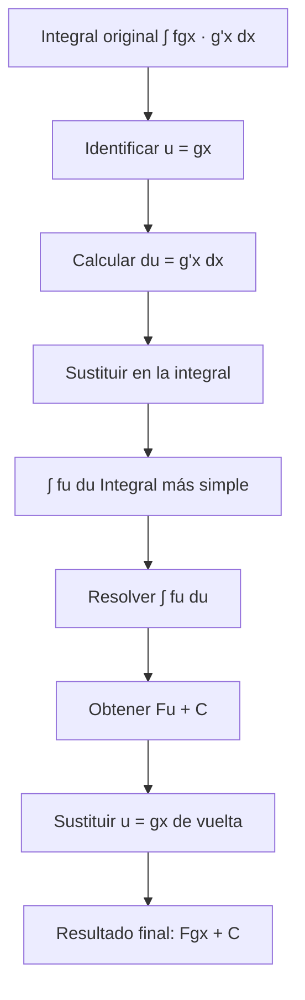

# Matemáticas para Ciencias Aplicadas I - Métodos de integración

## 5.2 Cambio de variable.

---

### 1. Concepto del Método de Cambio de Variable

El método de cambio de variable (o sustitución) es una técnica de integración que permite transformar una integral compleja en una más simple mediante la sustitución de la variable de integración.

**Base teórica:** Es el análogo inverso de la regla de la cadena para derivadas.

### 2. Fórmula Fundamental

Si $u = g(x)$ es una función derivable cuyo rango es un intervalo $I$, y $f$ es continua en $I$, entonces:

$$\int f(g(x)) \cdot g'(x)  dx = \int f(u)  du$$

donde:

- $u = g(x)$ (nueva variable)
- $du = g'(x)  dx$ (diferencial de la nueva variable)

### 3. Procedimiento Paso a Paso

#### 3.1. Algoritmo General

1. **Identificar** la sustitución adecuada: $u = g(x)$
2. **Calcular** el diferencial: $du = g'(x)  dx$
3. **Expresar** la integral en términos de $u$
4. **Resolver** la integral más simple
5. **Sustituir** de vuelta a la variable original

#### 3.2. Cambios de Variable Comunes

| Tipo de Integral              | Sustitución recomendada |
| ----------------------------- | ----------------------- |
| $\int f(ax + b)  dx$          | $u = ax + b$            |
| $\int f(x^n) x^{n-1}  dx$     | $u = x^n$               |
| $\int \frac{f'(x)}{f(x)}  dx$ | $u = f(x)$              |
| $\int \sin^n x \cos x  dx$    | $u = \sin x$            |
| $\int \cos^n x \sin x  dx$    | $u = \cos x$            |

### 4. Implementación Computacional

```python
import sympy as sp
import numpy as np

# Función para demostrar cambio de variable
def cambio_variable(integral, sustitucion, variable_original):
    """
    Demuestra el proceso de cambio de variable
    """
    x = sp.symbols(variable_original)
    u = sp.symbols('u')

    # Aplicar la sustitución
    expr_sust = integral.subs(sustitucion, u)
    derivada = sp.diff(sustitucion, x)
    du = derivada * sp.diff(x)

    # Mostrar pasos
    print(f"Integral original: ∫ {integral} d{variable_original}")
    print(f"Sustitución: u = {sustitucion}")
    print(f"d{u} = {derivada} d{variable_original}")
    print(f"Integral transformada: ∫ {expr_sust/derivada} d{u}")

    # Resolver la integral
    integral_u = sp.integrate(expr_sust/derivada, u)
    print(f"Resultado en términos de u: {integral_u}")

    # Sustituir de vuelta
    resultado_final = integral_u.subs(u, sustitucion)
    print(f"Resultado final: {resultado_final} + C")

    return resultado_final

# Ejemplo 1: ∫ 2x cos(x²) dx
print("=== EJEMPLO 1 ===")
x = sp.symbols('x')
integral1 = 2*x * sp.cos(x**2)
cambio_variable(integral1, x**2, 'x')

print("\n=== EJEMPLO 2 ===")
# Ejemplo 2: ∫ sin³x cosx dx
integral2 = sp.sin(x)**3 * sp.cos(x)
cambio_variable(integral2, sp.sin(x), 'x')
```

### 5. Diagrama del Proceso de Cambio de Variable



### 6. Casos Especiales y Sustituciones Trigonométricas

#### 6.1. Sustituciones Trigonométricas Estándar

| Expresión en la integral | Sustitución recomendada | Identidad útil                      |
| ------------------------ | ----------------------- | ----------------------------------- |
| $\sqrt{a^2 - x^2}$       | $x = a \sin \theta$     | $1 - \sin^2 \theta = \cos^2 \theta$ |
| $\sqrt{a^2 + x^2}$       | $x = a \tan \theta$     | $1 + \tan^2 \theta = \sec^2 \theta$ |
| $\sqrt{x^2 - a^2}$       | $x = a \sec \theta$     | $\sec^2 \theta - 1 = \tan^2 \theta$ |

#### 6.2. Ejemplo: Sustitución Trigonométrica

$$\int \frac{dx}{\sqrt{4 - x^2}}$$

- Sustitución: $x = 2 \sin \theta$, entonces $dx = 2 \cos \theta  d\theta$
- $\int \frac{2 \cos \theta  d\theta}{\sqrt{4 - 4 \sin^2 \theta}} = \int \frac{2 \cos \theta  d\theta}{2 \cos \theta} = \int d\theta = \theta + C$
- $\theta = \arcsin\left(\frac{x}{2}\right)$, por tanto: $\arcsin\left(\frac{x}{2}\right) + C$

### 7. Ejercicios Resueltos

#### Ejercicio 1

$$\int x \sqrt{x^2 + 1}  dx$$

**Solución:**

- Sea $u = x^2 + 1$, entonces $du = 2x  dx$ ⇒ $x  dx = \frac{du}{2}$
- $\int \sqrt{u} \cdot \frac{du}{2} = \frac{1}{2} \int u^{1/2}  du = \frac{1}{2} \cdot \frac{2}{3} u^{3/2} + C = \frac{1}{3} (x^2 + 1)^{3/2} + C$

#### Ejercicio 2

$$\int \frac{e^x}{1 + e^{2x}}  dx$$

**Solución:**

- Sea $u = e^x$, entonces $du = e^x  dx$
- $\int \frac{du}{1 + u^2} = \arctan u + C = \arctan(e^x) + C$

#### Ejercicio 3

$$\int \frac{\cos(\sqrt{x})}{\sqrt{x}}  dx$$

**Solución:**

- Sea $u = \sqrt{x} = x^{1/2}$, entonces $du = \frac{1}{2}x^{-1/2}  dx = \frac{1}{2\sqrt{x}}  dx$
- $\int \cos u \cdot 2  du = 2 \int \cos u  du = 2 \sin u + C = 2 \sin(\sqrt{x}) + C$

### 8. Aplicaciones del Método

#### 8.1. Cálculo de Áreas

El cambio de variable permite calcular áreas bajo curvas complejas transformándolas en formas más simples.

#### 8.2. Problemas de Física

- Cálculo de trabajo variable
- Centroides y momentos de inercia
- Problemas de movimiento

#### 8.3. Probabilidad y Estadística

- Transformación de variables aleatorias
- Cálculo de valores esperados

### 9. Ejercicios Propuestos

Resuelva las siguientes integrales usando el método de cambio de variable:

1. $\int x^2 (x^3 + 1)^4  dx$
2. $\int \frac{\sin x}{\cos^2 x}  dx$
3. $\int \frac{dx}{x \ln x}$
4. $\int \tan x  dx$
5. $\int \frac{x}{\sqrt{1 - x^4}}  dx$
6. $\int e^{3x} \sqrt{1 + e^{3x}}  dx$
7. $\int \frac{\arctan x}{1 + x^2}  dx$
8. $\int \sin(2x) \cos^3(2x)  dx$

### 10. Referencias

- Stewart, J. (2008). _Cálculo: Trascendentes tempranas_
- Larson, R., & Edwards, B. H. (2009). _Cálculo_
- Thomas, G. B. (2009). _Cálculo de una variable_
- Apostol, T. M. (1967). _Calculus, Vol. 1_

### Ver también

- **5.1** Integración por partes — técnica complementaria al cambio de variable.
- **4.2** Regla de la cadena — el cambio de variable invierte la regla de la cadena.
- **Matemáticas CC III 1.1** (Sem. 3) — cambio de variable en integrales múltiples.

### Referencias

- Stewart, J. (2016). _Cálculo de una variable_ (8.ª ed.). Cengage Learning.
- Simmons, G. F. (2012). _Cálculo con geometría analítica_ (2.ª ed.). McGraw-Hill.
- Thomas, G. B. et al. (2014). _Cálculo_ (13.ª ed.). Pearson.
