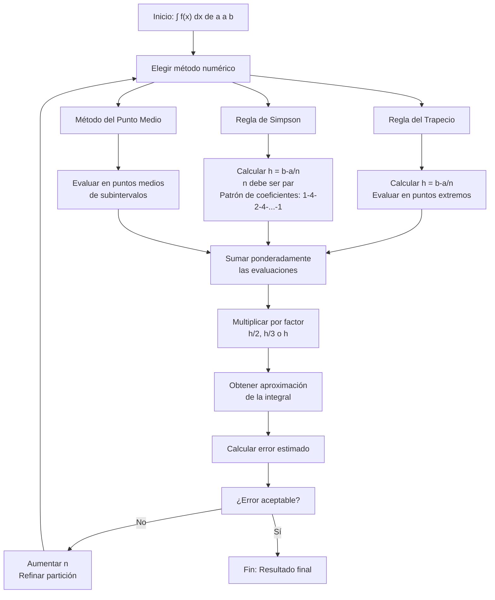

# Matemáticas para Ciencias Aplicadas I - Métodos de integración

## 5.3 Métodos numéricos.

---

### 1. Introducción a la Integración Numérica

La integración numérica es el estudio de cómo calcular el valor aproximado de una integral definida:

$$I = \int_a^b f(x)  dx$$

cuando no es posible o es muy difícil encontrar una antiderivada explícita de $f(x)$.

### 2. Métodos Básicos de Integración Numérica

#### 2.1. Regla del Rectángulo (Punto Medio)

**Fórmula:**

$$\int_a^b f(x)  dx \approx (b - a) \cdot f\left(\frac{a + b}{2}\right)$$

**Error:** $E \leq \frac{(b - a)^3}{24} \max|f''(x)|$

#### 2.2. Regla del Trapecio

**Fórmula:**

$$\int_a^b f(x)  dx \approx \frac{b - a}{2} [f(a) + f(b)]$$

**Error:** $E \leq \frac{(b - a)^3}{12} \max|f''(x)|$

#### 2.3. Regla de Simpson

**Fórmula:**

$$\int_a^b f(x)  dx \approx \frac{b - a}{6} [f(a) + 4f\left(\frac{a + b}{2}\right) + f(b)]$$

**Error:** $E \leq \frac{(b - a)^5}{2880} \max|f^{(4)}(x)|$

### 3. Métodos Compuestos

#### 3.1. Regla del Trapecio Compuesta

Dividimos $[a, b]$ en $n$ subintervalos de igual longitud $h = \frac{b - a}{n}$:

$$\int_a^b f(x)  dx \approx \frac{h}{2} [f(x_0) + 2\sum_{i=1}^{n-1} f(x_i) + f(x_n)]$$

#### 3.2. Regla de Simpson Compuesta

Requiere $n$ par:

$$\int_a^b f(x)  dx \approx \frac{h}{3} [f(x_0) + 4\sum_{i=1,3,5}^{n-1} f(x_i) + 2\sum_{i=2,4,6}^{n-2} f(x_i) + f(x_n)]$$

### 4. Implementación Computacional

```python
import numpy as np
import matplotlib.pyplot as plt

def trapecio_compuesto(f, a, b, n):
    """
    Regla del trapecio compuesta
    """
    h = (b - a) / n
    x = np.linspace(a, b, n + 1)
    suma = f(a) + f(b)

    for i in range(1, n):
        suma += 2 * f(x[i])

    return (h / 2) * suma

def simpson_compuesto(f, a, b, n):
    """
    Regla de Simpson compuesta (n debe ser par)
    """
    if n % 2 != 0:
        n += 1  # Aseguramos que n sea par

    h = (b - a) / n
    x = np.linspace(a, b, n + 1)
    suma = f(a) + f(b)

    # Términos impares (coeficiente 4)
    for i in range(1, n, 2):
        suma += 4 * f(x[i])

    # Términos pares (coeficiente 2)
    for i in range(2, n - 1, 2):
        suma += 2 * f(x[i])

    return (h / 3) * suma

# Ejemplo: ∫ sen(x) dx de 0 a π (valor exacto: 2)
def f(x):
    return np.sin(x)

a, b = 0, np.pi
n = 10

trapecio_result = trapecio_compuesto(f, a, b, n)
simpson_result = simpson_compuesto(f, a, b, n)
exacto = 2.0

print(f"Trapecio compuesto (n={n}): {trapecio_result:.6f}")
print(f"Simpson compuesto (n={n}): {simpson_result:.6f}")
print(f"Valor exacto: {exacto:.6f}")
print(f"Error trapecio: {abs(trapecio_result - exacto):.6f}")
print(f"Error Simpson: {abs(simpson_result - exacto):.6f}")

# Visualización
def visualizar_integracion(f, a, b, n):
    x_vals = np.linspace(a, b, 1000)
    y_vals = f(x_vals)

    plt.figure(figsize=(10, 6))
    plt.plot(x_vals, y_vals, 'b-', label='f(x)')
    plt.fill_between(x_vals, y_vals, alpha=0.3)

    # Puntos de evaluación
    x_eval = np.linspace(a, b, n + 1)
    y_eval = f(x_eval)
    plt.plot(x_eval, y_eval, 'ro', label='Puntos de evaluación')

    plt.title(f'Integración numérica de f(x) entre {a} y {b}')
    plt.xlabel('x')
    plt.ylabel('f(x)')
    plt.legend()
    plt.grid(True)
    plt.show()

visualizar_integracion(f, a, b, n)
```

### 5. Diagrama de Flujo de los Métodos Numéricos



### 6. Análisis de Error y Convergencia

#### 6.1. Orden de Convergencia

| Método     | Orden de convergencia | Error |
| ---------- | --------------------- | ----- |
| Rectángulo | O(h)                  | O(h²) |
| Trapecio   | O(h²)                 | O(h²) |
| Simpson    | O(h⁴)                 | O(h⁴) |

#### 6.2. Estimación del Error

**Para trapecio compuesto:**

$$E_T \leq \frac{(b - a)^3}{12n^2} \max_{x \in [a,b]} |f''(x)|$$

**Para Simpson compuesto:**

$$E_S \leq \frac{(b - a)^5}{180n^4} \max_{x \in [a,b]} |f^{(4)}(x)|$$

### 7. Ejercicios Resueltos

#### Ejercicio 1

Aproximar $\int_0^1 e^{-x^2}  dx$ usando la regla del trapecio con $n = 4$

**Solución:**

- $h = \frac{1 - 0}{4} = 0.25$
- Puntos: $x_0 = 0, x_1 = 0.25, x_2 = 0.5, x_3 = 0.75, x_4 = 1$
- $\approx \frac{0.25}{2} [f(0) + 2f(0.25) + 2f(0.5) + 2f(0.75) + f(1)]$
- $\approx 0.125 [1 + 2(0.939) + 2(0.779) + 2(0.570) + 0.368] \approx 0.743$

#### Ejercicio 2

Aproximar $\int_0^{\pi} \sin x  dx$ usando Simpson con $n = 4$

**Solución:**

- $h = \frac{\pi}{4} = 0.7854$
- $\approx \frac{\pi}{12} [\sin 0 + 4\sin(\pi/4) + 2\sin(\pi/2) + 4\sin(3\pi/4) + \sin \pi]$
- $\approx \frac{3.1416}{12} [0 + 4(0.7071) + 2(1) + 4(0.7071) + 0] \approx 2.004$

### 8. Aplicaciones Prácticas

#### 8.1. Física y Ingeniería

- Cálculo de trabajo variable
- Centro de masa y momentos de inercia
- Análisis de señales

#### 8.2. Economía y Finanzas

- Cálculo de valor presente neto
- Análisis de curvas de demanda

#### 8.3. Ciencias de la Computación

- Gráficos por computadora
- Visión artificial
- Aprendizaje automático

### 9. Ejercicios Propuestos

1. Aproxime $\int_0^1 x^2  dx$ usando:
   a) Trapecio con n = 4
   b) Simpson con n = 4
   c) Compare con el valor exacto

2. Calcule $\int_1^2 \frac{1}{x}  dx$ usando trapecio compuesto con n = 6

3. Estime el error para $\int_0^1 e^x  dx$ usando trapecio con n = 8

4. Implemente el método del punto medio compuesto en Python

5. Compare la convergencia de trapecio vs Simpson para $\int_0^1 \sin(x^2)  dx$

6. Calcule $\int_0^{\pi/2} \cos x  dx$ usando n = 6 subintervalos con ambos métodos

7. Investigue y describa el método de Romberg para integración numérica

8. Aplique integración numérica para calcular el área bajo una curva normal estándar entre -1 y 1

### 10. Referencias

- Burden, R. L., & Faires, J. D. (2010). _Análisis Numérico_
- Chapra, S. C., & Canale, R. P. (2010). _Métodos numéricos para ingenieros_
- Stoer, J., & Bulirsch, R. (2002). _Introduction to Numerical Analysis_
- Press, W. H., et al. (2007). _Numerical Recipes: The Art of Scientific Computing_

### Ver también

- **5.1–5.2** Técnicas analíticas — cuando estas no bastan se recurre a métodos numéricos.
- **4.4** Raíces de polinomios — raíces por métodos numéricos (Newton).
- **4.1** Método de Newton — técnica numérica aplicada también a integrales.

### Referencias

- Stewart, J. (2016). _Cálculo de una variable_ (8.ª ed.). Cengage Learning.
- Simmons, G. F. (2012). _Cálculo con geometría analítica_ (2.ª ed.). McGraw-Hill.
- Thomas, G. B. et al. (2014). _Cálculo_ (13.ª ed.). Pearson.
