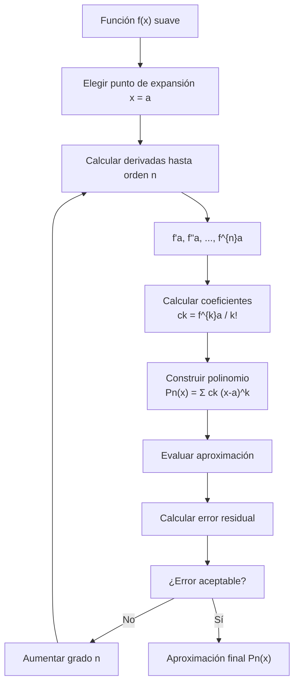

# Matemáticas para Ciencias Aplicadas I - Series

## 6.1 Polinomio de Taylor.

---

### 1. Introducción al Polinomio de Taylor

El polinomio de Taylor es una herramienta fundamental en cálculo que permite aproximar funciones suaves mediante polinomios. Proporciona una manera de representar funciones complejas localmente alrededor de un punto usando sus derivadas.

### 2. Fórmula del Polinomio de Taylor

#### 2.1. Polinomio de Taylor de grado n

Para una función $f$ n-veces derivable en $x = a$, el polinomio de Taylor de grado $n$ centrado en $a$ es:

$$ P_n(x) = f(a) + f'(a)(x - a) + \frac{f''(a)}{2!}(x - a)^2 + \cdots + \frac{f^{(n)}(a)}{n!}(x - a)^n $$

En notación sigma:

$$ P_n(x) = \sum_{k=0}^n \frac{f^{(k)}(a)}{k!}(x - a)^k $$

#### 2.2. Caso Especial: Serie de Maclaurin

Cuando $a = 0$, obtenemos la serie de Maclaurin:

$$ P_n(x) = f(0) + f'(0)x + \frac{f''(0)}{2!}x^2 + \cdots + \frac{f^{(n)}(0)}{n!}x^n $$

### 3. Implementación Computacional

```python
import numpy as np
import matplotlib.pyplot as plt
import sympy as sp

def taylor_polynomial(f, a, n, x):
    """
    Calcula el polinomio de Taylor de grado n para f en x = a
    """
    x_sym = sp.symbols('x')
    taylor_sum = 0

    for k in range(n + 1):
        # Calcular la k-ésima derivada en x = a
        derivada_k = sp.diff(f, x_sym, k)
        derivada_en_a = derivada_k.subs(x_sym, a)

        # Término del polinomio
        termino = (derivada_en_a / sp.factorial(k)) * (x - a)**k
        taylor_sum += termino

    return taylor_sum

# Ejemplo: Polinomio de Taylor para e^x alrededor de x = 0
x_sym = sp.symbols('x')
f = sp.exp(x_sym)
a = 0
grado = 4

# Calcular polinomio
P4 = taylor_polynomial(f, a, grado, x_sym)
print(f"Polinomio de Taylor de grado {grado} para e^x:")
print(P4)

# Evaluar y comparar
x_vals = np.linspace(-2, 2, 100)
f_exact = np.exp(x_vals)
P4_func = sp.lambdify(x_sym, P4, 'numpy')
P4_vals = P4_func(x_vals)

# Graficar
plt.figure(figsize=(10, 6))
plt.plot(x_vals, f_exact, 'b-', label='e^x (exacta)')
plt.plot(x_vals, P4_vals, 'r--', label=f'P_{grado}(x)')
plt.axvline(x=a, color='g', linestyle=':', label=f'Centro x = {a}')
plt.title('Aproximación de Taylor para e^x')
plt.xlabel('x')
plt.ylabel('f(x)')
plt.legend()
plt.grid(True)
plt.show()
```

### 4. Diagrama del Proceso de Aproximación de Taylor



### 5. Polinomios de Taylor para Funciones Comunes

#### 5.1. Función Exponencial (e^x)

$$e^x \approx 1 + x + \frac{x^2}{2!} + \frac{x^3}{3!} + \cdots + \frac{x^n}{n!}$$

#### 5.2. Función Seno

$$\sin x \approx x - \frac{x^3}{3!} + \frac{x^5}{5!} - \frac{x^7}{7!} + \cdots$$

#### 5.3. Función Coseno

$$\cos x \approx 1 - \frac{x^2}{2!} + \frac{x^4}{4!} - \frac{x^6}{6!} + \cdots$$

#### 5.4. Logaritmo Natural (ln(1+x))

$$\ln(1 + x) \approx x - \frac{x^2}{2} + \frac{x^3}{3} - \frac{x^4}{4} + \cdots$$

### 6. Error de Aproximación

#### 6.1. Término Residual (Resto de Lagrange)

$$R_n(x) = f(x) - P_n(x) = \frac{f^{(n+1)}(c)}{(n+1)!}(x - a)^{n+1}$$

donde $c$ está entre $a$ y $x$

#### 6.2. Cota del Error

$$|R_n(x)| \leq \frac{M}{(n+1)!}|x - a|^{n+1}$$

donde $M = \max |f^{(n+1)}(z)|$ para $z$ entre $a$ y $x$

### 7. Ejercicios Resueltos

#### Ejercicio 1

Encontrar el polinomio de Taylor de grado 3 para $f(x) = \sqrt{x}$ alrededor de $x = 1$

**Solución:**

- $f(1) = 1$
- $f'(x) = \frac{1}{2}x^{-1/2}$, $f'(1) = \frac{1}{2}$
- $f''(x) = -\frac{1}{4}x^{-3/2}$, $f''(1) = -\frac{1}{4}$
- $f'''(x) = \frac{3}{8}x^{-5/2}$, $f'''(1) = \frac{3}{8}$

$$P_3(x) = 1 + \frac{1}{2}(x-1) - \frac{1}{8}(x-1)^2 + \frac{1}{16}(x-1)^3$$

#### Ejercicio 2

Estimar el error al aproximar $e^{0.1}$ con el polinomio de Taylor de grado 2

**Solución:**

- $P_2(x) = 1 + x + \frac{x^2}{2}$
- $P_2(0.1) = 1 + 0.1 + 0.005 = 1.105$
- Error: $|R_2(0.1)| \leq \frac{e^c}{3!}(0.1)^3 \leq \frac{e^{0.1}}{6}(0.001) \approx 0.000183$

### 8. Aplicaciones del Polinomio de Taylor

#### 8.1. Aproximación Numérica

- Cálculo de funciones trascendentes
- Implementación en calculadoras y computadoras

#### 8.2. Análisis de Límites

- Resolución de indeterminaciones
- Comportamiento local de funciones

#### 8.3. Física e Ingeniería

- Linealización de ecuaciones diferenciales
- Análisis de pequeñas oscilaciones
- Teoría de perturbaciones

#### 8.4. Optimización

- Métodos de optimización numérica
- Algoritmos de machine learning

### 9. Ejercicios Propuestos

1. Encuentre el polinomio de Taylor de grado 4 para $f(x) = \cos x$ alrededor de $x = 0$

2. Calcule el polinomio de Taylor de grado 3 para $f(x) = \ln x$ alrededor de $x = 1$

3. Use el polinomio de Taylor de grado 2 para aproximar $\sqrt{4.1}$ y estime el error

4. Encuentre el polinomio de Taylor de grado 5 para $f(x) = \sin x$ alrededor de $x = \pi/2$

5. Demuestre que el polinomio de Taylor para $e^x$ converge a la función para todo $x$

6. Implemente en Python una función que calcule el polinomio de Taylor para cualquier función dada

7. Compare las aproximaciones de Taylor para $\sin x$ con diferentes grados

8. Investigue y explique la diferencia entre serie de Taylor y serie de Maclaurin

### 10. Referencias

- Stewart, J. (2008). _Cálculo: Trascendentes tempranas_
- Apostol, T. M. (1967). _Calculus, Vol. 1_
- Thomas, G. B. (2009). _Cálculo de una variable_
- Kreyszig, E. (2011). _Advanced Engineering Mathematics_

### Ver también

- **4.5** Función exponencial — la serie de Taylor es el ejemplo fundamental.
- **2.8** Derivadas de orden superior — el polinomio de Taylor usa derivadas de todo orden.
- **6.2** Cálculo de funciones con series — aplicación directa del polinomio.

### Referencias

- Stewart, J. (2016). _Cálculo de una variable_ (8.ª ed.). Cengage Learning.
- Simmons, G. F. (2012). _Cálculo con geometría analítica_ (2.ª ed.). McGraw-Hill.
- Thomas, G. B. et al. (2014). _Cálculo_ (13.ª ed.). Pearson.
