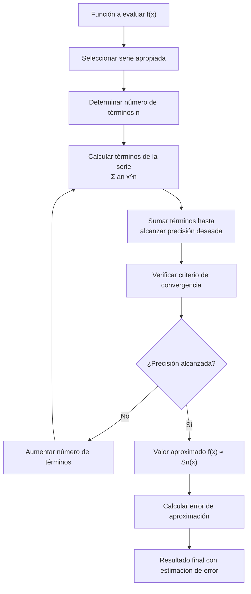

# Matemáticas para Ciencias Aplicadas I - Series

## 6.2 Cálculo de valores de una función con ayuda de las series.

---

### 1. Introducción al Cálculo con Series

El cálculo de valores de funciones mediante series es una técnica fundamental en matemáticas aplicadas que permite evaluar funciones complejas utilizando aproximaciones polinómicas. Este método es especialmente útil para funciones trascendentes que no tienen expresiones algebraicas simples.

### 2. Series de Potencias para Funciones Elementales

#### 2.1. Función Exponencial

$$e^x = \sum_{n=0}^{\infty} \frac{x^n}{n!} = 1 + x + \frac{x^2}{2!} + \frac{x^3}{3!} + \cdots$$

**Radio de convergencia:** $\infty$

#### 2.2. Funciones Trigonométricas

$$\sin x = \sum_{n=0}^{\infty} \frac{(-1)^n x^{2n+1}}{(2n+1)!} = x - \frac{x^3}{3!} + \frac{x^5}{5!} - \cdots$$

$$\cos x = \sum_{n=0}^{\infty} \frac{(-1)^n x^{2n}}{(2n)!} = 1 - \frac{x^2}{2!} + \frac{x^4}{4!} - \cdots$$

**Radio de convergencia:** $\infty$

#### 2.3. Logaritmo Natural

$$\ln(1 + x) = \sum_{n=1}^{\infty} \frac{(-1)^{n+1} x^n}{n} = x - \frac{x^2}{2} + \frac{x^3}{3} - \cdots$$

**Radio de convergencia:** $(-1, 1]$

#### 2.4. Función Arctangente

$$\arctan x = \sum_{n=0}^{\infty} \frac{(-1)^n x^{2n+1}}{2n+1} = x - \frac{x^3}{3} + \frac{x^5}{5} - \cdots$$

**Radio de convergencia:** $[-1, 1]$

### 3. Implementación Computacional

```python
import numpy as np
import matplotlib.pyplot as plt
import math

def calcular_serie(funcion, x, n_terminos):
    """
    Calcula el valor de una función usando su serie de potencias
    """
    resultado = 0
    for n in range(n_terminos):
        if funcion == 'exp':
            termino = x**n / math.factorial(n)
        elif funcion == 'sin':
            termino = (-1)**n * x**(2*n+1) / math.factorial(2*n+1)
        elif funcion == 'cos':
            termino = (-1)**n * x**(2*n) / math.factorial(2*n)
        elif funcion == 'ln':
            termino = (-1)**(n+1) * x**n / n if n > 0 else 0
        elif funcion == 'arctan':
            termino = (-1)**n * x**(2*n+1) / (2*n+1)
        else:
            raise ValueError("Función no soportada")

        resultado += termino

    return resultado

# Ejemplo: Calcular e^0.5 con 10 términos
x_valor = 0.5
n_terminos = 10

# Cálculo con serie
exp_aprox = calcular_serie('exp', x_valor, n_terminos)
exp_exacto = math.exp(x_valor)

# Cálculo de error
error_absoluto = abs(exp_exacto - exp_aprox)
error_relativo = error_absoluto / exp_exacto

print(f"e^{x_valor} aproximado: {exp_aprox:.8f}")
print(f"e^{x_valor} exacto: {exp_exacto:.8f}")
print(f"Error absoluto: {error_absoluto:.8f}")
print(f"Error relativo: {error_relativo:.8f}")

# Análisis de convergencia
terminos = range(1, 20)
errores = []
for n in terminos:
    aprox = calcular_serie('exp', x_valor, n)
    error = abs(math.exp(x_valor) - aprox)
    errores.append(error)

plt.figure(figsize=(10, 6))
plt.plot(terminos, errores, 'bo-')
plt.xlabel('Número de términos')
plt.ylabel('Error absoluto')
plt.title('Convergencia de la serie de Taylor para e^x')
plt.grid(True)
plt.yscale('log')
plt.show()
```

### 4. Diagrama de Proceso de Cálculo con Series



### 5. Estrategias para Mejorar la Convergencia

#### 5.1. Reducción de Argumento

Para funciones periódicas como $\sin x$ y $\cos x$, usar:

$$\sin x = \sin(x - 2\pi k)$$

donde $k$ es elegido para minimizar $|x - 2\pi k|$

#### 5.2. Identidades Trigonométricas

$$\sin x = 2\sin\left(\frac{x}{2}\right)\cos\left(\frac{x}{2}\right)$$

#### 5.3. Transformaciones de Argumento

Para $\ln x$ cuando $x$ está cerca de 1:

$$ \ln x = 2\sum_{n=0}^{\infty} \frac{1}{2n+1} \left(\frac{x-1}{x+1}\right)^{2n+1} $$

### 6. Estimación del Error y Precisión

#### 6.1. Error de Truncamiento

Para series alternantes:

$$ |R_n| \leq |a_{n+1}| $$

#### 6.2. Criterio de Parada

Detener la suma cuando:

$$|a_n| < \epsilon$$

donde $\epsilon$ es la tolerancia deseada

#### 6.3. Precisión Numérica

Número de términos necesarios para $d$ dígitos de precisión:

$$ \frac{M}{(n+1)!}|x|^{n+1} < 10^{-d} $$

### 7. Ejercicios Resueltos

#### Ejercicio 1

Calcular $\sin(0.5)$ con error menor a $10^{-6}$

**Solución:**

Serie: $\sin x = x - \frac{x^3}{6} + \frac{x^5}{120} - \frac{x^7}{5040} + \cdots$

Términos necesarios hasta que $|a_n| < 10^{-6}$:

- $a_1 = 0.5$
- $a_3 = 0.0208333$
- $a_5 = 0.0002604$
- $a_7 = 0.0000027$ ✓

$$\sin(0.5) \approx 0.5 - 0.0208333 + 0.0002604 = 0.4794271$$

#### Ejercicio 2

Calcular $e^{-2}$ con 5 términos de la serie

**Solución:**

$$e^{-2} \approx 1 - 2 + \frac{4}{2} - \frac{8}{6} + \frac{16}{24} = 1 - 2 + 2 - 1.3333 + 0.6667 = 0.3334$$

### 8. Aplicaciones Prácticas

#### 8.1. Cálculo Científico

- Implementación en librerías matemáticas
- Algoritmos para calculadoras y computadoras

#### 8.2. Física Computacional

- Solución de ecuaciones diferenciales
- Cálculo de integrales definidas

#### 8.3. Ingeniería

- Análisis de señales
- Procesamiento de imágenes
- Simulación numérica

#### 8.4. Finanzas Computacionales

- Cálculo de opciones financieras
- Modelos de tasas de interés

### 9. Ejercicios Propuestos

1. Calcule $\cos(0.8)$ usando 6 términos de la serie y estime el error
2. Determine cuántos términos se necesitan para calcular $e^3$ con error menor a $10^{-8}$
3. Implemente en Python una función que calcule $\ln(1.2)$ usando serie hasta alcanzar precisión de $10^{-10}$
4. Calcule $\arctan(0.3)$ con error menor a $10^{-6}$
5. Compare el número de términos necesarios para calcular $e^{10}$ vs $e^{0.1}$ con la misma precisión
6. Use la identidad $\sin x = \cos(\pi/2 - x)$ para calcular $\sin(1.2)$
7. Investigue y implemente el método de reducción de argumento para $\sin x$
8. Calcule $\sqrt{e}$ usando la serie de $e^x$ y estime el error cometido

### 10. Referencias

- Abramowitz, M., & Stegun, I. A. (1964). _Handbook of Mathematical Functions_
- Press, W. H., et al. (2007). _Numerical Recipes: The Art of Scientific Computing_
- Stoer, J., & Bulirsch, R. (2002). _Introduction to Numerical Analysis_
- Kreyszig, E. (2011). _Advanced Engineering Mathematics_

### Ver también

- **6.1** Polinomio de Taylor — base de las aproximaciones de este subtema.
- **4.5** Funciones logarítmicas y exponenciales — cálculo de sus valores con series.
- **Matemáticas CC II 5.1** (Sem. 2) — aproximación polinomial en varias variables.

### Referencias

- Stewart, J. (2016). _Cálculo de una variable_ (8.ª ed.). Cengage Learning.
- Simmons, G. F. (2012). _Cálculo con geometría analítica_ (2.ª ed.). McGraw-Hill.
- Thomas, G. B. et al. (2014). _Cálculo_ (13.ª ed.). Pearson.
