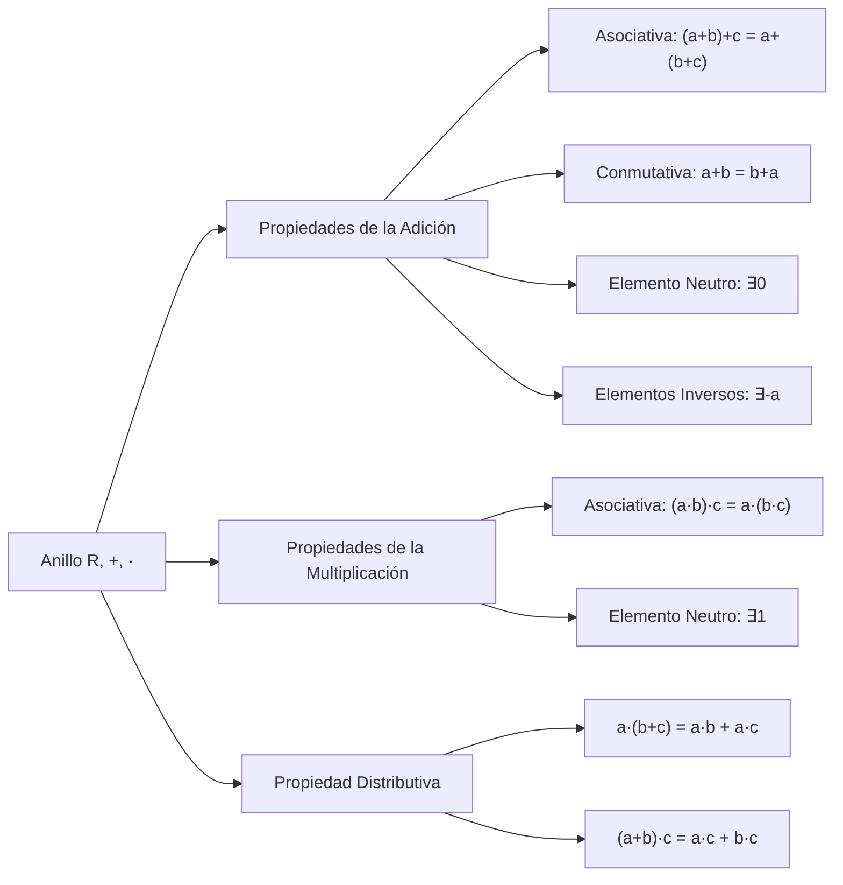
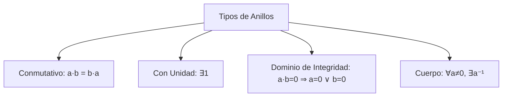

# Álgebra Superior II - Números enteros

## 1.1 El anillo de los números enteros.

---

### 1. Introducción a la Estructura de Anillo

El conjunto de los números enteros $\mathbb{Z} = \{..., -3, -2, -1, 0, 1, 2, 3, ...\}$ tiene una estructura algebraica conocida como **anillo**. Un anillo es un conjunto equipado con dos operaciones binarias que generalizan las operaciones aritméticas de adición y multiplicación.

### 2. Definición Formal de Anillo

Un anillo es una terna $(R, +, \cdot)$ donde $R$ es un conjunto y $+$, $\cdot$ son operaciones binarias en $R$ que satisfacen:

#### 2.1. Axiomas de la Adición

1. **Asociatividad:** $(a + b) + c = a + (b + c)$
2. **Conmutatividad:** $a + b = b + a$
3. **Elemento neutro:** $\exists 0 \in R$ tal que $a + 0 = a$
4. **Elemento inverso:** $\forall a \in R, \exists (-a) \in R$ tal que $a + (-a) = 0$

#### 2.2. Axiomas de la Multiplicación

5. **Asociatividad:** $(a \cdot b) \cdot c = a \cdot (b \cdot c)$
6. **Elemento neutro:** $\exists 1 \in R$ tal que $a \cdot 1 = a$

#### 2.3. Propiedad Distributiva

7. **Distributividad:** $a \cdot (b + c) = a \cdot b + a \cdot c$ y $(a + b) \cdot c = a \cdot c + b \cdot c$

### 3. El Anillo $\mathbb{Z}$ de los Enteros

#### 3.1. Propiedades de $(\mathbb{Z}, +, \cdot)$

- **Anillo conmutativo:** $a \cdot b = b \cdot a$
- **Anillo con unidad:** Posee elemento neutro multiplicativo $1$
- **Dominio de integridad:** Si $a \cdot b = 0$ entonces $a = 0$ o $b = 0$
- **No es cuerpo:** No todos los elementos tienen inverso multiplicativo

#### 3.2. Tablas de Operaciones

**Adición en $\mathbb{Z}_5$:**

| +   | 0   | 1   | 2   | 3   | 4   |
| --- | --- | --- | --- | --- | --- |
| 0   | 0   | 1   | 2   | 3   | 4   |
| 1   | 1   | 2   | 3   | 4   | 0   |
| 2   | 2   | 3   | 4   | 0   | 1   |
| 3   | 3   | 4   | 0   | 1   | 2   |
| 4   | 4   | 0   | 1   | 2   | 3   |

**Multiplicación en $\mathbb{Z}_5$:**

| ×   | 0   | 1   | 2   | 3   | 4   |
| --- | --- | --- | --- | --- | --- |
| 0   | 0   | 0   | 0   | 0   | 0   |
| 1   | 0   | 1   | 2   | 3   | 4   |
| 2   | 0   | 2   | 4   | 1   | 3   |
| 3   | 0   | 3   | 1   | 4   | 2   |
| 4   | 0   | 4   | 3   | 2   | 1   |

### 4. Implementación Computacional

```python
class AnilloEnteros:
    def __init__(self, n=None):
        self.n = n  # Para anillos mod n

    def operar(self, a, b, operacion):
        if self.n is None:
            # Anillo de todos los enteros
            if operacion == '+':
                return a + b
            elif operacion == '*':
                return a * b
        else:
            # Anillo módulo n
            if operacion == '+':
                return (a + b) % self.n
            elif operacion == '*':
                return (a * b) % self.n

    def verificar_axiomas(self, a, b, c):
        resultados = {}

        # Axiomas de adición
        resultados['Asociativa +'] = self.operar(self.operar(a, b, '+'), c, '+') == self.operar(a, self.operar(b, c, '+'), '+')
        resultados['Conmutativa +'] = self.operar(a, b, '+') == self.operar(b, a, '+')
        resultados['Neutro +'] = self.operar(a, 0, '+') == a
        resultados['Inverso +'] = self.operar(a, -a, '+') == 0

        # Axiomas de multiplicación
        resultados['Asociativa *'] = self.operar(self.operar(a, b, '*'), c, '*') == self.operar(a, self.operar(b, c, '*'), '*')
        resultados['Neutro *'] = self.operar(a, 1, '*') == a

        # Distributividad
        resultados['Distributiva'] = (self.operar(a, self.operar(b, c, '+'), '*') ==
                                     self.operar(self.operar(a, b, '*'), self.operar(a, c, '*'), '+'))

        return resultados

# Ejemplo de uso
anillo_Z = AnilloEnteros()
anillo_Z5 = AnilloEnteros(5)

a, b, c = 3, 4, 2

print("Verificación en ℤ:")
print(anillo_Z.verificar_axiomas(a, b, c))

print("\nVerificación en ℤ₅:")
print(anillo_Z5.verificar_axiomas(a, b, c))

print(f"\nOperaciones en ℤ₅:")
print(f"{a} + {b} = {anillo_Z5.operar(a, b, '+')} mod 5")
print(f"{a} × {b} = {anillo_Z5.operar(a, b, '*')} mod 5")
```

### 5. Diagrama de la Estructura de Anillo





### 6. Subanillos y Ideales

#### 6.1. Subanillo

Un subconjunto $S \subseteq R$ es un subanillo si:

1. $0, 1 \in S$
2. $\forall a, b \in S: a + b \in S$
3. $\forall a, b \in S: a \cdot b \in S$
4. $\forall a \in S: -a \in S$

#### 6.2. Ideal

Un subconjunto $I \subseteq R$ es un ideal si:

1. $0 \in I$
2. $\forall a, b \in I: a + b \in I$
3. $\forall a \in I, r \in R: r \cdot a \in I$ y $a \cdot r \in I$

**Ejemplo:** $n\mathbb{Z} = \{nk \mid k \in \mathbb{Z}\}$ es ideal de $\mathbb{Z}$

### 7. Elementos Notables en un Anillo

#### 7.1. Elementos Invertibles

$a \in R$ es invertible si $\exists b \in R$ tal que $a \cdot b = 1$

**En $\mathbb{Z}$:** Solo $\pm1$ son invertibles

**En $\mathbb{Z}_n$:** $a$ es invertible si $\gcd(a, n) = 1$

#### 7.2. Divisores de Cero

$a \in R$ es divisor de cero si $\exists b \neq 0$ tal que $a \cdot b = 0$

**En $\mathbb{Z}$:** No hay divisores de cero

**En $\mathbb{Z}_6$:** $2$ y $3$ son divisores de cero

#### 7.3. Elementos Nilpotentes

$a \in R$ es nilpotente si $\exists n > 0$ tal que $a^n = 0$

### 8. Ejercicios Resueltos

#### Ejercicio 1

Demuestre que $(\mathbb{Z}, +, \cdot)$ es un anillo conmutativo con unidad

**Solución:**

- Asociatividad y conmutatividad de + y · se heredan de propiedades aritméticas
- Elemento neutro aditivo: 0
- Elemento neutro multiplicativo: 1
- Inverso aditivo: $-a$
- Distributividad: $a(b + c) = ab + ac$

#### Ejercicio 2

Encuentre los elementos invertibles en $\mathbb{Z}_{12}$

**Solución:**
$a$ invertible mod 12 si $\gcd(a, 12) = 1$

- $\gcd(1, 12) = 1$ ✓
- $\gcd(5, 12) = 1$ ✓
- $\gcd(7, 12) = 1$ ✓
- $\gcd(11, 12) = 1$ ✓

Elementos invertibles: $\{1, 5, 7, 11\}$

### 9. Aplicaciones e Importancia

#### 9.1. Teoría de Números

- Estudio de congruencias
- Teorema Chino del Resto
- Aritmética modular

#### 9.2. Álgebra Abstracta

- Base para estudio de estructuras algebraicas
- Generalización a anillos de polinomios
- Teoría de ideales

#### 9.3. Criptografía

- Algoritmos de clave pública (RSA)
- Aritmética modular
- Campos finitos

#### 9.4. Computación

- Aritmética de computadoras
- Códigos correctores de errores
- Algoritmos eficientes

### 10. Ejercicios Propuestos

1. Demuestre que $n\mathbb{Z}$ es un ideal de $\mathbb{Z}$ y que, con la definición de la sección 6.1, no es un subanillo cuando $|n| \geq 2$, porque no contiene a $1$
2. Encuentre todos los divisores de cero en $\mathbb{Z}_{15}$
3. Demuestre que si $p$ es primo, $\mathbb{Z}_p$ es un cuerpo
4. Verifique los axiomas de anillo para $\mathbb{Z}_6$
5. Encuentre el inverso multiplicativo de 7 en $\mathbb{Z}_{11}$
6. Demuestre que la intersección de subanillos es un subanillo
7. Investigue qué elementos son nilpotentes en $\mathbb{Z}_8$
8. Implemente en Python una clase para anillos $\mathbb{Z}_n$ con métodos completos

### 11. Referencias

- Herstein, I. N. (1975). _Topics in Algebra_
- Fraleigh, J. B. (2003). _A First Course in Abstract Algebra_
- Dummit, D. S., & Foote, R. M. (2004). _Abstract Algebra_
- Burton, D. M. (2010). _Elementary Number Theory_
