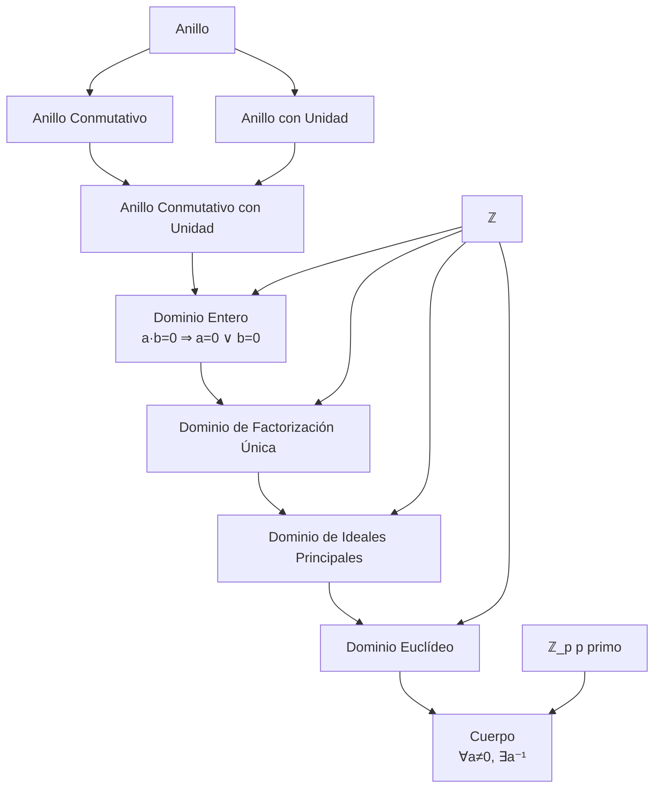

# Álgebra Superior II - Números enteros

## 1.2 ℤ como dominio entero.

---

### 1. Definición de Dominio Entero

Un **dominio entero** (o dominio de integridad) es un anillo conmutativo con unidad $R$ que satisface la siguiente propiedad adicional:

**Propiedad de integridad:** Para todo $a, b \in R$, si $a \cdot b = 0$ entonces $a = 0$ o $b = 0$ (o ambos).

Esta propiedad se conoce como la **ausencia de divisores de cero**.

### 2. ℤ como Dominio Entero

El conjunto de los números enteros $\mathbb{Z} = \{..., -3, -2, -1, 0, 1, 2, 3, ...\}$ con las operaciones usuales de suma y multiplicación forma un dominio entero.

#### 2.1. Verificación de los Axiomas

**ℤ satisface todas las propiedades de dominio entero:**

1. **Asociatividad de la suma:** $(a + b) + c = a + (b + c)$
2. **Conmutatividad de la suma:** $a + b = b + a$
3. **Elemento neutro aditivo:** $a + 0 = a$
4. **Elementos inversos aditivos:** $a + (-a) = 0$
5. **Asociatividad del producto:** $(a \cdot b) \cdot c = a \cdot (b \cdot c)$
6. **Conmutatividad del producto:** $a \cdot b = b \cdot a$
7. **Elemento neutro multiplicativo:** $a \cdot 1 = a$
8. **Distributividad:** $a \cdot (b + c) = a \cdot b + a \cdot c$
9. **No divisores de cero:** $a \cdot b = 0 \Rightarrow a = 0 \vee b = 0$

#### 2.2. Demostración de la Propiedad de Integridad

**Teorema:** $\mathbb{Z}$ es un dominio entero.

**Demostración:**
Sean $a, b \in \mathbb{Z}$ tales que $a \cdot b = 0$. Consideremos dos casos:

1. Si $a = 0$, la propiedad se satisface trivialmente.
2. Si $a \neq 0$, entonces $b$ debe ser 0, pues de lo contrario $|a \cdot b| \geq |a| \geq 1$, contradiciendo que $a \cdot b = 0$.

Por lo tanto, $a \cdot b = 0$ implica $a = 0$ o $b = 0$. ∎

### 3. Implementación Computacional

```python
class DominioEntero:
    def __init__(self):
        self.operaciones = ['+', '*']

    def es_divisor_cero(self, a, b):
        """Verifica si a o b son divisores de cero"""
        return a != 0 and b != 0 and a * b == 0

    def verificar_dominio_entero(self, elementos):
        """Verifica todas las propiedades de dominio entero"""
        resultados = {}

        # Propiedades básicas de anillo conmutativo con unidad
        resultados['conmutatividad_suma'] = all(
            a + b == b + a for a in elementos for b in elementos
        )

        resultados['conmutatividad_producto'] = all(
            a * b == b * a for a in elementos for b in elementos
        )

        resultados['elemento_neutro_suma'] = all(a + 0 == a for a in elementos)
        resultados['elemento_neutro_producto'] = all(a * 1 == a for a in elementos)

        # Propiedad de integridad (sin divisores de cero)
        resultados['sin_divisores_cero'] = not any(
            self.es_divisor_cero(a, b) for a in elementos for b in elementos
        )

        return resultados

    def encontrar_divisores_cero(self, modulo=None):
        """Encuentra divisores de cero en ℤ o ℤ_n"""
        divisores = []
        if modulo is None:
            # En ℤ no hay divisores de cero
            return []
        else:
            # En ℤ_n, buscar pares (a,b) con a,b ≠ 0 y a*b ≡ 0 mod n
            for a in range(1, modulo):
                for b in range(1, modulo):
                    if (a * b) % modulo == 0:
                        divisores.append((a, b))
            return divisores

# Ejemplo de uso
dominio_Z = DominioEntero()

# Verificar ℤ como dominio entero
elementos_prueba = [-3, -2, -1, 0, 1, 2, 3]
print("Verificación de ℤ como dominio entero:")
print(dominio_Z.verificar_dominio_entero(elementos_prueba))

# Comparar con ℤ_6 que NO es dominio entero
print("\nDivisores de cero en ℤ_6:")
print(dominio_Z.encontrar_divisores_cero(6))

# Verificar ℤ_7 que SÍ es dominio entero (y cuerpo)
print("\nDivisores de cero en ℤ_7:")
print(dominio_Z.encontrar_divisores_cero(7))
```

### 4. Diagrama de Relaciones Algebraicas



### 5. Propiedades de los Dominios Enteros

#### 5.1. Ley de Cancelación

En un dominio entero, vale la **ley de cancelación**:
Si $a \neq 0$ y $a \cdot b = a \cdot c$, entonces $b = c$.

**Demostración:**
$a \cdot b = a \cdot c \Rightarrow a \cdot (b - c) = 0$
Como $a \neq 0$ y estamos en dominio entero, entonces $b - c = 0 \Rightarrow b = c$.

#### 5.2. Característica de un Dominio Entero

La **característica** de un dominio entero $D$ es el menor entero positivo $n$ tal que:

$$ n \cdot 1 = \underbrace{1 + 1 + \cdots + 1}_{n \text{ veces}} = 0 $$

Si no existe tal $n$, se dice que la característica es 0.

**Ejemplo:** $\mathbb{Z}$ tiene característica 0.

### 6. Subdominios Enteros

#### 6.1. Definición

Un subconjunto $S$ de un dominio entero $D$ es un **subdominio entero** si:

1. $0, 1 \in S$
2. $S$ es cerrado bajo suma y multiplicación
3. $S$ es cerrado bajo inversos aditivos

#### 6.2. Ejemplos

- $\mathbb{Z}$ es subdominio entero de $\mathbb{Q}$
- $\mathbb{Z}[\sqrt{2}] = \{a + b\sqrt{2} \mid a, b \in \mathbb{Z}\}$ es subdominio entero de $\mathbb{R}$

### 7. Ejercicios Resueltos

#### Ejercicio 1

Demuestre que la ley de cancelación vale en $\mathbb{Z}$.

**Solución:**
Sean $a, b, c \in \mathbb{Z}$ con $a \neq 0$ tales que $a \cdot b = a \cdot c$.
Entonces $a \cdot (b - c) = 0$.
Como $a \neq 0$ y $\mathbb{Z}$ es dominio entero, tenemos $b - c = 0$, luego $b = c$.

#### Ejercicio 2

Muestre que $\mathbb{Z}_6$ no es dominio entero.

**Solución:**
En $\mathbb{Z}_6$, tenemos $2 \cdot 3 = 6 \equiv 0 \mod 6$, pero $2 \neq 0$ y $3 \neq 0$.
Por tanto, existen divisores de cero, luego $\mathbb{Z}_6$ no es dominio entero.

### 8. Aplicaciones e Importancia

#### 8.1. Teoría de Números

- Estudio de números primos y factorización única
- Congruencias y aritmética modular
- Teoría algebraica de números

#### 8.2. Álgebra Abstracta

- Construcción de cuerpos de fracciones
- Estudio de extensiones de anillos
- Teoría de ideales y módulos

#### 8.3. Geometría Algebraica

- Estudio de variedades algebraicas
- Anillos de coordenadas
- Teoría de curvas algebraicas

#### 8.4. Criptografía

- Algoritmos basados en factorización de enteros
- Criptografía de curva elíptica
- Sistemas de clave pública

### 9. Ejercicios Propuestos

1. Demuestre que todo cuerpo es un dominio entero.

2. Muestre que $\mathbb{Z}[\sqrt{-5}]$ es un dominio entero pero no es DFU.

3. Verifique que $\mathbb{Z}_p$ es dominio entero para todo primo $p$.

4. Encuentre todos los divisores de cero en $\mathbb{Z}_{12}$.

5. Demuestre que la intersección de subdominios enteros es un subdominio entero.

6. Investigue si $\mathbb{Z}[i]$ (enteros de Gauss) es dominio euclídeo.

7. Implemente un algoritmo para detectar si $\mathbb{Z}_n$ es dominio entero.

8. Estudie la característica de los dominios $\mathbb{Z}$, $\mathbb{Z}_p$, y $\mathbb{Q}$.

### 10. Referencias

- Herstein, I. N. (1975). _Topics in Algebra_
- Fraleigh, J. B. (2003). _A First Course in Abstract Algebra_
- Dummit, D. S., & Foote, R. M. (2004). _Abstract Algebra_
- Hungerford, T. W. (1974). _Algebra_
- Artin, M. (1991). _Algebra_
