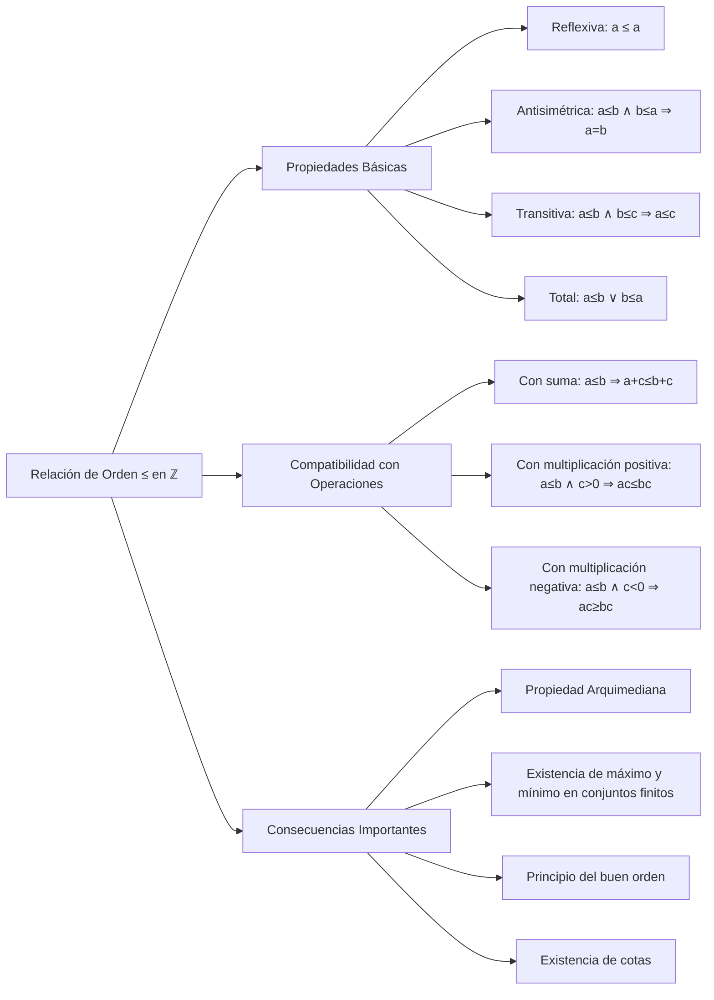

# Álgebra Superior II - Números enteros

## 1.3 El orden en ℤ.

---

### 1. Introducción al Orden en los Enteros

El conjunto de los números enteros $\mathbb{Z} = \{..., -3, -2, -1, 0, 1, 2, 3, ...\}$ posee una estructura de orden total que es compatible con las operaciones algebraicas. Esta relación de orden permite comparar números enteros y establecer relaciones de desigualdad.

### 2. Relación de Orden en ℤ

#### 2.1. Definición Formal

La relación de orden $\leq$ en $\mathbb{Z}$ satisface las siguientes propiedades para todo $a, b, c \in \mathbb{Z}$:

1. **Reflexividad:** $a \leq a$
2. **Antisimetría:** Si $a \leq b$ y $b \leq a$, entonces $a = b$
3. **Transitividad:** Si $a \leq b$ y $b \leq c$, entonces $a \leq c$
4. **Totalidad:** $a \leq b$ o $b \leq a$

#### 2.2. Definición por Positividad

Definimos el conjunto de enteros positivos $\mathbb{Z}^+ = \{1, 2, 3, ...\}$ y establecemos:

- $a > 0$ si $a \in \mathbb{Z}^+$
- $a > b$ si $a - b > 0$
- $a < b$ si $b > a$
- $a \geq b$ si $a > b$ o $a = b$

### 3. Propiedades del Orden con las Operaciones

#### 3.1. Compatibilidad con la Suma

Para todo $a, b, c, d \in \mathbb{Z}$:

- Si $a \leq b$, entonces $a + c \leq b + c$
- Si $a \leq b$ y $c \leq d$, entonces $a + c \leq b + d$

#### 3.2. Compatibilidad con la Multiplicación

Para todo $a, b, c \in \mathbb{Z}$:

- Si $a \leq b$ y $c > 0$, entonces $a \cdot c \leq b \cdot c$
- Si $a \leq b$ y $c < 0$, entonces $a \cdot c \geq b \cdot c$

#### 3.3. Propiedad Arquimediana

Para todo $a, b \in \mathbb{Z}$ con $a > 0$, existe $n \in \mathbb{Z}^+$ tal que:

$$ n \cdot a > b $$

### 4. Implementación Computacional

```python
class OrdenEnteros:
    def __init__(self):
        self.operaciones = ['≤', '≥', '<', '>']

    def verificar_propiedades_orden(self, a, b, c):
        """Verifica las propiedades del orden en ℤ"""
        resultados = {}

        # Propiedades básicas del orden
        resultados['reflexividad'] = a <= a
        resultados['antisimetria'] = not (a <= b and b <= a) or (a == b)
        resultados['transitividad'] = not (a <= b and b <= c) or (a <= c)
        resultados['totalidad'] = (a <= b) or (b <= a)

        # Compatibilidad con operaciones
        if a <= b:
            resultados['compatibilidad_suma'] = (a + c) <= (b + c)
            if c > 0:
                resultados['compatibilidad_mult_positivo'] = (a * c) <= (b * c)
            if c < 0:
                resultados['compatibilidad_mult_negativo'] = (a * c) >= (b * c)

        return resultados

    def encontrar_cota_superior(self, conjunto):
        """Encuentra cotas superiores de un subconjunto de ℤ"""
        if not conjunto:
            return None

        maximo = max(conjunto)
        return [x for x in range(maximo, maximo + 10)]  # Primeras 10 cotas superiores

    def propiedad_arquimediana(self, a, b):
        """Verifica la propiedad arquimediana"""
        if a <= 0:
            return False, "a debe ser positivo"

        n = 1
        while n * a <= b:
            n += 1

        return True, f"n = {n}, {n}·{a} = {n*a} > {b}"

# Ejemplo de uso
orden_Z = OrdenEnteros()

# Verificar propiedades del orden
a, b, c = 3, 5, -2
print("Propiedades del orden para a=3, b=5, c=-2:")
print(orden_Z.verificar_propiedades_orden(a, b, c))

# Propiedad arquimediana
print("\nPropiedad arquimediana:")
print(orden_Z.propiedad_arquimediana(2, 7))

# Encontrar cotas superiores
conjunto = {-3, 1, 5, 2}
print(f"\nCotas superiores de {conjunto}:")
print(orden_Z.encontrar_cota_superior(conjunto))
```

### 5. Diagrama de la Estructura de Orden



### 6. Principio del Buen Orden

#### 6.1. Enunciado

Todo subconjunto no vacío de $\mathbb{Z}^+$ tiene un elemento mínimo.

#### 6.2. Aplicaciones

- Demostraciones por inducción matemática
- Existencia de mínimo común múltiplo
- Algoritmos de división

#### 6.3. Ejemplo

El conjunto $\{n \in \mathbb{Z}^+ \mid n \text{ es par}\}$ tiene mínimo elemento 2.

### 7. Conjuntos Acotados y Extremos

#### 7.1. Definiciones

- **Cota superior:** $M$ es cota superior de $A \subseteq \mathbb{Z}$ si $\forall a \in A, a \leq M$
- **Cota inferior:** $m$ es cota inferior de $A \subseteq \mathbb{Z}$ si $\forall a \in A, a \geq m$
- **Máximo:** Elemento máximo de $A$ si es cota superior y pertenece a $A$
- **Mínimo:** Elemento mínimo de $A$ si es cota inferior y pertenece a $A$

#### 7.2. Propiedad

Todo subconjunto finito de $\mathbb{Z}$ tiene máximo y mínimo.

### 8. Ejercicios Resueltos

#### Ejercicio 1

Demuestre que si $a \leq b$ y $c \leq 0$, entonces $a \cdot c \geq b \cdot c$.

**Solución:**

Como $c \leq 0$, entonces $-c \geq 0$.
Por compatibilidad con multiplicación por positivo: $ a \cdot (-c) \leq b \cdot (-c) $

Es decir, $-a \cdot c \leq -b \cdot c$. Sumando $a \cdot c + b \cdot c$ a ambos lados, por la compatibilidad con la suma: $b \cdot c \leq a \cdot c$, que es lo que se quería. ∎

#### Ejercicio 2

Demuestre la propiedad arquimediana en $\mathbb{Z}$.

**Solución:**
Sean $a, b \in \mathbb{Z}$ con $a > 0$.
Supongamos, por contradicción, que $n \cdot a \leq b$ para todo $n \in \mathbb{Z}^+$.
Entonces el conjunto $S = \{b - n \cdot a \mid n \in \mathbb{Z}^+\}$ está formado por enteros no negativos y no es vacío.
Por el principio del buen orden, que vale también para conjuntos no vacíos de enteros no negativos, $S$ tiene un elemento mínimo $b - m \cdot a$.
Pero $b - (m + 1) \cdot a = (b - m \cdot a) - a$ también pertenece a $S$ y es menor, porque $a > 0$: contradicción.
Por lo tanto, existe $n \in \mathbb{Z}^+$ con $n \cdot a > b$. ∎

### 9. Aplicaciones e Importancia

#### 9.1. Teoría de Números

- Estudio de desigualdades diofánticas
- Análisis de algoritmos de división
- Teoría de aproximación

#### 9.2. Análisis Matemático

- Construcción de sucesiones y series
- Límites de sucesiones enteras
- Propiedades de convergencia

#### 9.3. Computación

- Algoritmos de ordenamiento
- Complejidad computacional
- Estructuras de datos ordenadas

#### 9.4. Optimización

- Problemas de programación entera
- Métodos de ramificación y acotamiento
- Algoritmos voraces

### 10. Ejercicios Propuestos

1. Demuestre que si $a < b$ y $c < d$, entonces $a + c < b + d$.

2. Muestre que $a^2 \geq 0$ para todo $a \in \mathbb{Z}$.

3. Encuentre el mínimo y máximo del conjunto $\{x \in \mathbb{Z} \mid -3 \leq x < 5\}$.

4. Demuestre que no existe el entero más grande.

5. Verifique la propiedad arquimediana para $a = 3$, $b = 10$.

6. Implemente un algoritmo para encontrar el mínimo de un conjunto de enteros.

7. Estudie las cotas del conjunto $\{2n \mid n \in \mathbb{Z}\}$.

8. Demuestre que todo subconjunto acotado superiormente de $\mathbb{Z}$ tiene máximo.

### 11. Referencias

- Apostol, T. M. (1976). _Introduction to Analytic Number Theory_
- Burton, D. M. (2010). _Elementary Number Theory_
- Hardy, G. H., & Wright, E. M. (2008). _An Introduction to the Theory of Numbers_
- Niven, I., Zuckerman, H. S., & Montgomery, H. L. (1991). _An Introduction to the Theory of Numbers_
