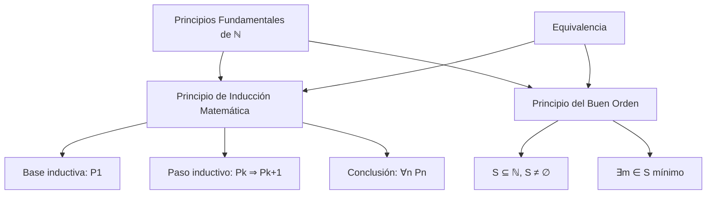
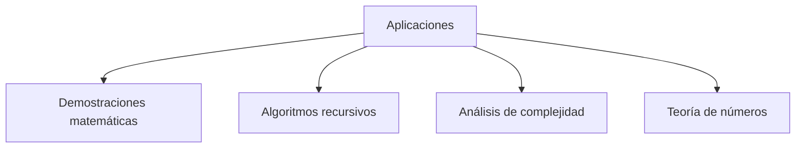

# Álgebra Superior II - Números enteros

## 1.4 Principio de inducción. Principio del buen orden.

---

### 1. Principio de Inducción Matemática

#### 1.1. Enunciado Formal

Sea $P(n)$ una proposición que depende de un número natural $n$. Si:

1. **Base inductiva:** $P(1)$ es verdadera
2. **Paso inductivo:** Para todo $k \in \mathbb{N}$, si $P(k)$ es verdadera entonces $P(k+1)$ es verdadera

Entonces $P(n)$ es verdadera para todo $n \in \mathbb{N}$.

#### 1.2. Forma Generalizada

Para cualquier $n_0 \in \mathbb{Z}$:

1. $P(n_0)$ es verdadera
2. Si $P(k)$ es verdadera para $k \geq n_0$, entonces $P(k+1)$ es verdadera

Entonces $P(n)$ es verdadera para todo $n \geq n_0$.

### 2. Principio del Buen Orden (PBO)

#### 2.1. Enunciado

Todo subconjunto no vacío $S \subseteq \mathbb{N}$ tiene un elemento mínimo. Es decir:

$$ \forall S \subseteq \mathbb{N}, S \neq \emptyset \Rightarrow \exists m \in S \text{ tal que } \forall s \in S, m \leq s $$

#### 2.2. Equivalencia con la Inducción

El Principio de Inducción Matemática y el Principio del Buen Orden son equivalentes en $\mathbb{N}$.

### 3. Implementación Computacional

```python
class PrincipioInduccion:
    def __init__(self):
        self.nombre = "Principio de Inducción Matemática"

    def verificar_proposicion(self, proposicion, n_min=1, n_max=10):
        """Verifica una proposición P(n) usando inducción matemática"""
        resultados = {}

        # Verificar base inductiva
        try:
            base = proposicion(n_min)
            resultados['base_inductiva'] = base
            if not base:
                return resultados, "Falla la base inductiva"
        except Exception as e:
            return {}, f"Error en base inductiva: {e}"

        # Verificar paso inductivo
        try:
            for k in range(n_min, n_max):
                if proposicion(k):  # Hipótesis inductiva
                    if not proposicion(k + 1):  # Tesis inductiva
                        resultados['paso_inductivo'] = False
                        resultados['contraejemplo'] = k
                        return resultados, f"Falla en el paso de {k} a {k+1}"
            resultados['paso_inductivo'] = True
        except Exception as e:
            return {}, f"Error en paso inductivo: {e}"

        # Revisar casos finitos no demuestra nada: solo puede encontrar contraejemplos
        return resultados, f"Se cumple de {n_min} a {n_max} (esto no sustituye la demostración)"

    def principio_buen_orden(self, conjunto):
        """Aplica el principio del buen orden a un conjunto de naturales"""
        if not conjunto:
            return None, "Conjunto vacío"

        if not all(isinstance(x, int) and x >= 0 for x in conjunto):
            return None, "El conjunto debe contener sólo naturales"

        minimo = min(conjunto)
        return minimo, f"El elemento mínimo es {minimo}"

# Ejemplo: Demostrar que 1 + 2 + ... + n = n(n+1)/2
def suma_gaussiana(n):
    return sum(range(1, n + 1)) == n * (n + 1) // 2

# Ejemplo de uso
induccion = PrincipioInduccion()

print("Verificación de la fórmula de Gauss:")
resultado, mensaje = induccion.verificar_proposicion(suma_gaussiana, 1, 100)
print(mensaje)

print("\nAplicación del principio del buen orden:")
conjunto = {5, 2, 8, 3, 1}
minimo, msg = induccion.principio_buen_orden(conjunto)
print(f"Para el conjunto {conjunto}: {msg}")
```

### 4. Diagrama de Relación entre los Principios



<br>



### 5. Esquema de Demostración por Inducción

#### 5.1. Estructura Típica

1. **Base inductiva:** Verificar $P(1)$ ( o $P(n_0)$ )
2. **Hipótesis inductiva:** Suponer $ P(k) $ verdadera para algún $k \geq 1$
3. **Paso inductivo:** Demostrar $ P(k+1) $ usando $P(k) $
4. **Conclusión:** Por principio de inducción, $ P(n) $ es verdadera ∀ $ n \in \mathbb{N} $

#### 5.2. Ejemplo: Suma de los primeros n naturales

**Proposición:** $1 + 2 + \cdots + n = \frac{n(n+1)}{2}$

**Demostración:**

- **Base:** Para $n=1$: $1 = \frac{1(2)}{2} = 1$ ✓
- **Hipótesis:** Supongamos válido para $k$: $1 + 2 + \cdots + k = \frac{k(k+1)}{2}$
- **Paso:** Para $k+1$:

  $$ 1 + 2 + \cdots + k + (k+1) = \frac{k(k+1)}{2} + (k+1) = \frac{(k+1)(k+2)}{2} $$

- **Conclusión:** La fórmula es válida $∀n \in \mathbb{N} $ ∎

### 6. Aplicación del Principio del Buen Orden

#### 6.1. Demostración por Contradicción

Para demostrar que todo natural tiene una propiedad $P$, se puede:

1. Suponer que existe algún natural que NO tiene la propiedad $P$
2. Sea $S = \{n \in \mathbb{N} \mid \neg P(n)\}$
3. Por PBO, $S$ tiene elemento mínimo $m$
4. Mostrar que esto lleva a una contradicción

#### 6.2. Ejemplo: Existencia de División Euclidiana

**Teorema:** $ ∀a, b \in \mathbb{Z} $ con $ b > 0 $, ∃ únicos $ q, r $ tales que:

$$ a = bq + r \quad \text{con} \quad 0 \leq r < b $$

**Demostración (usando PBO):**
Considerar $S = \{a - bx \mid x \in \mathbb{Z}, a - bx \geq 0\}$

- $S$ es un conjunto de enteros no negativos, y es no vacío: con $x = -|a|$ se tiene $a - bx = a + b|a| \geq 0$
- Por PBO, aplicado a enteros no negativos, $S$ tiene mínimo $r = a - bq$, y $r \geq 0$
- Si fuera $r \geq b$, entonces $r - b = a - b(q + 1)$ estaría en $S$ y sería menor que $r$: contradicción. Luego $0 \leq r < b$
- La unicidad se demuestra en el subtema 2.2 ∎

### 7. Ejercicios Resueltos

#### Ejercicio 1

Demuestre por inducción que $2^n > n$ para todo $n \in \mathbb{N}$.

**Solución:**

- **Base:** $n=1$: $2^1 = 2 > 1$ ✓
- **Hipótesis:** Supongamos $2^k > k$ para algún $k \geq 1$
- **Paso:** $2^{k+1} = 2 \cdot 2^k > 2 \cdot k \geq k + 1$ ( pues $k \geq 1$ )
- **Conclusión:** $2^n > n$ $∀n \in \mathbb{N}$ ∎

#### Ejercicio 2

Use el PBO para demostrar que todo natural $n > 1$ tiene divisor primo.

**Solución:**
Sea $S = \{n > 1 \mid n \text{ no tiene divisor primo}\}$

- Si $S \neq \emptyset$, por PBO tiene mínimo $m$
- $m$ no es primo (pues se dividiría por sí mismo)
- Entonces $m = ab$ con $1 < a, b < m$
- Como $a < m$ y $m$ es mínimo de $S$, $a$ tiene divisor primo
- Este divisor primo también divide a $m$ → Contradicción
- Luego $S = \emptyset$ ∎

### 8. Aplicaciones e Importancia

#### 8.1. Matemáticas Puras

- Demostraciones en teoría de números
- Propiedades de sucesiones y series
- Teoremas de existencia y unicidad

#### 8.2. Ciencias de la Computación

- Correctitud de algoritmos recursivos
- Análisis de complejidad computacional
- Demostración de propiedades de programas

#### 8.3. Ingeniería

- Análisis de sistemas discretos
- Teoría de control
- Modelado de sistemas dinámicos

#### 8.4. Economía y Finanzas

- Modelos de tiempo discreto
- Análisis de series temporales
- Teoría de juegos

### 9. Ejercicios Propuestos

1. Demuestre por inducción que $n! > 2^n$ para $n \geq 4$.

2. Use inducción para verificar que $1^3 + 2^3 + \cdots + n^3 = (1 + 2 + \cdots + n)^2$.

3. Demuestre usando PBO que todo natural es par o impar.

4. Muestre que el principio de inducción implica el principio del buen orden.

5. Demuestre por inducción fuerte que todo natural $n \geq 2$ es producto de primos.

6. Implemente una función que verifique proposiciones usando inducción completa.

7. Use PBO para demostrar que la sucesión de Fibonacci está bien definida.

8. Demuestre que $\sqrt{2}$ es irracional usando el principio del buen orden.

### 10. Referencias

- Apostol, T. M. (1976). _Introduction to Analytic Number Theory_
- Knuth, D. E. (1997). _The Art of Computer Programming, Vol. 1_
- Rosen, K. H. (2018). _Discrete Mathematics and Its Applications_
- Graham, R. L., Knuth, D. E., & Patashnik, O. (1994). _Concrete Mathematics_
