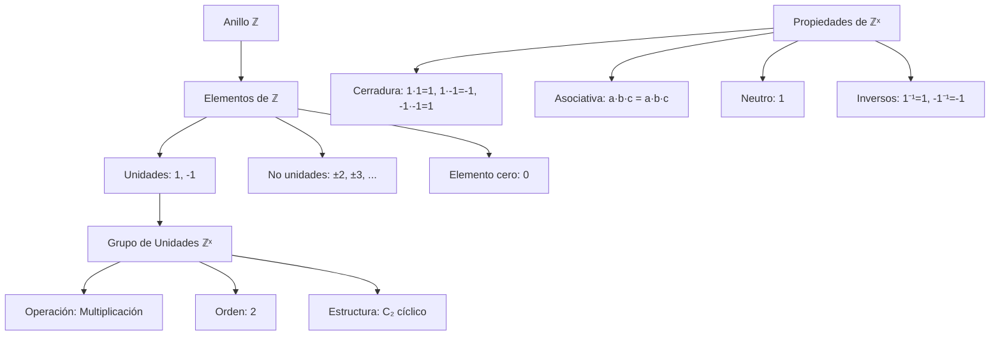

# Álgebra Superior II - Números enteros

## 1.5 Unidades en ℤ.

---

### 1. Definición de Unidades en un Anillo

En un anillo conmutativo con unidad $(R, +, \cdot)$, un elemento $a \in R$ se llama **unidad** si existe un elemento $b \in R$ tal que:

$$a \cdot b = 1$$

El elemento $b$ se denomina **inverso multiplicativo** de $a$ y se denota por $a^{-1}$.

### 2. Unidades en el Anillo de los Enteros ℤ

#### 2.1. Caracterización de las Unidades en ℤ

En el anillo de los enteros $(\mathbb{Z}, +, \cdot)$, las unidades son exactamente los elementos que tienen inverso multiplicativo en $\mathbb{Z}$.

**Teorema:** $a \in \mathbb{Z}$ es una unidad si y sólo si $a = 1$ o $a = -1$.

**Demostración:**

- Si $a = 1$, entonces $1 \cdot 1 = 1$, luego $1$ es unidad.
- Si $a = -1$, entonces $(-1) \cdot (-1) = 1$, luego $-1$ es unidad.
- Si $|a| > 1$, entonces para cualquier $b \in \mathbb{Z}$ con $b \neq 0$, $|a \cdot b| \geq |a| > 1$, por lo que $a \cdot b \neq 1$. Si $b = 0$, $a \cdot 0 = 0 \neq 1$.
  Por tanto, sólo $1$ y $-1$ son unidades en $\mathbb{Z}$. ∎

#### 2.2. Grupo de Unidades

El conjunto de unidades de un anillo $R$ forma un grupo bajo la multiplicación, llamado **grupo de unidades** y denotado por $R^\times$.

Para $\mathbb{Z}$:

$$ \mathbb{Z}^\times = \{1, -1\} $$

Este grupo es isomorfo al grupo cíclico de orden 2: $\mathbb{Z}^\times \cong C_2$.

### 3. Implementación Computacional

```python
class UnidadesEnteros:
    def __init__(self):
        self.unidades = {1, -1}

    def es_unidad(self, a):
        """Determina si un entero a es unidad en ℤ"""
        return a in self.unidades

    def inverso_multiplicativo(self, a):
        """Calcula el inverso multiplicativo de a en ℤ si existe"""
        if self.es_unidad(a):
            return a  # Pues 1⁻¹ = 1 y (-1)⁻¹ = -1
        else:
            return None

    def grupo_unidades(self):
        """Retorna el grupo de unidades de ℤ"""
        return self.unidades

    def propiedades_grupo(self):
        """Verifica las propiedades de grupo de ℤˣ"""
        propiedades = {}

        # Cerradura
        propiedades['cerradura'] = all(
            (a * b) in self.unidades
            for a in self.unidades
            for b in self.unidades
        )

        # Asociatividad
        a, b, c = 1, -1, -1
        propiedades['asociatividad'] = (a * b) * c == a * (b * c)

        # Elemento neutro
        propiedades['elemento_neutro'] = 1 in self.unidades and all(
            a * 1 == a for a in self.unidades
        )

        # Elementos inversos
        propiedades['inversos'] = all(
            self.inverso_multiplicativo(a) is not None
            for a in self.unidades
        )

        return propiedades

    def tablas_grupo(self):
        """Genera las tablas del grupo de unidades"""
        print("Tabla de multiplicación de ℤˣ:")
        print("× |  1  -1")
        print("--+--------")
        for a in sorted(self.unidades):
            fila = f"{a} |"
            for b in sorted(self.unidades):
                fila += f" {a*b:3}"
            print(fila)

# Ejemplo de uso
unidades = UnidadesEnteros()

print("Unidades en ℤ:", unidades.grupo_unidades())
print("\n¿Es 2 una unidad?", unidades.es_unidad(2))
print("¿Es -1 una unidad?", unidades.es_unidad(-1))
print("Inverso de 1:", unidades.inverso_multiplicativo(1))

print("\nPropiedades del grupo ℤˣ:")
print(unidades.propiedades_grupo())

print("\nTablas del grupo:")
unidades.tablas_grupo()
```

### 4. Diagrama de la Estructura de Grupos



### 5. Propiedades Algebraicas de las Unidades

#### 5.1. Relación con la Divisibilidad

Si $a$ es unidad en $\mathbb{Z}$, entonces:

- $a$ divide a todo entero $b$, pues $b = a \cdot (a^{-1} \cdot b)$
- Los únicos asociados de cualquier elemento $b$ son $b$ y $-b$

#### 5.2. Comportamiento bajo Operaciones

- El producto de unidades es unidad: $1 \cdot 1 = 1$, $1 \cdot (-1) = -1$, $(-1) \cdot (-1) = 1$
- La suma de unidades no necesariamente es unidad: $1 + (-1) = 0$

#### 5.3. Unidades y Ideales

El ideal generado por una unidad es todo el anillo:

$$ \langle a \rangle = \mathbb{Z} \iff a \in \mathbb{Z}^\times $$

### 6. Generalización a Otros Anillos

#### 6.1. Unidades en ℤₙ

En el anillo $\mathbb{Z}_n$, las unidades son los elementos coprimos con $n$:

$$ \mathbb{Z}_n^\times = \{a \in \mathbb{Z}_n \mid \gcd(a, n) = 1\} $$

#### 6.2. Unidades en Dominios Euclidianos

En general, para un dominio euclidiano $D$, las unidades son los elementos de norma 1:

$$ D^\times = \{a \in D \mid N(a) = 1\} $$

### 7. Ejercicios Resueltos

#### Ejercicio 1

Demuestre que si $a$ es unidad en $\mathbb{Z}$, entonces $a$ divide a todo $b \in \mathbb{Z}$.

**Solución:**
Sea $a \in \mathbb{Z}^\times$, entonces existe $a^{-1} \in \mathbb{Z}$ tal que $a \cdot a^{-1} = 1$.
Para cualquier $b \in \mathbb{Z}$, tenemos:

$$ b = 1 \cdot b = (a \cdot a^{-1}) \cdot b = a \cdot (a^{-1} \cdot b) $$

Luego $a$ divide a $b$. ∎

#### Ejercicio 2

Muestre que $\langle a \rangle = \mathbb{Z}$ si y sólo si $a$ es unidad.

**Solución:**
$(\Rightarrow)$ Si $\langle a \rangle = \mathbb{Z}$, entonces $1 \in \langle a \rangle$, luego existe $b \in \mathbb{Z}$ tal que $a \cdot b = 1$, por lo que $a$ es unidad.

$(\Leftarrow)$ Si $a$ es unidad, entonces para todo $c \in \mathbb{Z}$, $c = a \cdot (a^{-1} \cdot c) \in \langle a \rangle$, luego $\langle a \rangle = \mathbb{Z}$. ∎

### 8. Aplicaciones e Importancia

#### 8.1. Teoría de Números

- Estudio de números primos y factorización única
- Teorema de Euler y Fermat
- Aritmética modular

#### 8.2. Álgebra Abstracta

- Clasificación de elementos en anillos
- Estudio de ideales maximales y primos
- Teoría de cuerpos y extensiones

#### 8.3. Criptografía

- Generación de claves en RSA
- Cálculo de inversos multiplicativos mod n
- Algoritmos de cifrado asimétrico

#### 8.4. Teoría de Códigos

- Códigos correctores de errores
- Construcción de cuerpos finitos
- Algoritmos de codificación

### 9. Ejercicios Propuestos

1. Demuestre que el conjunto de unidades de cualquier anillo forma un grupo bajo la multiplicación.

2. Encuentre todas las unidades en el anillo $\mathbb{Z}[i]$ de los enteros de Gauss.

3. Demuestre que si $a$ y $b$ son unidades, entonces $a \cdot b$ es unidad.

4. Investigue cómo son las unidades en el anillo de polinomios $\mathbb{Z}[x]$.

5. Implemente una función que determine si dos enteros son asociados.

6. Demuestre que las únicas unidades en $\mathbb{Z}[\sqrt{2}]$ son de la forma $\pm(1 + \sqrt{2})^n$.

7. Estudie el grupo de unidades de $\mathbb{Z}_n$ para diferentes valores de $n$.

8. Demuestre que todo elemento no nulo en un cuerpo es unidad.

### 10. Referencias

- Herstein, I. N. (1975). _Topics in Algebra_
- Dummit, D. S., & Foote, R. M. (2004). _Abstract Algebra_
- Fraleigh, J. B. (2003). _A First Course in Abstract Algebra_
- Hungerford, T. W. (1974). _Algebra_
- Rotman, J. J. (2000). _A First Course in Abstract Algebra_
