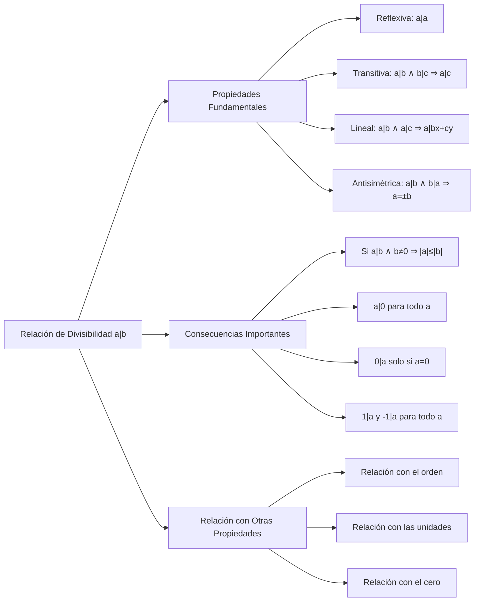

# Álgebra Superior II - Divisibilidad

## 2.1 Propiedades elementales.

---

### 1. Definición de Divisibilidad

Sean $a, b \in \mathbb{Z}$. Decimos que **$a$ divide a $b$**, denotado por $a \mid b$, si existe un entero $c \in \mathbb{Z}$ tal que:

$$b = a \cdot c$$

En este caso, decimos que:

- $a$ es un **divisor** de $b$
- $b$ es un **múltiplo** de $a$
- $b$ es **divisible** por $a$

Si $a$ no divide a $b$, escribimos $a \nmid b$.

### 2. Propiedades Fundamentales de la Divisibilidad

#### 2.1. Propiedades Básicas

Para todo $a, b, c, d \in \mathbb{Z}$:

1. **Reflexividad:** $a \mid a$
2. **Transitividad:** Si $a \mid b$ y $b \mid c$, entonces $a \mid c$
3. **Linealidad:** Si $a \mid b$ y $a \mid c$, entonces $a \mid (bx + cy)$ para todo $x, y \in \mathbb{Z}$
4. **Antisimetría:** Si $a \mid b$ y $b \mid a$, entonces $a = \pm b$

#### 2.2. Propiedades con Cero y Unidades

5. **Divisibilidad por 1:** $1 \mid a$ para todo $a \in \mathbb{Z}$
6. **Divisibilidad por -1:** $-1 \mid a$ para todo $a \in \mathbb{Z}$
7. **Divisibilidad del cero:** $a \mid 0$ para todo $a \in \mathbb{Z}$
8. **Cero como divisor:** $0 \mid a$ si y sólo si $a = 0$

#### 2.3. Propiedades de Orden

9. **Acotación:** Si $a \mid b$ y $b \neq 0$, entonces $|a| \leq |b|$
10. **Divisor no nulo:** Si $a \mid b$ y $b \neq 0,$ entonces $a \neq 0;$ además, $a \mid b$ si y solo si $|a| \mid |b|$

### 3. Implementación Computacional

```python
class Divisibilidad:
    def __init__(self):
        self.propiedades = [
            "Reflexividad", "Transitividad", "Linealidad", "Antisimetría",
            "Divisibilidad por 1", "Divisibilidad por -1",
            "Divisibilidad del cero", "Cero como divisor",
            "Acotación", "Positividad"
        ]

    def divide(self, a, b):
        """Determina si a divide a b"""
        if a == 0:
            return b == 0
        return b % a == 0

    def verificar_propiedades(self, a, b, c, x=1, y=1):
        """Verifica las propiedades de divisibilidad para enteros dados"""
        resultados = {}

        # Propiedades básicas
        resultados["Reflexividad"] = self.divide(a, a)
        resultados["Transitividad"] = not (self.divide(a, b) and self.divide(b, c)) or self.divide(a, c)
        resultados["Linealidad"] = not (self.divide(a, b) and self.divide(a, c)) or self.divide(a, b*x + c*y)
        resultados["Antisimetría"] = not (self.divide(a, b) and self.divide(b, a)) or (abs(a) == abs(b))

        # Propiedades con cero y unidades
        resultados["Divisibilidad por 1"] = self.divide(1, a)
        resultados["Divisibilidad por -1"] = self.divide(-1, a)
        resultados["Divisibilidad del cero"] = self.divide(a, 0)
        resultados["Cero como divisor"] = not self.divide(0, a) or (a == 0)

        # Propiedades de orden
        if self.divide(a, b) and b != 0:
            resultados["Acotación"] = abs(a) <= abs(b)
        else:
            resultados["Acotación"] = "No aplica"

        if self.divide(a, b) and b > 0:
            resultados["Positividad"] = (a > 0) or (a < 0)
        else:
            resultados["Positividad"] = "No aplica"

        return resultados

    def encontrar_divisores(self, n):
        """Encuentra todos los divisores, positivos y negativos, de un entero"""
        if n == 0:
            return "Todos los enteros"  # c · 0 = 0, incluso con c = 0

        divisores = []
        for i in range(1, abs(n) + 1):
            if n % i == 0:
                divisores.append(i)
                if i != -i:  # Para incluir los negativos si es necesario
                    divisores.append(-i)

        return sorted(set(divisores))

    def tabla_divisibilidad(self, numeros):
        """Genera una tabla de divisibilidad para una lista de números"""
        print("Tabla de Divisibilidad:")
        print("a\\b |", end="")
        for b in numeros:
            print(f" {b:4}", end="")
        print("\n----+" + "-----" * len(numeros))

        for a in numeros:
            print(f"{a:3} |", end="")
            for b in numeros:
                resultado = "  ✓  " if self.divide(a, b) else "  ✗  "
                print(resultado, end="")
            print()

# Ejemplo de uso
div = Divisibilidad()

print("¿3 divide a 12?", div.divide(3, 12))
print("¿5 divide a 17?", div.divide(5, 17))

print("\nDivisores de 24:", div.encontrar_divisores(24))

print("\nVerificación de propiedades para a=2, b=6, c=12:")
resultados = div.verificar_propiedades(2, 6, 12)
for prop, valor in resultados.items():
    print(f"{prop}: {valor}")

print("\nTabla de divisibilidad para [-2, -1, 0, 1, 2]:")
div.tabla_divisibilidad([-2, -1, 0, 1, 2])
```

### 4. Diagrama de Relaciones de Divisibilidad



### 5. Teoremas y Corolarios Importantes

#### 5.1. Teorema de la Combinación Lineal

Si $a \mid b$ y $a \mid c$, entonces $a \mid (mb + nc)$ para cualesquiera $m, n \in \mathbb{Z}$.

**Demostración:**

Por definición, existen $k, l \in \mathbb{Z}$ tales que $b = ak$ y $c = al$.
Luego:

$$ mb + nc = m(ak) + n(al) = a(mk + nl) $$

Por tanto, $a \mid (mb + nc)$. ∎

#### 5.2. Corolario: Divisibilidad de la Suma

Si $a \mid b$ y $a \mid c$, entonces $a \mid (b + c)$ y $a \mid (b - c)$.

#### 5.3. Lema de Euclides

Si $a \mid bc$ y $\gcd(a, b) = 1$, entonces $a \mid c$.

### 6. Ejercicios Resueltos

#### Ejercicio 1

Demuestre que si $a \mid b$ y $b \neq 0$, entonces $|a| \leq |b|$.

**Solución:**

Como $a \mid b$, existe $c \in \mathbb{Z}$ tal que $b = a \cdot c$.
Como $b \neq 0$, tenemos $c \neq 0$, luego $|c| \geq 1$.
Por tanto:

$$ |b| = |a \cdot c| = |a| \cdot |c| \geq |a| \cdot 1 = |a| $$ ∎

#### Ejercicio 2

Demuestre que si $a \mid b$ y $b \mid a$, entonces $a = \pm b$.

**Solución:**

Existen $c, d \in \mathbb{Z}$ tales que $b = a \cdot c$ y $a = b \cdot d$.
Sustituyendo: $a = (a \cdot c) \cdot d = a \cdot (c \cdot d)$
Si $a \neq 0$, entonces $c \cdot d = 1$, luego $c = d = \pm 1$.
Por tanto, $b = a \cdot (\pm 1) = \pm a$.
Si $a = 0$, entonces $b = 0$, y $0 = \pm 0$. ∎

### 7. Aplicaciones e Importancia

#### 7.1. Teoría de Números

- Estudio de números primos y compuestos
- Algoritmo de Euclides para el máximo común divisor
- Teorema fundamental de la aritmética

#### 7.2. Álgebra Abstracta

- Estudio de ideales en anillos
- Teoría de dominios de factorización única
- Anillos de enteros algebraicos

#### 7.3. Criptografía

- Algoritmos de clave pública (RSA)
- Tests de primalidad
- Factorización de enteros

#### 7.4. Matemáticas Computacionales

- Algoritmos eficientes para divisibilidad
- Cálculo de divisores y múltiplos
- Optimización de operaciones aritméticas

### 8. Ejercicios Propuestos

1. Demuestre que si $a \mid b$ y $c \mid d$, entonces $ac \mid bd$.

2. Encuentre todos los enteros $n$ tales que $n \mid (n + 1)$.

3. Demuestre que si $a \mid b$ y $a \mid (b + c)$, entonces $a \mid c$.

4. Investigue la relación entre divisibilidad y congruencias.

5. Implemente un algoritmo eficiente para encontrar todos los divisores de un número.

6. Demuestre que $a \mid b$ si y sólo si $-a \mid b$.

7. Estudie la relación de divisibilidad en $\mathbb{Z}_n$.

8. Demuestre que si $a \mid b$ y $b \mid a$, entonces los ideales $\langle a \rangle$ y $\langle b \rangle$ son iguales.

### 9. Referencias

- Hardy, G. H., & Wright, E. M. (2008). _An Introduction to the Theory of Numbers_
- Niven, I., Zuckerman, H. S., & Montgomery, H. L. (1991). _An Introduction to the Theory of Numbers_
- Burton, D. M. (2010). _Elementary Number Theory_
- Apostol, T. M. (1976). _Introduction to Analytic Number Theory_
- Rosen, K. H. (2018). _Discrete Mathematics and Its Applications_
