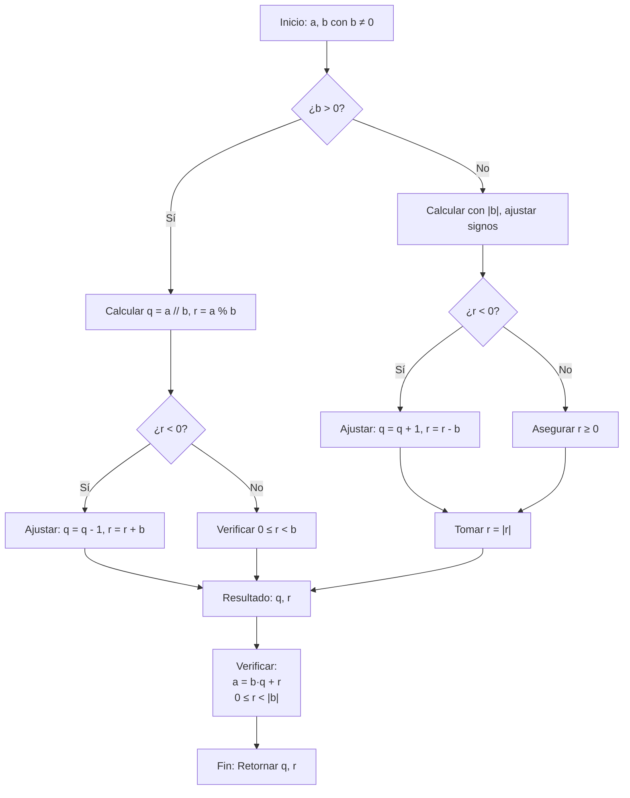

# Álgebra Superior II - Divisibilidad

## 2.2 Algoritmo de la división.

---

### 1. Enunciado del Algoritmo de la División

El **Algoritmo de la División** establece que para cualquier par de enteros $a$ (dividendo) y $b$ (divisor) con $b \neq 0$, existen únicos enteros $q$ (cociente) y $r$ (residuo) tales que:

$$a = b \cdot q + r$$

con la condición:

$$0 \leq r < |b|$$

#### 1.1. Casos Especiales

- Si $r = 0$, decimos que $b$ **divide exactamente** a $a$ ( $b \mid a$ )
- Si $r \neq 0$, decimos que $b$ **no divide exactamente** a $a$ ( $b \nmid a$ )

### 2. Demostración del Algoritmo de la División

#### 2.1. Existencia

Consideremos el conjunto:

$$ S = \{a - b \cdot k \mid k \in \mathbb{Z},\ a - b \cdot k \geq 0\} $$

- $S \subseteq \mathbb{N}_0$ y es no vacío (por el principio del buen orden)
- Sea $r = \min S$, entonces $r = a - b \cdot q \geq 0$ para algún $q \in \mathbb{Z}$
- Falta mostrar que $r < |b|$:
  - Si $r \geq |b|$, entonces $r - |b| \geq 0$ y $r - |b| = a - b(q \pm 1) \in S$
  - Esto contradice la minimalidad de $r$

#### 2.2. Unicidad

Supongamos dos representaciones:

$$ a = bq_1 + r_1 = bq_2 + r_2 $$

con $0 \leq r_1, r_2 < |b|$

Entonces:

$$ b(q_1 - q_2) = r_2 - r_1 $$

Como $|r_2 - r_1| < |b|$, la única posibilidad es $q_1 = q_2$ y $r_1 = r_2$

### 3. Implementación Computacional

```python
class AlgoritmoDivision:
    def __init__(self):
        self.name = "Algoritmo de la División"

    def division_entera(self, a, b):
        """
        Implementa el algoritmo de la división para enteros
        Retorna (cociente, residuo)
        """
        if b == 0:
            raise ValueError("El divisor no puede ser cero")

        # Caso especial cuando a = 0
        if a == 0:
            return 0, 0

        # Calculamos cociente y residuo
        if b > 0:
            q = a // b
            r = a % b
            # Aseguramos que 0 ≤ r < b
            if r < 0:
                q -= 1
                r += b
        else:
            # Para b negativo, trabajamos con |b|
            q = a // b
            r = a % b
            if r < 0:
                q += 1
                r -= b
            # Aseguramos 0 ≤ r < |b|
            r = abs(r)

        return q, r

    def verificar_propiedades(self, a, b):
        """Verifica que se cumplan las propiedades del algoritmo"""
        if b == 0:
            return False, "Divisor cero"

        q, r = self.division_entera(a, b)

        propiedades = {}
        propiedades["Ecuación fundamental"] = (a == b * q + r)
        propiedades["Residuo no negativo"] = (r >= 0)
        propiedades["Residuo menor que |b|"] = (r < abs(b))
        propiedades["Unicidad"] = True  # Se cumple por construcción

        return propiedades, (q, r)

    def tabla_division(self, dividendos, divisor):
        """Genera una tabla de divisiones para un divisor fijo"""
        if divisor == 0:
            return "Divisor no puede ser cero"

        print(f"Tabla de división por {divisor}:")
        print("a\tq\tr\ta = b·q + r")
        print("-" * 30)

        for a in dividendos:
            q, r = self.division_entera(a, divisor)
            print(f"{a}\t{q}\t{r}\t{a} = {divisor}·{q} + {r}")

# Ejemplo de uso
algo_div = AlgoritmoDivision()

# Ejemplos básicos
print("División de 17 entre 5:")
q, r = algo_div.division_entera(17, 5)
print(f"17 = 5·{q} + {r}")

print("\nDivisión de -17 entre 5:")
q, r = algo_div.division_entera(-17, 5)
print(f"-17 = 5·{q} + {r}")

print("\nDivisión de 17 entre -5:")
q, r = algo_div.division_entera(17, -5)
print(f"17 = -5·{q} + {r}")

# Verificación de propiedades
print("\nVerificación para a=23, b=7:")
props, (q, r) = algo_div.verificar_propiedades(23, 7)
for prop, valor in props.items():
    print(f"{prop}: {valor}")

# Tabla de división
print("\n" + "="*50)
algo_div.tabla_division([-5, -4, -3, -2, -1, 0, 1, 2, 3, 4, 5], 3)
```

### 4. Diagrama del Algoritmo de la División



### 5. Aplicaciones del Algoritmo de la División

#### 5.1. Aritmética Modular

El residuo $r$ define la clase de congruencia de $a$ módulo $b$:

$$ a \equiv r \pmod{b} $$

#### 5.2. Algoritmo de Euclides

Para calcular $\gcd(a, b)$:

$$ \gcd(a, b) = \gcd(b, r) $$

donde $a = bq + r$

#### 5.3. Representación de Números

- Sistema decimal: división por 10
- Sistema binario: división por 2
- Cambio de base: división por la base

#### 5.4. Teoría de Números

- Estudio de congruencias
- Anillos $\mathbb{Z}_n$
- Campos finitos

### 6. Ejercicios Resueltos

#### Ejercicio 1

Encuentre el cociente y residuo de la división de $-37$ entre $5$.

**Solución:**
Queremos encontrar $q, r$ tales que:
$-37 = 5q + r$ con $0 \leq r < 5$

- $-37 ÷ 5 = -7.4$, luego $q = -8$ (redondeo hacia abajo)
- $r = -37 - 5(-8) = -37 + 40 = 3$
- Verificación: $-37 = 5(-8) + 3$ ✓

#### Ejercicio 2

Demuestre que el cuadrado de cualquier entero es de la forma $3k$ o $3k + 1$.

**Solución:**
Por el algoritmo de la división, cualquier entero $n$ puede escribirse como:
$n = 3q + r$ con $r = 0, 1, 2$

- Si $r = 0$: $n^2 = 9q^2 = 3(3q^2)$ → forma $3k$
- Si $r = 1$: $n^2 = 9q^2 + 6q + 1 = 3(3q^2 + 2q) + 1$ → forma $3k + 1$
- Si $r = 2$: $n^2 = 9q^2 + 12q + 4 = 3(3q^2 + 4q + 1) + 1$ → forma $3k + 1$

### 7. Generalizaciones y Extensiones

#### 7.1. Anillos Euclidianos

El algoritmo de la división se generaliza a anillos euclidianos, donde existe una función norma $N: R \rightarrow \mathbb{N}_0$ tal que para todo $a, b \in R$ con $b \neq 0$, existen $q, r \in R$ con:

$$ a = bq + r $$

y $r = 0$ o $N(r) < N(b)$

#### 7.2. Polinomios

Para polinomios $f(x), g(x) \in F[x]$ sobre un campo $F$, existen únicos $q(x), r(x)$ tales que:
$$f(x) = g(x)q(x) + r(x)$$
con $\deg(r(x)) < \deg(g(x))$ o $r(x) = 0$

### 8. Aplicaciones e Importancia

#### 8.1. Matemáticas Puras

- Fundamentos de la teoría de números
- Estructura de anillos e ideales
- Teoría de congruencias

#### 8.2. Ciencias de la Computación

- Algoritmos eficientes (Euclides, RSA)
- Aritmética de computadoras
- Criptografía

#### 8.3. Ingeniería

- Teoría de códigos correctores
- Procesamiento de señales digitales
- Sistemas de comunicación

#### 8.4. Matemáticas Aplicadas

- Análisis numérico
- Métodos computacionales
- Optimización

### 9. Ejercicios Propuestos

1. Encuentre el cociente y residuo de:
   a) $47$ dividido por $6$
   b) $-47$ dividido por $6$
   c) $47$ dividido por $-6$

2. Demuestre que el cubo de cualquier entero es de la forma $9k$, $9k + 1$, o $9k + 8$.

3. Implemente el algoritmo de la división usando sólo sumas y restas.

4. Demuestre que si $a = bq + r$, entonces $\gcd(a, b) = \gcd(b, r)$.

5. Generalice el algoritmo para divisores negativos.

6. Investigue cómo funciona la división entera en diferentes lenguajes de programación.

7. Demuestre que el algoritmo de la división es válido en $\mathbb{Z}[i]$ (enteros de Gauss).

8. Estudie la relación entre el algoritmo de la división y las fracciones continuas.

### 10. Referencias

- Hardy, G. H., & Wright, E. M. (2008). _An Introduction to the Theory of Numbers_
- Knuth, D. E. (1997). _The Art of Computer Programming, Vol. 1_
- Rosen, K. H. (2018). _Discrete Mathematics and Its Applications_
- Burton, D. M. (2010). _Elementary Number Theory_
- Apostol, T. M. (1976). _Introduction to Analytic Number Theory_
