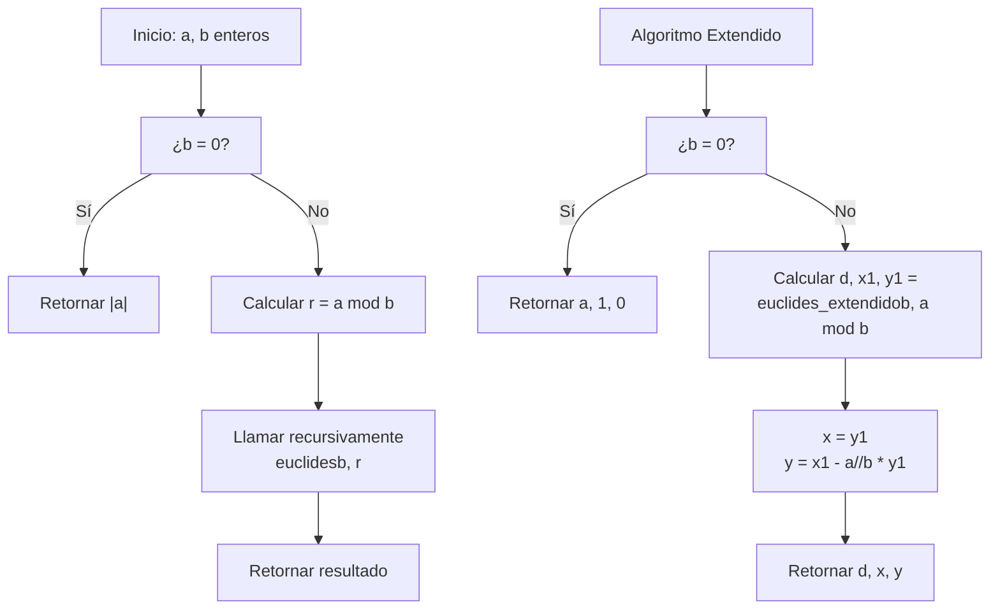

# Álgebra Superior II - Divisibilidad

## 2.3 Máximo común divisor. Algoritmo de Euclides. Mínimo común múltiplo.

---

### 1. Máximo Común Divisor (MCD)

#### 1.1. Definición

El **máximo común divisor** de dos enteros $a$ y $b$ (no ambos cero) es el mayor entero positivo $d$ que divide a ambos números. Se denota por $\gcd(a, b)$ o simplemente $(a, b)$.

Equivalentemente, $d$ es el único entero que cumple:

- $d > 0$
- $d \mid a$ y $d \mid b$
- Si $c \mid a$ y $c \mid b$, entonces $c \mid d$

#### 1.2. Propiedades Fundamentales

Para todo $a, b, c \in \mathbb{Z}$:

1. $\gcd(a, b) = \gcd(b, a)$ (Conmutatividad)
2. $\gcd(a, \gcd(b, c)) = \gcd(\gcd(a, b), c)$ (Asociatividad)
3. $\gcd(a, 0) = |a|$ para $a \neq 0$
4. $\gcd(a, 1) = 1$
5. $\gcd(a, a) = |a|$
6. $\gcd(a, b) = \gcd(a, b + ka)$ para cualquier $k \in \mathbb{Z}$

### 2. Algoritmo de Euclides

#### 2.1. Descripción del Algoritmo

El algoritmo de Euclides calcula el MCD de dos números mediante divisiones sucesivas:

1. Sea $r_0 = a$, $r_1 = b$ con $a \geq b > 0$
2. Mientras $r_i \neq 0$:
   - $r_{i-1} = q_i r_i + r_{i+1}$ donde $0 \leq r_{i+1} < r_i$
3. El último residuo no cero es $\gcd(a, b)$

#### 2.2. Versión Extendida

El **algoritmo extendido de Euclides** encuentra además coeficientes $x, y \in \mathbb{Z}$ tales que:

$$ \gcd(a, b) = ax + by $$

### 3. Mínimo Común Múltiplo (MCM)

#### 3.1. Definición

El **mínimo común múltiplo** de dos enteros $a$ y $b$ es el menor entero positivo $m$ que es múltiplo de ambos. Se denota por $\text{lcm}(a, b)$ o $[a, b]$.

#### 3.2. Relación entre MCD y MCM

Para $a, b \in \mathbb{Z}^+$:

$$ \gcd(a, b) \cdot \text{lcm}(a, b) = a \cdot b $$

### 4. Implementación Computacional

```python
class AritmeticaEnteros:
    def __init__(self):
        self.name = "MCD y MCM"

    def euclides(self, a, b):
        """Algoritmo de Euclides para MCD"""
        a, b = abs(a), abs(b)
        if b == 0:
            return a
        return self.euclides(b, a % b)

    def euclides_extendido(self, a, b):
        """Algoritmo extendido de Euclides"""
        if b == 0:
            return a, 1, 0
        else:
            d, x1, y1 = self.euclides_extendido(b, a % b)
            x = y1
            y = x1 - (a // b) * y1
            return d, x, y

    def mcm(self, a, b):
        """Mínimo común múltiplo usando MCD"""
        if a == 0 or b == 0:
            return 0
        return abs(a * b) // self.euclides(a, b)

    def propiedades_mcd(self, a, b):
        """Verifica propiedades del MCD"""
        d = self.euclides(a, b)
        propiedades = {}

        propiedades["Conmutatividad"] = d == self.euclides(b, a)
        propiedades["gcd(a, 0) = |a|"] = (b == 0 and d == abs(a)) or (b != 0)
        propiedades["gcd(a, 1) = 1"] = (b == 1 and d == 1) or (b != 1)

        # Verificar identidad de Bézout
        if a != 0 and b != 0:
            d_ext, x, y = self.euclides_extendido(a, b)
            propiedades["Identidad de Bézout"] = (d == a*x + b*y)

        return propiedades

    def tabla_mcd_mcm(self, numeros):
        """Genera tabla de MCD y MCM para pares de números"""
        print("a\\b", end="")
        for b in numeros:
            print(f"|{b:6}", end="")
        print("\n----" + "------" * len(numeros))

        for a in numeros:
            print(f"{a:3}", end="")
            for b in numeros:
                if a == 0 or b == 0:
                    print("|      ", end="")
                else:
                    mcd = self.euclides(a, b)
                    print(f"|{mcd:3},{self.mcm(a, b):3}", end="")
            print()

# Ejemplo de uso
aritmetica = AritmeticaEnteros()

print("MCD de 48 y 18:", aritmetica.euclides(48, 18))
print("MCM de 48 y 18:", aritmetica.mcm(48, 18))

print("\nAlgoritmo extendido para 48 y 18:")
d, x, y = aritmetica.euclides_extendido(48, 18)
print(f"gcd(48, 18) = {d} = 48*({x}) + 18*({y})")

print("\nPropiedades del MCD para 48 y 18:")
props = aritmetica.propiedades_mcd(48, 18)
for prop, valor in props.items():
    print(f"{prop}: {valor}")

print("\nTabla de MCD y MCM:")
aritmetica.tabla_mcd_mcm([2, 3, 4, 6, 8])
```

### 5. Diagrama del Algoritmo de Euclides



### 6. Teoremas y Propiedades Importantes

#### 6.1. Identidad de Bézout

Para cualquier par de enteros $a, b$ (no ambos cero), existen enteros $x, y$ tales que:

$$ \gcd(a, b) = ax + by $$

#### 6.2. Lema de Euclides

Si $a \mid bc$ y $\gcd(a, b) = 1$, entonces $a \mid c$.

#### 6.3. Propiedad de Linearidad

Para todo $k \in \mathbb{Z}$:

$$ \gcd(ka, kb) = |k| \cdot \gcd(a, b) $$

#### 6.4. Relación con Ideales

El ideal generado por $a$ y $b$ coincide con el ideal generado por su MCD:

$$ \langle a, b \rangle = \langle \gcd(a, b) \rangle $$

### 7. Ejercicios Resueltos

#### Ejercicio 1

Calcule $\gcd(1071, 462)$ usando el algoritmo de Euclides.

**Solución:**

- $1071 = 2 \times 462 + 147$
- $462 = 3 \times 147 + 21$
- $147 = 7 \times 21 + 0$
- $\gcd(1071, 462) = 21$

#### Ejercicio 2

Encuentre enteros $x, y$ tales que $1071x + 462y = \gcd(1071, 462)$.

**Solución:**
Del ejercicio anterior:

- $147 = 1071 - 2 \times 462$
- $21 = 462 - 3 \times 147 = 462 - 3(1071 - 2 \times 462) = -3 \times 1071 + 7 \times 462$
- Por tanto, $x = -3$, $y = 7$

### 8. Aplicaciones e Importancia

#### 8.1. Teoría de Números

- Simplificación de fracciones
- Estudio de números coprimos
- Teorema fundamental de la aritmética

#### 8.2. Álgebra Abstracta

- Estructura de anillos e ideales
- Dominios de factorización única
- Anillos de enteros algebraicos

#### 8.3. Criptografía

- Algoritmo RSA
- Generación de claves públicas
- Sistemas de cifrado

#### 8.4. Matemáticas Computacionales

- Algoritmos eficientes
- Aritmética modular
- Optimización de operaciones

### 9. Ejercicios Propuestos

1. Calcule $\gcd(123456, 7890)$ usando el algoritmo de Euclides.

2. Encuentre enteros $x, y$ tales que $123x + 45y = \gcd(123, 45)$.

3. Demuestre que $\gcd(a, b) = \gcd(a, b + ka)$ para cualquier $k \in \mathbb{Z}$.

4. Implemente una versión iterativa del algoritmo de Euclides.

5. Demuestre que si $\gcd(a, b) = 1$ y $\gcd(a, c) = 1$, entonces $\gcd(a, bc) = 1$.

6. Calcule $\text{lcm}(12, 18, 24)$ generalizando el método.

7. Investigue la complejidad computacional del algoritmo de Euclides.

8. Demuestre que $\gcd(F_n, F_m) = F_{\gcd(n, m)}$ donde $F_n$ es el n-ésimo número de Fibonacci.

### 10. Referencias

- Knuth, D. E. (1997). _The Art of Computer Programming, Vol. 1_
- Hardy, G. H., & Wright, E. M. (2008). _An Introduction to the Theory of Numbers_
- Rosen, K. H. (2018). _Discrete Mathematics and Its Applications_
- Cormen, T. H., et al. (2009). _Introduction to Algorithms_
- Burton, D. M. (2010). _Elementary Number Theory_
