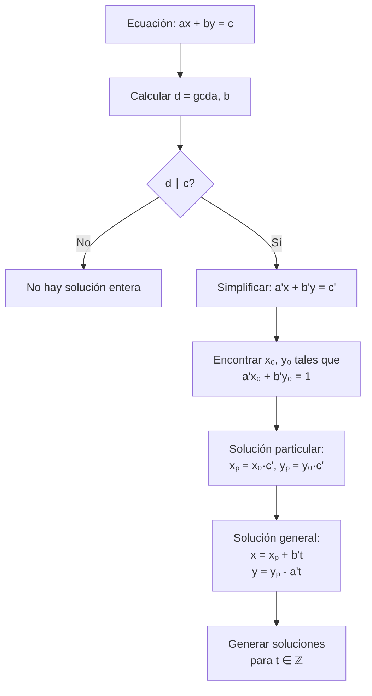

# Álgebra Superior II - Divisibilidad

## 2.4 Soluciones enteras de una ecuación lineal.

---

### 1. Ecuaciones Diofánticas Lineales

Una **ecuación diofántica lineal** es una ecuación de la forma:

$$ax + by = c$$

donde $a, b, c \in \mathbb{Z}$ son constantes conocidas y $x, y \in \mathbb{Z}$ son las incógnitas que buscamos en los enteros.

#### 1.1. Condición de Existencia de Soluciones

**Teorema:** La ecuación $ax + by = c$ tiene solución entera si y sólo si:

$$\gcd(a, b) \mid c$$

#### 1.2. Estructura de las Soluciones

Si $(x_0, y_0)$ es una solución particular, entonces **todas las soluciones** están dadas por:

$$x = x_0 + \frac{b}{d} \cdot t$$
$$y = y_0 - \frac{a}{d} \cdot t$$

donde $d = \gcd(a, b)$ y $t \in \mathbb{Z}$.

### 2. Método de Resolución

#### 2.1. Algoritmo de Resolución

1. **Verificar existencia:** Calcular $d = \gcd(a, b)$
   - Si $d \nmid c$ → No hay soluciones enteras
   - Si $d \mid c$ → Proceder

2. **Simplificar:** Dividir toda la ecuación por $d$:

   $$ \frac{a}{d}x + \frac{b}{d}y = \frac{c}{d} $$

3. **Encontrar solución particular:** Usar el algoritmo extendido de Euclides para encontrar $x_0, y_0$ tales que:

   $$ \frac{a}{d}x_0 + \frac{b}{d}y_0 = 1 $$

4. **Escalar:** Multiplicar por $\frac{c}{d}$ para obtener una solución particular de la ecuación original

5. **Solución general:** Aplicar las fórmulas:

   $$ x = x_0 \cdot \frac{c}{d} + \frac{b}{d} \cdot t $$

   $$ y = y_0 \cdot \frac{c}{d} - \frac{a}{d} \cdot t $$

### 3. Implementación Computacional

```python
class EcuacionesDiofanticas:
    def __init__(self):
        self.name = "Resolución de ecuaciones diofánticas lineales"

    def gcd_extendido(self, a, b):
        """Algoritmo extendido de Euclides"""
        if b == 0:
            return a, 1, 0
        d, x1, y1 = self.gcd_extendido(b, a % b)
        x = y1
        y = x1 - (a // b) * y1
        return d, x, y

    def resolver_ecuacion(self, a, b, c):
        """Resuelve ax + by = c en enteros"""
        # Paso 1: Verificar existencia
        d, x0, y0 = self.gcd_extendido(a, b)

        if c % d != 0:
            return None, "No hay solución: gcd(a,b) no divide a c"

        # Paso 2: Simplificar
        a_prime = a // d
        b_prime = b // d
        c_prime = c // d

        # Paso 3: Encontrar solución particular
        # x0, y0 ya satisfacen a_prime*x0 + b_prime*y0 = 1
        x_particular = x0 * c_prime
        y_particular = y0 * c_prime

        # Paso 4: Solución general
        def solucion_general(t):
            x = x_particular + b_prime * t
            y = y_particular - a_prime * t
            return x, y

        return solucion_general, f"Solución particular: ({x_particular}, {y_particular})"

    def encontrar_soluciones_positivas(self, a, b, c, rango=10):
        """Encuentra soluciones positivas en un rango"""
        sol_gen, mensaje = self.resolver_ecuacion(a, b, c)
        if sol_gen is None:
            return [], mensaje

        soluciones_positivas = []
        for t in range(-rango, rango + 1):
            x, y = sol_gen(t)
            if x > 0 and y > 0:
                soluciones_positivas.append((x, y, t))

        return soluciones_positivas, mensaje

    def verificar_solucion(self, a, b, c, x, y):
        """Verifica si (x, y) es solución"""
        return a*x + b*y == c

# Ejemplo de uso
diofantica = EcuacionesDiofanticas()

# Ejemplo 1: 3x + 6y = 9
print("Ecuación: 3x + 6y = 9")
sol_gen, mensaje = diofantica.resolver_ecuacion(3, 6, 9)
print(mensaje)

if sol_gen:
    print("Soluciones para t = -2, -1, 0, 1, 2:")
    for t in range(-2, 3):
        x, y = sol_gen(t)
        print(f"t = {t}: (x, y) = ({x}, {y})")
        print(f"Verificación: 3*{x} + 6*{y} = {3*x + 6*y}")

# Ejemplo 2: 2x + 4y = 7 (sin solución)
print("\nEcuación: 2x + 4y = 7")
sol_gen, mensaje = diofantica.resolver_ecuacion(2, 4, 7)
print(mensaje)

# Ejemplo 3: Soluciones positivas de 3x + 5y = 20
print("\nSoluciones positivas de 3x + 5y = 20:")
soluciones, msg = diofantica.encontrar_soluciones_positivas(3, 5, 20)
for x, y, t in soluciones:
    print(f"(x, y) = ({x}, {y}), t = {t}")
```

### 4. Diagrama del Proceso de Resolución



### 5. Casos Especiales y Aplicaciones

#### 5.1. Ecuaciones Homogéneas

Cuando $c = 0$, la ecuación $ax + by = 0$ tiene soluciones:

$$ x = \frac{b}{d} \cdot t, \quad y = -\frac{a}{d} \cdot t $$

#### 5.2. Una Incógnita

Si $b = 0$, la ecuación se reduce a $ax = c$, que tiene solución si y sólo si $a \mid c$.

#### 5.3. Aplicación: Problemas de Monedas

Problemas del tipo: "¿De cuántas maneras se puede obtener $c$ pesos usando monedas de $a$ y $b$ pesos?"

#### 5.4. Aplicación: Problemas de Medidas

Problemas de mezclas o combinaciones lineales con restricciones enteras.

### 6. Ejercicios Resueltos

#### Ejercicio 1

Resuelva la ecuación $6x + 9y = 21$ en enteros.

**Solución:**

1. $\gcd(6, 9) = 3$ y $3 \mid 21$ → Hay solución
2. Simplificar: $2x + 3y = 7$
3. Solución particular de $2x + 3y = 1$: $x_0 = -1, y_0 = 1$
4. Solución particular: $x_p = -7, y_p = 7$
5. Solución general:

   $$ x = -7 + 3t $$
   $$ y = 7 - 2t $$

#### Ejercicio 2

Encuentre todas las soluciones positivas de $5x + 7y = 41$.

**Solución:**
De la solución general $x = -41 + 7t$, $y = 41 - 5t$
Buscamos $x > 0$, $y > 0$:

- $-41 + 7t > 0$ ⇒ $t > 5.857$ ⇒ $t \geq 6$
- $41 - 5t > 0$ ⇒ $t < 8.2$ ⇒ $t \leq 8$

Soluciones:

- $t = 6$: $(x, y) = (1, 11)$
- $t = 7$: $(x, y) = (8, 6)$
- $t = 8$: $(x, y) = (15, 1)$

### 7. Generalizaciones

#### 7.1. Múltiples Variables

Para ecuaciones de la forma:

$$ a_1x_1 + a_2x_2 + \cdots + a_nx_n = c $$

Tiene solución entera si y sólo si:

$$ \gcd(a_1, a_2, \ldots, a_n) \mid c $$

#### 7.2. Restricciones Adicionales

- Soluciones no negativas
- Soluciones en intervalos específicos
- Múltiples ecuaciones (sistemas)

### 8. Aplicaciones e Importancia

#### 8.1. Teoría de Números

- Estudio de números congruentes
- Problemas de particiones
- Teoría algebraica de números

#### 8.2. Matemáticas Discretas

- Combinatoria
- Teoría de grafos
- Optimización discreta

#### 8.3. Ciencias de la Computación

- Algoritmos de programación entera
- Criptografía
- Teoría de códigos

#### 8.4. Economía y Investigación Operativa

- Problemas de optimización con restricciones enteras
- Planificación de producción
- Logística y transporte

### 9. Ejercicios Propuestos

1. Resuelva $12x + 18y = 30$ y encuentre 3 soluciones particulares.

2. Determine si la ecuación $15x + 25y = 7$ tiene solución entera.

3. Encuentre todas las soluciones positivas de $4x + 7y = 52$.

4. Implemente un algoritmo para resolver ecuaciones con 3 variables.

5. Demuestre que si $\gcd(a, b) = 1$, entonces la ecuación $ax + by = c$ siempre tiene solución.

6. Resuelva el sistema:

   $ 3x + 5y = 7 $

   $ 2x + 3y = 4 $

7. Encuentre el número de soluciones no negativas de $2x + 3y = 20$.

8. Investigue el "problema de las monedas" y su relación con las ecuaciones diofánticas.

### 10. Referencias

- Mordell, L. J. (1969). _Diophantine Equations_
- Hardy, G. H., & Wright, E. M. (2008). _An Introduction to the Theory of Numbers_
- Rosen, K. H. (2018). _Discrete Mathematics and Its Applications_
- Niven, I., Zuckerman, H. S., & Montgomery, H. L. (1991). _An Introduction to the Theory of Numbers_
- Burton, D. M. (2010). _Elementary Number Theory_
