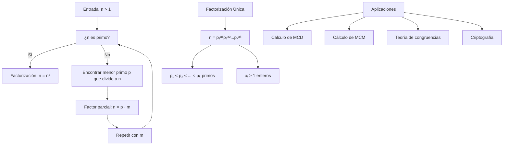

# Álgebra Superior II - Divisibilidad

## 2.5 Números primos. Factorización única.

---

### 1. Números Primos

#### 1.1. Definición

Un **número primo** es un entero $p > 1$ cuyos únicos divisores positivos son 1 y $p$ mismo. Un entero mayor que 1 que no es primo se llama **compuesto**.

**Ejemplos:**

- Primos: 2, 3, 5, 7, 11, 13, ...
- Compuestos: 4, 6, 8, 9, 10, 12, ...

#### 1.2. Teorema Fundamental de la Aritmética

Todo entero $n > 1$ puede ser expresado como un producto de números primos de manera única, excepto por el orden de los factores.

Formalmente:

$$ n = p_1^{a_1} p_2^{a_2} \cdots p_k^{a_k} $$

donde $p_1 < p_2 < \cdots < p_k$ son primos y $a_i \in \mathbb{Z}^+$.

### 2. Propiedades de los Números Primos

#### 2.1. Infinitud de los Primos

**Teorema (Euclides):** Existen infinitos números primos.

**Demostración:** Supongamos que hay sólo finitos primos $p_1, p_2, \ldots, p_n$. Sea $N = p_1p_2\cdots p_n + 1$. $N$ no es divisible por ningún $p_i$, luego es primo o tiene un factor primo diferente de los listados. Contradicción.

#### 2.2. Lema de Euclides

Si $p$ es primo y $p \mid ab$, entonces $p \mid a$ o $p \mid b$.

#### 2.3. Pequeño Teorema de Fermat

Si $p$ es primo y $p \nmid a$, entonces:

$$ a^{p-1} \equiv 1 \pmod{p} $$

### 3. Factorización Única

#### 3.1. Algoritmo de Factorización

Para factorizar un número $n > 1$:

1. Si $n$ es primo, terminamos
2. Si $n$ es compuesto, encontrar el menor primo $p$ que divide a $n$
3. Escribir $n = p \cdot m$
4. Repetir el proceso con $m$

#### 3.2. Aplicaciones de la Factorización

- Cálculo del MCD y MCM
- Simplificación de fracciones
- Resolución de congruencias
- Teoría de números algebraica

### 4. Implementación Computacional

```python
class TeoriaPrimos:
    def __init__(self):
        self.primos = [2, 3, 5, 7, 11, 13, 17, 19, 23, 29]

    def es_primo(self, n):
        """Determina si n es primo"""
        if n <= 1:
            return False
        if n <= 3:
            return True
        if n % 2 == 0 or n % 3 == 0:
            return False

        i = 5
        while i * i <= n:
            if n % i == 0 or n % (i + 2) == 0:
                return False
            i += 6
        return True

    def factorizar(self, n):
        """Factorización única de n"""
        if n <= 1:
            return {}

        factores = {}
        temp = n

        # División por 2
        while temp % 2 == 0:
            factores[2] = factores.get(2, 0) + 1
            temp //= 2

        # División por primos impares
        p = 3
        while p * p <= temp:
            while temp % p == 0:
                factores[p] = factores.get(p, 0) + 1
                temp //= p
            p += 2

        # Si queda un primo mayor
        if temp > 1:
            factores[temp] = factores.get(temp, 0) + 1

        return factores

    def gcd_por_factorizacion(self, a, b):
        """MCD usando factorización"""
        factores_a = self.factorizar(a)
        factores_b = self.factorizar(b)

        gcd_factores = {}
        for p in set(factores_a.keys()) | set(factores_b.keys()):
            exp = min(factores_a.get(p, 0), factores_b.get(p, 0))
            if exp > 0:
                gcd_factores[p] = exp

        # Reconstruir MCD
        gcd_val = 1
        for p, exp in gcd_factores.items():
            gcd_val *= p ** exp

        return gcd_val

    def generar_primos(self, limite):
        """Genera primos hasta límite usando criba de Eratóstenes"""
        es_primo = [True] * (limite + 1)
        es_primo[0] = es_primo[1] = False

        for i in range(2, int(limite**0.5) + 1):
            if es_primo[i]:
                for j in range(i*i, limite + 1, i):
                    es_primo[j] = False

        return [i for i, primo in enumerate(es_primo) if primo]

# Ejemplo de uso
primos = TeoriaPrimos()

print("¿Es 17 primo?", primos.es_primo(17))
print("¿Es 25 primo?", primos.es_primo(25))

print("\nFactorización de 360:")
factores = primos.factorizar(360)
for p, exp in factores.items():
    print(f"{p}^{exp}")

print("\nMCD de 48 y 18 por factorización:", primos.gcd_por_factorizacion(48, 18))

print("\nPrimos hasta 50:")
print(primos.generar_primos(50))
```

### 5. Diagrama del Proceso de Factorización



### 6. Teoremas Importantes

#### 6.1. Teorema de Wilson

Un entero $p > 1$ es primo si y sólo si:

$$ (p-1)! \equiv -1 \pmod{p} $$

#### 6.2. Teorema de Dirichlet

Si $\gcd(a, d) = 1$, entonces la progresión aritmética $a, a + d, a + 2d, \ldots$ contiene infinitos primos.

#### 6.3. Teorema de los Números Primos

Si $\pi(x)$ cuenta los primos $\leq x$, entonces:

$$ \lim_{x \to \infty} \frac{\pi(x)}{x / \ln x} = 1 $$

### 7. Ejercicios Resueltos

#### Ejercicio 1

Demuestre que si $p$ es primo y $p \mid a^2$, entonces $p \mid a$.

**Solución:**
Por el lema de Euclides, si $p \mid a^2 = a \cdot a$, entonces $p \mid a$ o $p \mid a$. En cualquier caso, $p \mid a$. ∎

#### Ejercicio 2

Factorice 840 y encuentre su forma canónica.

**Solución:**

- $840 \div 2 = 420$
- $420 \div 2 = 210$
- $210 \div 2 = 105$
- $105 \div 3 = 35$
- $35 \div 5 = 7$
- $7$ es primo

Luego:

$$ 840 = 2^3 \cdot 3^1 \cdot 5^1 \cdot 7^1 $$

### 8. Aplicaciones de la Factorización Única

#### 8.1. Cálculo del MCD y MCM

Si:

$$ a = \prod p_i^{a_i}, \quad b = \prod p_i^{b_i} $$

Entonces:

$$ \gcd(a, b) = \prod p_i^{\min(a_i, b_i)} $$

$$ \text{lcm}(a, b) = \prod p_i^{\max(a_i, b_i)} $$

#### 8.2. Número de Divisores

Si $n = \prod p_i^{a_i}$, entonces el número de divisores positivos es:

$$ \tau(n) = \prod (a_i + 1) $$

#### 8.3. Suma de Divisores

La suma de divisores positivos es:

$$ \sigma(n) = \prod \frac{p_i^{a_i + 1} - 1}{p_i - 1} $$

### 9. Ejercicios Propuestos

1. Demuestre que todo entero $n > 1$ tiene un factor primo.

2. Factorice completamente: 1001, 1728, 2024.

3. Encuentre el menor número con exactamente 12 divisores.

4. Demuestre que si $n$ es compuesto, entonces tiene un factor primo $\leq \sqrt{n}$.

5. Implemente la criba de Eratóstenes para encontrar primos hasta 1000.

6. Demuestre que hay infinitos primos de la forma $4k + 3$.

7. Calcule $\gcd(2^{100} - 1, 2^{80} - 1)$ sin factorizar, demostrando primero que $\gcd(2^m - 1, 2^n - 1) = 2^{\gcd(m, n)} - 1$.

8. Investigue la conjetura de Goldbach y su relación con los números primos.

### 10. Referencias

- Hardy, G. H., & Wright, E. M. (2008). _An Introduction to the Theory of Numbers_
- Apostol, T. M. (1976). _Introduction to Analytic Number Theory_
- Burton, D. M. (2010). _Elementary Number Theory_
- Niven, I., Zuckerman, H. S., & Montgomery, H. L. (1991). _An Introduction to the Theory of Numbers_
- Ribenboim, P. (2004). _The Little Book of Bigger Primes_
