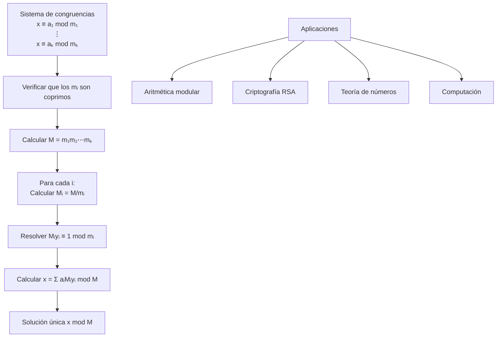

# Álgebra Superior II - Divisibilidad

## 2.6 Congruencias. Congruencias lineales. Teorema chino del residuo.

---

### 1. Congruencias

#### 1.1. Definición

Dado un entero $m > 0$ (módulo), decimos que dos enteros $a$ y $b$ son **congruentes módulo $m$** si:

$$a \equiv b \pmod{m} \iff m \mid (a - b)$$

#### 1.2. Propiedades Fundamentales

Para todo $a, b, c, d \in \mathbb{Z}$ y $m > 0$:

1. **Reflexividad:** $a \equiv a \pmod{m}$
2. **Simetría:** $a \equiv b \pmod{m} \iff b \equiv a \pmod{m}$
3. **Transitividad:** $a \equiv b \pmod{m}$ y $b \equiv c \pmod{m} \Rightarrow a \equiv c \pmod{m}$
4. **Compatibilidad con operaciones:**
   - $a \equiv b \pmod{m} \Rightarrow a + c \equiv b + c \pmod{m}$
   - $a \equiv b \pmod{m} \Rightarrow ac \equiv bc \pmod{m}$
   - $a \equiv b \pmod{m}$ y $c \equiv d \pmod{m} \Rightarrow a + c \equiv b + d \pmod{m}$
   - $a \equiv b \pmod{m}$ y $c \equiv d \pmod{m} \Rightarrow ac \equiv bd \pmod{m}$

### 2. Congruencias Lineales

#### 2.1. Definición

Una **congruencia lineal** es una ecuación de la forma:

$$ax \equiv b \pmod{m}$$

donde $a, b, m \in \mathbb{Z}$ con $m > 0$.

#### 2.2. Teorema de Existencia

La congruencia $ax \equiv b \pmod{m}$ tiene solución si y sólo si:

$$\gcd(a, m) \mid b$$

#### 2.3. Número de Soluciones

Si $d = \gcd(a, m)$ y $d \mid b$, entonces existen exactamente $d$ soluciones incongruentes módulo $m$.

### 3. Teorema Chino del Residuo

#### 3.1. Enunciado

Sean $m_1, m_2, \ldots, m_k$ enteros positivos coprimos dos a dos ( $\gcd(m_i, m_j) = 1$ para $i \neq j$ ). Entonces el sistema de congruencias:

$$ \begin{cases} x \equiv a_1 \pmod{m_1} \\\ x \equiv a_2 \pmod{m_2} \\\ \vdots \\\ x \equiv a_k \pmod{m_k} \end{cases} $$

tiene una única solución módulo $M = m_1m_2\cdots m_k$.

#### 3.2. Algoritmo de Resolución

1. Calcular $M = \prod_{i=1}^k m_i$
2. Para cada $i$, calcular $M_i = M / m_i$
3. Encontrar $y_i$ tal que $M_i y_i \equiv 1 \pmod{m_i}$
4. La solución es: $x \equiv \sum_{i=1}^k a_i M_i y_i \pmod{M}$

### 4. Implementación Computacional

```python
class Congruencias:
    def __init__(self):
        self.name = "Teoría de Congruencias"

    def resolver_congruencia_lineal(self, a, b, m):
        """Resuelve ax ≡ b (mod m)"""
        d, x0, y0 = self.gcd_extendido(a, m)

        if b % d != 0:
            return None, f"No hay solución: gcd({a}, {m}) = {d} no divide a {b}"

        # Simplificar
        a_prime = a // d
        b_prime = b // d
        m_prime = m // d

        # Encontrar solución particular
        x_particular = (x0 * b_prime) % m_prime
        if x_particular < 0:
            x_particular += m_prime

        # Soluciones módulo m
        soluciones = []
        for i in range(d):
            sol = x_particular + i * m_prime
            soluciones.append(sol % m)

        return soluciones, f"{d} soluciones módulo {m}"

    def gcd_extendido(self, a, b):
        """Algoritmo extendido de Euclides"""
        if b == 0:
            return a, 1, 0
        d, x1, y1 = self.gcd_extendido(b, a % b)
        x = y1
        y = x1 - (a // b) * y1
        return d, x, y

    def teorema_chino_residuo(self, congruencias):
        """Resuelve sistema de congruencias usando TCR"""
        # congruencias = [(a1, m1), (a2, m2), ...]
        M = 1
        for a, m in congruencias:
            M *= m

        solucion = 0
        for i, (a_i, m_i) in enumerate(congruencias):
            M_i = M // m_i
            d, y_i, _ = self.gcd_extendido(M_i, m_i)
            if d != 1:
                return None, f"módulos no coprimos: gcd({M_i}, {m_i}) = {d}"

            solucion += a_i * M_i * y_i

        return solucion % M, f"Solución única módulo {M}"

    def verificar_congruencia(self, x, a, m):
        """Verifica si x ≡ a (mod m)"""
        return (x - a) % m == 0

# Ejemplo de uso
cong = Congruencias()

print("Resolución de 3x ≡ 2 (mod 7):")
soluciones, mensaje = cong.resolver_congruencia_lineal(3, 2, 7)
print(f"Soluciones: {soluciones}, {mensaje}")

print("\nSistema de congruencias:")
print("x ≡ 2 (mod 3)")
print("x ≡ 3 (mod 5)")
print("x ≡ 2 (mod 7)")

sistema = [(2, 3), (3, 5), (2, 7)]
solucion, msg = cong.teorema_chino_residuo(sistema)
print(f"Solución: x ≡ {solucion} (mod 105)")
print(f"Verificación: {cong.verificar_congruencia(solucion, 2, 3)}")
print(f"Verificación: {cong.verificar_congruencia(solucion, 3, 5)}")
print(f"Verificación: {cong.verificar_congruencia(solucion, 2, 7)}")
```

### 5. Diagrama del Teorema Chino del Residuo



### 6. Aplicaciones de las Congruencias

#### 6.1. Criterios de Divisibilidad

- **Entre 2:** Última cifra par
- **Entre 3:** Suma de cifras divisible por 3
- **Entre 9:** Suma de cifras divisible por 9
- **Entre 11:** Diferencia alternada de cifras divisible por 11

#### 6.2. Aritmética del Reloj

Las congruencias módulo 12 y 24 modelan la aritmética del tiempo.

#### 6.3. Cálculo de Dígitos Verificadores

Algoritmos como ISBN, CUIT, tarjetas de crédito usan congruencias.

### 7. Ejercicios Resueltos

#### Ejercicio 1

Resuelva $5x \equiv 2 \pmod{7}$

**Solución:**
$\gcd(5, 7) = 1 \mid 2$ → Hay solución única
$5^{-1} \equiv 3 \pmod{7}$ pues $5 \cdot 3 = 15 \equiv 1 \pmod{7}$
$x \equiv 2 \cdot 3 \equiv 6 \pmod{7}$

#### Ejercicio 2

Resuelva el sistema:

$$
\begin{cases}
x \equiv 2 \pmod{3} \\
x \equiv 3 \pmod{5} \\
x \equiv 2 \pmod{7}
\end{cases}
$$

**Solución:**

$M = 3 \cdot 5 \cdot 7 = 105$

$M_1 = 35$, $35y_1 \equiv 1 \pmod{3}$ ⇒ $y_1 = 2$

$M_2 = 21$, $21y_2 \equiv 1 \pmod{5}$ ⇒ $y_2 = 1$

$M_3 = 15$, $15y_3 \equiv 1 \pmod{7}$ ⇒ $y_3 = 1$

$x = 2\cdot35\cdot2 + 3\cdot21\cdot1 + 2\cdot15\cdot1 = 140 + 63 + 30 = 233$

$x \equiv 233 \equiv 23 \pmod{105}$

### 8. Generalizaciones

#### 8.1. Módulos No Coprimos

Si los módulos no son coprimos, el sistema puede:

- No tener solución
- Tener solución única módulo $\text{lcm}(m_1, \ldots, m_k)$
- Tener múltiples soluciones

#### 8.2. Congruencias Polinómicas

Ecuaciones de la forma:

$$ a_nx^n + a_{n-1}x^{n-1} + \cdots + a_0 \equiv 0 \pmod{m} $$

#### 8.3. Anillos Cociente

$\mathbb{Z}/m\mathbb{Z}$ es el anillo de clases de congruencia módulo $m$.

### 9. Ejercicios Propuestos

1. Resuelva $7x \equiv 3 \pmod{15}$

2. Encuentre todos los enteros $x$ tales que $x \equiv 2 \pmod{5}$ y $x \equiv 3 \pmod{7}$

3. Demuestre que $a \equiv b \pmod{m}$ implica $a^n \equiv b^n \pmod{m}$

4. Implemente una función que resuelva sistemas de congruencias con módulos no necesariamente coprimos

5. Encuentre el menor entero positivo que deja residuos 1, 2, 3 al dividirse por 3, 4, 5 respectivamente

6. Demuestre que si $p$ es primo, entonces $(p-1)! \equiv -1 \pmod{p}$ (Teorema de Wilson)

7. Investigue la función φ de Euler y su relación con las congruencias

8. Resuelva el sistema:

$$ \begin{cases} x \equiv 1 \pmod{2} \\\ x \equiv 2 \pmod{3} \\\ x \equiv 3 \pmod{5} \\\ x \equiv 4 \pmod{7} \end{cases} $$

### 10. Referencias

- Rosen, K. H. (2018). _Discrete Mathematics and Its Applications_
- Hardy, G. H., & Wright, E. M. (2008). _An Introduction to the Theory of Numbers_
- Burton, D. M. (2010). _Elementary Number Theory_
- Niven, I., Zuckerman, H. S., & Montgomery, H. L. (1991). _An Introduction to the Theory of Numbers_
- Ireland, K., & Rosen, M. (1990). _A Classical Introduction to Modern Number Theory_
