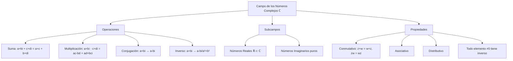

# Álgebra Superior II - Números complejos

## 3.1 El campo de los números complejos.

---

### 1. Definición y Construcción Formal

#### 1.1. Definición como Pares Ordenados

El conjunto de los números complejos $\mathbb{C}$ se define como:

$$\mathbb{C} = \{(a, b) \mid a, b \in \mathbb{R}\}$$

con las operaciones:

- **Suma:** $(a, b) + (c, d) = (a + c, b + d)$
- **Multiplicación:** $(a, b) \cdot (c, d) = (ac - bd, ad + bc)$

#### 1.2. Forma Binómica

Todo número complejo se puede expresar como:

$$ z = a + bi $$

donde:

- $a = \Re(z)$: parte real
- $b = \Im(z)$: parte imaginaria
- $i = \sqrt{-1}$: unidad imaginaria ( $i^2 = -1$ )

### 2. Estructura Algebraica

#### 2.1. Propiedades de Campo

$(\mathbb{C}, +, \cdot)$ es un campo, es decir, satisface:

1. **Asociatividad:** $z + (w + v) = (z + w) + v$, $z(wv) = (zw)v$
2. **Conmutatividad:** $z + w = w + z$, $zw = wz$
3. **Elementos neutros:** $0 = 0 + 0i$, $1 = 1 + 0i$
4. **Inversos:** Todo $z \neq 0$ tiene inverso multiplicativo
5. **Distributividad:** $z(w + v) = zw + zv$

#### 2.2. Subcampo Real

$\mathbb{R}$ se identifica con el subconjunto $\{a + 0i \mid a \in \mathbb{R}\} \subset \mathbb{C}$

### 3. Operaciones Fundamentales

#### 3.1. Conjugación

El **conjugado** de $z = a + bi$ es:

$$ \overline{z} = a - bi $$

**Propiedades:**

- $\overline{z + w} = \overline{z} + \overline{w}$
- $\overline{zw} = \overline{z} \cdot \overline{w}$
- $z + \overline{z} = 2\Re(z)$
- $z - \overline{z} = 2i\Im(z)$

#### 3.2. Módulo

El **módulo** de $z = a + bi$ es:

$$ |z| = \sqrt{a^2 + b^2} $$

**Propiedades:**

- $|z| \geq 0$ y $|z| = 0 \iff z = 0$
- $|zw| = |z||w|$
- $|z + w| \leq |z| + |w|$ (Desigualdad triangular)

#### 3.3. Inverso Multiplicativo

Si $z = a + bi \neq 0$, su inverso es:

$$ z^{-1} = \frac{\overline{z}}{|z|^2} = \frac{a - bi}{a^2 + b^2} $$

### 4. Implementación Computacional

```python
import math
import cmath

class NumeroComplejo:
    def __init__(self, real, imag):
        self.real = real
        self.imag = imag

    def __str__(self):
        return f"{self.real} {self.imag:+}i"

    def conjugado(self):
        return NumeroComplejo(self.real, -self.imag)

    def modulo(self):
        return math.sqrt(self.real**2 + self.imag**2)

    def argumento(self):
        return cmath.phase(complex(self.real, self.imag))

    def inverso(self):
        denom = self.real**2 + self.imag**2
        if denom == 0:
            raise ValueError("División por cero")
        return NumeroComplejo(self.real/denom, -self.imag/denom)

    def __add__(self, other):
        return NumeroComplejo(self.real + other.real, self.imag + other.imag)

    def __sub__(self, other):
        return NumeroComplejo(self.real - other.real, self.imag - other.imag)

    def __mul__(self, other):
        real = self.real*other.real - self.imag*other.imag
        imag = self.real*other.imag + self.imag*other.real
        return NumeroComplejo(real, imag)

    def __truediv__(self, other):
        return self * other.inverso()

    def potencia(self, n):
        """Calcula z^n usando forma polar"""
        r = self.modulo()
        theta = self.argumento()
        new_r = r**n
        new_theta = theta * n
        return NumeroComplejo(new_r*math.cos(new_theta), new_r*math.sin(new_theta))

# Ejemplos de uso
z = NumeroComplejo(3, 4)
w = NumeroComplejo(1, -2)

print(f"z = {z}")
print(f"w = {w}")
print(f"z + w = {z + w}")
print(f"z * w = {z * w}")
print(f"Conjugado de z: {z.conjugado()}")
print(f"Módulo de z: {z.modulo():.2f}")
print(f"Inverso de z: {z.inverso()}")
print(f"z / w = {z / w}")
print(f"z^2 = {z.potencia(2)}")
```

### 5. Diagrama de la Estructura Algebraica



### 6. Forma Polar y Teorema de De Moivre

#### 6.1. Forma Polar

Todo número complejo $z = a + bi$ puede escribirse como:

$$ z = r(\cos\theta + i\sin\theta)$$

donde:

- $r = |z| = \sqrt{a^2 + b^2}$ (módulo)
- $\theta = \arg(z)$ (argumento)

#### 6.2. Fórmula de Euler

$$e^{i\theta} = \cos\theta + i\sin\theta$$
$$z = re^{i\theta}$$

#### 6.3. Teorema de De Moivre

Para todo $n \in \mathbb{Z}$:

$$ [r(\cos\theta + i\sin\theta)]^n = r^n(\cos n\theta + i\sin n\theta) $$

### 7. Aplicaciones y Ejemplos

#### 7.1. Resolución de Ecuaciones Cuadráticas

Para $az^2 + bz + c = 0$ con $a, b, c \in \mathbb{R}$:

$$ z = \frac{-b \pm \sqrt{b^2 - 4ac}}{2a} $$

Si $b^2 - 4ac < 0$, las soluciones son complejas conjugadas.

#### 7.2. Raíces de la Unidad

Las n-ésimas raíces de la unidad son:

$$ \omega_k = e^{2\pi i k/n} = \cos\left(\frac{2\pi k}{n}\right) + i\sin\left(\frac{2\pi k}{n}\right) $$

para $k = 0, 1, \ldots, n-1$

### 8. Ejercicios Resueltos

#### Ejercicio 1

Calcule $(1 + i)^4$

**Solución:**
$1 + i = \sqrt{2}(\cos\frac{\pi}{4} + i\sin\frac{\pi}{4})$
$(1 + i)^4 = (\sqrt{2})^4(\cos\pi + i\sin\pi) = 4(-1 + 0i) = -4$

#### Ejercicio 2

Encuentre las raíces cúbicas de $8$

**Solución:**
$8 = 8(\cos 0 + i\sin 0)$
Raíces: $2(\cos\frac{2\pi k}{3} + i\sin\frac{2\pi k}{3})$ para $k = 0, 1, 2$

- $k=0$: $2$
- $k=1$: $2(\cos\frac{2\pi}{3} + i\sin\frac{2\pi}{3}) = -1 + i\sqrt{3}$
- $k=2$: $2(\cos\frac{4\pi}{3} + i\sin\frac{4\pi}{3}) = -1 - i\sqrt{3}$

### 9. Ejercicios Propuestos

1. Calcule $(2 - 3i)(4 + 5i)$

2. Encuentre el módulo y argumento de $z = 1 - i\sqrt{3}$

3. Resuelva la ecuación $z^2 + 4z + 13 = 0$

4. Demuestre que $|z + w|^2 + |z - w|^2 = 2(|z|^2 + |w|^2)$

5. Encuentre todas las raíces cuartas de $-16$

6. Implemente una clase que represente números complejos con operaciones

7. Demuestre que $\overline{z^{-1}} = (\overline{z})^{-1}$

8. Investigue la representación matricial de los números complejos

### 10. Referencias

- Ahlfors, L. V. (1979). _Complex Analysis_
- Churchill, R. V., & Brown, J. W. (2014). _Complex Variables and Applications_
- Needham, T. (1997). _Visual Complex Analysis_
- Marsden, J. E., & Hoffman, M. J. (1999). _Basic Complex Analysis_
- Lang, S. (1999). _Complex Analysis_
