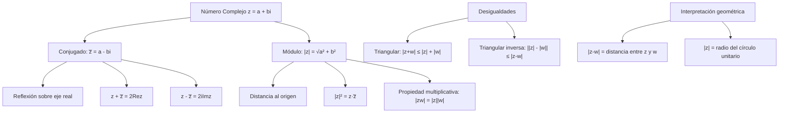

# Álgebra Superior II - Números complejos

## 3.2 Conjugación. Módulo o norma.

---

### 1. Conjugación de Números Complejos

#### 1.1. Definición

El **conjugado** de un número complejo $z = a + bi$ se define como:

$$\overline{z} = a - bi$$

#### 1.2. Propiedades de la Conjugación

Para todo $z, w \in \mathbb{C}$:

1. **Involución:** $\overline{\overline{z}} = z$
2. **Conjugado de la suma:** $\overline{z + w} = \overline{z} + \overline{w}$
3. **Conjugado del producto:** $\overline{zw} = \overline{z} \cdot \overline{w}$
4. **Conjugado del cociente:** $\overline{\left(\frac{z}{w}\right)} = \frac{\overline{z}}{\overline{w}}$ para $w \neq 0$
5. **Parte real e imaginaria:**
   - $\Re(z) = \frac{z + \overline{z}}{2}$
   - $\Im(z) = \frac{z - \overline{z}}{2i}$
6. **Relación con el inverso:** $\overline{z^{-1}} = (\overline{z})^{-1}$

### 2. Módulo o Norma de Números Complejos

#### 2.1. Definición

El **módulo** (o valor absoluto) de $z = a + bi$ es:

$$|z| = \sqrt{a^2 + b^2}$$

#### 2.2. Propiedades del Módulo

Para todo $z, w \in \mathbb{C}$:

1. **No negatividad:** $|z| \geq 0$ y $|z| = 0 \iff z = 0$
2. **Multiplicatividad:** $|zw| = |z||w|$
3. **Desigualdad triangular:** $|z + w| \leq |z| + |w|$
4. **Desigualdad triangular inversa:** $||z| - |w|| \leq |z - w|$
5. **Relación con el conjugado:** $|z|^2 = z\overline{z}$
6. **Módulo del inverso:** $|z^{-1}| = \frac{1}{|z|}$ para $z \neq 0$

### 3. Implementación Computacional

```python
import math
import cmath

class Complejo:
    def __init__(self, real, imag):
        self.real = real
        self.imag = imag

    def __str__(self):
        return f"{self.real} {self.imag:+}i"

    def conjugado(self):
        """Retorna el conjugado del número complejo"""
        return Complejo(self.real, -self.imag)

    def modulo(self):
        """Calcula el módulo del número complejo"""
        return math.sqrt(self.real**2 + self.imag**2)

    def argumento(self):
        """Calcula el argumento principal en radianes"""
        return cmath.phase(complex(self.real, self.imag))

    def forma_polar(self):
        """Representación en forma polar"""
        r = self.modulo()
        theta = self.argumento()
        return f"{r:.2f}(cos{theta:.2f} + i sen{theta:.2f})"

    def __add__(self, other):
        return Complejo(self.real + other.real, self.imag + other.imag)

    def __sub__(self, other):
        return Complejo(self.real - other.real, self.imag - other.imag)

    def __mul__(self, other):
        real = self.real*other.real - self.imag*other.imag
        imag = self.real*other.imag + self.imag*other.real
        return Complejo(real, imag)

    def __truediv__(self, other):
        # (a+bi)/(c+di) = [(a+bi)(c-di)]/(c²+d²)
        denom = other.real**2 + other.imag**2
        real = (self.real*other.real + self.imag*other.imag) / denom
        imag = (self.imag*other.real - self.real*other.imag) / denom
        return Complejo(real, imag)

    def verificar_propiedades(self, other):
        """Verifica propiedades de conjugación y módulo"""
        resultados = {}

        # Propiedades de conjugación
        resultados["Involución"] = self.conjugado().conjugado() == self
        resultados["Conjugado de suma"] = (self + other).conjugado() == self.conjugado() + other.conjugado()
        resultados["Conjugado de producto"] = (self * other).conjugado() == self.conjugado() * other.conjugado()
        resultados["z * z_conj"] = abs((self * self.conjugado()).real - self.modulo()**2) < 1e-10

        # Propiedades de módulo
        resultados["Módulo producto"] = abs((self * other).modulo() - self.modulo() * other.modulo()) < 1e-10
        resultados["Desigualdad triangular"] = (self + other).modulo() <= self.modulo() + other.modulo()
        resultados["Módulo conjugado"] = abs(self.modulo() - self.conjugado().modulo()) < 1e-10

        return resultados

# Ejemplos de uso
z = Complejo(3, 4)
w = Complejo(1, -2)

print(f"z = {z}")
print(f"w = {w}")
print(f"Conjugado de z: {z.conjugado()}")
print(f"Módulo de z: {z.modulo():.2f}")
print(f"Forma polar de z: {z.forma_polar()}")
print(f"z * conjugado(z) = {z * z.conjugado()}")  # Debe ser real

print("\nVerificación de propiedades:")
props = z.verificar_propiedades(w)
for prop, valor in props.items():
    print(f"{prop}: {valor}")

# Demostración de desigualdad triangular
print(f"\n|z| = {z.modulo():.2f}")
print(f"|w| = {w.modulo():.2f}")
print(f"|z + w| = {(z + w).modulo():.2f}")
print(f"|z| + |w| = {z.modulo() + w.modulo():.2f}")
print(f"¿Se cumple |z + w| ≤ |z| + |w|? {(z + w).modulo() <= z.modulo() + w.modulo()}")
```

### 4. Diagrama de Relaciones Geométricas



### 5. Relaciones entre Conjugación y Módulo

#### 5.1. Identidad Fundamental

$$|z|^2 = z\overline{z}$$

#### 5.2. Fórmula para el Inverso

$$z^{-1} = \frac{\overline{z}}{|z|^2} \quad \text{para } z \neq 0$$

#### 5.3. Descomposición en Partes Real e Imaginaria

$$\Re(z) = \frac{z + \overline{z}}{2}, \quad \Im(z) = \frac{z - \overline{z}}{2i}$$

#### 5.4. Módulo del Conjugado

$$|\overline{z}| = |z|$$

### 6. Aplicaciones Geométricas

#### 6.1. Representación en el Plano Complejo

- El conjugado $\overline{z}$ es la reflexión de $z$ sobre el eje real
- El módulo $|z|$ representa la distancia del punto al origen
- $|z - w|$ es la distancia entre los puntos $z$ y $w$

#### 6.2. Ecuación del Círculo

El conjunto $\{z \in \mathbb{C} \mid |z - z_0| = r\}$ representa un círculo de centro $z_0$ y radio $r$.

#### 6.3. Rectas y Semiplanos

- $\{z \in \mathbb{C} \mid \Re(z) = c\}$: recta vertical
- $\{z \in \mathbb{C} \mid \Im(z) = c\}$: recta horizontal
- $\{z \in \mathbb{C} \mid \Re(z) > 0\}$: semiplano derecho

### 7. Ejercicios Resueltos

#### Ejercicio 1

Demuestre que $|z + w|^2 + |z - w|^2 = 2(|z|^2 + |w|^2)$

**Solución:**
$$ \begin{align*} |z + w|^2 + |z - w|^2 &= (z + w)(\overline{z + w}) + (z - w)(\overline{z - w}) \\\ &= (z + w)(\overline{z} + \overline{w}) + (z - w)(\overline{z} - \overline{w}) \\\ &= z\overline{z} + z\overline{w} + w\overline{z} + w\overline{w} + z\overline{z} - z\overline{w} - w\overline{z} + w\overline{w} \\\ &= 2z\overline{z} + 2w\overline{w} \\\ &= 2(|z|^2 + |w|^2) \end{align*} $$

#### Ejercicio 2

Encuentre todos los números complejos $z$ tales que $z\overline{z} + 2z + 2\overline{z} + 4 = 0$

**Solución:**
Completando cuadrados:

$$ z\overline{z} + 2z + 2\overline{z} + 4 = (z + 2)(\overline{z} + 2) = |z + 2|^2 = 0 $$
Luego $z = -2$

### 8. Ejercicios Propuestos

1. Demuestre que $\overline{\left(\frac{1}{z}\right)} = \frac{1}{\overline{z}}$ para $z \neq 0$

2. Verifique que $|z_1 + z_2|^2 = |z_1|^2 + |z_2|^2 + 2\Re(z_1\overline{z_2})$

3. Encuentre todos los $z \in \mathbb{C}$ tales que $|z - 1| = |z + i|$

4. Demuestre que si $|z| = 1$, entonces $\frac{1}{z} = \overline{z}$

5. Implemente una función que calcule la distancia entre dos números complejos

6. Demuestre que $|\Re(z)| \leq |z|$ y $|\Im(z)| \leq |z|$

7. Encuentre el lugar geométrico de los puntos $z$ que satisfacen $|z - 2| + |z + 2| = 6$

8. Investigue la interpretación geométrica de la multiplicación por $i$

### 9. Referencias

- Ahlfors, L. V. (1979). _Complex Analysis_
- Churchill, R. V., & Brown, J. W. (2014). _Complex Variables and Applications_
- Needham, T. (1997). _Visual Complex Analysis_
- Marsden, J. E., & Hoffman, M. J. (1999). _Basic Complex Analysis_
- Lang, S. (1999). _Complex Analysis_
