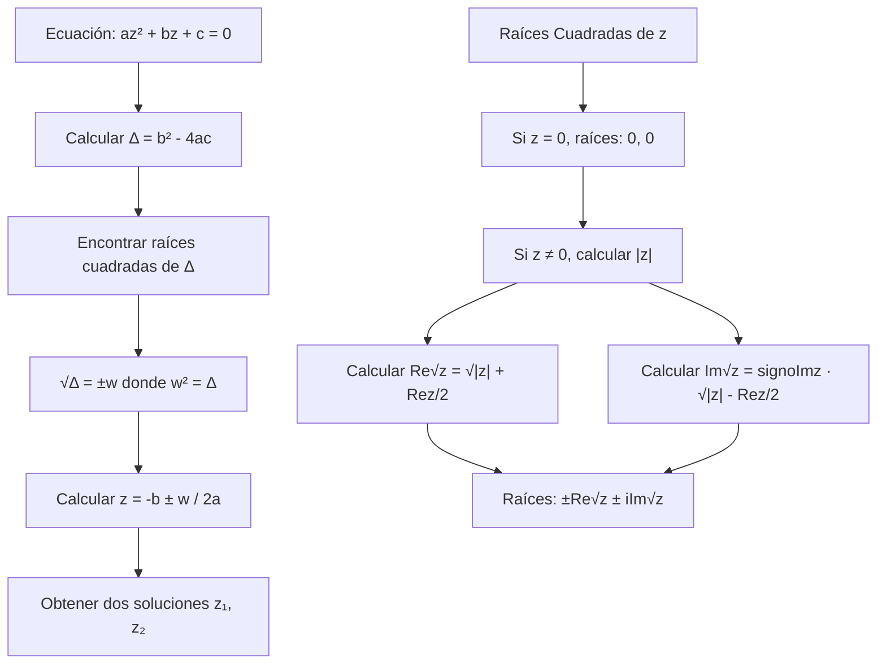
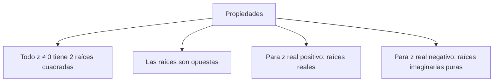

# Álgebra Superior II - Números complejos

## 3.3 Raíces cuadradas. La ecuación de 2° grado.

---

### 1. Raíces Cuadradas en los Números Complejos

#### 1.1. Definición

Un número complejo $w$ es una **raíz cuadrada** de $z \in \mathbb{C}$ si:

$$w^2 = z$$

A diferencia de los reales, todo número complejo no nulo tiene exactamente dos raíces cuadradas (excepto el 0).

#### 1.2. Fórmula para las Raíces Cuadradas

Para $z = a + bi \neq 0$, las raíces cuadradas están dadas por:

$$w = \pm \left( \sqrt{\frac{|z| + a}{2}} + i \cdot \frac{b}{|b|} \sqrt{\frac{|z| - a}{2}} \right)$$

donde $\frac{b}{|b|}$ se interpreta como $1$ si $b = 0$ y $a \geq 0$, o $-1$ si $b = 0$ y $a < 0$.

### 2. Ecuación Cuadrática en ℂ

#### 2.1. Forma General

La ecuación cuadrática general en $\mathbb{C}$ es:

$$az^2 + bz + c = 0$$

donde $a, b, c \in \mathbb{C}$ y $a \neq 0$.

#### 2.2. Fórmula General

Las soluciones están dadas por:

$$z = \frac{-b \pm \sqrt{b^2 - 4ac}}{2a}$$

donde $\sqrt{\Delta}$ denota las dos raíces cuadradas del discriminante $\Delta = b^2 - 4ac$.

#### 2.3. Casos Especiales

- Si $\Delta = 0$: una raíz doble
- Si $\Delta \neq 0$: dos raíces distintas
- Siempre existen exactamente 2 soluciones (contando multiplicidades)

### 3. Implementación Computacional

```python
import math
import cmath

class AlgebraCompleja:
    def __init__(self):
        self.tolerancia = 1e-10

    def raices_cuadradas(self, z):
        """Calcula las dos raíces cuadradas de un número complejo"""
        a, b = z.real, z.imag

        if abs(z) < self.tolerancia:  # z = 0
            return [0, 0]

        # Calcular módulo y signo de b
        r = abs(z)
        signo_b = 1 if b >= 0 else -1
        if abs(b) < self.tolerancia:
            signo_b = 1 if a >= 0 else -1

        # Fórmula para raíces cuadradas
        parte_real = math.sqrt((r + a) / 2)
        parte_imag = signo_b * math.sqrt((r - a) / 2)

        w1 = complex(parte_real, parte_imag)
        w2 = complex(-parte_real, -parte_imag)

        return [w1, w2]

    def resolver_cuadratica(self, a, b, c):
        """Resuelve la ecuación cuadrática az² + bz + c = 0"""
        # Calcular discriminante
        discriminante = b**2 - 4*a*c

        # Calcular raíces cuadradas del discriminante
        raices_delta = self.raices_cuadradas(discriminante)

        soluciones = []
        for raiz in raices_delta:
            z = (-b + raiz) / (2*a)
            soluciones.append(z)

        return soluciones

    def verificar_raiz(self, z, a, b, c):
        """Verifica si z es solución de az² + bz + c = 0"""
        valor = a*z**2 + b*z + c
        return abs(valor) < self.tolerancia

    def forma_canonica(self, a, b, c):
        """Convierte a forma canónica: a(z - h)² + k"""
        h = -b/(2*a)
        k = c - a*h**2
        return h, k

# Ejemplos de uso
algebra = AlgebraCompleja()

print("Raíces cuadradas de -1:")
raices = algebra.raices_cuadradas(complex(-1, 0))
for i, raiz in enumerate(raices, 1):
    print(f"Raíz {i}: {raiz}")

print("\nRaíces cuadradas de 3 + 4i:")
raices = algebra.raices_cuadradas(complex(3, 4))
for i, raiz in enumerate(raices, 1):
    print(f"Raíz {i}: {raiz}")

print("\nResolución de z² + 4z + 13 = 0:")
soluciones = algebra.resolver_cuadratica(1, 4, 13)
for i, sol in enumerate(soluciones, 1):
    print(f"Solución {i}: {sol}")
    print(f"Verificación: {algebra.verificar_raiz(sol, 1, 4, 13)}")

print("\nResolución de z² - 2z + 1 = 0:")  # Raíz doble
soluciones = algebra.resolver_cuadratica(1, -2, 1)
for i, sol in enumerate(soluciones, 1):
    print(f"Solución {i}: {sol}")
```

### 4. Diagrama del Proceso de Resolución





### 5. Relaciones entre Coeficientes y Raíces

#### 5.1. Fórmulas de Vieta

Si $z_1$ y $z_2$ son las raíces de $az^2 + bz + c = 0$, entonces:

- $z_1 + z_2 = -\frac{b}{a}$
- $z_1 z_2 = \frac{c}{a}$

#### 5.2. Discriminante y Naturaleza de las Raíces

- $\Delta > 0$ (real positivo): dos raíces reales distintas
- $\Delta = 0$: una raíz real doble
- $\Delta < 0$ (real negativo): dos raíces complejas conjugadas

#### 5.3. Forma Factorizada

$$az^2 + bz + c = a(z - z_1)(z - z_2)$$

### 6. Casos Especiales y Ejemplos

#### 6.1. Raíces Cuadradas de Números Reales Negativos

Para $x > 0$:

$$ \sqrt{-x} = \pm i\sqrt{x} $$

#### 6.2. Raíces Cuadradas de Números Imaginarios Puros

Para $y > 0$:

$$ \sqrt{iy} = \pm \left( \sqrt{\frac{y}{2}} + i\sqrt{\frac{y}{2}} \right) $$

#### 6.3. Ecuaciones con Coeficientes Complejos

Misma fórmula aplica, pero las raíces no necesariamente son conjugadas.

### 7. Ejercicios Resueltos

#### Ejercicio 1

Encuentre las raíces cuadradas de $5 + 12i$

**Solución:**
$|5 + 12i| = 13$
$\sqrt{\frac{13 + 5}{2}} = \sqrt{9} = 3$
$\sqrt{\frac{13 - 5}{2}} = \sqrt{4} = 2$
Como $b = 12 > 0$, las raíces son:

$ 3 + 2i $ y $ -3 - 2i $

#### Ejercicio 2

Resuelva $z^2 - (3 + 2i)z + (1 + 3i) = 0$

**Solución:**
$\Delta = (3 + 2i)^2 - 4(1)(1 + 3i) = 9 + 12i - 4 - 4 - 12i = 1$
$\sqrt{\Delta} = \pm 1$
$z = \frac{(3 + 2i) \pm 1}{2}$
Soluciones: $z_1 = 2 + i$, $z_2 = 1 + i$

### 8. Aplicaciones e Importancia

#### 8.1. Teorema Fundamental del Álgebra

Toda ecuación polinomial de grado $n$ tiene exactamente $n$ raíces en $\mathbb{C}$ (contando multiplicidades).

#### 8.2. Análisis de Circuitos Eléctricos

Las ecuaciones cuadráticas complejas aparecen en el análisis de circuitos RLC.

#### 8.3. Procesamiento de Señales

Raíces de polinomios complejos en análisis de sistemas.

#### 8.4. Geometría Fractal

Conjuntos de Julia y Mandelbrot se definen mediante iteraciones cuadráticas.

### 9. Ejercicios Propuestos

1. Encuentre las raíces cuadradas de:
   a) $-9$
   b) $2i$
   c) $1 - i$

2. Resuelva las ecuaciones:
   a) $z^2 + 9 = 0$
   b) $z^2 - 2z + 5 = 0$
   c) $(1 + i)z^2 + (2 - i)z - 1 = 0$

3. Demuestre que si $w$ es raíz cuadrada de $z$, entonces $-w$ también lo es.

4. Implemente una función que resuelva ecuaciones cúbicas en $\mathbb{C}$

5. Encuentre todos los $z \in \mathbb{C}$ tales que $z^2 = \overline{z}$

6. Demuestre que las raíces de $z^2 + pz + q = 0$ con $p, q \in \mathbb{R}$ son reales o complejas conjugadas.

7. Investigue el método de completar cuadrados para ecuaciones cuadráticas complejas.

8. Estudie la relación entre las raíces de una ecuación cuadrática y los puntos fijos de una transformación de Möbius.

### 10. Referencias

- Ahlfors, L. V. (1979). _Complex Analysis_
- Churchill, R. V., & Brown, J. W. (2014). _Complex Variables and Applications_
- Needham, T. (1997). _Visual Complex Analysis_
- Lang, S. (1999). _Complex Analysis_
- Marsden, J. E., & Hoffman, M. J. (1999). _Basic Complex Analysis_
