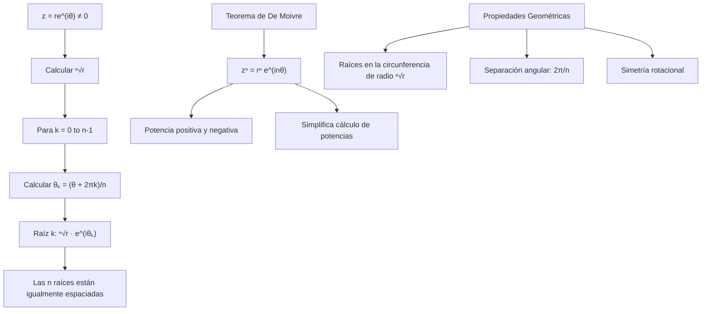

# Álgebra Superior II - Números complejos

## 3.4 Representación polar. Teorema de De Moivre. Raíces 𝑛-ésimas.

---

### 1. Representación Polar de Números Complejos

#### 1.1. Forma Polar

Todo número complejo $z = a + bi \neq 0$ puede escribirse en forma polar como:

$$z = r(\cos\theta + i\sin\theta)$$

donde:

- $r = |z| = \sqrt{a^2 + b^2}$ (módulo)
- $\theta = \arg(z)$ ( argumento principal, $-\pi < \theta \leq \pi$ )

#### 1.2. Fórmula de Euler

$$e^{i\theta} = \cos\theta + i\sin\theta$$
$$z = re^{i\theta}$$

#### 1.3. Conversión entre Formas

- De rectangular a polar: $r = \sqrt{a^2 + b^2}$, $\theta = \arctan2(b, a)$
- De polar a rectangular: $a = r\cos\theta$, $b = r\sin\theta$

### 2. Teorema de De Moivre

#### 2.1. Enunciado

Para todo $n \in \mathbb{Z}$ y $z = r(\cos\theta + i\sin\theta)$:

$$ [r(\cos\theta + i\sin\theta)]^n = r^n(\cos n\theta + i\sin n\theta) $$

#### 2.2. Casos Especiales

- **Potencia positiva:** $z^n = r^n e^{in\theta}$
- **Potencia negativa:** $z^{-n} = r^{-n} e^{-in\theta}$
- **Inverso:** $z^{-1} = r^{-1} e^{-i\theta}$

#### 2.3. Aplicaciones

- Cálculo de potencias de números complejos
- Simplificación de expresiones trigonométricas
- Resolución de ecuaciones

### 3. Raíces n-ésimas

#### 3.1. Definición

Un número complejo $w$ es una **raíz n-ésima** de $z$ si:

$$w^n = z$$

#### 3.2. Fórmula General

Para $z = r(\cos\theta + i\sin\theta) \neq 0$, las $n$ raíces n-ésimas son:

$$w_k = \sqrt[n]{r} \left( \cos\left(\frac{\theta + 2\pi k}{n}\right) + i\sin\left(\frac{\theta + 2\pi k}{n}\right) \right)$$

para $k = 0, 1, 2, \ldots, n-1$

#### 3.3. Propiedades

- Todo $z \neq 0$ tiene exactamente $n$ raíces n-ésimas distintas
- Las raíces están igualmente espaciadas sobre la circunferencia de radio $\sqrt[n]{r}$, separadas por un ángulo de $\frac{2\pi}{n}$
- Si $z = 0$, la única raíz es $0$ ( con multiplicidad $n$ )

### 4. Implementación Computacional

```python
import math
import cmath
import numpy as np

class ComplejoPolar:
    def __init__(self):
        self.tolerancia = 1e-10

    def a_polar(self, z):
        """Convierte número complejo a forma polar"""
        r = abs(z)
        theta = cmath.phase(z)
        return r, theta

    def a_rectangular(self, r, theta):
        """Convierte forma polar a rectangular"""
        a = r * math.cos(theta)
        b = r * math.sin(theta)
        return complex(a, b)

    def de_moivre(self, z, n):
        """Calcula z^n usando el teorema de De Moivre"""
        r, theta = self.a_polar(z)
        new_r = r ** n
        new_theta = theta * n
        return self.a_rectangular(new_r, new_theta)

    def raices_nesimas(self, z, n):
        """Calcula las n raíces n-ésimas de z"""
        if abs(z) < self.tolerancia:  # z = 0
            return [0] * n

        r, theta = self.a_polar(z)
        raiz_n_r = r ** (1/n)

        raices = []
        for k in range(n):
            angulo = (theta + 2 * math.pi * k) / n
            raiz = self.a_rectangular(raiz_n_r, angulo)
            raices.append(raiz)

        return raices

    def verificar_raiz(self, w, z, n):
        """Verifica si w^n = z"""
        return abs(w**n - z) < self.tolerancia

    def graficar_raices(self, z, n):
        """Genera datos para graficar las raíces"""
        raices = self.raices_nesimas(z, n)
        return [(w.real, w.imag) for w in raices]

# Ejemplos de uso
polar = ComplejoPolar()

# Conversión entre formas
z = complex(1, 1)
r, theta = polar.a_polar(z)
print(f"z = {z} en forma polar: r = {r:.2f}, θ = {theta:.2f} rad")

# Teorema de De Moivre
print(f"\n(1 + i)^5 = {polar.de_moivre(z, 5)}")
print(f"Verificación: {z**5}")

# Raíces cúbicas de 8
print(f"\nRaíces cúbicas de 8:")
raices = polar.raices_nesimas(8, 3)
for i, raiz in enumerate(raices):
    print(f"Raíz {i+1}: {raiz}")
    print(f"Verificación: {raiz**3} ≈ 8? {abs(raiz**3 - 8) < 1e-10}")

# Raíces cuartas de -16
print(f"\nRaíces cuartas de -16:")
raices = polar.raices_nesimas(-16, 4)
for i, raiz in enumerate(raices):
    print(f"Raíz {i+1}: {raiz}")
```

### 5. Diagrama de Raíces n-ésimas



### 6. Aplicaciones del Teorema de De Moivre

#### 6.1. Fórmulas Trigonométricas

Para expresar $\cos n\theta$ y $\sin n\theta$ en términos de $\cos\theta$ y $\sin\theta$:

$$(\cos\theta + i\sin\theta)^n = \cos n\theta + i\sin n\theta$$

#### 6.2. Cálculo de Potencias

Simplificación de expresiones como $(1 + i)^{100}$

#### 6.3. Resolución de Ecuaciones

Ecuaciones de la forma $z^n = w$

### 7. Ejercicios Resueltos

#### Ejercicio 1

Calcule $(1 + i\sqrt{3})^6$

**Solución:**
$1 + i\sqrt{3} = 2(\cos\frac{\pi}{3} + i\sin\frac{\pi}{3})$
$(1 + i\sqrt{3})^6 = 2^6(\cos 2\pi + i\sin 2\pi) = 64(1 + 0i) = 64$

#### Ejercicio 2

Encuentre todas las raíces cúbicas de $i$

**Solución:**
$i = e^{i\pi/2}$
Raíces: $e^{i(\pi/2 + 2\pi k)/3} = e^{i(\pi/6 + 2\pi k/3)}$ para $k = 0, 1, 2$

- $k=0$: $e^{i\pi/6} = \cos\frac{\pi}{6} + i\sin\frac{\pi}{6} = \frac{\sqrt{3}}{2} + \frac{i}{2}$
- $k=1$: $e^{i5\pi/6} = -\frac{\sqrt{3}}{2} + \frac{i}{2}$
- $k=2$: $e^{i3\pi/2} = -i$

### 8. Aplicaciones e Importancia

#### 8.1. Análisis de Fourier

La forma polar es fundamental en el análisis de señales.

#### 8.2. Teoría de Control

Raíces de polinomios característicos en el plano complejo.

#### 8.3. Geometría Computacional

Rotaciones y escalamientos usando números complejos.

#### 8.4. Física Cuántica

Amplitudes de probabilidad y fases.

### 9. Ejercicios Propuestos

1. Exprese en forma polar:
   a) $-2 + 2i$
   b) $3 - 3i\sqrt{3}$
   c) $-4i$

2. Calcule usando De Moivre:
   a) $(1 - i)^8$
   b) $(\sqrt{3} + i)^6$
   c) $\left(\frac{1}{2} + \frac{i\sqrt{3}}{2}\right)^{12}$

3. Encuentre todas las raíces:
   a) Raíces cuadradas de $-4i$
   b) Raíces cúbicas de $27$
   c) Raíces cuartas de $-1$

4. Demuestre que las raíces n-ésimas de 1 suman 0 para $n > 1$

5. Implemente una función que calcule $\cos n\theta$ usando De Moivre

6. Encuentre las raíces sextas de $-64$ y grafíquelas

7. Resuelva la ecuación $z^4 + 16 = 0$

8. Investigue la relación entre las raíces de la unidad y los polígonos regulares

### 10. Referencias

- Ahlfors, L. V. (1979). _Complex Analysis_
- Churchill, R. V., & Brown, J. W. (2014). _Complex Variables and Applications_
- Needham, T. (1997). _Visual Complex Analysis_
- Lang, S. (1999). _Complex Analysis_
- Marsden, J. E., & Hoffman, M. J. (1999). _Basic Complex Analysis_
