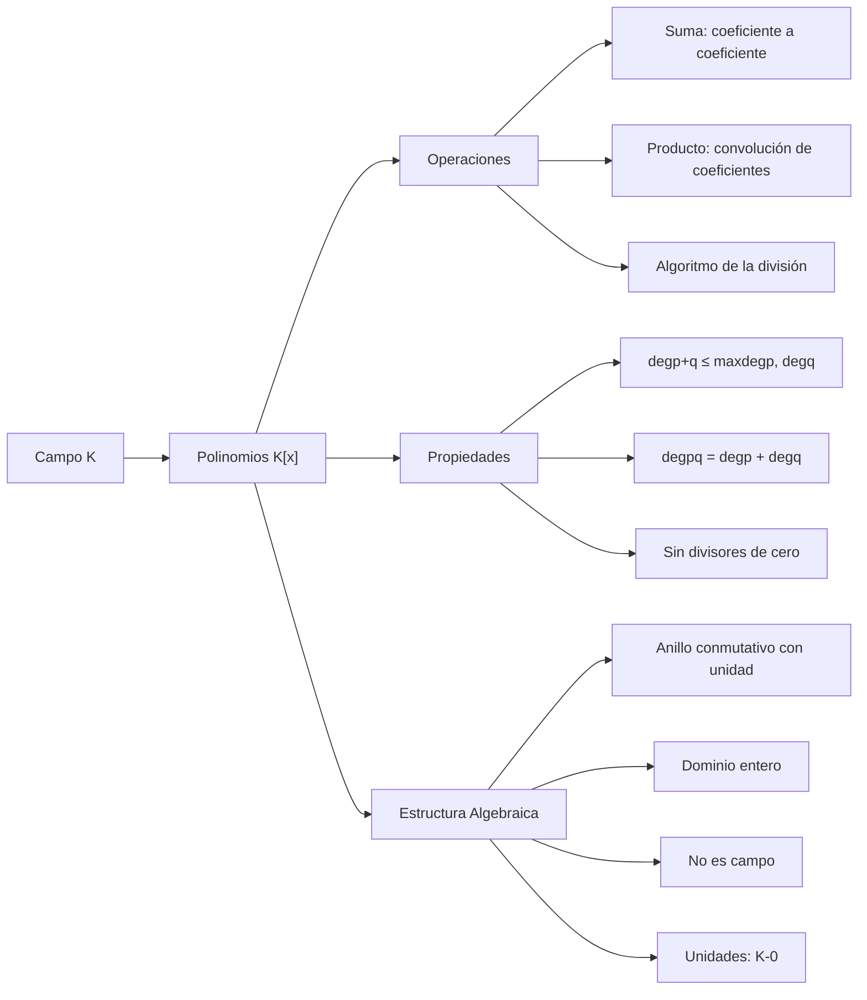

# Álgebra Superior II - Polinomios y ecuaciones polinomiales

## 4.1 Polinomios con coeficientes en un campo K. Operaciones. El dominio entero K[x].

---

### 1. Definición de Polinomios

#### 1.1. Definición Formal

Un **polinomio** sobre un campo $K$ es una expresión de la forma:

$$p(x) = a_nx^n + a_{n-1}x^{n-1} + \cdots + a_1x + a_0$$

donde $a_i \in K$ para $i = 0, 1, \ldots, n$ y $a_n \neq 0$.

#### 1.2. Notación y Términos

- $K[x]$: conjunto de todos los polinomios con coeficientes en $K$
- **Grado:** $\deg(p) = n$ ( si $a_n \neq 0$ )
- **Coeficiente líder:** $a_n$
- **Término constante:** $a_0$
- **Polinomio mónico:** coeficiente líder = 1

#### 1.3. Polinomio Cero

El polinomio cero $0$ tiene grado indefinido ( a veces se define $\deg(0) = -\infty$ ).

### 2. Operaciones con Polinomios

#### 2.1. Suma de Polinomios

Para $p(x) = \sum a_ix^i$ y $q(x) = \sum b_ix^i$:

$$(p + q)(x) = \sum (a_i + b_i)x^i$$

#### 2.2. Producto de Polinomios

Para $p(x) = \sum a_ix^i$ y $q(x) = \sum b_ix^i$:

$$(pq)(x) = \sum c_kx^k \quad \text{donde} \quad c_k = \sum_{i+j=k} a_ib_j$$

#### 2.3. Propiedades de las Operaciones

- **Conmutatividad:** $p + q = q + p$, $pq = qp$
- **Asociatividad:** $(p + q) + r = p + (q + r)$, $(pq)r = p(qr)$
- **Distributividad:** $p(q + r) = pq + pr$
- **Elementos neutros:** $p + 0 = p$, $p \cdot 1 = p$

### 3. El Dominio Entero $K[x]$

#### 3.1. Estructura Algebraica

$(K[x], +, \cdot)$ es un **dominio entero** (anillo conmutativo con unidad sin divisores de cero).

#### 3.2. Propiedades como Dominio Entero

1. **Sin divisores de cero:** $pq = 0 \Rightarrow p = 0$ o $q = 0$
2. **Ley de cancelación:** $pr = qr$ y $r \neq 0 \Rightarrow p = q$
3. **Grado del producto:** $\deg(pq) = \deg(p) + \deg(q)$
4. **Unidades:** Las únicas unidades son los polinomios constantes no nulos

#### 3.3. Algoritmo de la División

Para $f(x), g(x) \in K[x]$ con $g(x) \neq 0$, existen únicos $q(x), r(x) \in K[x]$ tales que:

$$f(x) = g(x)q(x) + r(x)$$

con $\deg(r) < \deg(g)$ o $r(x) = 0$.

### 4. Implementación Computacional

```python
class Polinomio:
    def __init__(self, coeficientes):
        """Inicializa polinomio con lista de coeficientes [a0, a1, ..., an]"""
        # Eliminar ceros a la derecha
        while len(coeficientes) > 1 and coeficientes[-1] == 0:
            coeficientes.pop()
        self.coef = coeficientes

    def grado(self):
        """Retorna el grado del polinomio"""
        return len(self.coef) - 1

    def __str__(self):
        """Representación string del polinomio"""
        terminos = []
        for i, c in enumerate(self.coef):
            if c != 0:
                if i == 0:
                    terminos.append(f"{c}")
                elif i == 1:
                    terminos.append(f"{c}x" if c != 1 else "x")
                else:
                    terminos.append(f"{c}x^{i}" if c != 1 else f"x^{i}")
        return " + ".join(reversed(terminos)) if terminos else "0"

    def __add__(self, other):
        """Suma de polinomios"""
        max_grado = max(self.grado(), other.grado())
        nuevo_coef = [0] * (max_grado + 1)

        for i in range(len(self.coef)):
            nuevo_coef[i] += self.coef[i]
        for i in range(len(other.coef)):
            nuevo_coef[i] += other.coef[i]

        return Polinomio(nuevo_coef)

    def __mul__(self, other):
        """Multiplicación de polinomios"""
        nuevo_grado = self.grado() + other.grado()
        nuevo_coef = [0] * (nuevo_grado + 1)

        for i, a in enumerate(self.coef):
            for j, b in enumerate(other.coef):
                nuevo_coef[i + j] += a * b

        return Polinomio(nuevo_coef)

    def evaluar(self, x):
        """Evalúa el polinomio en x usando el método de Horner"""
        resultado = 0
        for coef in reversed(self.coef):
            resultado = resultado * x + coef
        return resultado

    def es_unidad(self):
        """Determina si el polinomio es unidad"""
        return self.grado() == 0 and self.coef[0] != 0

    def algoritmo_division(self, divisor):
        """Implementa el algoritmo de la división"""
        if divisor.grado() < 0:
            raise ValueError("Divisor no puede ser cero")

        cociente = [0] * (self.grado() - divisor.grado() + 1)
        resto = self.coef.copy()

        for i in range(self.grado(), divisor.grado() - 1, -1):
            if resto[i] != 0:
                cociente_coef = resto[i] / divisor.coef[-1]
                cociente[i - divisor.grado()] = cociente_coef

                for j in range(divisor.grado() + 1):
                    resto[i - j] -= cociente_coef * divisor.coef[divisor.grado() - j]

        return Polinomio(cociente), Polinomio(resto)

# Ejemplos de uso
p = Polinomio([1, 2, 3])  # 3x² + 2x + 1
q = Polinomio([1, 1])     # x + 1

print(f"p(x) = {p}")
print(f"q(x) = {q}")
print(f"Grado de p: {p.grado()}")
print(f"p + q = {p + q}")
print(f"p * q = {p * q}")
print(f"p(2) = {p.evaluar(2)}")
print(f"¿p es unidad? {p.es_unidad()}")

# Algoritmo de la división
cociente, resto = p.algoritmo_division(q)
print(f"p / q: Cociente = {cociente}, Resto = {resto}")
```

### 5. Diagrama de la Estructura Algebraica



### 6. Propiedades Importantes

#### 6.1. Homomorfismo de Evaluación

Para cada $a \in K$, la función $\phi_a: K[x] \rightarrow K$ definida por $\phi_a(p) = p(a)$ es un homomorfismo de anillos.

#### 6.2. Polinomios como Funciones

Todo polinomio $p(x) \in K[x]$ define una función polinomial $p: K \rightarrow K$.

#### 6.3. Igualdad de Polinomios

Dos polinomios son iguales si y sólo si todos sus coeficientes correspondientes son iguales.

### 7. Ejercicios Resueltos

#### Ejercicio 1

Demuestre que $\deg(pq) = \deg(p) + \deg(q)$ para $p, q \neq 0$.

**Solución:**
Sean $p(x) = a_nx^n + \cdots$, $q(x) = b_mx^m + \cdots$ con $a_n, b_m \neq 0$.
El término de mayor grado en $pq$ es $a_nb_mx^{n+m}$.
Como $K$ es campo y $a_n, b_m \neq 0$, entonces $a_nb_m \neq 0$.
Luego $\deg(pq) = n + m = \deg(p) + \deg(q)$. ∎

#### Ejercicio 2

Demuestre que las únicas unidades en $K[x]$ son los polinomios constantes no nulos.

**Solución:**
Si $p(x)q(x) = 1$, entonces $\deg(p) + \deg(q) = \deg(1) = 0$.
Luego $\deg(p) = \deg(q) = 0$, es decir, $p$ y $q$ son constantes no nulas. ∎

### 8. Aplicaciones e Importancia

#### 8.1. Teoría de Códigos

Polinomios sobre campos finitos en códigos correctores de errores.

#### 8.2. Criptografía

Aritmética polinomial en algoritmos de cifrado.

#### 8.3. Matemáticas Computacionales

Interpolación polinomial y métodos numéricos.

#### 8.4. Álgebra Abstracta

Estudio de extensiones de campos y teoría de Galois.

### 9. Ejercicios Propuestos

1. Demuestre que $K[x]$ es un anillo conmutativo con unidad.

2. Encuentre el cociente y resto de dividir $x^4 + 2x^3 - x + 1$ entre $x^2 + 1$ en $\mathbb{Q}[x]$.

3. Demuestre que si $p(a) = 0$ para todo $a \in K$ y $K$ es infinito, entonces $p = 0$.

4. Implemente la multiplicación de polinomios usando la transformada rápida de Fourier.

5. Demuestre que el algoritmo de la división produce cociente y resto únicos.

6. Investigue cómo se definen los polinomios sobre anillos que no son campos.

7. Demuestre que $K[x]$ es un espacio vectorial sobre $K$.

8. Encuentre todas las unidades en $\mathbb{Z}_p[x]$ para $p$ primo.

### 10. Referencias

- Herstein, I. N. (1975). _Topics in Algebra_
- Dummit, D. S., & Foote, R. M. (2004). _Abstract Algebra_
- Lang, S. (2002). _Algebra_
- Fraleigh, J. B. (2003). _A First Course in Abstract Algebra_
- Hungerford, T. W. (1974). _Algebra_
