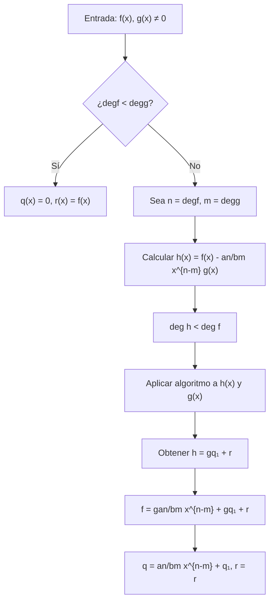
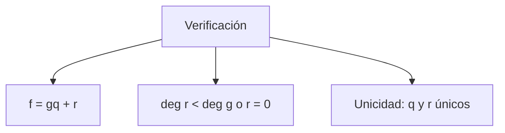

# Álgebra Superior II - Polinomios y ecuaciones polinomiales

## 4.2 Divisibilidad. Algoritmo de la división.

---

### 1. Divisibilidad en K[x]

#### 1.1. Definición de Divisibilidad

Sean $f(x), g(x) \in K[x]$. Decimos que **$g(x)$ divide a $f(x)$**, denotado $g(x) \mid f(x)$, si existe $h(x) \in K[x]$ tal que:

$$f(x) = g(x) \cdot h(x)$$

#### 1.2. Propiedades de la Divisibilidad

Para todo $f, g, h \in K[x]$:

1. **Reflexividad:** $f \mid f$
2. **Transitividad:** Si $f \mid g$ y $g \mid h$, entonces $f \mid h$
3. **Linealidad:** Si $f \mid g$ y $f \mid h$, entonces $f \mid (ag + bh)$ para todo $a, b \in K[x]$
4. **Unidades:** $f \mid g$ y $g \mid f$ si y sólo si $f = c \cdot g$ para alguna unidad $c \in K^\times$

#### 1.3. Polinomios Asociados

Dos polinomios $f$ y $g$ se dicen **asociados** si difieren por una unidad multiplicativa:

$$ f \sim g \iff \exists c \in K^\times \text{ tal que } f = c \cdot g $$

### 2. Algoritmo de la División en K[x]

#### 2.1. Enunciado del Algoritmo

Sean $f(x), g(x) \in K[x]$ con $g(x) \neq 0$. Entonces existen únicos polinomios $q(x)$ (cociente) y $r(x)$ (resto) tales que:

$$f(x) = g(x) \cdot q(x) + r(x)$$

con $\deg(r) < \deg(g)$ o $r(x) = 0$.

#### 2.2. Demostración de Existencia

Por inducción sobre $\deg(f)$:

- Si $\deg(f) < \deg(g)$: tomar $q = 0$, $r = f$
- Si $\deg(f) \geq \deg(g)$: sea $f(x) = a_nx^n + \cdots$, $g(x) = b_mx^m + \cdots$
  - $h(x) = f(x) - \frac{a_n}{b_m}x^{n-m}g(x)$ tiene grado $< n$
  - Por hipótesis inductiva, $h(x) = g(x)q_1(x) + r(x)$ con $\deg(r) < m$
  - Luego $f(x) = g(x)\left(\frac{a_n}{b_m}x^{n-m} + q_1(x)\right) + r(x)$

#### 2.3. Demostración de Unicidad

Supongamos dos representaciones:
$$f = gq_1 + r_1 = gq_2 + r_2$$
Entonces $g(q_1 - q_2) = r_2 - r_1$.
Como $\deg(r_2 - r_1) < \deg(g)$, debe ser $q_1 = q_2$ y $r_1 = r_2$.

### 3. Implementación Computacional

```python
class PolinomioDivisible:
    def __init__(self, coeficientes):
        """Inicializa polinomio con lista de coeficientes [a0, a1, ..., an]"""
        # Eliminar ceros a la derecha
        while len(coeficientes) > 1 and coeficientes[-1] == 0:
            coeficientes.pop()
        self.coef = coeficientes

    def grado(self):
        """Retorna el grado del polinomio"""
        return len(self.coef) - 1

    def __str__(self):
        """Representación string del polinomio"""
        terminos = []
        for i, c in enumerate(self.coef):
            if c != 0:
                if i == 0:
                    terminos.append(f"{c}")
                elif i == 1:
                    terminos.append(f"{c}x" if c != 1 else "x")
                else:
                    terminos.append(f"{c}x^{i}" if c != 1 else f"x^{i}")
        return " + ".join(reversed(terminos)) if terminos else "0"

    def divide(self, other):
        """Verifica si other divide a self"""
        if other.grado() < 0:  # other es cero
            return False
        _, resto = self.algoritmo_division(other)
        return resto.grado() < 0  # resto es cero

    def algoritmo_division(self, divisor):
        """Implementa el algoritmo de la división"""
        if divisor.grado() < 0:
            raise ValueError("Divisor no puede ser cero")

        # Copiar coeficientes del dividendo
        resto_coef = self.coef.copy()
        cociente_coef = [0] * (self.grado() - divisor.grado() + 1)

        for i in range(self.grado(), divisor.grado() - 1, -1):
            if len(resto_coef) <= i:
                continue

            if resto_coef[i] != 0:
                # Calcular término del cociente
                term_cociente = resto_coef[i] / divisor.coef[-1]
                cociente_coef[i - divisor.grado()] = term_cociente

                # Restar múltiplo del divisor
                for j in range(divisor.grado() + 1):
                    if i - j >= 0 and i - j < len(resto_coef):
                        resto_coef[i - j] -= term_cociente * divisor.coef[divisor.grado() - j]

        # Eliminar ceros del resto
        while len(resto_coef) > 1 and resto_coef[-1] == 0:
            resto_coef.pop()

        return PolinomioDivisible(cociente_coef), PolinomioDivisible(resto_coef)

    def es_asociado(self, other):
        """Determina si dos polinomios son asociados"""
        if self.grado() != other.grado():
            return False
        if self.grado() < 0:  # ambos son cero
            return True
        # Verificar que difieran por una constante
        factor = self.coef[-1] / other.coef[-1]
        return self == other * PolinomioDivisible([factor])

    def mcd(self, other):
        """Calcula el MCD usando el algoritmo de Euclides"""
        a, b = self, other
        while b.grado() >= 0:  # mientras b ≠ 0
            _, r = a.algoritmo_division(b)
            a, b = b, r
        return a

# Ejemplos de uso
print("=== EJEMPLOS DE DIVISIBILIDAD ===")

f = PolinomioDivisible([1, 0, 1])  # x² + 1
g = PolinomioDivisible([1, 1])     # x + 1

print(f"f(x) = {f}")
print(f"g(x) = {g}")

# Algoritmo de la división
cociente, resto = f.algoritmo_division(g)
print(f"f / g: Cociente = {cociente}, Resto = {resto}")
print(f"¿g divide a f? {f.divide(g)}")

# Polinomios asociados
h = PolinomioDivisible([2, 0, 2])  # 2x² + 2
print(f"h(x) = {h}")
print(f"¿f y h son asociados? {f.es_asociado(h)}")

# Cálculo de MCD
p = PolinomioDivisible([1, 2, 1])  # x² + 2x + 1
q = PolinomioDivisible([1, 1])     # x + 1
print(f"MCD(p, q) = {p.mcd(q)}")
```

### 4. Diagrama del Algoritmo de la División





### 5. Aplicaciones del Algoritmo de la División

#### 5.1. Cálculo del Máximo Común Divisor

El **algoritmo de Euclides** para polinomios:

1. $a_0 = f$, $a_1 = g$
2. Mientras $a_i \neq 0$:
   - $a_{i+1} = a_{i-1} \mod a_i$
3. $\gcd(f, g) = a_k$ (último resto no nulo)

#### 5.2. Evaluación de Polinomios (Regla de Ruffini)

Para evaluar $f(x)$ en $x = a$:

$$ f(x) = (x - a)q(x) + f(a) $$

#### 5.3. Raíces de Polinomios

$a$ es raíz de $f(x)$ si y sólo si $(x - a) \mid f(x)$

#### 5.4. Polinomios Irreducibles

Un polinomio es irreducible si sus únicos divisores son unidades y sus asociados.

### 6. Ejercicios Resueltos

#### Ejercicio 1

Divida $f(x) = x^3 + 2x^2 - x + 1$ entre $g(x) = x^2 + 1$ en $\mathbb{Q}[x]$

**Solución:**
$$ \begin{align*} x^3 + 2x^2 - x + 1 &= (x^2 + 1)(x + 2) + (-2x - 1) \\\ \text{Cociente: } & x + 2 \\\ \text{Resto: } & -2x - 1 \end{align*} $$

#### Ejercicio 2

Demuestre que si $f(x) \mid g(x)$ y $g(x) \mid f(x)$, entonces $f$ y $g$ son asociados.

**Solución:**
Existen $h, k \in K[x]$ tales que $g = fh$ y $f = gk$.
Luego $f = fhk$, por lo que $hk = 1$ (pues $K[x]$ es dominio entero).
Así, $h$ y $k$ son unidades, luego $f$ y $g$ son asociados. ∎

### 7. Generalizaciones

#### 7.1. Anillos Euclidianos

$K[x]$ es un **anillo euclidiano** con función grado:

- $\deg(f) \geq 0$ para $f \neq 0$
- $\deg(fg) = \deg(f) + \deg(g)$
- Algoritmo de la división

#### 7.2. Dominios de Ideales Principales

Todo ideal de $K[x]$ es principal: $I = \langle d(x) \rangle$ donde $d(x)$ es el MCD de los generadores.

#### 7.3. Dominios de Factorización Única

$K[x]$ es DFU: todo polinomio se factoriza únicamente como producto de irreducibles.

### 8. Ejercicios Propuestos

1. Divida $x^4 - 3x^3 + 2x^2 - x + 1$ entre $x^2 - x + 1$ en $\mathbb{Q}[x]$

2. Demuestre que el algoritmo de la división produce cociente y resto únicos.

3. Implemente el algoritmo extendido de Euclides para polinomios.

4. Demuestre que si $f \mid g$ y $f \mid h$, entonces $f \mid (ug + vh)$ para todo $u, v \in K[x]$

5. Encuentre el MCD de $x^4 + x^3 + 2x^2 + x + 1$ y $x^3 - 1$ en $\mathbb{Q}[x]$

6. Demuestre que todo polinomio de grado 1 es irreducible.

7. Investigue cómo se modifica el algoritmo de la división en $\mathbb{Z}[x]$

8. Estudie la relación entre divisibilidad y evaluación de polinomios.

### 9. Referencias

- Herstein, I. N. (1975). _Topics in Algebra_
- Dummit, D. S., & Foote, R. M. (2004). _Abstract Algebra_
- Lang, S. (2002). _Algebra_
- Fraleigh, J. B. (2003). _A First Course in Abstract Algebra_
- Hungerford, T. W. (1974). _Algebra_
