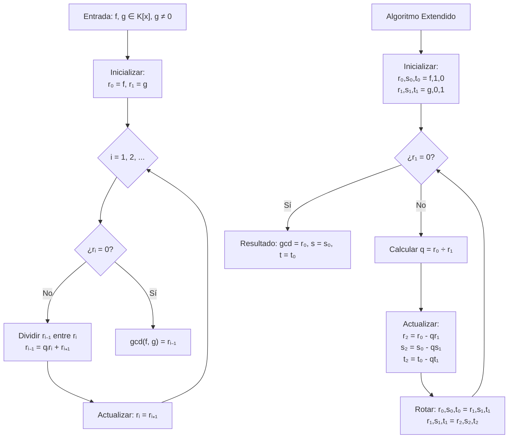

# Álgebra Superior II - Polinomios y ecuaciones polinomiales

## 4.3 Máximo común divisor. Algoritmo de Euclides.

---

### 1. Máximo Común Divisor en K[x]

#### 1.1. Definición Formal

Sean $f(x), g(x) \in K[x]$ no ambos nulos. El **máximo común divisor** (MCD) de $f$ y $g$ es un polinomio $d(x) \in K[x]$ tal que:

1. $d(x) \mid f(x)$ y $d(x) \mid g(x)$
2. Si $h(x) \mid f(x)$ y $h(x) \mid g(x)$, entonces $h(x) \mid d(x)$

#### 1.2. Propiedades del MCD

Para $f, g, h \in K[x]$ no todos nulos:

- **Conmutatividad:** $\gcd(f, g) = \gcd(g, f)$
- **Asociatividad:** $\gcd(\gcd(f, g), h) = \gcd(f, \gcd(g, h))$
- **Linealidad:** $\gcd(f, g) = \gcd(f, g + hf)$ para cualquier $h \in K[x]$
- **Unicidad:** El MCD es único salvo multiplicación por unidades (polinomios asociados)

#### 1.3. MCD de Múltiples Polinomios

Para $f_1, f_2, \ldots, f_n \in K[x]$:

$$ \gcd(f_1, f_2, \ldots, f_n) = \gcd(\gcd(f_1, f_2, \ldots, f_{n-1}), f_n) $$

### 2. Algoritmo de Euclides para Polinomios

#### 2.1. Algoritmo Básico

Dados $f(x), g(x) \in K[x]$ con $g(x) \neq 0$:

1. $r_0 = f$, $r_1 = g$
2. Para $i = 1, 2, \ldots$ mientras $r_i \neq 0$:
   - $r_{i-1} = q_i r_i + r_{i+1}$ con $\deg(r_{i+1}) < \deg(r_i)$
3. $\gcd(f, g) = r_k$ (último resto no nulo)

#### 2.2. Algoritmo Extendido de Euclides

Encuentra además polinomios $s(x), t(x) \in K[x]$ tales que:

$$ \gcd(f, g) = s(x)f(x) + t(x)g(x) $$

### 3. Implementación Computacional

```python
from fractions import Fraction

class PolinomioMCD:
    def __init__(self, coeficientes):
        """Coeficientes [a0, a1, ..., an] en Q, con aritmética exacta"""
        coef = [Fraction(c) for c in coeficientes]
        while coef and coef[-1] == 0:      # el polinomio cero queda como []
            coef.pop()
        self.coef = coef

    def grado(self):
        return len(self.coef) - 1          # -1 para el polinomio cero

    def es_cero(self):
        return not self.coef

    def __eq__(self, other):
        return self.coef == other.coef

    def __add__(self, other):
        n = max(len(self.coef), len(other.coef))
        a = self.coef + [0] * (n - len(self.coef))
        b = other.coef + [0] * (n - len(other.coef))
        return PolinomioMCD([x + y for x, y in zip(a, b)])

    def __neg__(self):
        return PolinomioMCD([-c for c in self.coef])

    def __sub__(self, other):
        return self + (-other)

    def __mul__(self, other):
        if self.es_cero() or other.es_cero():
            return PolinomioMCD([])
        prod = [Fraction(0)] * (len(self.coef) + len(other.coef) - 1)
        for i, a in enumerate(self.coef):
            for j, b in enumerate(other.coef):
                prod[i + j] += a * b
        return PolinomioMCD(prod)

    def __str__(self):
        if self.es_cero():
            return "0"
        terminos = []
        for i, c in enumerate(self.coef):
            if c != 0:
                coef = "" if c == 1 and i > 0 else str(c)
                terminos.append(coef + ("" if i == 0 else "x" if i == 1 else f"x^{i}"))
        return " + ".join(reversed(terminos))

    def algoritmo_division(self, divisor):
        if divisor.es_cero():
            raise ValueError("El divisor no puede ser cero")
        resto = self.coef.copy()
        m = divisor.grado()
        cociente = [Fraction(0)] * max(self.grado() - m + 1, 0)
        for i in range(self.grado(), m - 1, -1):
            if resto[i] != 0:
                t = resto[i] / divisor.coef[-1]
                cociente[i - m] = t
                for j in range(m + 1):
                    resto[i - j] -= t * divisor.coef[m - j]
        return PolinomioMCD(cociente), PolinomioMCD(resto)

    def hacer_monico(self):
        if self.es_cero():
            return self
        return self * PolinomioMCD([1 / self.coef[-1]])

    def euclides(self, other):
        """MCD mónico"""
        a, b = self, other
        while not b.es_cero():
            a, b = b, a.algoritmo_division(b)[1]
        return a.hacer_monico()

    def euclides_extendido(self, other):
        """Regresa (d, s, t) con d = s·self + t·other y d mónico"""
        r0, r1 = self, other
        s0, s1 = PolinomioMCD([1]), PolinomioMCD([])
        t0, t1 = PolinomioMCD([]), PolinomioMCD([1])
        while not r1.es_cero():
            q, r2 = r0.algoritmo_division(r1)
            r0, r1 = r1, r2
            s0, s1 = s1, s0 - q * s1
            t0, t1 = t1, t0 - q * t1
        c = PolinomioMCD([1 / r0.coef[-1]])     # normalizar para que d sea mónico
        return r0 * c, s0 * c, t0 * c

# Ejemplos de uso
print("=== ALGORITMO DE EUCLIDES PARA POLINOMIOS ===")

f = PolinomioMCD([1, 0, 1])  # x² + 1
g = PolinomioMCD([1, 1])     # x + 1
print(f"gcd({f}, {g}) = {f.euclides(g)}")

d, s, t = f.euclides_extendido(g)
print(f"{d} = ({s})·({f}) + ({t})·({g})")
print("Verificación:", s * f + t * g == d)

f = PolinomioMCD([-1, 0, 0, 1])  # x³ - 1
g = PolinomioMCD([-1, 0, 1])     # x² - 1
print(f"gcd({f}, {g}) = {f.euclides(g)}")
```

### 4. Diagrama del Algoritmo de Euclides



### 5. Propiedades y Teoremas Importantes

#### 5.1. Identidad de Bézout

Para $f, g \in K[x]$ no ambos nulos, existen $s, t \in K[x]$ tales que:

$$ \gcd(f, g) = s(x)f(x) + t(x)g(x) $$

#### 5.2. Lema de Euclides

Si $f \mid gh$ y $\gcd(f, g) = 1$, entonces $f \mid h$

#### 5.3. Relación con Ideales

$$\langle f, g \rangle = \langle \gcd(f, g) \rangle$$

#### 5.4. MCD de Polinomios Mónicos

El MCD puede normalizarse para ser único tomando el polinomio mónico asociado.

### 6. Ejercicios Resueltos

#### Ejercicio 1

Calcule $\gcd(x^3 - 1, x^2 - 1)$ en $\mathbb{Q}[x]$

**Solución:**
$$ \begin{align*} x^3 - 1 &= (x^2 - 1)x + (x - 1) \\\ x^2 - 1 &= (x - 1)(x + 1) + 0 \end{align*} $$
Último resto no nulo: $x - 1$
∴ $\gcd(x^3 - 1, x^2 - 1) = x - 1$

#### Ejercicio 2

Encuentre $s(x), t(x)$ tales que $\gcd(x^2 + 1, x + 1) = s(x)(x^2 + 1) + t(x)(x + 1)$

**Solución:**

$$ \begin{align*} x^2 + 1 &= (x + 1)(x - 1) + 2 \\\ x + 1 &= 2\left(\frac{1}{2}x + \frac{1}{2}\right) + 0 \end{align*} $$

Trabajando hacia atrás:

$$2 = (x^2 + 1) - (x + 1)(x - 1)$$

El último resto no nulo es la constante $2$, que es asociada de $1$, así que $x^2 + 1$ y $x + 1$ son coprimos y su MCD mónico es $1$. Dividiendo entre 2:

$$1 = \tfrac{1}{2}(x^2 + 1) - \tfrac{1}{2}(x - 1)(x + 1),$$

es decir, $s(x) = \frac{1}{2}$ y $t(x) = -\frac{1}{2}(x - 1)$.

### 7. Aplicaciones del Algoritmo de Euclides

#### 7.1. Simplificación de Fracciones Algebraicas

$$\frac{f(x)}{g(x)} = \frac{f(x)/d(x)}{g(x)/d(x)} \quad \text{donde } d(x) = \gcd(f, g)$$

#### 7.2. Resolución de Ecuaciones Diofánticas Polinomiales

Encontrar $s(x), t(x)$ tales que $f(x)s(x) + g(x)t(x) = h(x)$

#### 7.3. Cálculo de Inversos Modulares

En $K[x]/\langle m(x) \rangle$, $f(x)$ es invertible si $\gcd(f, m) = 1$

#### 7.4. Teoría de Códigos Correctores

Cálculo de polinomios generadores en códigos cíclicos.

### 8. Ejercicios Propuestos

1. Calcule $\gcd(x^4 - 1, x^3 - 1)$ usando el algoritmo de Euclides

2. Encuentre polinomios $s(x), t(x)$ tales que:

   $$ \gcd(x^3 + 2x^2 - x - 2, x^2 - 1) = s(x)f(x) + t(x)g(x) $$

3. Demuestre que si $\gcd(f, g) = 1$ y $\gcd(f, h) = 1$, entonces $\gcd(f, gh) = 1$

4. Implemente una función que calcule el MCD de tres polinomios

5. Demuestre que $\gcd(f, g) = \gcd(f, g + hf)$ para cualquier $h \in K[x]$

6. Investigue la complejidad computacional del algoritmo de Euclides para polinomios

7. Encuentre el inverso de $x^2 + 1$ en $\mathbb{Q}[x]/\langle x^3 + x + 1 \rangle$

8. Explique por qué el algoritmo de Euclides no se generaliza directamente a polinomios en dos variables: en $K[x, y]$, ¿existen $s$ y $t$ con $s \cdot x + t \cdot y = 1$?

### 9. Referencias

- Herstein, I. N. (1975). _Topics in Algebra_
- Dummit, D. S., & Foote, R. M. (2004). _Abstract Algebra_
- Lang, S. (2002). _Algebra_
- Knuth, D. E. (1997). _The Art of Computer Programming, Vol. 2_
- von zur Gathen, J., & Gerhard, J. (2013). _Modern Computer Algebra_
