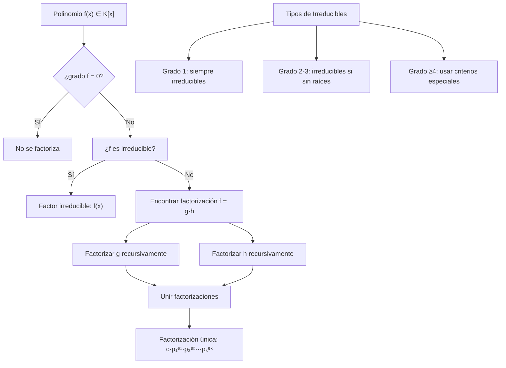
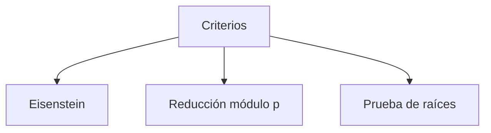

# Álgebra Superior II - Polinomios y ecuaciones polinomiales

## 4.4 Polinomios irreducibles. Factorización única.

---

### 1. Polinomios Irreducibles

#### 1.1. Definición

Un polinomio $p(x) \in K[x]$ de grado positivo se dice **irreducible** sobre $K$ si no puede escribirse como producto de dos polinomios de grado positivo en $K[x]$. Es decir, si:

$$p(x) = a(x)b(x) \Rightarrow \deg(a) = 0 \quad \text{o} \quad \deg(b) = 0$$

#### 1.2. Polinomios Reducibles

Un polinomio es **reducible** si puede factorizarse como producto de polinomios de grado positivo:

$$p(x) = a(x)b(x) \quad \text{con} \quad \deg(a) \geq 1, \deg(b) \geq 1$$

#### 1.3. Criterios de Irreducibilidad

1. **Polinomios de grado 1:** Siempre irreducibles
2. **Polinomios de grado 2 o 3:** Son irreducibles si no tienen raíces en $K$
3. **Criterio de Eisenstein:** Si existe primo $p$ tal que:
   - $p \nmid a_n$
   - $p \mid a_i$ para $i = 0, 1, \ldots, n-1$
   - $p^2 \nmid a_0$
     entonces el polinomio es irreducible sobre $\mathbb{Q}$

### 2. Factorización Única en K[x]

#### 2.1. Teorema de Factorización Única

Todo polinomio $f(x) \in K[x]$ de grado positivo puede escribirse como:

$$f(x) = c \cdot p_1(x)^{e_1} p_2(x)^{e_2} \cdots p_k(x)^{e_k}$$

donde:

- $c \in K^\times$ es el coeficiente líder
- $p_i(x)$ son polinomios mónicos irreducibles distintos
- $e_i \geq 1$ son las multiplicidades
- La factorización es única salvo el orden de los factores

#### 2.2. Consecuencias del Teorema

1. **Existencia:** Toda factorización existe
2. **Unicidad:** La factorización es única
3. **Analogía con $\mathbb{Z}$:** Similar al teorema fundamental de la aritmética

### 3. Implementación Computacional

```python
from fractions import Fraction

class PolinomioIrreducible:
    def __init__(self, coeficientes):
        """Coeficientes enteros o racionales [a0, a1, ..., an]"""
        coef = [Fraction(c) for c in coeficientes]
        while coef and coef[-1] == 0:
            coef.pop()
        self.coef = coef
        self.grado = len(coef) - 1          # -1 para el polinomio cero

    def es_cero(self):
        return not self.coef

    def evaluar(self, x):
        """Evalúa con el método de Horner, en aritmética exacta"""
        resultado = Fraction(0)
        for c in reversed(self.coef):
            resultado = resultado * x + c
        return resultado

    def tiene_raiz(self, a):
        return self.evaluar(a) == 0

    def candidatos_racionales(self):
        """Teorema de las raíces racionales: ±p/q con p | a0 y q | an.
        Supone coeficientes enteros y a0 ≠ 0."""
        a0, an = abs(int(self.coef[0])), abs(int(self.coef[-1]))
        divisores = lambda n: [d for d in range(1, n + 1) if n % d == 0]
        return {sgn * Fraction(p, q) for p in divisores(a0) for q in divisores(an) for sgn in (1, -1)}

    def encontrar_raices(self):
        """Raíces racionales del polinomio"""
        raices = set()
        if self.grado >= 1 and self.coef[0] == 0:
            raices.add(Fraction(0))
        coef = self.coef
        while coef and coef[0] == 0:        # quitar el factor x^k
            coef = coef[1:]
        if len(coef) > 1:
            raices |= {r for r in PolinomioIrreducible(coef).candidatos_racionales() if self.tiene_raiz(r)}
        return sorted(raices)

    def es_irreducible_grado2o3(self):
        """Sobre Q: un polinomio de grado 2 o 3 es irreducible si y solo si no tiene raíces racionales"""
        if self.grado not in (2, 3):
            raise ValueError("El criterio solo aplica a grados 2 y 3")
        return not self.encontrar_raices()

    def dividir_por_lineal(self, raiz):
        """División sintética entre (x - raiz): regresa (cociente, resto)"""
        n = self.grado
        nuevo = [Fraction(0)] * n
        nuevo[n - 1] = self.coef[n]
        for i in range(n - 2, -1, -1):
            nuevo[i] = self.coef[i + 1] + raiz * nuevo[i + 1]
        resto = self.coef[0] + raiz * nuevo[0]
        return PolinomioIrreducible(nuevo), resto

    def factorizar(self):
        """Extrae los factores lineales con su multiplicidad; regresa también el factor restante"""
        factores, temp = [], self
        for raiz in self.encontrar_raices():
            multiplicidad = 0
            while temp.grado >= 1 and temp.tiene_raiz(raiz):
                temp, _ = temp.dividir_por_lineal(raiz)
                multiplicidad += 1
            factores.append((f"x - ({raiz})", multiplicidad))
        return factores, temp.coef

# Ejemplos de uso
print("=== POLINOMIOS IRREDUCIBLES Y FACTORIZACIÓN ===")

p1 = PolinomioIrreducible([1, 0, 1])        # x² + 1
print("x² + 1 irreducible sobre Q:", p1.es_irreducible_grado2o3())

p2 = PolinomioIrreducible([-1, 0, 1])       # x² - 1
print("x² - 1 irreducible sobre Q:", p2.es_irreducible_grado2o3())

p3 = PolinomioIrreducible([-2, 0, 0, 1])    # x³ - 2
print("x³ - 2 irreducible sobre Q:", p3.es_irreducible_grado2o3())

p4 = PolinomioIrreducible([4, 0, -5, 0, 1]) # x⁴ - 5x² + 4
factores, resto = p4.factorizar()
print("Factores lineales de x⁴ - 5x² + 4:", factores, " factor restante:", [str(c) for c in resto])
```

### 4. Diagrama de Factorización Única



<br>



### 5. Criterios de Irreducibilidad Avanzados

#### 5.1. Criterio de Eisenstein

Sea $f(x) = a_nx^n + \cdots + a_0 \in \mathbb{Z}[x]$. Si existe primo $p$ tal que:

1. $p \nmid a_n$
2. $p \mid a_i$ para $i = 0, 1, \ldots, n-1$
3. $p^2 \nmid a_0$
   entonces $f(x)$ es irreducible sobre $\mathbb{Q}$.

**Ejemplo:** $x^4 + 2x^3 + 2x^2 + 2x + 2$ es irreducible por $p=2$

#### 5.2. Reducción Módulo p

Si $f(x) \in \mathbb{Z}[x]$ y su reducción módulo $p$ es irreducible en $\mathbb{Z}_p[x]$ para algún primo $p$ que no divida al coeficiente líder, entonces $f(x)$ es irreducible sobre $\mathbb{Q}$.

#### 5.3. Criterio de las Raíces Racionales

Si $f(x) = a_nx^n + \cdots + a_0 \in \mathbb{Z}[x]$, toda raíz racional $\frac{p}{q}$ debe satisfacer:

- $p \mid a_0$
- $q \mid a_n$

### 6. Ejemplos y Ejercicios Resueltos

#### Ejemplo 1

Demuestre que $x^2 + 1$ es irreducible sobre $\mathbb{R}$ pero reducible sobre $\mathbb{C}$

**Solución:**

- Sobre $\mathbb{R}$: es de grado 2 y no tiene raíces reales, porque $x^2 + 1 \geq 1$, y por lo tanto no se puede factorizar como producto de polinomios reales de grado 1
- Sobre $\mathbb{C}$: $x^2 + 1 = (x - i)(x + i)$

#### Ejemplo 2

Factorice $x^4 - 4$ sobre $\mathbb{Q}$

**Solución:**
$$ x^4 - 4 = (x^2 - 2)(x^2 + 2) $$
Ambos factores son irreducibles sobre $\mathbb{Q}$: son de grado 2 y no tienen raíces racionales, porque las raíces de $x^2 - 2$ son $\pm\sqrt{2}$, irracionales, y $x^2 + 2$ ni siquiera tiene raíces reales.

### 7. Aplicaciones de la Factorización Única

#### 7.1. Cálculo de MCD y MCM

Si $f = c \prod p_i^{e_i}$ y $g = d \prod p_i^{f_i}$, entonces:

- $\gcd(f, g) = \prod p_i^{\min(e_i, f_i)}$
- $\text{lcm}(f, g) = \prod p_i^{\max(e_i, f_i)}$

#### 7.2. Fracciones Parciales

Descomposición de funciones racionales en suma de fracciones simples.

#### 7.3. Teoría de Galois

Estudio de extensiones de campos mediante grupos de automorfismos.

#### 7.4. Criptografía

En algoritmos basados en aritmética de polinomios sobre campos finitos.

### 8. Ejercicios Propuestos

1. Demuestre que $x^3 - 2$ es irreducible sobre $\mathbb{Q}$

2. Factorice completamente $x^6 - 1$ sobre $\mathbb{Q}$

3. Verifique el criterio de Eisenstein para $x^4 + 4x^3 + 6x^2 + 4x + 2$ con $p=2$

4. Implemente el criterio de Eisenstein en la clase PolinomioIrreducible

5. Demuestre que todo polinomio con coeficientes reales y de grado impar tiene al menos una raíz real

6. Encuentre todos los polinomios irreducibles de grado ≤ 3 en $\mathbb{Z}_2[x]$

7. Investigue la relación entre polinomios irreducibles y extensiones de campos

8. Demuestre que si $f$ es irreducible y $f \mid gh$, entonces $f \mid g$ o $f \mid h$

### 9. Referencias

- Herstein, I. N. (1975). _Topics in Algebra_
- Dummit, D. S., & Foote, R. M. (2004). _Abstract Algebra_
- Lang, S. (2002). _Algebra_
- Fraleigh, J. B. (2003). _A First Course in Abstract Algebra_
- Hungerford, T. W. (1974). _Algebra_
