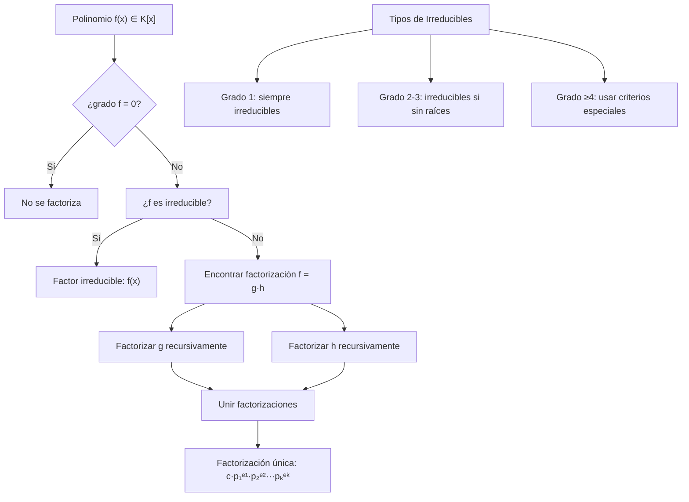
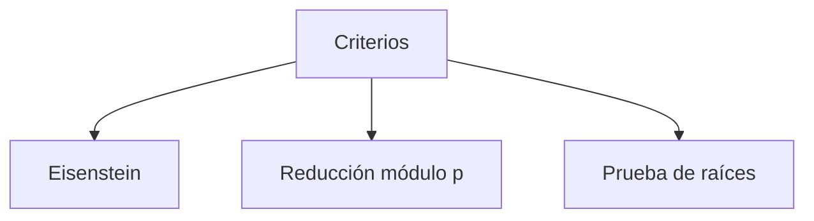

# Álgebra Superior II - Polinomios y ecuaciones polinomiales

## 4.4 Polinomios irreducibles. Factorización única.

---

### 1. Polinomios Irreducibles

#### 1.1. Definición

Un polinomio $p(x) \in K[x]$ de grado positivo se dice **irreducible** sobre $K$ si no puede escribirse como producto de dos polinomios de grado positivo en $K[x]$. Es decir, si:

$$p(x) = a(x)b(x) \Rightarrow \deg(a) = 0 \quad \text{o} \quad \deg(b) = 0$$

#### 1.2. Polinomios Reducibles

Un polinomio es **reducible** si puede factorizarse como producto de polinomios de grado positivo:

$$p(x) = a(x)b(x) \quad \text{con} \quad \deg(a) \geq 1, \deg(b) \geq 1$$

#### 1.3. Criterios de Irreducibilidad

1. **Polinomios de grado 1:** Siempre irreducibles
2. **Polinomios de grado 2 o 3:** Son irreducibles si no tienen raíces en $K$
3. **Criterio de Eisenstein:** Si existe primo $p$ tal que:
   - $p \nmid a_n$
   - $p \mid a_i$ para $i = 0, 1, \ldots, n-1$
   - $p^2 \nmid a_0$
     entonces el polinomio es irreducible sobre $\mathbb{Q}$

### 2. Factorización Única en K[x]

#### 2.1. Teorema de Factorización Única

Todo polinomio $f(x) \in K[x]$ de grado positivo puede escribirse como:

$$f(x) = c \cdot p_1(x)^{e_1} p_2(x)^{e_2} \cdots p_k(x)^{e_k}$$

donde:

- $c \in K^\times$ es el coeficiente líder
- $p_i(x)$ son polinomios mónicos irreducibles distintos
- $e_i \geq 1$ son las multiplicidades
- La factorización es única salvo el orden de los factores

#### 2.2. Consecuencias del Teorema

1. **Existencia:** Toda factorización existe
2. **Unicidad:** La factorización es única
3. **Analogía con $\mathbb{Z}$:** Similar al teorema fundamental de la aritmética

### 3. Implementación Computacional

```python
class PolinomioIrreducible:
    def __init__(self, coeficientes):
        """Inicializa polinomio con lista de coeficientes [a0, a1, ..., an]"""
        # Eliminar ceros a la derecha y normalizar
        while len(coeficientes) > 1 and coeficientes[-1] == 0:
            coeficientes.pop()
        self.coef = coeficientes
        self.grado = len(coeficientes) - 1 if coeficientes else -1

    def es_mónico(self):
        """Verifica si el polinomio es mónico"""
        return not self.es_cero() and abs(self.coef[-1] - 1) < 1e-10

    def hacer_mónico(self):
        """Convierte el polinomio a mónico"""
        if self.es_cero():
            return self
        coef_lider = self.coef[-1]
        return PolinomioIrreducible([c/coef_lider for c in self.coef])

    def evaluar(self, x):
        """Evalúa el polinomio en x usando Horner"""
        resultado = 0
        for coef in reversed(self.coef):
            resultado = resultado * x + coef
        return resultado

    def tiene_raiz(self, a):
        """Verifica si a es raíz del polinomio"""
        return abs(self.evaluar(a)) < 1e-10

    def es_irreducible_grado1(self):
        """Polinomios de grado 1 son siempre irreducibles"""
        return self.grado == 1

    def es_irreducible_grado2o3(self):
        """Para grado 2 o 3: irreducible si no tiene raíces en K"""
        if self.grado not in [2, 3]:
            return False

        # Buscar raíces racionales (para K=Q)
        if self.coef[-1] == 0:
            return False

        # Probamos posibles raíces racionales ±p/q
        posibles_raices = set()
        p = abs(self.coef[0])
        q = abs(self.coef[-1])

        for i in range(1, int(p**0.5) + 1):
            if p % i == 0:
                for j in range(1, int(q**0.5) + 1):
                    if q % j == 0:
                        posibles_raices.add(i/j)
                        posibles_raices.add(-i/j)
                        posibles_raices.add(p/i/j)
                        posibles_raices.add(-p/i/j)

        for raiz in posibles_raices:
            if self.tiene_raiz(raiz):
                return False
        return True

    def factorizar(self):
        """Factorización en irreducibles (algoritmo básico)"""
        if self.grado <= 0:
            return []

        factores = []
        temp = self

        # Factorizar factores lineales
        for raiz in self.encontrar_raices():
            multiplicidad = 0
            while temp.tiene_raiz(raiz):
                multiplicidad += 1
                # Dividir por (x - raiz)
                cociente, resto = temp.dividir_por_lineal(raiz)
                if resto.es_cero():
                    temp = cociente
                else:
                    break
            if multiplicidad > 0:
                factores.append((PolinomioIrreducible([-raiz, 1]), multiplicidad))

        # El resto debe ser irreducible o constante
        if temp.grado > 0:
            factores.append((temp, 1))

        return factores

    def dividir_por_lineal(self, raiz):
        """División por (x - raiz) usando Ruffini"""
        if self.grado < 1:
            return self, PolinomioIrreducible([0])

        nuevo_coef = [0] * self.grado
        nuevo_coef[-1] = self.coef[-1]

        for i in range(self.grado - 2, -1, -1):
            nuevo_coef[i] = self.coef[i + 1] + raiz * nuevo_coef[i + 1]

        resto = self.coef[0] + raiz * nuevo_coef[0]
        return PolinomioIrreducible(nuevo_coef), PolinomioIrreducible([resto])

# Ejemplos de uso
print("=== POLINOMIOS IRREDUCIBLES Y FACTORIZACIÓN ===")

# Polinomio irreducible: x² + 1
p1 = PolinomioIrreducible([1, 0, 1])
print(f"p1(x) = {p1.coef}")
print(f"¿Es irreducible? {p1.es_irreducible_grado2o3()}")

# Polinomio reducible: x² - 1
p2 = PolinomioIrreducible([-1, 0, 1])
print(f"p2(x) = {p2.coef}")
print(f"¿Es irreducible? {p2.es_irreducible_grado2o3()}")

# Factorización
p3 = PolinomioIrreducible([-4, 0, 5, 0, 1])  # x⁴ + 5x² - 4
factores = p3.factorizar()
print(f"Factorización de {p3.coef}:")
for pol, mult in factores:
    print(f"  ({pol.coef})^{mult}")
```

### 4. Diagrama de Factorización Única



<br>



### 5. Criterios de Irreducibilidad Avanzados

#### 5.1. Criterio de Eisenstein

Sea $f(x) = a_nx^n + \cdots + a_0 \in \mathbb{Z}[x]$. Si existe primo $p$ tal que:

1. $p \nmid a_n$
2. $p \mid a_i$ para $i = 0, 1, \ldots, n-1$
3. $p^2 \nmid a_0$
   entonces $f(x)$ es irreducible sobre $\mathbb{Q}$.

**Ejemplo:** $x^4 + 2x^3 + 2x^2 + 2x + 2$ es irreducible por $p=2$

#### 5.2. Reducción Módulo p

Si $f(x) \in \mathbb{Z}[x]$ y su reducción módulo $p$ es irreducible en $\mathbb{Z}_p[x]$ para algún primo $p$ que no divida al coeficiente líder, entonces $f(x)$ es irreducible sobre $\mathbb{Q}$.

#### 5.3. Criterio de las Raíces Racionales

Si $f(x) = a_nx^n + \cdots + a_0 \in \mathbb{Z}[x]$, toda raíz racional $\frac{p}{q}$ debe satisfacer:

- $p \mid a_0$
- $q \mid a_n$

### 6. Ejemplos y Ejercicios Resueltos

#### Ejemplo 1

Demuestre que $x^2 + 1$ es irreducible sobre $\mathbb{R}$ pero reducible sobre $\mathbb{C}$

**Solución:**

- Sobre $\mathbb{R}$: No se puede factorizar como producto de polinomios reales de grado 1
- Sobre $\mathbb{C}$: $x^2 + 1 = (x - i)(x + i)$

#### Ejemplo 2

Factorice $x^4 - 4$ sobre $\mathbb{Q}$

**Solución:**
$$ x^4 - 4 = (x^2 - 2)(x^2 + 2) $$
Ambos factores son irreducibles sobre $\mathbb{Q}$ pues $\sqrt{2}$ y $\sqrt{-2}$ son irracionales.

### 7. Aplicaciones de la Factorización Única

#### 7.1. Cálculo de MCD y MCM

Si $f = c \prod p_i^{e_i}$ y $g = d \prod p_i^{f_i}$, entonces:

- $\gcd(f, g) = \prod p_i^{\min(e_i, f_i)}$
- $\text{lcm}(f, g) = \prod p_i^{\max(e_i, f_i)}$

#### 7.2. Fracciones Parciales

Descomposición de funciones racionales en suma de fracciones simples.

#### 7.3. Teoría de Galois

Estudio de extensiones de campos mediante grupos de automorfismos.

#### 7.4. Criptografía

En algoritmos basados en aritmética de polinomios sobre campos finitos.

### 8. Ejercicios Propuestos

1. Demuestre que $x^3 - 2$ es irreducible sobre $\mathbb{Q}$

2. Factorice completamente $x^6 - 1$ sobre $\mathbb{Q}$

3. Verifique el criterio de Eisenstein para $x^4 + 4x^3 + 6x^2 + 4x + 2$ con $p=2$

4. Implemente el criterio de Eisenstein en la clase PolinomioIrreducible

5. Demuestre que todo polinomio de grado impar tiene al menos una raíz real

6. Encuentre todos los polinomios irreducibles de grado ≤ 3 en $\mathbb{Z}_2[x]$

7. Investigue la relación entre polinomios irreducibles y extensiones de campos

8. Demuestre que si $f$ es irreducible y $f \mid gh$, entonces $f \mid g$ o $f \mid h$

### 9. Referencias

- Herstein, I. N. (1975). _Topics in Algebra_
- Dummit, D. S., & Foote, R. M. (2004). _Abstract Algebra_
- Lang, S. (2002). _Algebra_
- Fraleigh, J. B. (2003). _A First Course in Abstract Algebra_
- Hungerford, T. W. (1974). _Algebra_
