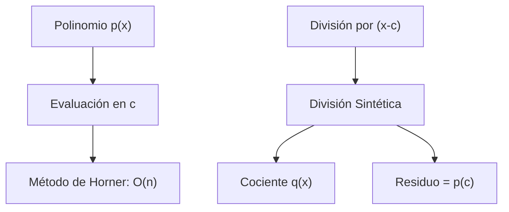
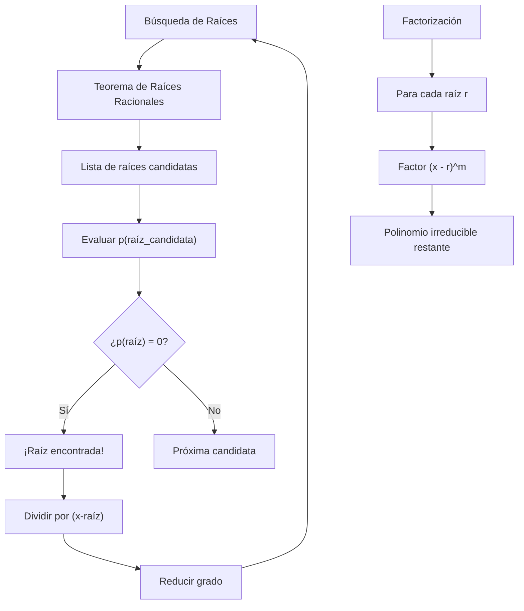

# Álgebra Superior II - Polinomios y ecuaciones polinomiales

## 4.5 Evaluación. Raíces de un polinomio. Teorema del residuo. Teorema del factor. Factorización de polinomios. División sintética.

---

### 1. Evaluación de Polinomios

#### 1.1. Definición

La **evaluación** de un polinomio $p(x) = a_nx^n + a_{n-1}x^{n-1} + \cdots + a_1x + a_0$ en un punto $c \in K$ es:

$$p(c) = a_nc^n + a_{n-1}c^{n-1} + \cdots + a_1c + a_0$$

#### 1.2. Método de Horner

Evaluación eficiente mediante factorización anidada:

$$ p(c) = a_0 + c(a_1 + c(a_2 + \cdots + c(a_{n-1} + ca_n)\cdots)) $$

**Complejidad:** $O(n)$ operaciones vs $O(n^2)$ del método directo.

### 2. Raíces de Polinomios

#### 2.1. Definición

Un elemento $c \in K$ es **raíz** de $p(x)$ si $p(c) = 0$.

#### 2.2. Multiplicidad

La **multiplicidad** de una raíz $c$ es el mayor entero $m$ tal que $(x - c)^m$ divide a $p(x)$.

#### 2.3. Teorema Fundamental del Álgebra

Todo polinomio no constante con coeficientes complejos tiene al menos una raíz compleja.

### 3. Teoremas Fundamentales

#### 3.1. Teorema del Residuo

Si dividimos $p(x)$ entre $(x - c)$, el residuo es $p(c)$:

$$ p(x) = (x - c)q(x) + p(c) $$

#### 3.2. Teorema del Factor

$c$ es raíz de $p(x)$ si y sólo si $(x - c)$ es factor de $p(x)$:

$$ p(c) = 0 \iff (x - c) \mid p(x) $$

#### 3.3. Corolarios

- Un polinomio de grado $n$ tiene a lo más $n$ raíces
- Si $p$ tiene más de $n$ raíces, entonces $p = 0$

### 4. División Sintética

#### 4.1. Algoritmo

Método abreviado para dividir polinomios entre $(x - c)$:

Coeficientes: $ a_n, a_{n-1}, ..., a_1, a_0 $

$ c, c·b_n, ..., c·b_2, c·b_1 $

$ b_n, b_{n-1}, ..., b_1 $ Residuo

#### 4.2. Ventajas

- Más eficiente que la división polinomial tradicional
- Fácil implementación computacional
- Directamente relacionado con el método de Horner

### 5. Implementación Computacional

```python
class PolinomioRaices:
    def __init__(self, coeficientes):
        """Inicializa polinomio con lista de coeficientes [a0, a1, ..., an]"""
        # Coeficientes en orden creciente de grado
        self.coef = coeficientes
        self.grado = len(coeficientes) - 1

    def evaluar_horner(self, c):
        """Evalúa el polinomio en c usando el método de Horner"""
        resultado = 0
        # Recorrer de mayor a menor grado
        for coef in reversed(self.coef):
            resultado = resultado * c + coef
        return resultado

    def division_sintetica(self, c):
        """Realiza división sintética por (x - c)"""
        # Coeficientes en orden descendente
        coef_desc = self.coef[::-1]
        n = len(coef_desc)
        resultado = [0] * n
        resultado[0] = coef_desc[0]

        for i in range(1, n):
            resultado[i] = coef_desc[i] + c * resultado[i-1]

        # El último elemento es el residuo
        residuo = resultado[-1]
        cociente = resultado[:-1][::-1]  # Invertir y quitar residuo

        return PolinomioRaices(cociente), residuo

    def encontrar_raices_racionales(self):
        """Encuentra posibles raíces racionales usando el teorema de raíces racionales"""
        if not self.coef:
            return []

        # Coeficiente constante y líder
        a0 = self.coef[0]
        an = self.coef[-1]

        # Factores de a0 y an
        factores_a0 = self._obtener_factores(a0)
        factores_an = self._obtener_factores(an)

        raices_posibles = set()
        for p in factores_a0:
            for q in factores_an:
                if q != 0:
                    raiz = p / q
                    raices_posibles.add(raiz)
                    raices_posibles.add(-raiz)

        return sorted(raices_posibles)

    def _obtener_factores(self, n):
        """Obtiene los factores enteros de un número"""
        if n == 0:
            return [0]
        n = abs(n)
        factores = set()
        for i in range(1, int(n**0.5) + 1):
            if n % i == 0:
                factores.add(i)
                factores.add(n // i)
        return sorted(factores)

    def factorizar(self):
        """Factoriza el polinomio encontrando raíces racionales"""
        raices = []
        temp = self
        factores = []

        # Buscar raíces racionales
        posibles_raices = self.encontrar_raices_racionales()

        for raiz in posibles_raices:
            # Verificar si es raíz
            if abs(temp.evaluar_horner(raiz)) < 1e-10:
                multiplicidad = 0
                # Dividir sucesivamente por (x - raiz)
                while abs(temp.evaluar_horner(raiz)) < 1e-10:
                    cociente, residuo = temp.division_sintetica(raiz)
                    if abs(residuo) < 1e-10:
                        multiplicidad += 1
                        temp = cociente
                    else:
                        break
                factores.append((raiz, multiplicidad))

        # El polinomio restante puede ser irreducible
        if temp.grado > 0:
            factores.append((f"Polinomio irreducible grado {temp.grado}", 1))

        return factores

# Ejemplos de uso
print("=== EVALUACIÓN Y FACTORIZACIÓN DE POLINOMIOS ===")

# Polinomio: 2x³ - 3x² - 11x + 6
p = PolinomioRaices([6, -11, -3, 2])
print(f"Polinomio: {p.coef}")

# Evaluación
c = 2
print(f"p({c}) = {p.evaluar_horner(c)}")

# División sintética
cociente, residuo = p.division_sintetica(2)
print(f"División por (x-2): Cociente = {cociente.coef}, Residuo = {residuo}")

# Raíces racionales
raices_posibles = p.encontrar_raices_racionales()
print(f"Raíces racionales posibles: {raices_posibles}")

# Factorización
factores = p.factorizar()
print("Factorización:")
for raiz, mult in factores:
    print(f"  (x - {raiz})^{mult}" if isinstance(raiz, (int, float)) else f"  {raiz}")
```

### 6. Diagrama de Procesos



<br>



### 7. Teorema de Raíces Racionales

#### 7.1. Enunciado

Sea $p(x) = a_nx^n + \cdots + a_0 \in \mathbb{Z}[x]$. Si $\frac{p}{q}$ es una raíz racional irreducible, entonces:

- $p \mid a_0$
- $q \mid a_n$

#### 7.2. Aplicación

Para encontrar raíces racionales:

1. Listar factores de $a_0$ y $a_n$
2. Probar todas las combinaciones $\pm \frac{p}{q}$
3. Verificar si $p\left(\frac{p}{q}\right) = 0$

#### 7.3. Ejemplo

Para $p(x) = 2x^3 - 3x^2 - 11x + 6$:

- Factores de 6: $\pm1, \pm2, \pm3, \pm6$
- Factores de 2: $\pm1, \pm2$
- Raíces posibles: $\pm1, \pm2, \pm3, \pm6, \pm\frac{1}{2}, \pm\frac{3}{2}$

### 8. Ejercicios Resueltos

#### Ejercicio 1

Evalúe $p(x) = x^3 - 4x^2 + 2x - 1$ en $x = 2$ usando Horner

**Solución:**

Coeficientes: [ -1, 2, -4, 1 ]

$$ \begin{align*} &\text{Paso 1: } 1 \\\ &\text{Paso 2: } 1 \cdot 2 + (-4) = -2 \\\ &\text{Paso 3: } (-2) \cdot 2 + 2 = -2 \\\ &\text{Paso 4: } (-2) \cdot 2 + (-1) = -5 \\\ \end{align*} $$

$$ p(2) = -5 $$

#### Ejercicio 2

Divida $x^3 - 6x^2 + 11x - 6$ entre $(x - 2)$ usando división sintética

**Solución:**

Coeficientes: ${1, -6, 11, -6}$

$ \frac{2, 2, -8, 6}{1, -4, 3, 0} $

Cociente: $x^2 - 4x + 3$, Residuo: $0$

### 9. Aplicaciones Prácticas

#### 9.1. Análisis Numérico

- Método de Newton-Raphson para encontrar raíces
- Interpolación polinomial

#### 9.2. Ingeniería

- Análisis de sistemas de control
- Procesamiento de señales digitales

#### 9.3. Computación Gráfica

- Curvas de Bézier
- Superficies polinómicas

#### 9.4. Criptografía

- Aritmética en campos finitos
- Códigos correctores de errores

### 10. Ejercicios Propuestos

1. Evalúe $p(x) = 3x^4 - 2x^3 + 5x - 1$ en $x = -1$ usando Horner

2. Use división sintética para dividir $2x^4 - 3x^3 + x^2 - 5$ entre $(x + 2)$

3. Encuentre todas las raíces racionales de $x^3 - 3x^2 - 4x + 12$

4. Demuestre el teorema del residuo usando el algoritmo de la división

5. Implemente una función que encuentre raíces múltiples

6. Factorice completamente $x^4 - 5x^2 + 4$

7. Investigue la relación entre las raíces y los coeficientes de un polinomio

8. Generalice el método de Horner para evaluación en matrices

### 11. Referencias

- Burden, R. L., & Faires, J. D. (2010). _Análisis Numérico_
- Strang, G. (2006). _Linear Algebra and Its Applications_
- Anton, H., & Rorres, C. (2010). _Elementary Linear Algebra_
- Press, W. H., et al. (2007). _Numerical Recipes: The Art of Scientific Computing_
- Uspensky, J. V. (1948). _Theory of Equations_
