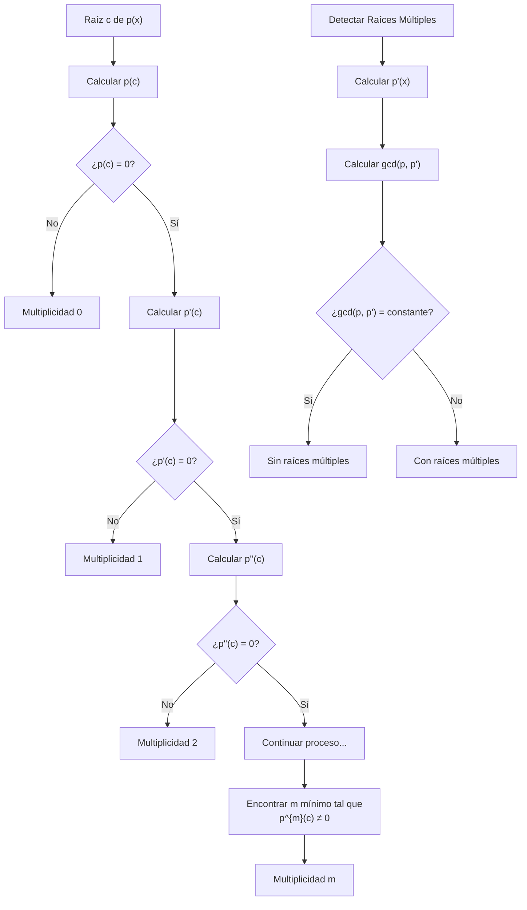

# Álgebra Superior II - Polinomios y ecuaciones polinomiales

## 4.6 Raíces múltiples. Derivadas y multiplicidad.

---

### 1. Raíces Múltiples

#### 1.1. Definición

Una raíz $c \in K$ de un polinomio $p(x) \in K[x]$ tiene **multiplicidad** $m \geq 1$ si:

$$p(x) = (x - c)^m q(x) \quad \text{con} \quad q(c) \neq 0$$

- $m = 1$: raíz simple
- $m > 1$: raíz múltiple
- $m = 0$: no es raíz

#### 1.2. Caracterización mediante Derivadas

$c$ es raíz múltiple de $p(x)$ si y sólo si:

$$ p(c) = 0 \quad \text{y} \quad p'(c) = 0 $$

Más generalmente, $c$ tiene multiplicidad $m$ si y sólo si:

$$ p(c) = p'(c) = p''(c) = \cdots = p^{(m-1)}(c) = 0 \quad \text{y} \quad p^{(m)}(c) \neq 0 $$

### 2. Derivada Formal de Polinomios

#### 2.1. Definición

Para $p(x) = a_nx^n + a_{n-1}x^{n-1} + \cdots + a_1x + a_0$, la **derivada formal** es:

$$ p'(x) = na_nx^{n-1} + (n-1)a_{n-1}x^{n-2} + \cdots + a_1 $$

#### 2.2. Propiedades de la Derivada

Para $p, q \in K[x]$ y $c \in K$:

1. **Linealidad:** $(cp + q)' = cp' + q'$
2. **Regla del producto:** $(pq)' = p'q + pq'$
3. **Regla de la potencia:** $(x^n)' = nx^{n-1}$
4. **Derivadas sucesivas:** Se definen recursivamente

### 3. Implementación Computacional

```python
class PolinomioDerivada:
    def __init__(self, coeficientes):
        """Inicializa polinomio con coeficientes [a0, a1, ..., an]"""
        self.coef = coeficientes
        self.grado = len(coeficientes) - 1

    def derivada(self, orden=1):
        """Calcula la derivada de orden especificado"""
        if orden == 0:
            return self

        coef_deriv = []
        for i in range(1, len(self.coef)):
            coef_deriv.append(i * self.coef[i])

        if not coef_deriv:
            coef_deriv = [0]

        pol_deriv = PolinomioDerivada(coef_deriv)
        return pol_deriv.derivada(orden - 1)

    def multiplicidad_raiz(self, c, tol=1e-10):
        """Determina la multiplicidad de una raíz c"""
        if abs(self.evaluar(c)) > tol:
            return 0  # No es raíz

        multiplicidad = 0
        derivada_actual = self

        while True:
            if abs(derivada_actual.evaluar(c)) > tol:
                break
            multiplicidad += 1
            derivada_actual = derivada_actual.derivada()
            if derivada_actual.grado < 0:
                break

        return multiplicidad

    def evaluar(self, c):
        """Evalúa el polinomio en c usando Horner"""
        resultado = 0
        for coef in reversed(self.coef):
            resultado = resultado * c + coef
        return resultado

    def tiene_raices_multiples(self):
        """Verifica si el polinomio tiene raíces múltiples"""
        p_prima = self.derivada()
        mcd = self.mcd(p_prima)
        return mcd.grado > 0  # Tiene raíces múltiples si gcd(p, p') ≠ constante

    def mcd(self, other):
        """Algoritmo de Euclides para polinomios"""
        a, b = self, other
        while b.grado >= 0 and not b.es_cero():
            _, resto = a.division_sintetica_simplificada(b)
            a, b = b, resto
        return a

    def division_sintetica_simplificada(self, divisor):
        """División sintética simplificada para algoritmo de Euclides"""
        # Implementación básica de división
        # (Para una implementación completa ver guía anterior)
        pass

    def es_cero(self):
        """Verifica si el polinomio es cero"""
        return all(abs(c) < 1e-10 for c in self.coef)

    def __str__(self):
        return " + ".join(f"{c}x^{i}" for i, c in enumerate(self.coef) if c != 0)

# Ejemplos de uso
print("=== RAÍCES MÚLTIPLES Y DERIVADAS ===")

# Polinomio con raíz múltiple: p(x) = (x-2)^3(x+1) = x^4 - 5x^3 + 6x^2 + 4x - 8
coef = [-8, 4, 6, -5, 1]
p = PolinomioDerivada(coef)
print(f"Polinomio: {p.coef}")

# Derivadas
print(f"p'(x): {p.derivada().coef}")
print(f"p''(x): {p.derivada(2).coef}")
print(f"p'''(x): {p.derivada(3).coef}")

# Multiplicidad de raíces
raices_test = [2, -1, 0]
for c in raices_test:
    mult = p.multiplicidad_raiz(c)
    print(f"Multiplicidad de x = {c}: {mult}")

# Verificar si tiene raíces múltiples
print(f"¿Tiene raíces múltiples? {p.tiene_raices_multiples()}")
```

### 4. Diagrama de Multiplicidad de Raíces



### 5. Criterio para Raíces Múltiples

#### 5.1. Teorema Fundamental

Un polinomio $p(x)$ tiene raíces múltiples si y sólo si:

$$ \gcd(p(x), p'(x)) \neq 1 $$

#### 5.2. Polinomio Libre de Cuadrados

Un polinomio es **libre de cuadrados** si no tiene raíces múltiples. Se puede obtener mediante:

$$ q(x) = \frac{p(x)}{\gcd(p(x), p'(x))} $$

#### 5.3. Discriminante

El **discriminante** $\Delta(p)$ es una función de los coeficientes que se anula si y sólo si $p(x)$ tiene raíces múltiples.

### 6. Ejemplos y Ejercicios Resueltos

#### Ejemplo 1

Determine la multiplicidad de $x = 1$ en $p(x) = x^3 - 3x + 2$

**Solución:**
$p(x) = (x - 1)^2(x + 2)$

- $p(1) = 0$
- $p'(x) = 3x^2 - 3$, $p'(1) = 0$
- $p''(x) = 6x$, $p''(1) = 6 \neq 0$
  ∴ Multiplicidad 2

#### Ejemplo 2

Verifique si $p(x) = x^4 - 4x^3 + 6x^2 - 4x + 1$ tiene raíces múltiples

**Solución:**
$p(x) = (x - 1)^4$
$p'(x) = 4(x - 1)^3$
$\gcd(p, p') = (x - 1)^3 \neq 1$ ⇒ Tiene raíces múltiples

### 7. Aplicaciones e Importancia

#### 7.1. Análisis Numérico

- Raíces múltiples afectan la convergencia de métodos iterativos
- El método de Newton converge linealmente para raíces múltiples

#### 7.2. Geometría Algebraica

- Raíces múltiples corresponden a puntos singulares en curvas algebraicas
- Estudio de tangentes e intersecciones

#### 7.3. Teoría de Galois

- Raíces múltiples afectan la separabilidad de extensiones
- Campos perfectos y extensiones inseparables

#### 7.4. Física Matemática

- Puntos de bifurcación en sistemas dinámicos
- Estabilidad de soluciones en ecuaciones diferenciales

### 8. Ejercicios Propuestos

1. Determine la multiplicidad de $x = 0$ en $p(x) = x^5 - 2x^3 + x$

2. Encuentre todos los polinomios mónicos de grado 3 con una raíz de multiplicidad 2 en $x = 1$

3. Demuestre que si $p(x)$ tiene raíz múltiple $c$, entonces $c$ también es raíz de $p'(x)$

4. Implemente una función que calcule el polinomio libre de cuadrados de un polinomio dado

5. Investigue la relación entre el discriminante y las raíces múltiples

6. Para $p(x) = x^4 + ax^2 + b$, encuentre condiciones sobre $a$ y $b$ para que tenga raíces múltiples

7. Demuestre que todo polinomio irreducible sobre un campo de característica 0 es separable

8. Estudie el comportamiento del método de Newton para raíces múltiples

### 9. Referencias

- Herstein, I. N. (1975). _Topics in Algebra_
- Dummit, D. S., & Foote, R. M. (2004). _Abstract Algebra_
- Lang, S. (2002). _Algebra_
- van der Waerden, B. L. (1991). _Algebra_
- Jacobson, N. (1985). _Basic Algebra I_
