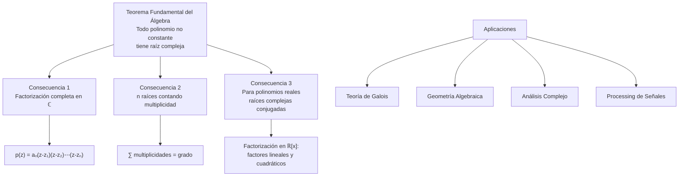

# Álgebra Superior II - Polinomios y ecuaciones polinomiales

## 4.7 Teorema fundamental del álgebra. Consecuencias.

---

### 1. Teorema Fundamental del Álgebra

#### 1.1. Enunciado Formal

Todo polinomio no constante con coeficientes complejos tiene al menos una raíz compleja. Es decir, para todo polinomio:

$$p(z) = a_nz^n + a_{n-1}z^{n-1} + \cdots + a_1z + a_0 \in \mathbb{C}[z]$$

con $a_n \neq 0$ y $n \geq 1$, existe al menos un $z_0 \in \mathbb{C}$ tal que:

$$p(z_0) = 0$$

#### 1.2. Formulación Equivalente

Todo polinomio de grado $n \geq 1$ con coeficientes complejos se factoriza completamente en $\mathbb{C}$ como:

$$p(z) = a_n(z - z_1)(z - z_2)\cdots(z - z_n)$$

donde $z_1, z_2, \ldots, z_n \in \mathbb{C}$ son las raíces (no necesariamente distintas).

### 2. Demostraciones del Teorema

#### 2.1. Enfoques de Demostración

1. **Analítico:** Usando teoremas de variable compleja (Liouville, Cauchy)
2. **Algebraico:** Via teoría de Galois y extensiones de campos
3. **Topológico:** Argumentos de grado de aplicaciones

#### 2.2. Idea de la Demostración Analítica

Si $p(z)$ no tuviera raíces, entonces $1/p(z)$ sería una función entera y acotada, contradiciendo el teorema de Liouville.

### 3. Consecuencias del Teorema Fundamental

#### 3.1. Factorización Completa

Todo polinomio $p(z) \in \mathbb{C}[z]$ de grado $n$ tiene exactamente $n$ raíces complejas (contando multiplicidades).

#### 3.2. Polinomios con Coeficientes Reales

Si $p(z) \in \mathbb{R}[z]$ y $z_0$ es raíz compleja, entonces $\overline{z_0}$ también es raíz. Por tanto, las raíces complejas no reales aparecen en pares conjugados.

#### 3.3. Factorización en $\mathbb{R}[x]$

Todo polinomio con coeficientes reales se factoriza como producto de factores lineales y cuadráticos irreducibles:

$$p(x) = a_n(x - r_1)^{m_1}\cdots(x - r_k)^{m_k}(x^2 + b_1x + c_1)^{n_1}\cdots(x^2 + b_lx + c_l)^{n_l}$$

### 4. Implementación Computacional

```python
import numpy as np
import matplotlib.pyplot as plt
from scipy.optimize import root

class TeoremaFundamentalAlgebra:
    def __init__(self, coeficientes):
        """Inicializa polinomio con coeficientes [a0, a1, ..., an]"""
        self.coef = coeficientes
        self.grado = len(coeficientes) - 1

    def encontrar_raices_complejas(self):
        """Encuentra todas las raíces complejas usando numpy"""
        return np.roots(self.coef)

    def verificar_teorema(self):
        """Verifica el teorema fundamental encontrando raíces"""
        if self.grado == 0:
            return True  # Polinomio constante

        raices = self.encontrar_raices_complejas()

        # Verificar que todas las evaluaciones son cercanas a cero
        tolerancia = 1e-10
        for raiz in raices:
            valor = np.polyval(self.coef, raiz)
            if abs(valor) > tolerancia:
                return False
        return True

    def factorizar_complejo(self):
        """Factorización completa en factores lineales"""
        raices = self.encontrar_raices_complejas()
        return self.coef[-1] * np.poly(raices)

    def factorizar_real(self):
        """Factorización en factores reales (lineales y cuadráticos)"""
        raices = self.encontrar_raices_complejas()
        factores_reales = []

        # Agrupar raíces complejas conjugadas
        raices_restantes = list(raices)
        while raices_restantes:
            raiz = raices_restantes.pop(0)

            if np.isreal(raiz):
                factores_reales.append(([float(-raiz), 1.0], 1))  # (x - raiz)
            else:
                # Buscar el conjugado
                conjugado = np.conj(raiz)
                if conjugado in raices_restantes:
                    raices_restantes.remove(conjugado)
                    # Factor cuadrático: (x - raiz)(x - conjugado) = x² - 2Re(raiz)x + |raiz|²
                    a = 1.0
                    b = -2 * np.real(raiz)
                    c = np.abs(raiz)**2
                    factores_reales.append(([c, b, a], 1))

        return factores_reales

    def graficar_raices(self):
        """Grafica las raíces en el plano complejo"""
        raices = self.encontrar_raices_complejas()

        plt.figure(figsize=(8, 8))
        plt.scatter(np.real(raices), np.imag(raices), color='red', s=100)
        plt.axhline(0, color='black', linewidth=0.5)
        plt.axvline(0, color='black', linewidth=0.5)
        plt.grid(True, alpha=0.3)
        plt.xlabel('Parte Real')
        plt.ylabel('Parte Imaginaria')
        plt.title('Raíces en el Plano Complejo')
        plt.axis('equal')
        plt.show()

# Ejemplos de uso
print("=== TEOREMA FUNDAMENTAL DEL ÁLGEBRA ===")

# Polinomio con coeficientes reales: x³ - 6x² + 11x - 6 = (x-1)(x-2)(x-3)
coef = [-6, 11, -6, 1]
tfa = TeoremaFundamentalAlgebra(coef)

print(f"Polinomio: {tfa.coef}")
print(f"Grado: {tfa.grado}")

# Encontrar raíces
raices = tfa.encontrar_raices_complejas()
print(f"Raíces encontradas: {raices}")

# Verificar teorema
print(f"¿Se cumple el teorema? {tfa.verificar_teorema()}")

# Factorización en complejos
factor_complejo = tfa.factorizar_complejo()
print(f"Factorización compleja: {factor_complejo}")

# Factorización en reales
factores_reales = tfa.factorizar_real()
print("Factorización real:")
for factor, mult in factores_reales:
    print(f"  {factor} (multiplicidad {mult})")

# Graficar raíces
tfa.graficar_raices()
```

### 5. Diagrama de Consecuencias del Teorema



### 6. Aplicaciones del Teorema Fundamental

#### 6.1. Teoría de Galois

- El campo $\mathbb{C}$ es algebraicamente cerrado
- Toda extensión algebraica de $\mathbb{R}$ es $\mathbb{R}$ o $\mathbb{C}$

#### 6.2. Análisis Complejo

- Demostración del teorema de Liouville
- Teorema del módulo máximo
- Principio de identidad

#### 6.3. Processing de Señales

- Análisis de Fourier y transformada Z
- Estabilidad de sistemas lineales
- Diseño de filtros digitales

#### 6.4. Geometría Algebraica

- Estudio de curvas y variedades algebraicas
- Teoría de intersecciones
- Puntos singulares

### 7. Ejercicios Resueltos

#### Ejercicio 1

Demuestre que todo polinomio de grado impar con coeficientes reales tiene al menos una raíz real.

**Solución:**
Por el teorema fundamental, tiene $n$ raíces complejas. Como las raíces complejas no reales vienen en pares conjugados, debe haber al menos una raíz real (pues $n$ es impar).

#### Ejercicio 2

Factorice completamente $p(x) = x^4 + 1$ en $\mathbb{R}[x]$

**Solución:**
Las raíces son las raíces cuartas de $ -1 = e^{i\pi} $:

$ z_k = e^{i(\pi + 2\pi k)/4} $ para $ k = 0,1,2,3 $
Agrupando conjugados:

$$ x^4 + 1 = (x^2 - \sqrt{2}x + 1)(x^2 + \sqrt{2}x + 1) $$

### 8. Generalizaciones y Extensiones

#### 8.1. Campos Algebraicamente Cerrados

Un campo $K$ se dice **algebraicamente cerrado** si todo polinomio no constante con coeficientes en $K$ tiene una raíz en $K$.

#### 8.2. Clausura Algebraica

Todo campo tiene una **clausura algebraica** única salvo isomorfismo.

#### 8.3. Teorema de los Ceros de Hilbert

Relación entre ideales y variedades algebraicas sobre campos algebraicamente cerrados.

### 9. Ejercicios Propuestos

1. Encuentre todas las raíces de $p(z) = z^4 - 16$ y verifique el teorema fundamental

2. Demuestre que si $p(z)$ tiene coeficientes reales y grado impar, entonces tiene al menos una raíz real

3. Implemente un algoritmo para encontrar raíces de polinomios usando el método de Newton en el plano complejo

4. Factorice $x^6 - 1$ completamente en $\mathbb{R}[x]$

5. Investique la demostración analítica del teorema fundamental usando el teorema de Liouville

6. Demuestre que $\mathbb{C}$ es algebraicamente cerrado usando la teoría de Galois

7. Estudie la relación entre el teorema fundamental y la transformada discreta de Fourier

8. Generalice el teorema fundamental para polinomios en varias variables

### 10. Referencias

- Ahlfors, L. V. (1979). _Complex Analysis_
- Lang, S. (1999). _Complex Analysis_
- Conway, J. B. (1978). _Functions of One Complex Variable_
- Remmert, R. (1991). _Theory of Complex Functions_
- Needham, T. (1997). _Visual Complex Analysis_
