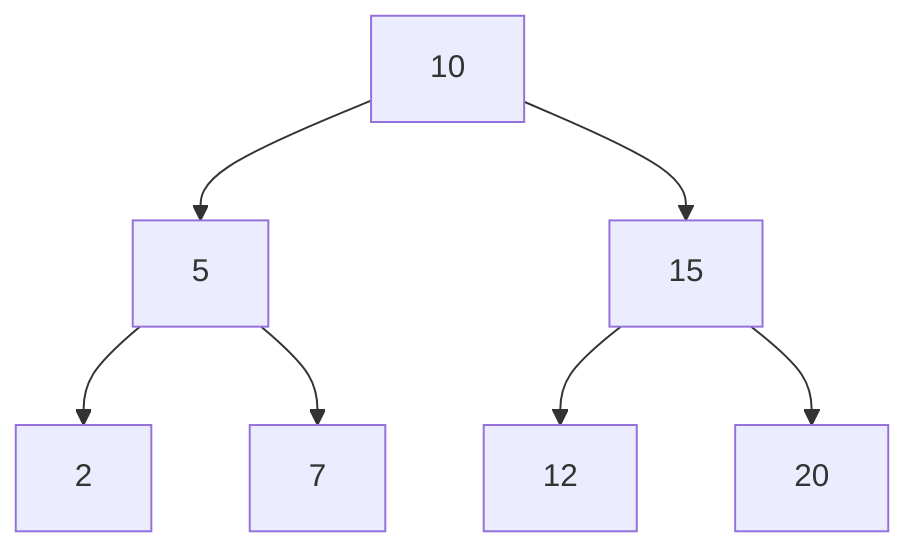
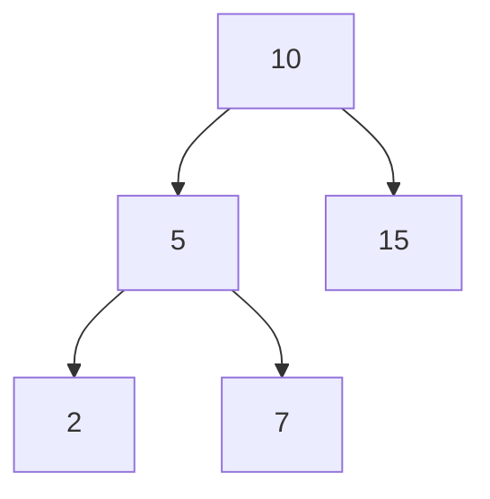

# Estructuras de Datos - Árboles binarios

## 10.1 Conceptos y cotas relacionadas con árboles binarios, TDA.

---

### 1. Definición de Árbol Binario

Un **árbol binario** es una estructura de datos jerárquica en la que cada nodo tiene como máximo **dos hijos**, denominados **hijo izquierdo** e **hijo derecho**.

- **Nodo:** Unidad básica que contiene un valor y referencias a sus hijos.
- **Raíz:** Nodo superior del árbol.
- **Hojas:** Nodos sin hijos.
- **Padre/Hijo:** Relación entre nodos.
- **Subárbol:** Árbol contenido dentro de otro nodo.

**Diagrama Mermaid:**



### 2. Conceptos relacionados

- **Altura de un nodo:** Longitud del camino más largo desde ese nodo hasta una hoja.
- **Nivel de un nodo:** Distancia desde la raíz.
- **Grado de un nodo:** Número de hijos (0, 1 o 2).
- **Árbol completo:** Todos los niveles, excepto posiblemente el último, están completos y todos los nodos del último nivel están lo más a la izquierda posible.
- **Árbol lleno:** Cada nodo tiene 0 o 2 hijos.
- **Árbol perfecto:** Todos los nodos internos tienen dos hijos y todas las hojas están en el mismo nivel; con altura $h$ tiene exactamente $2^{h+1} - 1$ nodos. Ser completo y lleno no basta: un árbol con raíz, dos hijos y dos nietos bajo el hijo izquierdo es completo y lleno, pero no perfecto.
- **Árbol degenerado:** Cada nodo interno tiene un solo hijo; se comporta como una lista.

**Cotas importantes:**

- Número máximo de nodos en un árbol binario de altura $h$:

$$ n_{max} = 2^{h+1} - 1 $$

- Número mínimo de nodos en un árbol binario de altura $h$:

$$ n_{min} = h + 1 $$

- Altura mínima de un árbol con $n$ nodos:

$$ h_{min} = \lfloor \log_2 n \rfloor $$

- Altura máxima de un árbol con $n$ nodos:

$$ h_{max} = n - 1 $$

### 3. TDA Árbol Binario (Tipo Abstracto de Datos)

El **TDA Árbol Binario** define operaciones fundamentales que cualquier implementación debe soportar:

| Operación             | Descripción                                                             |
| --------------------- | ----------------------------------------------------------------------- |
| insertar(valor)       | Inserta un nodo manteniendo la propiedad del árbol binario (si es BST). |
| eliminar(valor)       | Elimina un nodo y reorganiza los subárboles.                            |
| buscar(valor)         | Retorna el nodo que contiene el valor buscado.                          |
| recorrido_preorden()  | Visita raíz, luego izquierdo, luego derecho.                            |
| recorrido_inorden()   | Visita izquierdo, raíz, derecho (útil en BST para orden ascendente).    |
| recorrido_postorden() | Visita izquierdo, derecho, raíz.                                        |
| altura()              | Retorna la altura del árbol.                                            |

### 4. Implementación básica en Python

```python
class NodoBinario:
    def __init__(self, valor):
        self.valor = valor
        self.izquierdo = None
        self.derecho = None

class ArbolBinario:
    def __init__(self):
        self.raiz = None

    def insertar(self, valor):
        if not self.raiz:
            self.raiz = NodoBinario(valor)
        else:
            self._insertar(self.raiz, valor)

    def _insertar(self, nodo, valor):
        if valor < nodo.valor:
            if nodo.izquierdo:
                self._insertar(nodo.izquierdo, valor)
            else:
                nodo.izquierdo = NodoBinario(valor)
        else:
            if nodo.derecho:
                self._insertar(nodo.derecho, valor)
            else:
                nodo.derecho = NodoBinario(valor)

    def recorrido_inorden(self, nodo):
        if nodo:
            self.recorrido_inorden(nodo.izquierdo)
            print(nodo.valor, end=' ')
            self.recorrido_inorden(nodo.derecho)

# Ejemplo de uso
arbol = ArbolBinario()
arbol.insertar(10)
arbol.insertar(5)
arbol.insertar(15)
arbol.insertar(2)
arbol.insertar(7)
arbol.recorrido_inorden(arbol.raiz)  # Salida: 2 5 7 10 15
```

**Diagrama Mermaid (BST de ejemplo):**



### 5. Aplicaciones de Árboles Binarios

1. **Búsqueda eficiente:** Árboles de búsqueda binaria (BST) permiten búsquedas, inserciones y eliminaciones en promedio $O(\log n)$.
2. **Expresiones aritméticas:** Árboles de expresión para evaluar operaciones.
3. **Compiladores:** Árboles sintácticos abstractos (AST).
4. **Algoritmos de decisión:** Árboles de decisión para IA y aprendizaje automático.
5. **Estructuras de almacenamiento:** Heap binario para colas de prioridad.

### 6. Referencias

- Cormen, T. H., Leiserson, C. E., Rivest, R. L., & Stein, C. (2009). _Introduction to Algorithms_ (3rd ed.). MIT Press.
- Goodrich, M. T., Tamassia, R., & Goldwasser, M. H. (2014). _Data Structures and Algorithms in Python_. Wiley.
- Weiss, M. A. (2013). _Data Structures and Algorithm Analysis in C++_. Pearson.
