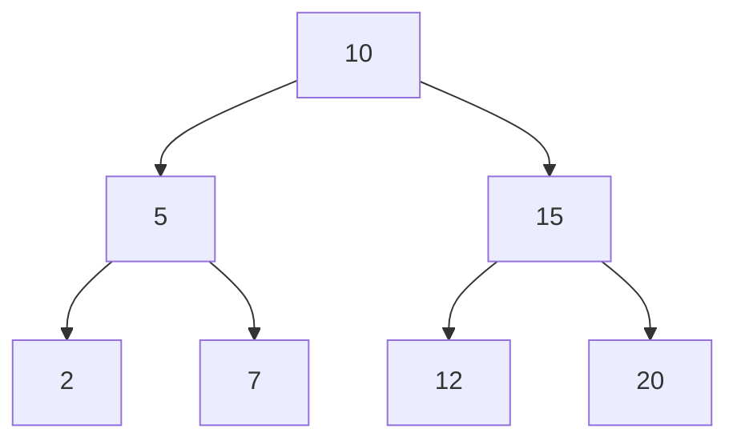
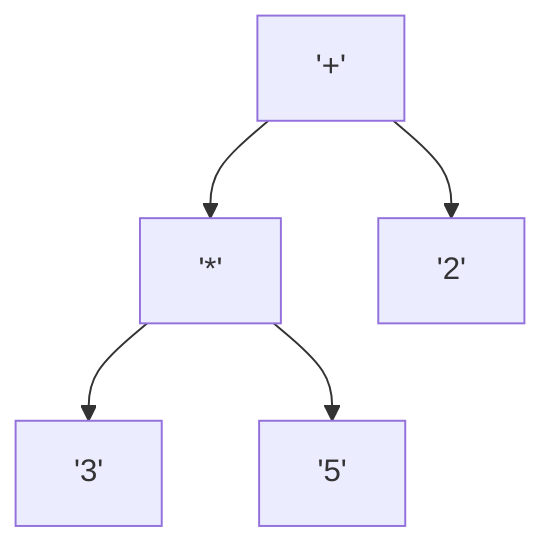

# Estructuras de Datos - Árboles binarios

## 10.2 Instrumentaciones de árboles binarios.

---

### 1. Introducción

Los **árboles binarios** son estructuras de datos jerárquicas donde cada nodo tiene a lo sumo dos hijos. La **instrumentación** se refiere a las diferentes formas de implementarlos y manipularlos para optimizar acceso, almacenamiento y operaciones.

### 2. Representación de Árboles Binarios

#### 2.1 Implementación con nodos y punteros (listas enlazadas)

- Cada nodo tiene un valor y referencias a sus hijos izquierdo y derecho.
- Permite estructura dinámica y crecimiento flexible.

**Definición en Python:**

```python
class NodoBinario:
    def __init__(self, valor):
        self.valor = valor
        self.izquierdo = None
        self.derecho = None

class ArbolBinario:
    def __init__(self):
        self.raiz = None

    def insertar(self, valor):
        if not self.raiz:
            self.raiz = NodoBinario(valor)
        else:
            self._insertar(self.raiz, valor)

    def _insertar(self, nodo, valor):
        if valor < nodo.valor:
            if nodo.izquierdo:
                self._insertar(nodo.izquierdo, valor)
            else:
                nodo.izquierdo = NodoBinario(valor)
        else:
            if nodo.derecho:
                self._insertar(nodo.derecho, valor)
            else:
                nodo.derecho = NodoBinario(valor)
```

**Diagrama:**



#### 2.2 Implementación mediante arreglos

- Útil para **árboles completos o perfectos**.
- Índices del arreglo determinan posición de hijos y padre:
  - Hijo izquierdo de nodo en índice $i$: $2i + 1$
  - Hijo derecho de nodo en índice $i$: $2i + 2$
  - Padre de nodo en índice $i$: $\lfloor \frac{i-1}{2} \rfloor$

**Ejemplo en Python:**

```python
arbol = [10, 5, 15, 2, 7, 12, 20]
# Nodo 10 (índice 0) -> hijos: 5 (1) y 15 (2)
```

#### 2.3 Árbol Binario de Búsqueda (BST)

- Mantiene la propiedad: hijo izquierdo < nodo < hijo derecho.
- Permite **búsqueda, inserción y eliminación** en promedio $O(log n)$.

**Ejemplo de recorrido Inorden en BST (Python):**

```python
def inorden(nodo):
    if nodo:
        inorden(nodo.izquierdo)
        print(nodo.valor, end=' ')
        inorden(nodo.derecho)
```

### 3. Funciones y operaciones comunes

#### 3.1 Recorridos

- **Preorden (Root-Left-Right):** útil para copiar árboles.
- **Inorden (Left-Root-Right):** devuelve elementos en orden ascendente en BST.
- **Postorden (Left-Right-Root):** útil para eliminar árboles.
- **Nivel por nivel (BFS):** útil para estructuras jerárquicas.

**Diagrama recorrido BFS:**


#### 3.2 Altura de un árbol

**Definición recursiva:**

$$ altura(n) = \begin{cases} 0, & \text{si el nodo es None} \\ 1 + \max(altura(n.izquierdo), altura(n.derecho)), & \text{en otro caso} \end{cases} $$

**Implementación en Python:**

```python
def altura(nodo):
    if not nodo:
        return 0
    return 1 + max(altura(nodo.izquierdo), altura(nodo.derecho))
```

### 4. Aplicaciones de Árboles Binarios

1. **Búsqueda eficiente:** BST.
2. **Evaluación de expresiones:** Árboles de expresión.
3. **Compiladores:** Árboles sintácticos abstractos (AST).
4. **Colas de prioridad:** Heaps binarios.
5. **Toma de decisiones:** Árboles de decisión en IA.

**Ejemplo (Árbol de expresión):**



### 5. Referencias

- Cormen, T. H., Leiserson, C. E., Rivest, R. L., & Stein, C. (2009). _Introduction to Algorithms_ (3rd ed.). MIT Press.
- Goodrich, M. T., Tamassia, R., & Goldwasser, M. H. (2014). _Data Structures and Algorithms in Python_. Wiley.
- Weiss, M. A. (2013). _Data Structures and Algorithm Analysis in C++_. Pearson.
