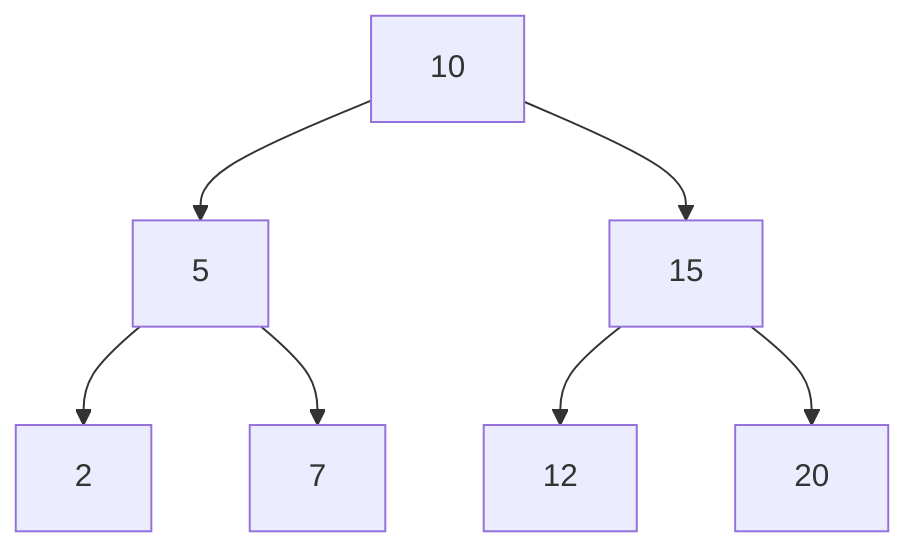
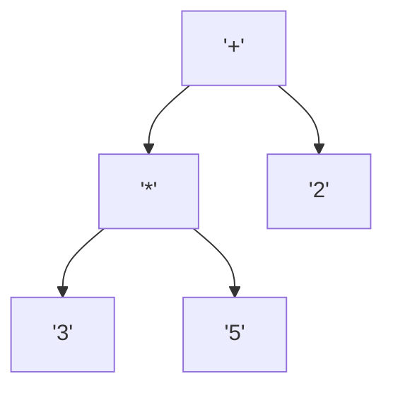

# Estructuras de Datos - Árboles binarios

## 10.3 Recorridos.

---

### 1. Introducción

Los **recorridos en árboles binarios** son métodos para visitar todos los nodos de un árbol siguiendo un orden específico. Se utilizan para analizar, procesar o mostrar los datos almacenados en el árbol.

- Permiten operaciones como búsqueda, impresión, copia, eliminación y evaluación de expresiones.
- Cada tipo de recorrido tiene un propósito particular según la aplicación.

### 2. Tipos de Recorridos

#### 2.1 Recorrido Preorden (Root-Left-Right)

- Se visita primero el **nodo raíz**, luego el **subárbol izquierdo**, y finalmente el **subárbol derecho**.
- Útil para **copiar árboles** o generar expresiones prefijas.

**Definición en Python:**

```python
def preorden(nodo):
    if nodo:
        print(nodo.valor, end=' ')
        preorden(nodo.izquierdo)
        preorden(nodo.derecho)
```

**Diagrama:**



**Recorrido Preorden:** 10, 5, 2, 7, 15, 12, 20

#### 2.2 Recorrido Inorden (Left-Root-Right)

- Se visita primero el **subárbol izquierdo**, luego la **raíz**, y finalmente el **subárbol derecho**.
- En un **BST**, devuelve los valores en **orden ascendente**.

**Definición en Python:**

```python
def inorden(nodo):
    if nodo:
        inorden(nodo.izquierdo)
        print(nodo.valor, end=' ')
        inorden(nodo.derecho)
```

**Recorrido Inorden:** 2, 5, 7, 10, 12, 15, 20

#### 2.3 Recorrido Postorden (Left-Right-Root)

- Se visita primero el **subárbol izquierdo**, luego el **subárbol derecho**, y finalmente la **raíz**.
- Útil para **eliminar árboles** o **evaluar expresiones**.

**Definición en Python:**

```python
def postorden(nodo):
    if nodo:
        postorden(nodo.izquierdo)
        postorden(nodo.derecho)
        print(nodo.valor, end=' ')
```

**Recorrido Postorden:** 2, 7, 5, 12, 20, 15, 10

#### 2.4 Recorrido por niveles (BFS)

- Se visitan los nodos **nivel por nivel** de arriba hacia abajo.
- Se implementa usando **colas**.
- Útil para representar la estructura jerárquica y encontrar nodos cercanos a la raíz.

**Definición en Python:**

```python
from collections import deque

def bfs(raiz):
    if not raiz:
        return
    cola = deque([raiz])
    while cola:
        nodo = cola.popleft()
        print(nodo.valor, end=' ')
        if nodo.izquierdo:
            cola.append(nodo.izquierdo)
        if nodo.derecho:
            cola.append(nodo.derecho)
```

**Recorrido BFS:** 10, 5, 15, 2, 7, 12, 20

**Diagrama Mermaid (BFS):**


### 3. Complejidad de los Recorridos

| Recorrido | Complejidad Tiempo | Complejidad Espacio |
| --------- | ------------------ | ------------------- |
| Preorden  | O(n)               | O(h) (recursión)    |
| Inorden   | O(n)               | O(h)                |
| Postorden | O(n)               | O(h)                |
| BFS       | O(n)               | O(n) (cola)         |

- $n$ = número de nodos
- $h$ = altura del árbol

### 4. Ejemplos de Aplicación

1. **Expresiones matemáticas:** Evaluar expresiones usando recorridos Postorden.
2. **Ordenamiento:** Inorden en BST devuelve lista ordenada.
3. **Copiado de árboles:** Preorden para replicar estructura.
4. **Representación jerárquica:** BFS para mostrar niveles.

**Diagrama (Árbol de expresión):**



- Preorden: +, *, 3, 5, 2
- Inorden: 3, *, 5, +, 2
- Postorden: 3, 5, *, 2, +

### 5. Referencias

- Cormen, T. H., Leiserson, C. E., Rivest, R. L., & Stein, C. (2009). _Introduction to Algorithms_ (3rd ed.). MIT Press.
- Goodrich, M. T., Tamassia, R., & Goldwasser, M. H. (2014). _Data Structures and Algorithms in Python_. Wiley.
- Weiss, M. A. (2013). _Data Structures and Algorithm Analysis in C++_. Pearson.
