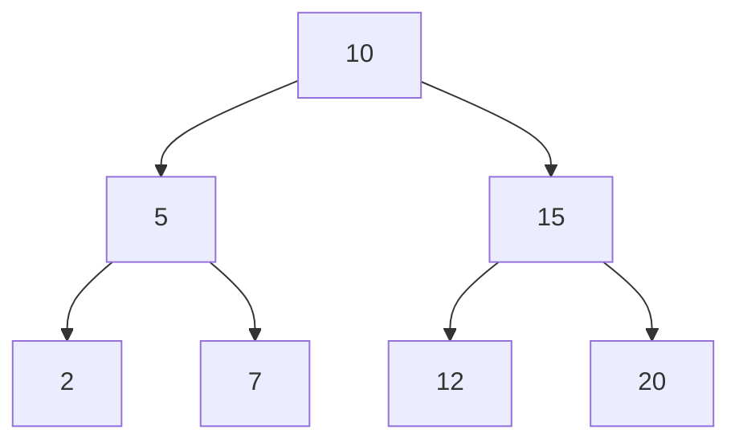
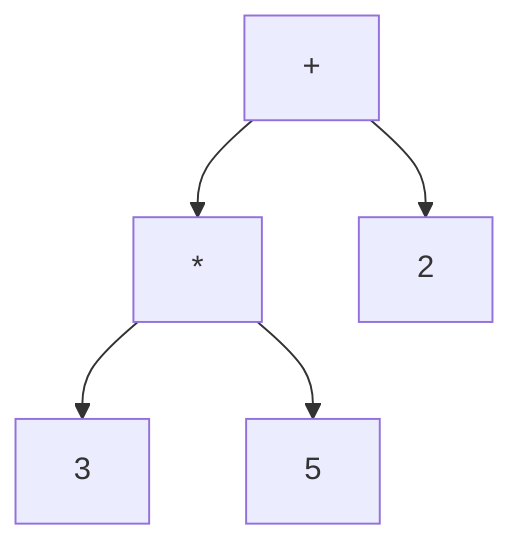
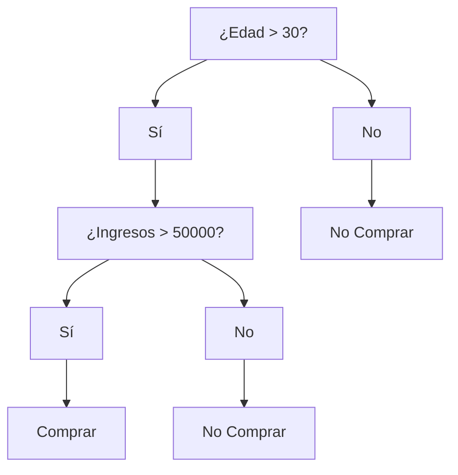
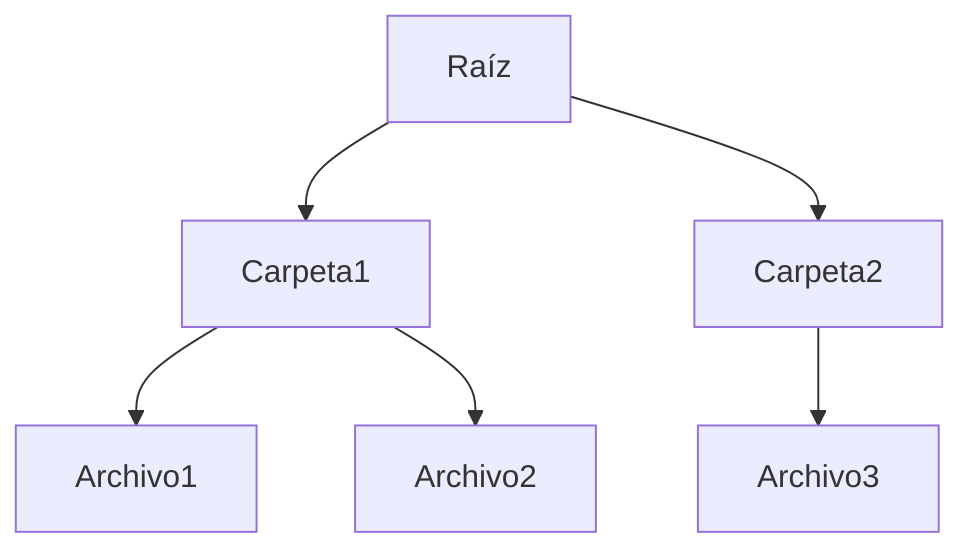

# Estructuras de Datos - Árboles binarios

## 10.4 Aplicaciones.

---

### 1. Introducción

Los **árboles binarios** son estructuras de datos jerárquicas donde cada nodo tiene como máximo dos hijos. Su organización permite **acceso rápido, búsqueda eficiente y modelado jerárquico**, lo que los hace ideales para múltiples aplicaciones.

### 2. Aplicaciones principales

#### 2.1 Árboles de Búsqueda Binaria (BST)

- Permiten **búsqueda, inserción y eliminación** de elementos en promedio $O(\log n)$.
- Son ampliamente usados en bases de datos y sistemas de almacenamiento.

**Ejemplo en Python:**

```python
class NodoBST:
    def __init__(self, valor):
        self.valor = valor
        self.izquierdo = None
        self.derecho = None

class BST:
    def __init__(self):
        self.raiz = None

    def insertar(self, valor):
        if not self.raiz:
            self.raiz = NodoBST(valor)
        else:
            self._insertar(self.raiz, valor)

    def _insertar(self, nodo, valor):
        if valor < nodo.valor:
            if nodo.izquierdo:
                self._insertar(nodo.izquierdo, valor)
            else:
                nodo.izquierdo = NodoBST(valor)
        else:
            if nodo.derecho:
                self._insertar(nodo.derecho, valor)
            else:
                nodo.derecho = NodoBST(valor)
```

**Diagrama Mermaid BST:**



#### 2.2 Árboles de Expresión

- Representan **expresiones matemáticas y lógicas**.
- Cada nodo interno es un operador y cada hoja es un operando.
- Se usan en **evaluación y compiladores**.

**Ejemplo en Python (evaluación Postorden):**

```python
class NodoExp:
    def __init__(self, valor, izquierdo=None, derecho=None):
        self.valor = valor
        self.izquierdo = izquierdo
        self.derecho = derecho

def evaluar(nodo):
    if not nodo.izquierdo and not nodo.derecho:
        return nodo.valor
    izq = evaluar(nodo.izquierdo)
    der = evaluar(nodo.derecho)
    if nodo.valor == '+':
        return izq + der
    elif nodo.valor == '*':
        return izq * der

raiz = NodoExp('+', NodoExp('*', NodoExp(3), NodoExp(5)), NodoExp(2))
print(evaluar(raiz))  # Salida: 17
```

**Diagrama Mermaid:**



#### 2.3 Árboles de Decisión

- Se usan en **inteligencia artificial y machine learning**.
- Cada nodo representa una decisión basada en una condición, con ramas que representan resultados posibles.

**Diagrama Mermaid:**



#### 2.4 Árboles Balanceados y Heaps

- **Heaps:** Árboles binarios completos que permiten implementar **colas de prioridad**.
- Mantienen la propiedad de heap (max-heap o min-heap).
- Operaciones: inserción y extracción del máximo/mínimo en $O(\log n)$.

**Ejemplo en Python usando heapq:**

```python
import heapq
heap = []
heapq.heappush(heap, 5)
heapq.heappush(heap, 2)
heapq.heappush(heap, 8)
print(heapq.heappop(heap))  # Salida: 2 (min-heap)
```

#### 2.5 Aplicaciones en Bases de Datos y Sistemas de Archivos

Estas estructuras no son árboles **binarios**: sus nodos tienen muchos hijos. Se incluyen como generalización de las ideas anteriores.

- **B-Trees y B+ Trees:** indexación rápida de grandes volúmenes de datos.
- **Sistemas de archivos:** estructura de directorios jerárquicos.

**Diagrama Mermaid (estructura de directorios):**



### 3. Conclusiones

- Los árboles binarios son versátiles y se aplican en **búsqueda, almacenamiento, evaluación, decisiones y jerarquías**.
- La elección del tipo de árbol y su instrumentación depende de la aplicación específica y la eficiencia deseada.
- Los recorridos y operaciones asociadas permiten explotar al máximo su estructura.

### 4. Referencias

- Cormen, T. H., Leiserson, C. E., Rivest, R. L., & Stein, C. (2009). _Introduction to Algorithms_ (3rd ed.). MIT Press.
- Goodrich, M. T., Tamassia, R., & Goldwasser, M. H. (2014). _Data Structures and Algorithms in Python_. Wiley.
- Weiss, M. A. (2013). _Data Structures and Algorithm Analysis in C++_. Pearson.
