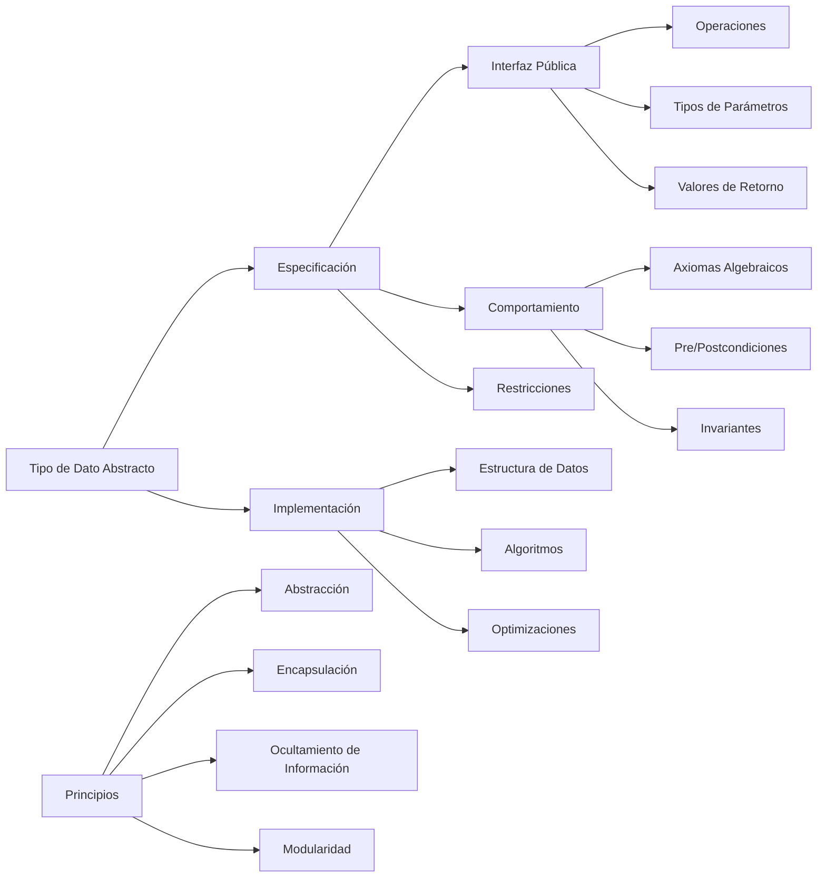

# Estructuras de Datos - Tipos de datos abstractos

## 1.1 Definición, especificación e instrumentación de tipos de dato abstractos (TDAs).

---

### 1. Definición de Tipos de Datos Abstractos

#### 1.1. Concepto Fundamental

Un **Tipo de Dato Abstracto (TDA)** es un modelo matemático que define:

- Un conjunto de **valores**
- Un conjunto de **operaciones** sobre esos valores
- El **comportamiento** de las operaciones

#### 1.2. Características Principales

- **Abstracción:** Oculta los detalles de implementación
- **Encapsulación:** Agrupa datos y operaciones relacionadas
- **Independencia:** La implementación puede cambiar sin afectar el uso

#### 1.3. Notación Formal

Un TDA se define como una tupla:

$$ \text{TDA} = (V, O, A) $$

donde:

- $V$: conjunto de valores
- $O$: conjunto de operaciones
- $A$: axiomas que definen el comportamiento

### 2. Especificación de TDAs

#### 2.1. Componentes de una Especificación

1. **Nombre:** Identificador del TDA
2. **Valores:** Tipos de datos que maneja
3. **Operaciones:** Firmas de las funciones
4. **Axiomas:** Reglas que gobiernan el comportamiento

#### 2.2. Especificación Algebraica

Uso de ecuaciones para definir el comportamiento:

$$ \text{pop(push(s, x)) = s} $$

$$ \text{top(push(s, x)) = x} $$

#### 2.3. Especificación por Pre/Postcondiciones

- **Precondiciones:** Condiciones que deben cumplirse antes de la operación
- **Postcondiciones:** Condiciones que deben cumplirse después

### 3. Implementación Computacional

```python
from abc import ABC, abstractmethod
from typing import TypeVar, Generic, List

T = TypeVar('T')

class TDA(ABC):
    """Clase abstracta base para todos los TDAs"""

    @abstractmethod
    def esta_vacio(self) -> bool:
        """Verifica si el TDA está vacío"""
        pass

    @abstractmethod
    def tamaño(self) -> int:
        """Retorna el número de elementos"""
        pass

    @abstractmethod
    def limpiar(self) -> None:
        """Elimina todos los elementos"""
        pass

class Pila(TDA, Generic[T]):
    """Implementación del TDA Pila"""

    def __init__(self):
        self._elementos: List[T] = []

    def esta_vacio(self) -> bool:
        return len(self._elementos) == 0

    def tamaño(self) -> int:
        return len(self._elementos)

    def limpiar(self) -> None:
        self._elementos.clear()

    def apilar(self, elemento: T) -> None:
        """Añade un elemento a la cima de la pila"""
        self._elementos.append(elemento)

    def desapilar(self) -> T:
        """Remueve y retorna el elemento de la cima"""
        if self.esta_vacio():
            raise IndexError("Pila vacía")
        return self._elementos.pop()

    def cima(self) -> T:
        """Retorna el elemento de la cima sin removerlo"""
        if self.esta_vacio():
            raise IndexError("Pila vacía")
        return self._elementos[-1]

    def __str__(self):
        return f"Pila({self._elementos})"

# Ejemplo de uso
print("=== IMPLEMENTACIÓN TDA PILA ===")
pila = Pila[int]()

# Operaciones básicas
pila.apilar(10)
pila.apilar(20)
pila.apilar(30)

print(f"Pila: {pila}")
print(f"Cima: {pila.cima()}")
print(f"Tamaño: {pila.tamaño()}")

# Desapilar
elemento = pila.desapilar()
print(f"Elemento desapilado: {elemento}")
print(f"Pila después: {pila}")

# Verificar estado
print(f"¿Está vacía? {pila.esta_vacio()}")
pila.limpiar()
print(f"¿Está vacía después de limpiar? {pila.esta_vacio()}")
```

### 4. Diagrama de Especificación TDA



### 5. Instrumentación de TDAs

#### 5.1. Patrones de Implementación

1. **Basada en arreglos:** Uso de listas/arrays
2. **Basada en nodos:** Estructuras enlazadas
3. **Híbrida:** Combinación de diferentes estructuras

#### 5.2. Consideraciones de Diseño

- **Eficiencia:** Complejidad temporal y espacial
- **Manejo de errores:** Excepciones y validaciones
- **Thread safety:** Uso en entornos concurrentes

#### 5.3. Testing de TDAs

- **Pruebas unitarias:** Verificación de cada operación
- **Pruebas de integración:** Interacción entre operaciones
- **Pruebas de stress:** Comportamiento bajo carga

### 6. Ejemplo: Especificación Formal de Pila

#### 6.1. Signaturas de Operaciones

- `crear(): Pila[T]`
- `apilar(p: Pila[T], x: T): Pila[T]`
- `desapilar(p: Pila[T]): Pila[T]`
- `cima(p: Pila[T]): T`
- `esta_vacia(p: Pila[T]): bool`

#### 6.2. Axiomas Algebraicos

$$ \begin{align*} \text{desapilar(apilar(p, x))} &= p \\\ \text{cima(apilar(p, x))} &= x \\\ esta_vacia(crear()) &= \text{true} \\\ esta_vacia(apilar(p, x)) &= \text{false} \end{align*} $$

#### 6.3. Precondiciones

- `desapilar(p)` requiere `¬esta_vacia(p)`
- `cima(p)` requiere `¬esta_vacia(p)`

### 7. Implementación de Múltiples TDAs

```python
from collections import deque
from typing import Optional

class Cola(TDA, Generic[T]):
    """Implementación del TDA Cola usando deque"""

    def __init__(self):
        self._elementos = deque()

    def esta_vacio(self) -> bool:
        return len(self._elementos) == 0

    def tamaño(self) -> int:
        return len(self._elementos)

    def limpiar(self) -> None:
        self._elementos.clear()

    def encolar(self, elemento: T) -> None:
        """Añade un elemento al final de la cola"""
        self._elementos.append(elemento)

    def desencolar(self) -> T:
        """Remueve y retorna el elemento del frente"""
        if self.esta_vacio():
            raise IndexError("Cola vacía")
        return self._elementos.popleft()

    def frente(self) -> T:
        """Retorna el elemento del frente sin removerlo"""
        if self.esta_vacio():
            raise IndexError("Cola vacía")
        return self._elementos[0]

    def __str__(self):
        return f"Cola({list(self._elementos)})"

class ListaEnlazada(TDA, Generic[T]):
    """Implementación del TDA Lista Enlazada"""

    class Nodo:
        def __init__(self, dato: T):
            self.dato = dato
            self.siguiente: Optional[ListaEnlazada.Nodo] = None

    def __init__(self):
        self.cabeza: Optional[self.Nodo] = None
        self._tamaño = 0

    def esta_vacio(self) -> bool:
        return self.cabeza is None

    def tamaño(self) -> int:
        return self._tamaño

    def limpiar(self) -> None:
        self.cabeza = None
        self._tamaño = 0

    def insertar(self, indice: int, elemento: T) -> None:
        """Inserta un elemento en la posición especificada"""
        if indice < 0 or indice > self._tamaño:
            raise IndexError("Índice fuera de rango")

        nuevo_nodo = self.Nodo(elemento)

        if indice == 0:
            nuevo_nodo.siguiente = self.cabeza
            self.cabeza = nuevo_nodo
        else:
            actual = self.cabeza
            for _ in range(indice - 1):
                actual = actual.siguiente
            nuevo_nodo.siguiente = actual.siguiente
            actual.siguiente = nuevo_nodo

        self._tamaño += 1

# Ejemplo de uso múltiple
print("\n=== COMPARACIÓN DE TDAS ===")

# Uso de Pila
pila = Pila()
pila.apilar("primero")
pila.apilar("segundo")
print(f"Pila - Cima: {pila.cima()}")

# Uso de Cola
cola = Cola()
cola.encolar("primero")
cola.encolar("segundo")
print(f"Cola - Frente: {cola.frente()}")

# Uso de Lista Enlazada
lista = ListaEnlazada()
lista.insertar(0, "elemento")
print(f"Lista - Tamaño: {lista.tamaño()}")
```

### 8. Ventajas de los TDAs

#### 8.1. Beneficios de Diseño

- **Modularidad:** Componentes independientes y reutilizables
- **Mantenibilidad:** Cambios localizados
- **Reusabilidad:** Implementaciones intercambiables

#### 8.2. Beneficios de Calidad

- **Confiabilidad:** Comportamiento predecible
- **Verificabilidad:** Especificación clara para testing
- **Extensibilidad:** Fácil añadir nuevas funcionalidades

#### 8.3. Beneficios de Desarrollo

- **Trabajo en equipo:** Interfaces bien definidas
- **Documentación:** Especificación como documentación
- **Evolución:** Implementaciones mejorables independientemente

### 9. Ejercicios Propuestos

1. Implemente el TDA Cola usando dos pilas
2. Diseñe la especificación formal del TDA Conjunto
3. Cree una implementación del TDA Pila usando listas enlazadas
4. Implemente el TDA Diccionario con operaciones de inserción, búsqueda y eliminación
5. Diseñe axiomas algebraicos para el TDA Cola de Prioridad
6. Implemente pruebas unitarias para el TDA Pila
7. Compare la eficiencia de diferentes implementaciones del mismo TDA
8. Investigue patrones de diseño aplicables a la implementación de TDAs

### 10. Referencias

- Liskov, B., & Zilles, S. (1974). _Programming with abstract data types_
- Guttag, J. V. (1977). _Abstract data types and the development of data structures_
- Meyer, B. (1997). _Object-Oriented Software Construction_
- Cormen, T. H., et al. (2009). _Introduction to Algorithms_
- Sedgewick, R., & Wayne, K. (2011). _Algorithms_
