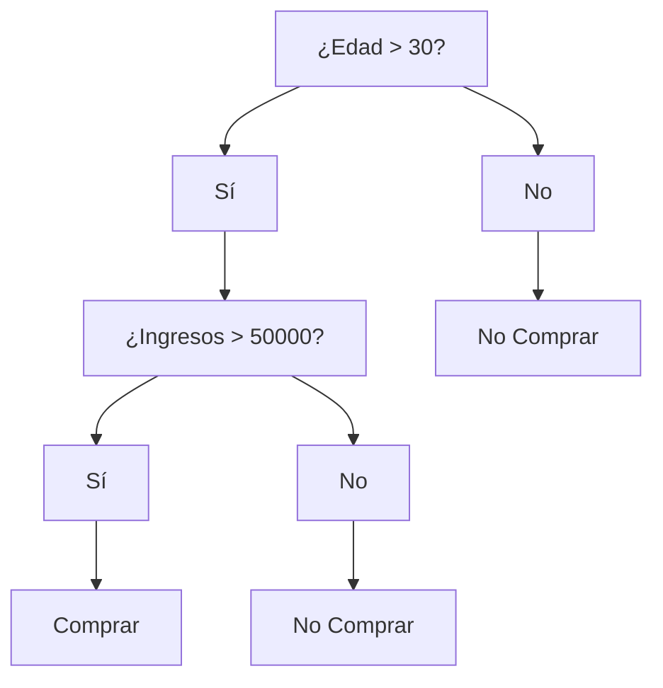
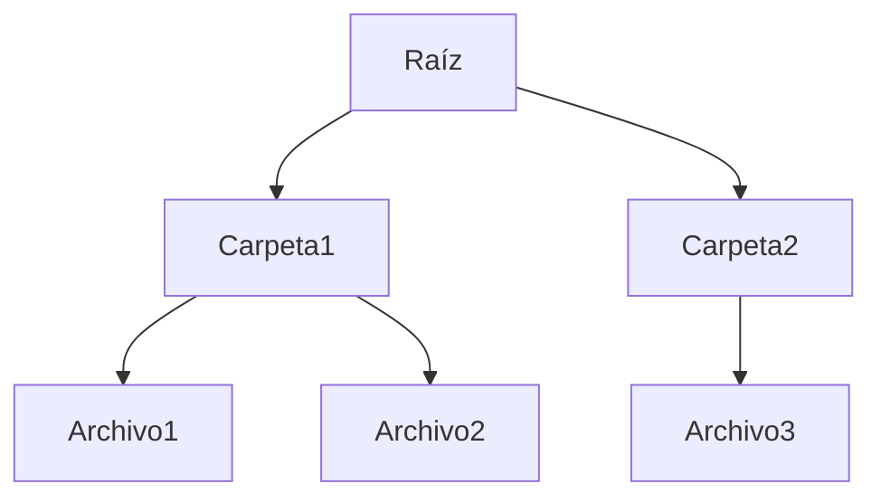

# Estructuras de Datos - Árboles binarios de búsqueda

## 11.3 Aplicaciones.

---

### 1. Introducción

Un **Árbol Binario de Búsqueda (BST)** es una estructura de datos jerárquica que permite organizar elementos de manera que:

- Para cada nodo, los valores del subárbol izquierdo son menores.
- Los valores del subárbol derecho son mayores.

Esto facilita operaciones como **búsqueda, inserción y eliminación**, y tiene aplicaciones en múltiples áreas de la informática.

### 2. Aplicaciones principales

#### 2.1 Búsqueda eficiente

- Los BST permiten búsquedas promedio en $O(\log n)$.
- Útiles para bases de datos pequeñas y almacenamiento dinámico.

**Ejemplo en Python:**

```python
class NodoBST:
    def __init__(self, valor):
        self.valor = valor
        self.izquierdo = None
        self.derecho = None

# Función de búsqueda
def buscar(nodo, valor):
    if not nodo or nodo.valor == valor:
        return nodo
    if valor < nodo.valor:
        return buscar(nodo.izquierdo, valor)
    else:
        return buscar(nodo.derecho, valor)
```

#### 2.2 Árboles de Expresión

- Representan expresiones matemáticas o lógicas.
- Nodos internos: operadores
- Hojas: operandos
- Utilizados en **compiladores y evaluadores de expresiones**.

**Ejemplo en Python:**

```python
class NodoExp:
    def __init__(self, valor, izquierdo=None, derecho=None):
        self.valor = valor
        self.izquierdo = izquierdo
        self.derecho = derecho

def evaluar(nodo):
    if not nodo.izquierdo and not nodo.derecho:
        return nodo.valor
    izq = evaluar(nodo.izquierdo)
    der = evaluar(nodo.derecho)
    if nodo.valor == '+':
        return izq + der
    elif nodo.valor == '*':
        return izq * der

raiz = NodoExp('+', NodoExp('*', NodoExp(3), NodoExp(5)), NodoExp(2))
print(evaluar(raiz))  # 17
```

#### 2.3 Árboles de Decisión

- Usados en **IA y machine learning**.
- Cada nodo representa una condición, con ramas para posibles decisiones.

**Diagrama Mermaid:**



#### 2.4 Árboles Balanceados y Heaps

- **Heaps binarios:** implementan **colas de prioridad**.
- Operaciones: inserción y extracción de máximo/mínimo en $O(\log n)$.

**Ejemplo Python:**

```python
import heapq
heap = []
heapq.heappush(heap, 5)
heapq.heappush(heap, 2)
heapq.heappush(heap, 8)
print(heapq.heappop(heap))  # 2
```

#### 2.5 Bases de Datos y Sistemas de Archivos

- **B-Trees y B+ Trees:** para indexación rápida de grandes volúmenes de datos.
- **Sistemas de archivos:** estructuras de directorios jerárquicos.

**Diagrama Mermaid (directorio):**



### 3. Conclusiones

- Los BST son versátiles y aplicables en búsqueda, almacenamiento, expresión matemática, decisiones y jerarquías.
- La eficiencia depende del **balance del árbol**.
- Se pueden combinar con estructuras avanzadas (AVL, Red-Black, B-Trees) para mejorar rendimiento.

### 4. Referencias

- Cormen, T. H., Leiserson, C. E., Rivest, R. L., & Stein, C. (2009). _Introduction to Algorithms_ (3rd ed.). MIT Press.
- Goodrich, M. T., Tamassia, R., & Goldwasser, M. H. (2014). _Data Structures and Algorithms in Python_. Wiley.
- Weiss, M. A. (2013). _Data Structures and Algorithm Analysis in C++_. Pearson.
