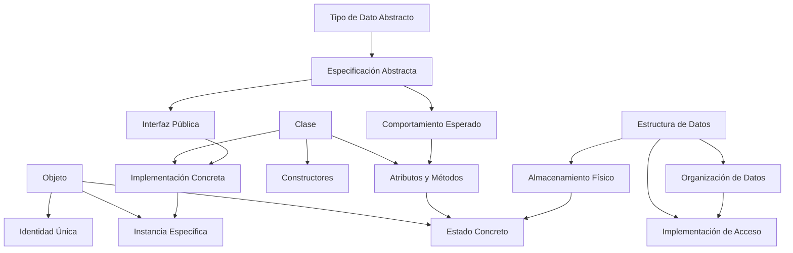

# Estructuras de Datos - Tipos de datos abstractos

## 1.2 Conceptos de clase, objeto y estructura de datos y su relación con TDA.

---

### 1. Conceptos Fundamentales

#### 1.1. Clase

Una **clase** es una plantilla o molde que define:

- **Atributos:** Variables que almacenan el estado
- **Métodos:** Operaciones que manipulan el estado
- **Constructores:** Inicialización de objetos

**Notación formal:**
$$\text{Clase} = (\text{Atributos}, \text{Métodos}, \text{Constructores})$$

#### 1.2. Objeto

Un **objeto** es una instancia concreta de una clase:

- Tiene un **estado** específico (valores de atributos)
- Ocupa **memoria** en tiempo de ejecución
- Responde a **mensajes** (llamadas a métodos)

#### 1.3. Estructura de Datos

Organización y almacenamiento de datos que permite:

- **Acceso eficiente** a la información
- **Operaciones** específicas de manipulación
- **Relaciones** entre datos

### 2. Relación con Tipos de Datos Abstractos

#### 2.1. TDA como Clase Abstracta

Un TDA se implementa como una **clase abstracta** que define:

- **Interfaz pública:** Métodos accesibles
- **Comportamiento esperado:** Especificación funcional
- **Contrato:** Pre/Post condiciones

#### 2.2. Objeto como Instancia de TDA

Cada objeto representa una **instancia específica** del TDA:

- **Estado interno:** Implementación concreta
- **Comportamiento:** Implementación de métodos
- **Identidad:** Referencia única en memoria

#### 2.3. Estructura como Implementación

La **estructura de datos** es la implementación concreta:

- **Almacenamiento:** Como se guardan los datos
- **Acceso:** Como se recupera la información
- **Eficiencia:** Complejidad computacional

### 3. Implementación Computacional

```python
from abc import ABC, abstractmethod
from typing import List, Optional

# ===== TDA PILA - CLASE ABSTRACTA =====
class TDA_Pila(ABC):
    """Tipo de Dato Abstracto Pila - Interfaz"""

    @abstractmethod
    def apilar(self, elemento) -> None:
        """Añade un elemento a la cima"""
        pass

    @abstractmethod
    def desapilar(self):
        """Remueve y retorna el elemento de la cima"""
        pass

    @abstractmethod
    def cima(self):
        """Retorna el elemento de la cima sin removerlo"""
        pass

    @abstractmethod
    def esta_vacia(self) -> bool:
        """Verifica si la pila está vacía"""
        pass

    @abstractmethod
    def tamaño(self) -> int:
        """Retorna el número de elementos"""
        pass

# ===== IMPLEMENTACIÓN CON LISTA - ESTRUCTURA DE DATOS =====
class PilaLista(TDA_Pila):
    """Implementación concreta usando lista como estructura"""

    def __init__(self):
        # Estructura de datos: Lista Python
        self._elementos: List = []
        # Estado del objeto: elementos almacenados

    def apilar(self, elemento) -> None:
        self._elementos.append(elemento)

    def desapilar(self):
        if self.esta_vacia():
            raise IndexError("Pila vacía")
        return self._elementos.pop()

    def cima(self):
        if self.esta_vacia():
            raise IndexError("Pila vacía")
        return self._elementos[-1]

    def esta_vacia(self) -> bool:
        return len(self._elementos) == 0

    def tamaño(self) -> int:
        return len(self._elementos)

    def __str__(self):
        return f"PilaLista({self._elementos})"

# ===== IMPLEMENTACIÓN CON NODOS - ESTRUCTURA ALTERNATIVA =====
class PilaNodos(TDA_Pila):
    """Implementación con lista enlazada como estructura"""

    class Nodo:
        """Estructura de dato nodo para lista enlazada"""
        def __init__(self, dato, siguiente=None):
            self.dato = dato
            self.siguiente = siguiente

    def __init__(self):
        # Estructura de datos: Lista enlazada
        self._cima: Optional[self.Nodo] = None
        self._tamaño: int = 0
        # Estado del objeto: cima y tamaño

    def apilar(self, elemento) -> None:
        nuevo_nodo = self.Nodo(elemento, self._cima)
        self._cima = nuevo_nodo
        self._tamaño += 1

    def desapilar(self):
        if self.esta_vacia():
            raise IndexError("Pila vacía")
        dato = self._cima.dato
        self._cima = self._cima.siguiente
        self._tamaño -= 1
        return dato

    def cima(self):
        if self.esta_vacia():
            raise IndexError("Pila vacía")
        return self._cima.dato

    def esta_vacia(self) -> bool:
        return self._cima is None

    def tamaño(self) -> int:
        return self._tamaño

    def __str__(self):
        elementos = []
        actual = self._cima
        while actual:
            elementos.append(actual.dato)
            actual = actual.siguiente
        return f"PilaNodos({elementos})"

# ===== USO DE OBJETOS =====
def demostrar_conceptos():
    print("=== DEMOSTRACIÓN CLASE-OBJETO-ESTRUCTURA ===")

    # Crear objetos (instancias de diferentes clases)
    pila1: TDA_Pila = PilaLista()  # Objeto con estructura de lista
    pila2: TDA_Pila = PilaNodos()  # Objeto con estructura de nodos

    # Mismo comportamiento (mismos métodos)
    for i in [1, 2, 3, 4, 5]:
        pila1.apilar(i)
        pila2.apilar(i)

    print(f"Pila con lista: {pila1}")
    print(f"Pila con nodos: {pila2}")
    print(f"Ambas vacías? {pila1.esta_vacia()} | {pila2.esta_vacia()}")
    print(f"Mismo tamaño? {pila1.tamaño()} == {pila2.tamaño()}")

    # Mismo comportamiento, diferente implementación
    print(f"Cima pila1: {pila1.cima()}")
    print(f"Cima pila2: {pila2.cima()}")

    # Demostrar identidad de objetos
    print(f"¿Mismo objeto? {pila1 is pila2}")
    print(f"Tipo pila1: {type(pila1)}")
    print(f"Tipo pila2: {type(pila2)}")

if __name__ == "__main__":
    demostrar_conceptos()
```

### 4. Diagrama de Relaciones



### 5. Principios de Diseño

#### 5.1. Encapsulación

**Ocultamiento de información:**

- Atributos privados (`_elementos`, `_cima`)
- Métodos públicos bien definidos
- Implementación invisible al usuario

#### 5.2. Abstracción

**Interfaz uniforme:**

- Mismos métodos para diferentes implementaciones
- Comportamiento predecible
- Contrato claro de uso

#### 5.3. Polimorfismo

**Múltiples formas:**

- Diferentes implementaciones del mismo TDA
- Mismo comportamiento, diferente estructura
- Intercambiabilidad de implementaciones

### 6. Ejemplos de Relaciones

#### 6.1. Relación TDA-Clase

```python
# TDA define QUÉ hace
class TDA_Cola(ABC):
    @abstractmethod
    def encolar(self, elemento): pass
    @abstractmethod
    def desencolar(self): pass

# Clase define CÓMO lo hace
class ColaLista(TDA_Cola):
    def __init__(self):
        self._elementos = []  # Estructura de datos
```

#### 6.2. Relación Clase-Objeto

```python
# Clase como molde
class Persona:
    def __init__(self, nombre):
        self.nombre = nombre  # Atributo/estado

# Objetos como instancias
persona1 = Persona("Ana")    # Objeto con estado "Ana"
persona2 = Persona("Carlos") # Objeto con estado "Carlos"
```

#### 6.3. Relación Objeto-Estructura

```python
class ArbolBinario:
    class Nodo:
        def __init__(self, valor):
            self.valor = valor
            self.izquierdo = None  # Estructura recursiva
            self.derecho = None

    def __init__(self):
        self.raiz = None  # Estructura de árbol
```

### 7. Ventajas del Enfoque

#### 7.1. Modularidad

- Componentes independientes
- Facil mantenimiento
- Reuso de código

#### 7.2. Flexibilidad

- Múltiples implementaciones
- Intercambiabilidad
- Evolución independiente

#### 7.3. Calidad

- Verificación formal
- Testing sistemático
- Documentación automática

### 8. Ejercicios Prácticos

1. Implemente el TDA Cola usando dos implementaciones diferentes

2. Cree una clase Persona y demuestre la creación de múltiples objetos

3. Compare la eficiencia de diferentes estructuras para el mismo TDA

4. Implemente el patrón Factory Method para crear instancias de TDAs

5. Demuestre el principio de sustitución de Liskov con TDAs

6. Cree una estructura de datos para árbol binario y implemente operaciones básicas

7. Implemente el TDA Conjunto usando diferentes estructuras (lista, hash, árbol)

8. Diseñe un sistema de herencia para TDAs relacionados

### 9. Referencias

- Liskov, B. (1987). Data abstraction and hierarchy
- Meyer, B. (1997). Object-Oriented Software Construction
- Gamma, E., et al. (1994). Design Patterns
- Bloch, J. (2008). Effective Java
- McConnell, S. (2004). Code Complete
