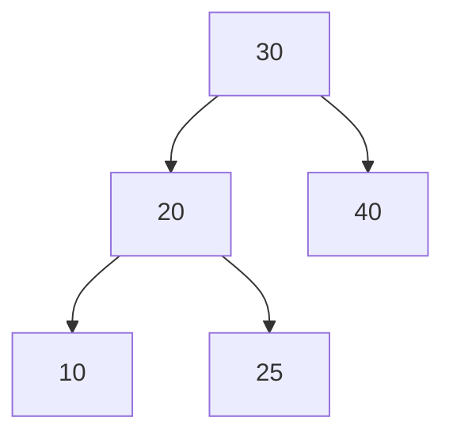

# Estructuras de Datos - Árboles de búsqueda balanceados

## 12.1 Motivación, definición, propiedades y TDA.

---

### 1. Motivación

En muchas aplicaciones de ciencias de la computación es necesario **almacenar, buscar y actualizar datos de forma eficiente**.  
Un **árbol de búsqueda binario (BST)** es una estructura útil para estos fines, pero puede volverse **ineficiente** si no está balanceado.

Ejemplo de problema:

- Si los datos se insertan en orden creciente en un BST, se genera una estructura degenerada similar a una **lista enlazada**, con complejidad en operaciones de búsqueda $O(n)$ en el peor caso.

#### Objetivo del balanceo

- Mantener la altura del árbol aproximadamente en $O(\log n)$.
- Garantizar eficiencia en operaciones de **búsqueda, inserción y eliminación**.

### 2. Definición

Un **árbol de búsqueda balanceado** es un **árbol binario de búsqueda (BST)** que cumple la condición de que su **altura se mantiene controlada** (balanceada), de manera que:

$$ h = O(\log n) $$

donde:

- $h$ es la altura del árbol.
- $n$ es el número de nodos.

Ejemplos de árboles balanceados:

- **AVL (Adelson-Velsky y Landis)**.
- **Árboles Rojo-Negro**.
- **Árboles B** (usados en bases de datos).

### 3. Propiedades

Un árbol de búsqueda balanceado debe cumplir:

1. **Propiedad de BST:**

- Para cada nodo $N$, todos los valores en el subárbol izquierdo son menores que $N$, y todos los del derecho son mayores.

$$ \forall x \in Left(N),\; x < N < y,\; \forall y \in Right(N) $$

2. **Balanceo de altura:**

- La diferencia de alturas entre los subárboles de cada nodo debe mantenerse dentro de un límite.

Ejemplo en **árboles AVL**:

$$ |h_{izq} - h_{der}| \leq 1 $$

3. **Eficiencia:**
   - Operaciones de búsqueda, inserción y eliminación tienen costo $O(\log n)$.

### 4. TDA (Tipo de Dato Abstracto)

El **TDA Árbol de Búsqueda Balanceado** se define mediante un conjunto de operaciones sobre un dominio de datos.

#### Operaciones principales:

- **Crear()** → inicializa un árbol vacío.
- **Insertar(T, x)** → inserta un elemento $x$ manteniendo el balance.
- **Eliminar(T, x)** → elimina el elemento $x$ ajustando el balance.
- **Buscar(T, x)** → localiza un elemento $x$ en tiempo $O(\log n)$.
- **Recorrer(T, orden)** → recorrido en inorden, preorden o postorden.

### 5. Ejemplo en Código (AVL en Python)

```python
class NodoAVL:
    def __init__(self, valor):
        self.valor = valor
        self.izq = None
        self.der = None
        self.altura = 1

class AVL:
    def insertar(self, raiz, valor):
        if not raiz:
            return NodoAVL(valor)
        elif valor < raiz.valor:
            raiz.izq = self.insertar(raiz.izq, valor)
        else:
            raiz.der = self.insertar(raiz.der, valor)

        raiz.altura = 1 + max(self.obtener_altura(raiz.izq),
                              self.obtener_altura(raiz.der))

        balance = self.obtener_balance(raiz)

        # Rotación simple derecha
        if balance > 1 and valor < raiz.izq.valor:
            return self.rotar_derecha(raiz)

        # Rotación simple izquierda
        if balance < -1 and valor > raiz.der.valor:
            return self.rotar_izquierda(raiz)

        # Rotación doble izquierda-derecha
        if balance > 1 and valor > raiz.izq.valor:
            raiz.izq = self.rotar_izquierda(raiz.izq)
            return self.rotar_derecha(raiz)

        # Rotación doble derecha-izquierda
        if balance < -1 and valor < raiz.der.valor:
            raiz.der = self.rotar_derecha(raiz.der)
            return self.rotar_izquierda(raiz)

        return raiz

    def obtener_altura(self, nodo):
        return nodo.altura if nodo else 0

    def obtener_balance(self, nodo):
        return self.obtener_altura(nodo.izq) - self.obtener_altura(nodo.der)

    def rotar_izquierda(self, z):
        y = z.der
        T2 = y.izq
        y.izq = z
        z.der = T2
        z.altura = 1 + max(self.obtener_altura(z.izq),
                           self.obtener_altura(z.der))
        y.altura = 1 + max(self.obtener_altura(y.izq),
                           self.obtener_altura(y.der))
        return y

    def rotar_derecha(self, z):
        y = z.izq
        T3 = y.der
        y.der = z
        z.izq = T3
        z.altura = 1 + max(self.obtener_altura(z.izq),
                           self.obtener_altura(z.der))
        y.altura = 1 + max(self.obtener_altura(y.izq),
                           self.obtener_altura(y.der))
        return y
```

### 6. Diagrama en Mermaid



Representa un **Árbol AVL balanceado** después de varias inserciones.

### 7. Referencias

- Cormen, T. H., Leiserson, C. E., Rivest, R. L., & Stein, C. (2009). _Introduction to Algorithms_ (3rd ed.). MIT Press.
- Goodrich, M. T., Tamassia, R., & Goldwasser, M. H. (2014). _Data Structures and Algorithms in Python_. Wiley.
- Weiss, M. A. (2013). _Data Structures and Algorithm Analysis in Java_. Pearson.
