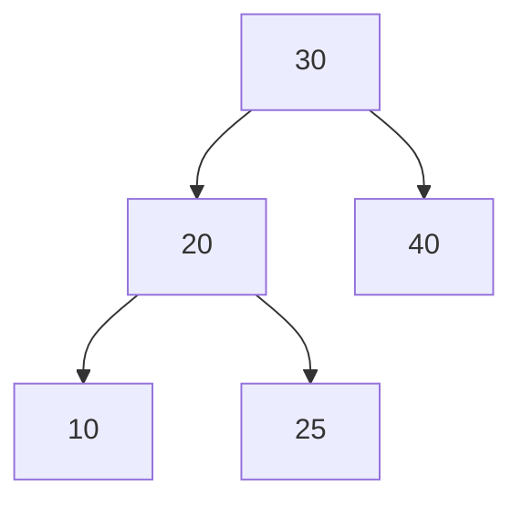
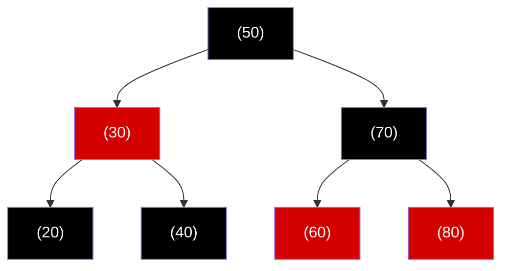

# Estructuras de Datos - Árboles de búsqueda balanceados

## 12.2 Árboles AVL, árboles rojinegros, definición, propiedades y TDA.

---

### 1. Introducción

Los árboles de búsqueda balanceados aseguran que las operaciones de inserción, búsqueda y eliminación se realicen en tiempo $O(\log n)$.  
Entre los más importantes están los **árboles AVL** y los **árboles Rojo-Negro**, ampliamente utilizados en algoritmos y sistemas.

### 2. Árboles AVL

#### 2.1 Definición

El **árbol AVL** (Adelson-Velsky y Landis, 1962) es un **árbol binario de búsqueda balanceado** que cumple con la condición de que:

$$ |h_{izq} - h_{der}| \leq 1 $$

para cada nodo, donde $h_{izq}$ y $h_{der}$ son las alturas de sus subárboles izquierdo y derecho.

#### 2.2 Propiedades

- Estrictamente balanceado en altura.
- La altura está acotada por $O(\log n)$.
- Puede requerir **rotaciones** (simples o dobles) al insertar o eliminar elementos.

#### 2.3 TDA (Tipo de Dato Abstracto)

Operaciones típicas en un árbol AVL:

- **Insertar(x)** → Inserta un nodo y realiza rotaciones si es necesario.
- **Eliminar(x)** → Elimina un nodo y rebalancea el árbol.
- **Buscar(x)** → Localiza un nodo en $O(\log n)$.
- **Recorridos()** → Inorden, preorden, postorden.

#### 2.4 Ejemplo en Mermaid



Representa un árbol AVL balanceado.

### 3. Árboles Rojo-Negro

#### 3.1 Definición

Un **árbol Rojo-Negro (RBT, Red-Black Tree)** es un árbol binario de búsqueda balanceado que mantiene un balance menos estricto que un AVL, pero garantiza operaciones en tiempo $O(\log n)$.  
Cada nodo se marca como **rojo** o **negro**, y cumple ciertas reglas de balanceo.

#### 3.2 Propiedades

1. Cada nodo es **rojo** o **negro**.
2. La raíz siempre es **negra**.
3. Toda hoja (nodo nulo) es **negra**.
4. Si un nodo es **rojo**, sus hijos deben ser **negros** (no hay dos rojos consecutivos).
5. Todo camino desde un nodo hasta una hoja contiene el mismo número de nodos negros (**altura negra**).

#### 3.3 TDA (Tipo de Dato Abstracto)

Operaciones típicas en un árbol Rojo-Negro:

- **Insertar(x)** → Inserta un nodo rojo y ajusta el árbol con recoloreos y rotaciones.
- **Eliminar(x)** → Ajusta el árbol para mantener las propiedades de color y balance.
- **Buscar(x)** → Localiza un nodo en $O(\log n)$.
- **Recorridos()** → Igual que en BST.

#### 3.4 Ejemplo



Representa un árbol Rojo-Negro balanceado.

### 4. Comparación AVL vs Rojo-Negro

| Característica        | AVL                                       | Rojo-Negro                             |
| --------------------- | ----------------------------------------- | -------------------------------------- |
| Balanceo              | Estricto ( $\|h_{izq}-h_{der}\| \leq 1$ ) | Menos estricto (altura negra uniforme) |
| Búsqueda              | Más rápida                                | Rápida pero ligeramente menor          |
| Inserción/Eliminación | Más costosa (rotaciones frecuentes)       | Más eficiente (menos rotaciones)       |
| Aplicaciones          | Bases de datos, memoria RAM               | Compiladores, sistemas operativos      |

### 5. Código en Python (Árbol Rojo-Negro simplificado)

```python
class NodoRBT:
    def __init__(self, valor, color="rojo"):
        self.valor = valor
        self.color = color
        self.izq = None
        self.der = None
        self.padre = None

class RBT:
    def __init__(self):
        self.NIL = NodoRBT(0, "negro")
        self.raiz = self.NIL

    def insertar(self, valor):
        nodo = NodoRBT(valor)
        nodo.izq = self.NIL
        nodo.der = self.NIL
        padre = None
        actual = self.raiz

        while actual != self.NIL:
            padre = actual
            if nodo.valor < actual.valor:
                actual = actual.izq
            else:
                actual = actual.der

        nodo.padre = padre
        if padre is None:
            self.raiz = nodo
        elif nodo.valor < padre.valor:
            padre.izq = nodo
        else:
            padre.der = nodo

        nodo.color = "rojo"
        self._fix_insert(nodo)

    def _fix_insert(self, nodo):
        while nodo != self.raiz and nodo.padre.color == "rojo":
            if nodo.padre == nodo.padre.padre.izq:
                tio = nodo.padre.padre.der
                if tio.color == "rojo":
                    nodo.padre.color = "negro"
                    tio.color = "negro"
                    nodo.padre.padre.color = "rojo"
                    nodo = nodo.padre.padre
                else:
                    if nodo == nodo.padre.der:
                        nodo = nodo.padre
                        self.rotar_izquierda(nodo)
                    nodo.padre.color = "negro"
                    nodo.padre.padre.color = "rojo"
                    self.rotar_derecha(nodo.padre.padre)
            else:
                tio = nodo.padre.padre.izq
                if tio.color == "rojo":
                    nodo.padre.color = "negro"
                    tio.color = "negro"
                    nodo.padre.padre.color = "rojo"
                    nodo = nodo.padre.padre
                else:
                    if nodo == nodo.padre.izq:
                        nodo = nodo.padre
                        self.rotar_derecha(nodo)
                    nodo.padre.color = "negro"
                    nodo.padre.padre.color = "rojo"
                    self.rotar_izquierda(nodo.padre.padre)
        self.raiz.color = "negro"

    def rotar_izquierda(self, x):
        y = x.der
        x.der = y.izq
        if y.izq != self.NIL:
            y.izq.padre = x
        y.padre = x.padre
        if x.padre is None:
            self.raiz = y
        elif x == x.padre.izq:
            x.padre.izq = y
        else:
            x.padre.der = y
        y.izq = x
        x.padre = y

    def rotar_derecha(self, x):
        y = x.izq
        x.izq = y.der
        if y.der != self.NIL:
            y.der.padre = x
        y.padre = x.padre
        if x.padre is None:
            self.raiz = y
        elif x == x.padre.der:
            x.padre.der = y
        else:
            x.padre.izq = y
        y.der = x
        x.padre = y
```

### 6. Referencias

- Adelson-Velsky, G. M., & Landis, E. M. (1962). _An algorithm for the organization of information_.
- Cormen, T. H., Leiserson, C. E., Rivest, R. L., & Stein, C. (2009). _Introduction to Algorithms_. MIT Press.
- Weiss, M. A. (2013). _Data Structures and Algorithm Analysis in Java_. Pearson.
- Sedgewick, R. (2002). _Algorithms in C++. Addison-Wesley_.
